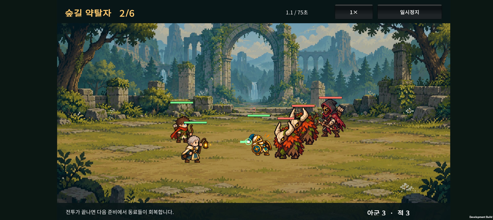
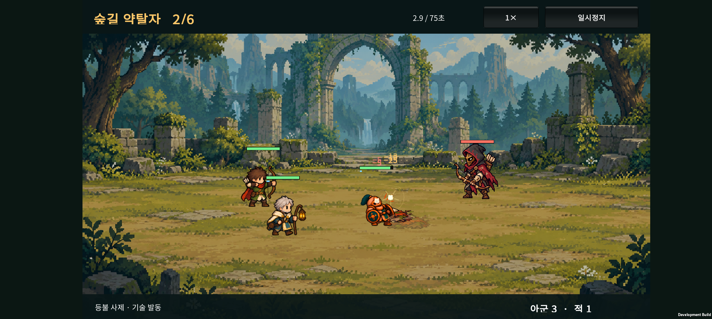

# 잔불 원정대 v0.12 · 적 무리와 전투 반응

2026-10-22. v0.11의 단일·소수 적 편성을 늘리고, 적 역할과 공격 피드백을 본편 원정에 연결한다.

## 적 편성

| 전투 | 구성 | 합계 |
| --- | --- | --- |
| 1 · 숲의 짐승 | 야수 2 | 2 |
| 2 · 숲길 약탈자 | 야수 2 + 약탈자 1 | 3 |
| 3 · 전초기지 수비대 | 야수 1 + 약탈자 2 | 3 |
| 4 · 매복한 약탈자 | 야수 2 + 약탈자 2 | 4 |
| 5 · 성문 수비대 | 야수 3 + 약탈자 2 | 5 |
| 6 · 성문 골렘 | 골렘 1 + 야수 1 + 약탈자 1 | 3 |

준비 화면에 적 편성을, 전투 하단에 양쪽 생존 수를 표시한다. 적은 분산 배치하며 이동 중 최소 간격을 유지한다. 적 수 증가에 맞춰 개별 HP·공격력을 낮췄다. 정식 출시 난이도 확정은 아니다.

## 적 행동

- 야수: 목표 위치를 고정해 0.6초 예고하고 0.2초 동안 돌진한다. 이동이 끝난 뒤 명중을 판정한다. 재사용 대기 6초이며 감속이 이동 거리를 줄인다. 목표가 예고점에서 벗어나면 빗나갈 수 있다.
- 약탈자: 사거리 3.6에서 원거리 공격하며, 사거리 안에서 체력 비율이 낮은 아군을 우선 노린다.
- 골렘: 이번에는 호위 졸개를 추가했다. 내려찍기·분노 단계 등 전용 보스 패턴은 후속 범위다.

## 화면·소리

- 실제 공격 예비동작의 남은 시간을 이용해 화살·마법 투사체가 명중 직전에 날아간다.
- 근접 공격 궤적, 명중 섬광·파편, 피격 색 변화와 작은 흔들림, 회복·보호막 효과를 표시한다.
- 강한 명중에 짧은 화면 정지를 적용한다. 기본 공격과 화상에는 적용하지 않는다.
- 기존 프로젝트에서 합성한 발사·명중 효과음을 재사용한다. 동시 효과음은 4개, 화면 효과는 24개로 제한한다.
- 일시정지 시 효과와 소리도 멈추며 전투를 나가면 정리한다.
- 준비 화면은 앞뒤 순서대로 동료를 그린다. 겹친 동료는 앞에 보이는 동료가 먼저 선택된다. 드래그는 잡은 지점을 유지한다.

아군 30형태와 기존 적 원본 이미지를 재사용한다. 새로운 적 스프라이트 애니메이션을 완성한 범위는 아니다.

## 저장·검증

기존 v0.11 저장 키와 형식을 유지한다. 업데이트 후 전투를 재개하면 현재 웨이브의 새 적 편성으로 시작한다.

- 순수 C# 원정 검사 2,308 assertions 통과: 편성·재개 일치, 돌진 예고·중간 이동·명중 지연·감속, 약탈자의 원거리 공격, 첫 두 전투의 기본 편성 완주 포함.
- 기존 카탈로그 110 assertions, 기존 전투 20 scenarios / 326 assertions 통과.
- Unity 실제 저장 직렬화·전투 검사 694 assertions, 8개 시드 6전투 완주 8/8 통과. 이는 연결 검사이며 출시 밸런스 검증은 아니다.
- Buddy2에서 준비 화면의 적 편성 표시, 드래그 시 잡은 위치 유지, 2번째 전투의 야수 2마리·약탈자 1명 출현과 생존 수 감소를 확인했다.
- 첫 기기 검사에서 발견한 효과 좌표의 화면 밖 이탈을 수정했다. 런타임 예외·Unity 오류 검색 결과는 0건이었다.
- 최종 APK를 Buddy2에 설치하고 효과가 전장 안의 캐릭터 주변에 표시되는 것을 재확인했다. 최종 기기 로그에서도 런타임 예외·Unity 오류 검색 결과 0건. 테스트 전 저장 파일과 복구한 파일이 정확히 같은지 확인했고 앱을 홈으로 열어 두었다.
- APK SHA-256: `1A6AC59F0BBB5A5A22EA323CBC264B42C1E584E72D2257157E07B3B7DDD3E252`.

장시간 성능과 효과음의 실제 청감 평가는 이번 확인에 포함하지 않는다.

## 다음 작업

골렘 전용 공격 예고·내려찍기·강화 단계, 실제 편성별 원정 난도 조정, 적 전용 도트 애니메이션. 전투 수 확장은 아래 새 기획 방향에 따라 재설계한다.

## 2026-10-22 추가 기획 논의 · 미구현

사용자 제안:

- 5전투마다 보스가 나오고, 해당 보스의 외형·테마에 맞는 졸개가 그 앞 구간에 등장한다.
- 현재 적들이 일반 적보다 보스처럼 보이므로 일반·정예·보스의 시각적 위계를 정리한다.
- 장기적으로 100전투를 목표로 하되 한 번에 모두 제작하지 않는다.
- 승리 보상을 재화로 지급하고 이 재화로 무작위 동료 소환을 하는 방식을 검토한다.
- 현재 난도는 지나치게 쉽다는 피드백이 있다. 현재는 연결 확인용 낮은 난도이며 최종 난도가 아니다.

후속 설계 제안(구현 전 수치·규칙 확정 필요):

- 먼저 10전투와 보스 테마 2개를 만든다. 5전투 단위 데이터와 난도 곡선을 검증한 뒤 확장한다.
- 100전투에는 보스전 20번이 필요하지만, 서로 다른 신규 보스 그림 20종이 반드시 필요한 것은 아니다. 재등장 보스는 행동·졸개 조합·전장 조건으로 구분한다.
- 원정 중 골드를 얻어 소환에 사용하고, 남은 골드는 다음 전투로 이월하는 방식을 우선 검토한다. 원정 종료 시 초기화하는 재화와 영구 해금 재화는 분리하는 안을 권장한다.
- 현재 전투별 무료 소환 횟수와 총 공급 14명 제한을 그대로 둔 채 골드를 추가하면 이중 제한이 되므로 함께 재설계한다. 골드 보상·소환 비용·보유 인원 상한을 하나의 경제 규칙으로 맞춘다.
- 한 원정의 목표 길이와 중간 저장·재개 경험을 먼저 검토한다. 100전투는 콘텐츠 확장 목표이며 당장 100전투 플레이 시간을 확정한 것은 아니다.
