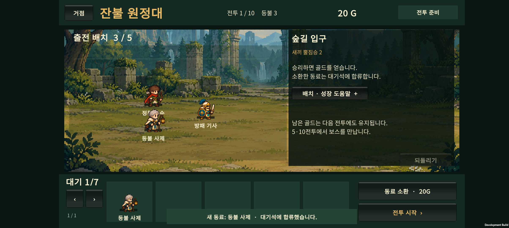
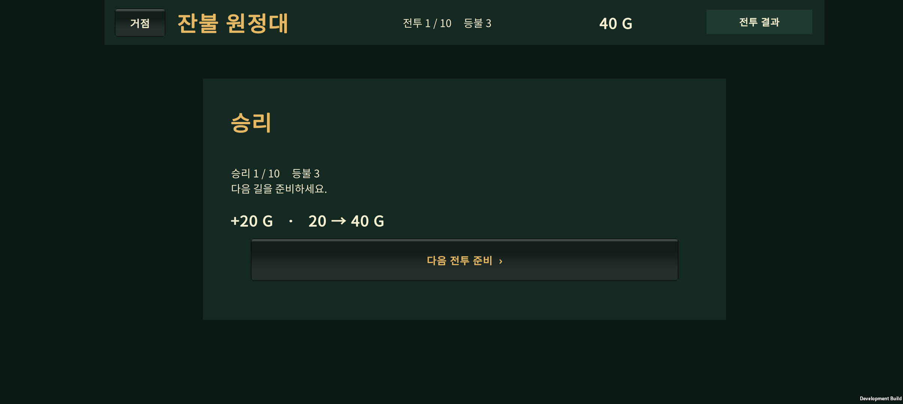
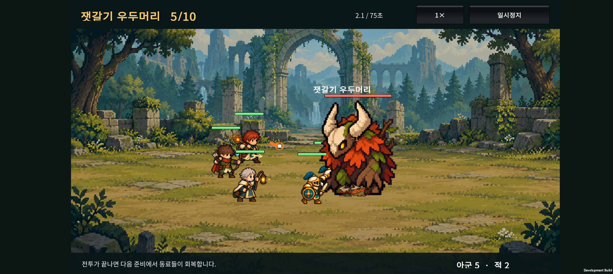
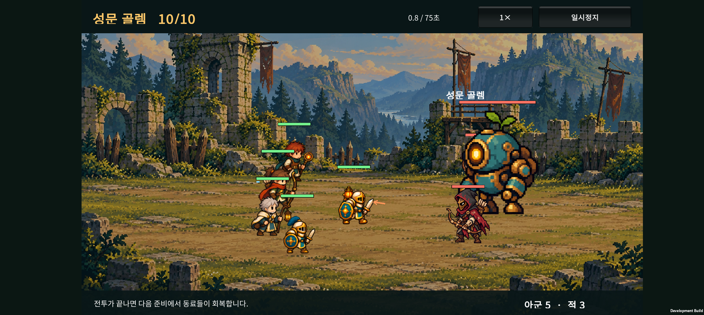

# v0.13 구현 기록 · 골드 소환과 10전투 원정

2026-10-22. 경제·원정 흐름을 먼저 연결한 개발 빌드다. 상세 기획의 모든 콘텐츠가 구현된 버전은 아니다.

## 적용한 규칙

- 기본 동료 3명과 40G로 시작한다. 기본 동료 한 명을 무작위 소환하는 비용은 20G다.
- 전투별 소환 횟수와 누적 14명 제한을 제거했다. 출전 최대 5명, 대기 최대 7명이며 남은 골드는 다음 전투로 이월한다.
- 1~9전투의 승리 보상은 순서대로 20 / 20 / 20 / 30 / 50 / 25 / 25 / 25 / 35G다. 10전투는 원정 종료 지점이므로 추가 골드가 없다.
- 보상은 승리 결과를 확정할 때 한 번만 지급한다. 준비 행동 되돌리기는 사용한 골드와 이미 소환한 동료를 되돌리지 않는다.
- 소환 공간이나 골드가 부족하면 소환 결과를 뽑지 않는다. 되돌리기로 대기석 7명을 초과하게 되면 그 되돌리기를 거절한다.
- 패배·시간 초과는 등불 1개를 소모한다. 등불이 남으면 같은 전투의 준비로 돌아간다. 5/10 보스도 동일하며 패배 보상은 없다.
- 전투 시작 시 동료는 체력을 회복한다. 중단된 전투는 같은 편성의 시작 상태부터 재개한다.

## 화면과 적 구성

- 준비 상단: 전투 / 등불 / 골드. 소환 버튼: 비용 또는 부족 금액·대기석 부족 사유.
- 전투 시작 시 소환 기회를 버린다는 확인창을 제거했다. 배치·성장 설명은 펼치고 접을 수 있다.
- 결과: 획득 골드와 이전/현재 보유량, 다음 준비 또는 같은 전투 재도전.
- 1~5는 숲 배경, 6~10은 성채 배경이다. 5전투에는 잿갈기 우두머리와 졸개 둘, 10전투에는 성문 골렘과 석궁병 둘이 등장한다.
- 일반·정예·보스는 기존 이미지의 크기로 구분한다. 야수 보스도 왼쪽을 바라보며, 성채 보병은 축소한 골렘 그림을 사용한다. 가시등 짐승은 야수의 색을 바꾼 임시 표현이다. 별도 신규 졸개 스프라이트를 제작한 것은 아니다.
- 야수 계열은 기존 돌진을 사용한다. 골렘 내려찍기와 보스 체력별 강화 단계는 아직 구현하지 않았다.

## 저장 전환

새 저장 키는 `ember.expedition.run.v013`, 데이터 Version은 2다. 골드·마지막 보상·보상을 받은 전투 번호·난수 상태·편성·진행을 함께 저장한다.

기존 `ember.expedition.run.v011`은 삭제하거나 변환하지 않는다. 홈에서 이전 원정이 보관되어 있음을 안내하고, 사용자가 새 원정 시작을 확인하면 새 키에 저장한다. 이전 버전 원정을 현재 규칙으로 이어서 플레이하는 기능은 제공하지 않는다.

## 검증

- 순수 C# 원정 검사 1,594 assertions, 카탈로그 111 assertions, 기존 전투 20 scenarios / 326 assertions 통과.
- Unity 실제 JSON 저장 왕복 및 10전투 시드 표본 1,190 assertions 통과. 성장 자동 플레이 8개 시드 모두 10전투 완료, 누적 공급 17명·남은 골드 10G를 확인했다. 이는 저장·진행 연결 검사이며 출시 난도 검증이 아니다.
- 별도 코드 리뷰에서 보상 중복·Undo 재화 보존·출전/대기 용량·패배 재도전·구버전 저장 보존 경로를 확인했다. 발견된 적 이름의 화면별 불일치를 통일했다.
- 고정 편성으로 보스 두 전투만 비교한 탐색 결과: 기본 3명은 5보스 15.3초, 10보스 21.5초에 전원 생존 승리. 분기 2명+기본 3명 편성은 각각 7.4초와 9.1초에 전원 생존 승리했다. **현재 난도는 매우 쉬운 연결용 초안**이며, 기획서의 보스 시간·성장 필요성 목표를 달성하지 않았다. 이 네 전투의 결과를 승률 통계로 해석하지 않는다.
- Android 빌드 성공 및 Galaxy Buddy2 업데이트 설치 완료. 실제 조작으로 새 원정 확인 → 소환 40→20G → 첫 전투 승리 +20G → 결과 40G → 앱 종료·재실행 → 두 번째 준비에서도 40G 유지를 확인했다.
- Unity 검사에서 만든 5/10전투 체크포인트를 기기에 임시 로드해 보스의 왼쪽 방향·크기·이름·지역 배경을 확인했다. 휴대폰에서 1~10을 수동으로 연속 완주한 검사는 아니다. 보스와 근접한 호위 일부가 그림 뒤에 가려지는 현상은 배치·미술 후속 개선 대상으로 남는다.
- 기기 Unity/AndroidRuntime 로그에서 Exception / FATAL / Unity 오류 검색 결과 0건. 테스트 전 PlayerPrefs 전체 파일을 정확히 복구한 뒤 앱 홈으로 열었다. 새 버전을 플레이하려면 **새 원정**을 누른다.
- APK: `unity/Builds/Android/expedition-combat-prototype.apk`. SHA-256: `76B78EA75BD345A3A905A2329A36D7891C56803D161AD6AB687A80BD71CE59BB`.
- 소스 `git diff --check` 통과. Unity가 다시 작성한 33개 이미지 메타 파일의 공백만 정리해 불필요한 가져오기 설정 변경을 남기지 않았다.

## 다음 작업

1. 보스의 공격 예고·전용 범위 공격과 체력에 따른 패턴 변화.
2. 두 지역의 일반 적 그림·애니메이션과 보스 위계 정리.
3. 무성장 / 분기 성장 / 최종 / 결합 편성별 난도·시간 조정.
4. 기본 원정이 안정된 후 원정 연구의 재화·노드·저장 연결.

원정 연구·유물·광고·100전투는 이 빌드에 포함하지 않는다.
