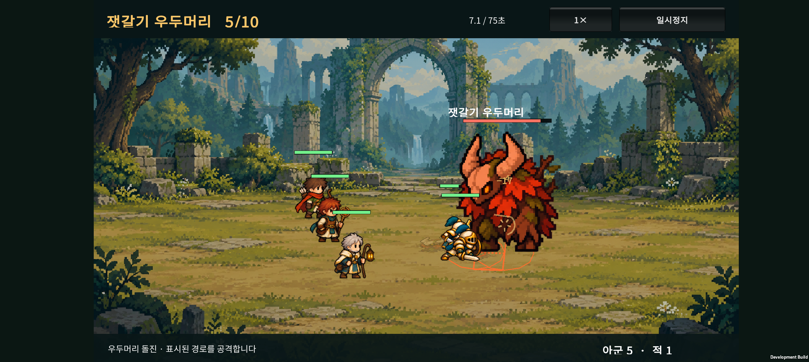
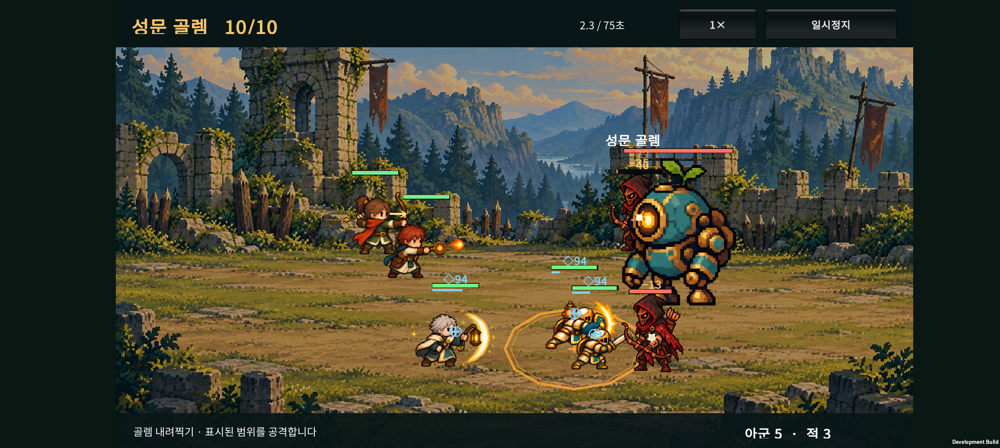

# v0.14 · 보스 패턴과 첫 원정 난도 조정

2026-10-23 작업 기록. v0.13의 10전투·골드 소환 위에 보스 공격과 성장 필요성을 추가한다. 출시 밸런스 확정판은 아니다.

## 1. 이번 변경

- **5전투 잿갈기 우두머리:** 첫 돌진은 전투 시작 7초 이후. 0.9초 예고 후 0.2초 이동하며, 표시된 경로에 있는 동료들을 각 한 번 공격한다. 경로 반폭 0.7, 이동 상한 3.6이다. 감속은 이동 거리를 줄인다. 돌진 종료 후 7초 대기하며, 체력 50% 이하 분노 이후 완료한 돌진부터 다음 대기가 5.5초로 줄어든다. 이미 예약된 대기는 그대로 유지한다.
- **10전투 성문 골렘:** 1.1초 동안 고정 위치의 원을 예고하고 반경 1.35 안을 내려찍는다. 공격력 계수 1.65, 내려찍기 종료 후 재사용 대기 8초다. 체력 40% 이하에서는 같은 중심의 좁은 반경 0.75 안에 0.6초 추가 예고 후 충격파가 발생한다. 충격파 계수는 1.1이다.
- **예고와 판정:** 예고 중 목표가 움직여도 찍을 위치는 따라가지 않는다. 목표가 죽어도 살아 있는 보스의 이미 예고된 범위 공격은 진행된다. 보스가 죽으면 취소된다. 일반 공격과 특수 패턴을 동시에 실행하지 않는다.
- **분노 표시:** 보스 체력바 아래에 ‘분노’, 몸 색 변화, 하단 안내를 추가했다. 바닥에는 돌진 경로와 내려찍기·후속파 범위, 명중 시에는 충격파가 표시된다.
- **준비 안내:** 우두머리 전에는 전열·후열을 한 줄에 겹치지 않게, 골렘 전에는 탱커 주변을 밀집시키지 않게 안내한다. 자동 전투 중 수동 회피를 요구하는 구조가 아니다.
- **호위 위치:** 골렘 호위를 양옆으로 벌려 시작 시 거대한 보스 그림에 가려지는 문제를 줄였다. 전투 중 근접하면 그림이 겹칠 수 있다.

기존 시험실과 예전 전투 검증에서 쓰는 보스는 새 패턴 옵션을 켜지 않으면 기존 행동을 유지한다. 본편 5/10전투 보스에는 옵션을 켰다.

## 2. 난도 변화

시작 40G·소환 20G·보상표·등불·10전투 구성은 유지한다. 1~2전투는 기본 3명으로 소환과 배치를 익히도록 유지하고, 3~4전투와 성채의 적 체력·공격력을 올렸다.

| 대상 | v0.13 | v0.14 |
| --- | --- | --- |
| 5보스 | HP 600 / 공격 17 / 방어 15 | HP 3200 / 공격 53 / 방어 20 + 광역 돌진·분노 |
| 10보스 | HP 800 / 공격 21 / 방어 16 | HP 5000 / 공격 80 / 방어 25 + 내려찍기·후속파 |

기존 3인 무성장 편성이 보스까지 쉽게 통과하던 상태에서, 성장과 배치가 필요한 상태로 바꾼 첫 수치다. 보스의 능력만 추가한 변경이 아니며 수치도 함께 올렸다.

## 3. 자동 비교 방법

`tests/ExpeditionRun/run-balance.ps1`에서 실제 소환·전승·진화·결합 API를 사용한다. 다섯 정책에 같은 소환 시드 범위를 사용하며 출전 5명·합법 골드 예산을 지킨다.

- 기본 3명: 시작 동료만 유지.
- 기본 5명: 처음 두 명을 소환해 출전시키고 성장하지 않음.
- 분기 분산: 5인을 채운 뒤 각 기본 동료를 순서대로 분기 진화.
- 최종 집중: 기사에게 먼저 재료를 모아 최종 진화, 이후 다른 동료 성장.
- 결합 중심: 기사·사제를 먼저 분기 진화하고, 6전투 이후 빈자리를 새 소환으로 채울 수 있을 때 H-02로 결합. 5전투 전에 인원이 줄어들도록 결합하지 않음.

탱커는 전방, 후열은 서로 다른 줄에 놓는 고정 배치를 사용한다. 전투별 적 대응이나 실패 후 편성 재설계는 하지 않는다. 조정용 시드 1~100과 별도 검증용 1001~1100을 나눴다. 검증용 결과를 보고 다시 수치를 맞추지는 않았다.

**개별 전투 승리 수는 앞선 모든 보상을 받았다고 가정한 비교다.** 패배했어도 다음 전투의 합법 성장량을 비교하기 위해 가상으로 진행한다. 실제 연속 진행 가능성은 별도의 ‘무패 10전투 완료’ 열로 표시한다. 재도전으로 전략을 바꾸는 사람의 승률이나 통계적 신뢰구간으로 해석하지 않는다. 시작 3명 정책은 소환하지 않으므로 100개의 서로 다른 부대가 아니라 같은 전투의 반복이다.

## 4. 별도 100개 시드 결과

| 자동 성장 정책 | 5전투 승리 | 10전투 단독 승리 | 무패 10전투 완료 | 10전투 평균 시간 |
| --- | ---: | ---: | ---: | ---: |
| 기본 3명 | 0/100 | 0/100 | 0/100 | 21.38초 |
| 기본 5명 | 0/100 | 0/100 | 0/100 | 27.90초 |
| 분기 분산 | 99/100 | 65/100 | 64/100 | 55.15초 |
| 최종 집중 | 64/100 | 100/100 | 64/100 | 47.16초 |
| 결합 중심 H-02 | 100/100 | 27/100 | 27/100 | 47.94초 |

분기 정책의 10전투 5건은 75초 시간 초과였다. 평균 시간에는 패배한 전투도 포함한다. 빨리 패배한 기본 편성을 빠르게 클리어한 것으로 읽으면 안 된다.

- 성장의 유무가 결과를 바꾸며, 최종 집중은 첫 보스 이전이 더 취약하다.
- H-02 결합 정책은 마지막 보스에서 약하다. 한 종류의 결합 자동 운용 결과이므로 모든 결합의 성능으로 일반화하지 않는다. 결합·회복·탱커 대체의 후속 조정이 필요하다.
- 분기·최종의 무패 완주 64/100은 이번 고정 정책의 관찰값이다. 최종의 단독 10전투 승률 100%만 보고 전체 원정이 쉽다고 판단하지 않는다.
- 일반 전투는 성장한 정책 기준 대체로 약 7~16초다. 기존 문서의 20~35초 목표보다 짧으며 우선 빠른 진행을 유지했다. 5보스는 정책에 따라 약 39~47초, 10보스는 약 47~55초다.

[조정용 전체 결과](balance-training.json) · [별도 검증 전체 결과](balance-holdout.json)

## 5. 저장과 검증

저장 키·버전은 v0.13과 같다. 이어하기를 누르면 현재 준비 편성 또는 중단된 전투 시작 상태에 새 적 수치와 패턴이 적용된다. 골드나 동료를 초기화하지 않는다.

- 원정·패턴 검사 1,649 assertions 통과: 고정 예고점, 범위 밖 이동, 목표 사망, 보스 사망 취소, 반격 사망, 감속 거리, 후속 충격파, 일시정지 및 Step 분할 일치 포함.
- 기존 카탈로그 111 assertions 및 기존 전투 20 scenarios / 326 assertions 통과.
- Unity 실제 JSON 저장 왕복 검사 1,190 assertions, 작은 표본 시드 1~8은 8/8 완주했다. 이 표본은 연결 검사용이고 위 100개 검증 시드의 밸런스 결과를 대체하지 않는다.
- 별도 코드 리뷰에서 예고·피해 좌표, 반격 사망 취소, 화면 좌표 변환, 합법 성장 예산과 무패 완주 집계를 확인했다.
- Buddy2 첫 빌드에서 돌진 경로와 골렘 원형 예고·호위 배치를 확인했다. 보스 경고가 아군의 기술 안내에 덮이는 문제를 찾아 경고 유지 시간 동안 보스 안내를 우선하도록 수정했다.
- 최종 APK를 Buddy2에 업데이트했고, 수정된 돌진 경고 문구·골렘 예고 표시와 보스전 승리 결과를 확인했다. 최종 기기 Unity/AndroidRuntime 로그의 예외·오류 검색 결과는 0건이다. 분노 임계값·후속파 피해는 코어 테스트에서 검증했고 기기 캡처는 예고 화면 중심이다.
- 기기 검사는 Unity에서 생성한 5/10전투 체크포인트를 사용했다. 휴대폰에서 처음부터 10전투를 수동 완주한 검사는 아니다. 검사 후 기기의 원래 PlayerPrefs 파일이 백업과 정확히 같은지 확인해 복구하고 홈으로 열었다.
- 최종 APK SHA-256: `EC310728C55478FE90AE4CC2B5067A679D7257265BECA429B5CDDD722127371A`. 빌드 파일은 `unity/Builds/Android/expedition-combat-prototype.apk`다.

## 6. 다음 단계

결합 정책의 마지막 보스 대응과 실제 초보 플레이 난도 확인, 두 지역의 졸개 전용 그림·애니메이션, 이후 원정 연구의 재화·노드 연결. 원정 연구와 광고는 아직 미구현이다.
