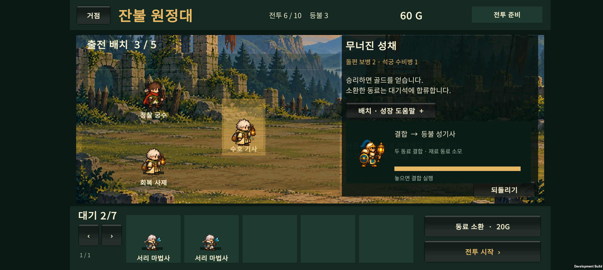
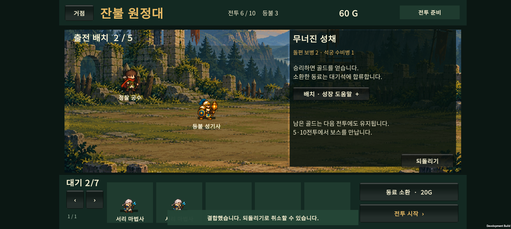
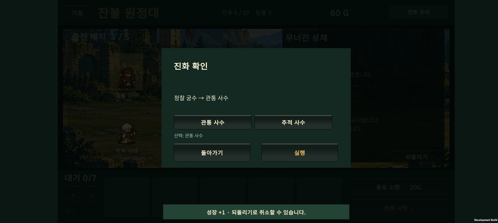

# v0.15 · 끌어서 성장하고 결합하기

> 후속 [v0.16](../design-v0.16/HANDOFF.md)에서 드래그는 흡수 성장으로 통일하고 특수 결합은 알림에서 선택하도록 변경했다. 아래는 당시 구현 기록이다.

2026-10-23. 전승·진화·결합의 기존 성장 조건을 유지하면서 준비 화면의 조작을 단순화했다.

## 조작

1. 재료로 사용할 동료를 키울 동료 위로 끈다.
2. 같은 대상 위에서 약 **0.45초** 유지한다. 오른쪽에 결과 이름·그림과 진행 막대가 표시된다.
3. **‘놓으면 성장 +1 실행’ 또는 ‘놓으면 결합 실행’**이 표시되면 손을 뗀다. 추가 확인창 없이 실행된다.
4. 성장으로 진화 조건을 채우면 진화 선택창이 바로 열린다. 진화하거나 돌아가기를 누르면 전장으로 돌아온다. 진화를 미뤘다면 상세창에서 다시 선택할 수 있다.
5. 준비 중 **되돌리기**로 실행을 취소한다. 진화까지 했다면 진화와 그 직전 흡수는 각각 별도의 준비 행동이다.

| 놓는 곳·방법 | 동작 |
| --- | --- |
| 전장의 빈 공간 | 이동 또는 대기 동료 출전 |
| 동료 위에서 잠시 유지 후 놓기 | 가능한 결합이 우선, 그 외에는 성장 +1 |
| 출전 5명일 때 대기 동료를 출전 동료 위에 빠르게 놓기 | 기존 출전 교체 유지 |
| 대기석의 동료 위 | 그 동료를 대상으로 성장·결합; 불가능하면 실행하지 않음 |
| 대기석 빈 곳 | 출전 동료를 대기로 이동, 기존 인원 제한 적용 |
| 동료를 누르기 | 능력치·재료 보호·기존 상세 성장 메뉴 |

성장 드래그는 **재료의 특성을 자동으로 덮어쓰지 않는다.** 특성 전승은 상세창의 전승 메뉴에서 선택한다. 드래그 중 다른 대상으로 이동하면 대기 시간이 다시 시작되고, 터치 취소·다중 터치·앱 포커스 상실 시 진행 중 동작은 취소된다.

## 재료 보호

동료 상세창에서 **재료 보호**를 켜면 해당 동료를 흡수하거나 결합 재료로 소모할 수 없다. 보호된 동료가 재료를 받아 성장하거나 결합 결과가 되는 것은 가능하다. 작은 ‘보호’ 표식이 붙고 앱 재실행 후에도 유지된다.

보호 설정은 준비 행동의 되돌리기와 별도로 유지한다. 예를 들어 이동 후 보호를 켜고 이동을 되돌려도 보호는 풀리지 않는다. 핵심 로직에서도 보호를 검사하므로 상세창 전승·결합에도 같은 제한이 적용된다.

## 유지한 성장 규칙

- 기본 동료는 전승 2회 후 두 분기 중 하나로 진화한다.
- 분기 동료는 누적 전승 6회에 최종 진화하거나, 지정된 다른 직업의 분기 동료와 결합한다.
- 기사+사제 등 기존 6가지 결합식과 수치는 유지한다. 두 동료 중 **놓인 자리의 동료**가 결과를 이어받으며, 끌어온 동료가 소모된다.
- 골드·소환 확률·보스·전투 난도는 이번 작업에서 조정하지 않았다.
- v0.13 저장 키와 버전은 유지하며, 새 보호 필드가 없는 이전 저장은 보호 해제 상태로 읽는다.

## 검증

- 원정 코어 검사: **1,665 assertions 통과**. 미리보기 무변경, 재료 보호, 저장 복구, 되돌리기 이후 보호 유지, 결합 방향과 전투 중 금지 포함.
- 기존 카탈로그 전투 검사: **111 assertions 통과**.
- Unity 실제 입력 처리·JSON 검사: **13 assertions 통과**. 대기→출전 성장, 취소, 움직이지 않는 길게 누르기, 놓는 순간 대상 변경, 자동 진화, 결합, 출전 교체 및 이전 저장 호환을 검사했다.
- 코드 검토에서 겹친 동료를 선택할 때 끌고 있는 동료의 원래 판정 영역이 대상을 가리는 문제를 찾아 수정했다.

### Buddy2 확인

- 새 Android 개발 APK를 Galaxy Buddy2에 업데이트했다.
- 임시 6전투 준비 편성에서 회복 사제→수호 기사 드래그의 **등불 성기사 미리보기**, 놓았을 때 결합과 출전 3→2명, 되돌리기로 원래 두 동료 복구를 확인했다.
- 대기 동료 두 명을 궁수에게 순서대로 흡수해 진행 0→1→2, 진화창 자동 열기, 관통 사수 진화 후 전장 복귀를 확인했다.
- Unity/AndroidRuntime 로그에서 Exception·FATAL·E Unity·NullReference 검색 결과 0건이다. 장시간 성능 측정과 사람의 자연스러운 손가락 조작 평가는 이번 범위에 포함하지 않았다.
- 검사 후 기기의 원래 PlayerPrefs 파일을 백업과 바이트 단위로 비교해 정확히 복구하고 홈 화면으로 열었다.
- APK: `unity/Builds/Android/expedition-combat-prototype.apk`
- SHA-256: `77A37D30E0BDDC2DF207BE7AD07AEFBB3B19F9153A3CFC6A394FA388D25DED88`

## 다음 작업

이 조작을 기준으로 초보 플레이를 확인한 뒤 결합 편성의 전투 성능을 조정한다. 지역별 졸개 아트와 원정 연구는 후속 작업이다.
