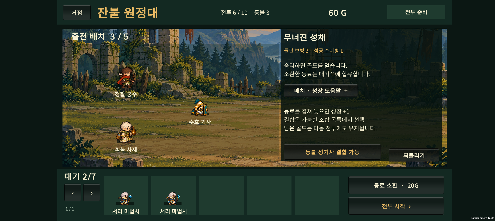
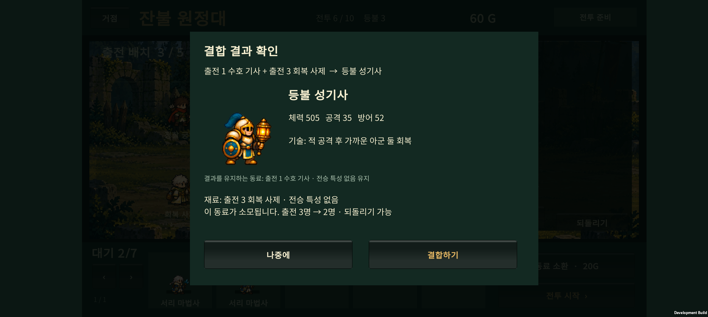

# v0.16 · 흡수 성장과 선택형 결합

2026-10-23. v0.15의 드래그가 조건에 따라 흡수 또는 결합을 자동 결정하던 구조를 변경했다.

## 플레이어가 알아야 할 두 문장

**동료 위에 끌어 잠시 유지한 뒤 놓으면 성장 +1.**

**특수 결합은 준비 화면의 ‘결합 가능’ 알림에서 결과를 확인하고 선택한다.**

별도의 강제 튜토리얼이나 자동 팝업은 추가하지 않았다. 준비 화면에 짧은 안내를 항상 보여주고, 실제로 가진 동료로 만들 수 있는 결합만 알림과 목록에 표시한다.

## 변경된 조작

- 드래그는 항상 일반 흡수 성장이다. 진화한 기사와 사제를 겹쳐도 성기사로 자동 변하지 않는다.
- 결과 미리보기에는 받는 동료, 성장 진행 +1, 재료 동료 소모를 표시한다. 진화 조건을 채우면 기존처럼 진화 선택창이 열린다.
- 만들 수 있는 결합이 생기면 **‘등불 성기사 결합 가능’** 또는 **‘결합 가능 N쌍 보기’** 버튼이 나타난다. 목록과 결과를 보기만 해서는 아무것도 소모하지 않는다.
- 결과 확인창에서 그림·이름·기본 체력/공격/방어·기술 요약, 소모될 동료, 유지되는 전승 특성, 출전 인원 변화를 확인한다. **결합하기**를 눌렀을 때만 실행된다.
- 나중에를 눌러 결합을 미룰 수 있고, 결합 후에는 준비 중 되돌리기로 복구할 수 있다.
- 같은 직업의 동료가 여러 명이면 출전/대기 순번과 재료 동료의 전승 특성으로 구분한다.

## 적용 범위

기존 6개 특수 결합식, 두 동료가 분기 진화 상태여야 한다는 조건, 일반 진화에 필요한 성장량, 소환 비용, 전투 수치와 난도는 유지했다. 재료 보호를 켠 동료는 소모되지 않는다. 보호된 동료가 결과를 이어받을 수 있을 때는 그 방향으로 기회를 제안한다. 둘 다 보호된 경우 실행 가능한 목록에서 제외한다.

이전 원정 저장을 그대로 읽는다. 별도의 튜토리얼 완료 상태나 새 영구 재화는 추가하지 않았다. 예전 v0.15 문서의 ‘드래그 시 결합 우선’ 설명은 이 버전에서 대체되었다.

## 검증 기록

- 순수 C# 원정 검사 **1,673 assertions 통과**: 결합 기회 조회가 동료·골드·되돌리기 기록을 변경하지 않음, 보호/출전 동료 우선 선택, 되돌리기 시 기회 복구, 전투 중 기회 없음 포함.
- Unity 입력 처리·JSON 검사 **17 assertions 통과**: 기존 드래그·취소·진화·출전 교체·JSON 검사를 유지하면서, 결합 가능한 쌍을 드래그해도 성장만 하는지와 결합을 명시적으로 확인한 경우에만 실행하는지를 검사했다.
- 코드 검토에서 같은 직업의 재료 동료가 여러 명일 때 구분되지 않는 문제를 찾아, 목록과 확인창에 출전/대기 순번과 재료 동료의 전승 특성을 추가했다.

### Buddy2 실기기

- APK 빌드 후 Galaxy Buddy2에 업데이트했다. 임시 6전투 준비 편성에서 결합 알림, 가능한 조합 목록, 결과 확인창의 글자·그림·버튼을 확인했다.
- ‘나중에’를 누른 뒤에도 기존 동료 5명과 60G가 유지되었다. ‘결합하기’를 누른 뒤에는 등불 성기사 생성과 재료 사제 제거, 출전 3→2명을 확인했다. 되돌리기로 두 동료와 출전 3명을 복구했다.
- 같은 기사·사제를 이번에는 드래그해, 기사 형태가 유지되고 성장만 2→3으로 올라가는 것을 확인했다.
- 검사 후 원래 PlayerPrefs 파일을 백업과 바이트 단위로 비교해 복구하고 홈 화면을 열었다. 임시 편성으로 조작 흐름을 검사했으며 초보 사용자의 자연스러운 플레이 평가나 장시간 성능 측정은 아니다.
- APK: `unity/Builds/Android/expedition-combat-prototype.apk`
- SHA-256: `4B01207AD185F19EEBF14BEA58AF29779CF8346A7E041EC24CC3E6BFD3C11DCF`

## 후속 과제

실제 초보 플레이에서 안내를 이해하는지 확인한다. 결합의 전투 성능 조정, 졸개 미술, 원정 연구는 별도 작업이다.

2026-10-23 추가 합의: **첫 마켓 출시는 30전투 원정**을 목표로 한다. 현재 10전투의 초반 난도부터 다듬고 20→30전투로 확장한다. 100전투·무한 모드는 출시 후 후보로 둔다. [비교 조사와 출시 범위](early-progression-review.md)에 기록했으며, 현재 APK는 여전히 10전투다.
