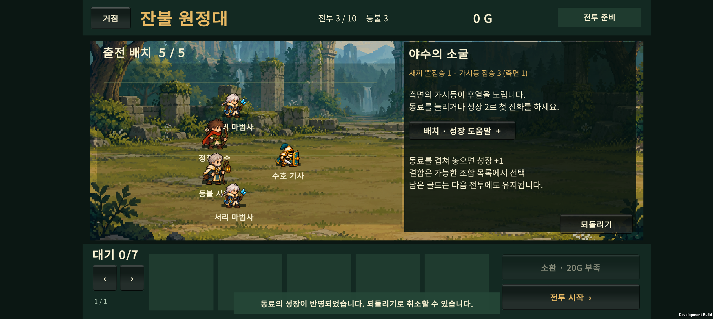
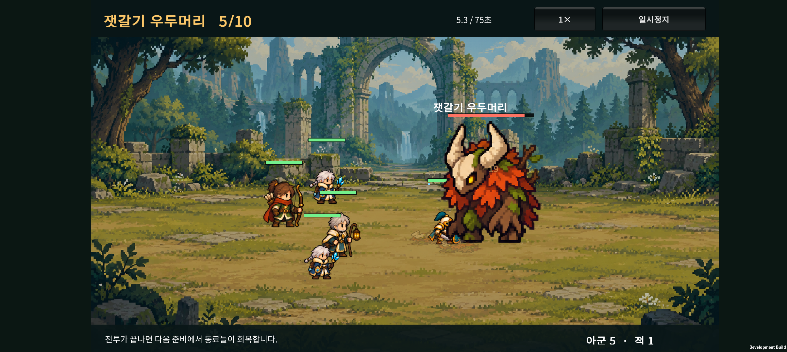
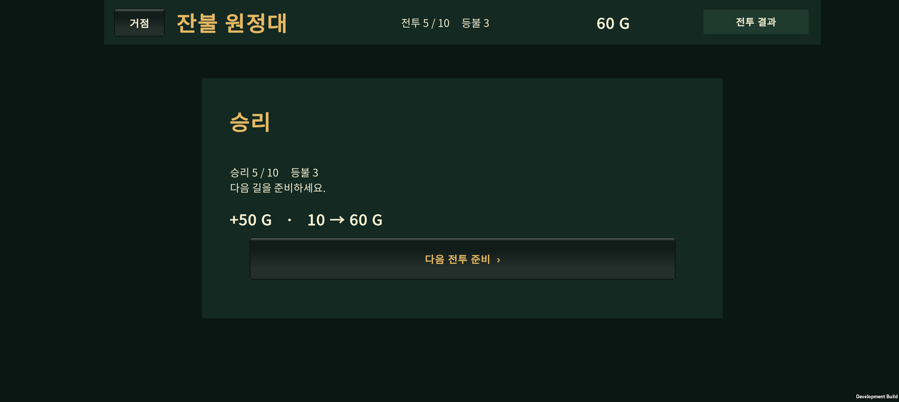

# v0.17 · 첫 보스까지의 난도와 성장 흐름

2026-10-23 · 첫 출시 목표는 30전투 · 현재 구현은 10전투

**3전투에 측면 원거리 적을 배치하고, 4전투 정예의 압박을 높였다. 첫 보스의 수치는 낮춰 일반 전투에서 성장한 부대로 도전할 수 있도록 연결했다.** 시작 인원 3명, 40G, 소환 20G와 기본 직업 6종은 유지했다.

## 1. 이번 변경

| 구간 | 변경 | 의도 |
| --- | --- | --- |
| 1~2전투 | 전투 수치 유지. 준비 화면에 전열·후열과 적 공격 방식 안내 | 기본 조작을 익히는 쉬운 구간 |
| 3전투 | 근접 2 + 원거리 2 → 근접 1 + 원거리 3. 원거리 한 명이 측면에 배치 | 후열에도 압박이 생기는 첫 전투 |
| 4전투 | 정예와 호위의 공격력 증가. 체력은 유지 | 동료 추가 또는 진화의 효과를 보스 전에 경험 |
| 5전투 | 보스 HP 3200→2500, 공격력 53→46 | 첫 보스에서 발생하던 급격한 난도 상승 완화 |

3전투의 측면 가시등은 준비 화면의 적 구성과 짧은 공략 안내에 표시한다. 4전투 정예의 돌진은 기존에 있던 기능이며, 이번에 새로운 공격 패턴을 추가한 것은 아니다. 보스의 직선 돌진과 체력 절반 이하 광폭화도 유지했다.

### 세부 수치

| 적 | 체력 | 공격력 | 비고 |
| --- | --- | --- | --- |
| 3전투 뿔짐승 ×1 | 150 | 17 | 기존 2마리에서 축소 |
| 3전투 가시등 ×3 | 125 | 19 | 마지막 개체는 좌표 (-0.5, 2.5)에서 시작 |
| 4전투 돌격 뿔짐승 ×1 | 340 | 38 | 기존 돌진 사용 |
| 4전투 일반 뿔짐승 ×2 | 145 | 22 | 정예 호위 |
| 4전투 가시등 ×1 | 100 | 25 | 원거리 압박 |
| 5전투 잿갈기 우두머리 ×1 | 2500 | 46 | 돌진·광폭화 유지, 졸개 2마리 수치 유지 |

6~10전투·승리 골드·성장 비용·흡수와 결합 조작·저장 형식은 이번 조정에서 바뀌지 않았다. 이전 저장을 이어갈 수 있으며, 전투를 새로 시작하거나 중단된 전투를 다시 재생할 때는 변경된 적 구성이 적용된다.

## 2. 성장 방식별 자동 비교

구현 담당의 조정 시드 1~40과 별도로, 검증에서는 시드 1001~1100을 사용했다. 각 정책은 실제 소환·출전·흡수·진화 API로 준비한다. 결과는 사람의 승률이 아니며, 자동 편성의 반복 결과다.

| 정책 | 3전투 승리 | 4전투 승리 | 5전투 승리 | 5전투 평균 시간 |
| --- | --- | --- | --- | --- |
| 시작 3명 유지, 소환·성장 없음 | 100/100 | 0/100 | 0/100 | 25.37초, 패배 |
| 기본형 5명까지 소환, 성장 없음 | 100/100 | 100/100 | 6/100 | 37.19초 |
| 5명 유지, 기사부터 분기 진화 | 100/100 | 100/100 | 100/100 | 29.41초 |
| 5명 유지, 궁수부터 분기 진화 | 100/100 | 100/100 | 100/100 | 29.41초 |
| 5명 유지, 사제부터 분기 진화 | 100/100 | 100/100 | 100/100 | 31.47초 |
| 시작 3명에 흡수 성장 집중 | 100/100 | 100/100 | 100/100 | 42.07초 |

기존에는 시작 3명이 4전투까지 전원 생존했다. 이번 비교에서는 4전투부터 보강하지 않은 편성과 보강한 편성의 결과가 갈린다. 기본형 5명은 4전투 종료 시 평균 총 체력 73.7%, 기사 우선 성장 편성은 85.5%가 남았다.

‘기사부터’와 ‘궁수부터’는 첫 진화 순서가 다르지만 보스 전에 두 명 모두 진화해 같은 최종 편성으로 수렴한다. 이를 완전히 다른 두 보스 빌드라고 세지 않는다. 사제 우선 편성과 3명 집중 성장 정책에서도 첫 보스 통과를 확인했다. 기본형 5명만으로는 여전히 첫 보스가 어려운 편이다.

### 패배 후 바꿀 선택지

기본형 5명 정책에서 첫 보스에 진 94개 시드를 실제 패배 처리한 뒤 다시 시험했다. 시작 때 두 명만 소환했으므로 남겨둔 90G를 사용해 4명 소환, 2명 분기 진화를 하고 같은 보스에 재도전했다. **추가 보상이나 임시 자원 없이 94/94회 승리**했다. 이는 해당 정책의 남은 자원으로 복구할 수 있다는 확인이며, 모든 잘못된 성장 선택을 복구할 수 있다는 보장은 아니다.

### 남은 한계

- 시작 3명 고정 정책과 3명 집중 성장 정책은 시드가 달라도 전투 편성이 같으므로, 100개의 서로 다른 팀을 시험한 것이 아니다.
- 각 전투 비교는 패배 후에도 이전 보상을 받았다고 가정해 계속한다. 무패 도달은 `reachWins`로 구분한다. 별도의 보스 재도전 검사는 실제 패배 경로를 사용했다.
- 밀집 배치와 분산 배치의 성장 편성은 모두 보스를 이겼으며 잔여 체력도 비슷했다. 이번 조정으로 배치 우위가 입증되었다고 말할 수 없다.
- 자동 정책은 일부 분기만 사용한다. 모든 직업·분기·특성·결합의 균형을 검증한 결과는 아니다.
- 전투 시간은 시뮬레이션 시간이다. 실제 초보 사용자의 이해도·재도전 의향과 장시간 발열·프레임은 별도 확인 대상이다.

[측정 원본](early-balance-holdout.json) · [재현 코드](../../tests/ExpeditionRun/EarlyBalanceProbe.cs) · [변경 전 기록](../design-v0.16/balance-baseline-2026-10-23.json)

## 3. 검사와 APK

- 원정 규칙: **1,675 assertions 통과**. 3전투 측면 적 배치와 4전투 정예의 기존 돌진 작동 확인 포함.
- 전투 회귀 검사: **111 assertions 통과**.
- Unity 입력·JSON 검사: **17 assertions 통과**.
- Android APK 빌드 성공, Unity 종료 코드 0. Galaxy Buddy2에 업데이트 설치했다.
- APK: `unity/Builds/Android/expedition-combat-prototype.apk`
- SHA-256: `D572A24E317B118055E55C7FEA07AF7387744D7BD401490DDE15D10BDA952788`

### Buddy2 실기기 확인

- 기존 저장을 새로 백업한 뒤, 앱의 새 원정 버튼으로 시작했다. 임시 편성이나 추가 골드를 주입하지 않았다.
- 첫 소환에서 얻은 서리 마법사 2명을 드래그로 출전시켰다. 이후 승리 골드로 동료를 얻고, 드래그 흡수로 기사와 궁수를 각각 분기 진화시켰다.
- 1~5전투를 연속 승리했다. 3전투의 측면 적 구성·진화 안내, 4전투 정예 안내가 준비 화면에서 잘리는 곳 없이 보였다.
- 첫 보스 승리 후 **50G 보상, 보유 골드 10→60G**를 확인했다. 자동 비교와 별도로 실기기에서 한 번의 자연스러운 원정 진행을 확인한 것이다.
- 해당 앱 프로세스의 런타임 로그에서 Unity 오류·치명적 예외 검색 결과 0건이었다. 장시간 성능·발열을 측정한 검사는 아니다.
- 확인 후 PlayerPrefs 전체를 테스트 직전 백업과 바이트 단위로 비교해 복구하고 홈 화면을 열었다. 사용자의 기존 원정 진행은 보존했다.







```powershell
./tests/ExpeditionRun/run.ps1
./tests/CatalogCombat/run.ps1
./tests/ExpeditionRun/run-early-balance.ps1
```

## 4. 적 디자인 재제작

**새 적 스프라이트는 아직 교체하지 않았다.** 이번 APK의 적은 임시 아트다. 사용자가 요청한 재디자인은 출시 전 작업으로 명시했다.

숲의 뿔짐승·가시등·돌격 정예·잿갈기 보스부터 제작하고, 성채의 보병·석궁병·석상·골렘으로 이어간다. 같은 지역의 적은 재질·색·모티프를 공유하되, 졸개·정예·보스는 실루엣과 체급으로 구분한다. 적의 기본 시선은 왼쪽이며 아군과 동일한 픽셀 밀도와 바닥 접점을 사용한다.

[적 재디자인 기준과 제작 목록](enemy-art-brief.md)

## 5. 다음 순서

실제 플레이 피드백으로 1~5전투를 한 번 더 확인한 뒤, 6~10전투 균형과 숲 지역 적 아트 시안을 진행한다. 첫 마켓 출시 목표인 30전투는 10→20→30 순서로 확장한다. 100전투·무한 모드는 출시 후 후보로 둔다.
