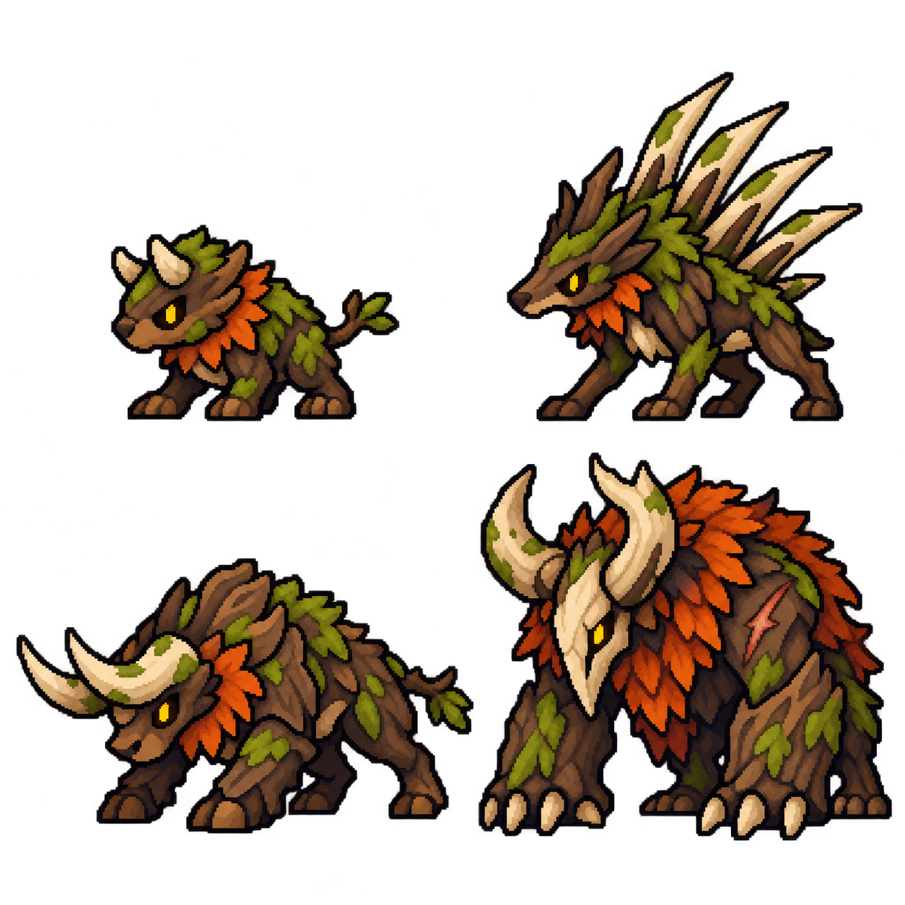

# 숲 적 4종 외형 시안 · v0.18

2026-10-23 · 외형 제작 단계 · 현재 APK는 v0.17

**졸개·원거리·정예·보스가 같은 숲의 생물로 보이면서도 서로 다른 역할과 체급을 갖도록 첫 시안을 제작했다.** 기존 개발 내용은 `d847438`에 커밋했다. 이 문서와 새 시안은 그 이후의 작업이다.

[전장 크기 비교 화면](enemy-preview.html) · [원본 PNG](assets/forest-enemy-concepts-v1.png) · [도구·입력·전체 프롬프트](ASSET-PROMPTS.md)

## 1. 이번에 만든 것

- 기존 아군 기사·궁수와 어울리는 중세 판타지 도트 스타일의 숲 적 4종 통합 시안.
- 모든 적이 왼쪽을 보는 외형. 근접 졸개와 원거리 졸개는 작은 네 발 동물, 정예는 낮고 넓은 돌격 자세, 보스는 큰 갈기와 앞발로 구분한다.
- 기존 아군 스프라이트와 숲 배경을 사용하는 HTML 비교 화면. 무리·정예·보스 조우 전환, 적 크기 80~120% 조절, 실루엣 보기를 제공한다.
- 생성 원본을 수정 없이 프로젝트 안에 복사했다. PNG는 1254 × 1254, RGBA이며 투명 배경을 갖는다.

시안 좌상단은 뿔짐승, 우상단은 가시등 짐승, 좌하단은 돌격 뿔짐승, 우하단은 잿갈기 우두머리다. 원본 시트의 그림 크기 자체가 전투 크기를 뜻하지 않는다. 비교 화면에서 역할별 표시 크기를 따로 적용했다.

## 2. 역할별 디자인

| 역할 | 디자인 | 전투에서 읽혀야 하는 정보 | 다음 동작 제작 |
| --- | --- | --- | --- |
| 근접 졸개 / 뿔짐승 | 짧은 뿔, 낮은 몸체, 작은 목깃 | 빠르게 접근하는 작은 근접 적 | 짧은 걷기, 머리 낮추기, 들이받기 |
| 원거리 졸개 / 가시등 짐승 | 작은 머리, 등 위의 길고 옅은 가시 | 등가시를 사용하는 원거리 적 | 웅크리기, 가시 세우기, 발사와 복귀 |
| 정예 / 돌격 뿔짐승 | 넓은 어깨, 앞을 향한 긴 뿔, 낮은 자세 | 직선 돌진을 준비하는 적 | 앞발 고정, 돌진 준비, 전진과 감속 |
| 보스 / 잿갈기 우두머리 | 큰 갈기, 밝은 얼굴 덮개, 거대한 앞발 | 호위와 다른 체급, 강한 돌진 | 무거운 대기, 돌진 예고, 광폭화, 피격·쓰러짐 |

짙은 나무껍질·이끼·상아빛 뿔·호박색 눈을 공유한다. 졸개에는 보스의 거대한 갈기와 얼굴 덮개를 반복하지 않는다. 측면에서 나타나는 가시등은 같은 시안을 사용한다. 새끼와 일반 뿔짐승은 우선 같은 종으로 다룬다.

## 3. 크기와 바닥 기준

비교 화면은 가로 1280, 전장 높이 588의 기준 좌표를 화면 폭에 맞춰 줄여 보여준다. 실제 Unity 화면을 캡처하거나 실행한 결과는 아니며, 배치는 미술 비교용이다.

| 대상 | 기준 높이 | 비고 |
| --- | --- | --- |
| 아군 기사·궁수·사제 | 최대 144 | 기존 첫 대기 프레임을 120 × 144 상자에 비율 유지하여 표시 |
| 뿔짐승 | 78 | 작은 몸체. 단체로 등장해도 보스 체급으로 보이지 않게 |
| 가시등 짐승 | 112 | 긴 등가시를 포함한 높이. 몸통 자체는 작게 |
| 돌격 뿔짐승 | 138 | 낮은 머리와 넓은 어깨·뿔로 체급 표현 |
| 잿갈기 우두머리 | 244 | 큰 갈기와 앞발로 시선 집중 |

표의 수치는 **제안값**이다. Unity 적용과 Buddy2에서 피격 숫자·체력 바·다수 적이 겹치는 화면을 확인한 뒤 조정한다. 발 접점은 각 그림의 아래쪽으로 맞췄고 미리보기 그림자는 HTML 요소로 따로 그린다.

## 4. 제작 상태와 확인 범위

### 완료

- 생성 이미지를 직접 보고 4종의 방향, 역할별 실루엣과 보스 체급 차이를 확인했다.
- 투명도와 실제 불투명 영역 좌표를 측정했다. 원본과 프로젝트 사본을 바이트 단위 해시로 비교했다.
- HTML의 스크립트 구문과 로컬 이미지·문서 참조를 확인했다.

### 아직 하지 않은 것

- 브라우저에서 비교 화면을 자동으로 실행·촬영하는 검수: 브라우저 도구의 `file://` 접근 정책에 막혀 실행하지 못했다. 사용자가 파일을 직접 열어 확인할 수 있다.
- 적별 정규 스프라이트 시트와 동작 프레임 제작, Unity 교체, 새 APK 빌드, 실기기 미술 검수.
- 성채 적과 11~30전투의 추가 지역 미술.

현재 이미지의 정예는 정확한 2 × 2 셀 경계를 조금 넘는다. 비교 화면은 실제 불투명 영역을 기준으로 표시하며, 정규 셀 단위 임포트용 시트로 취급하지 않는다. 일부 세부 질감과 윤곽은 실제 픽셀 밀도를 맞추는 정리 작업이 필요하다.

## 5. 다음 제작 순서

1. 근접 뿔짐승과 가시등의 독립 시트를 만들고 발 접점·방향·픽셀 밀도를 통일한다.
2. 대기·이동·공격·피격·쓰러짐을 제작한다. 가시등의 발사 동작은 투사체가 생기는 시점과 맞춘다.
3. 정예·보스는 기존 돌진 예고 및 광폭화 규칙에 맞춰 준비 동작을 더한다.
4. Unity에서 적 ID별 그림 연결을 분리해 색·크기만 바꾸던 임시 그림을 교체한다.
5. Buddy2에서 다수 적의 가독성, 발 접점, 체력 바와 피격 숫자 겹침, 프레임 시간을 확인한다.
6. 같은 기준으로 성채 지역을 제작한다.

전투 수치와 적 구성은 v0.17 그대로다. 이번 비교 화면의 조우 배치는 기존 웨이브 데이터를 변경하지 않는다.

## 6. Git 기록

- 기존 개발 체크포인트: `d847438 feat: simplify unit growth and tune early expedition battles`.
- 위 커밋에는 v0.15~v0.17 성장·결합 조작, 초반 밸런스, 테스트와 검증 문서가 포함된다.
- 이번 요청은 커밋 후 다음 작업 진행이므로, 새 v0.18 시안은 다음 커밋 대상 변경으로 남긴다. 원격 푸시는 이번 턴에서 실행하지 않았다.
- 이전 월드맵 문서에 남아 있던 별도 편집은 보존했다.
