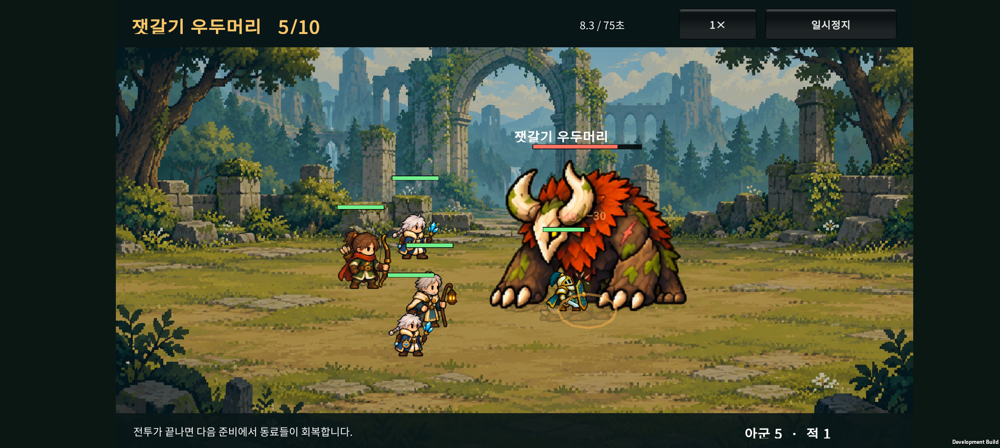
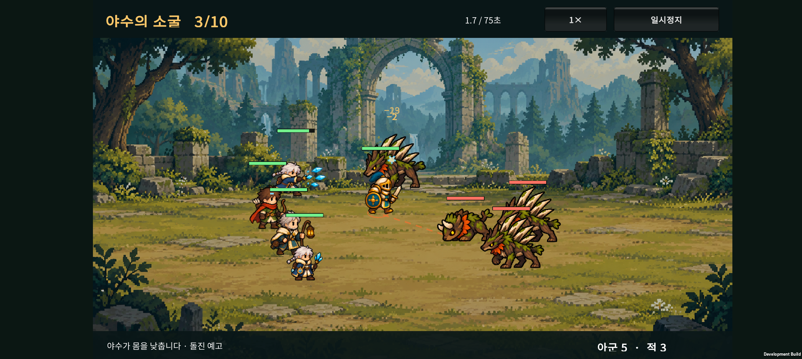
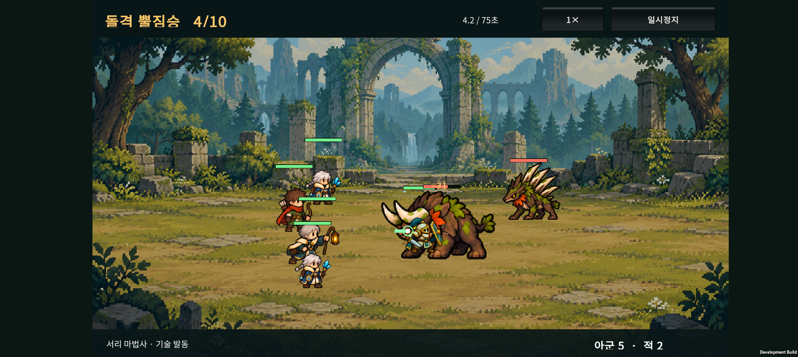
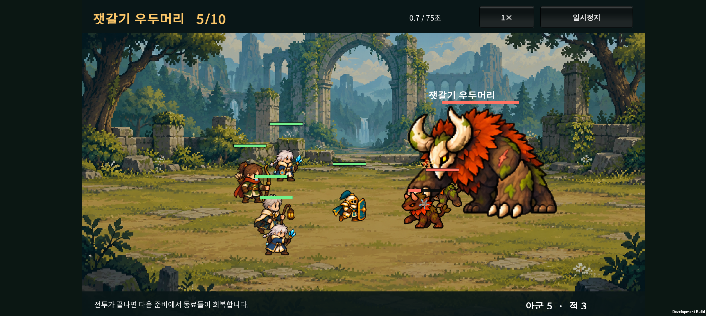
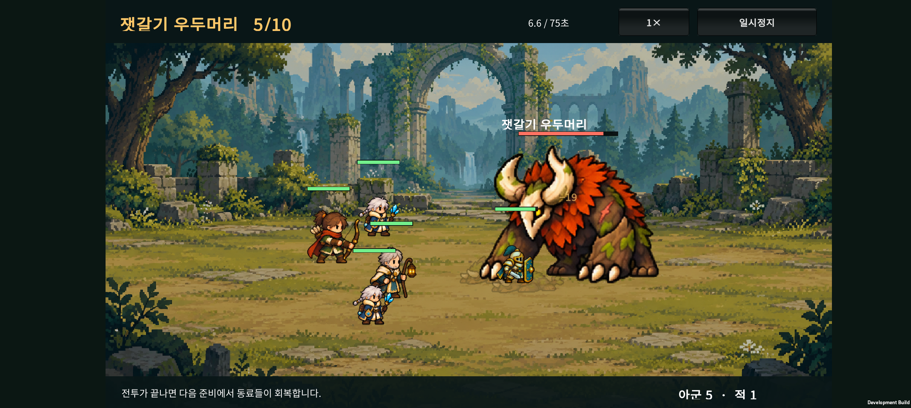

# 숲 적 애니메이션과 전투 적용 · v0.19

2026-10-23 · Unity / Android · 숲 지역 1~5전투

**v0.18의 숲 적 4종을 각각 움직이는 캐릭터로 제작하고 실제 전투에 연결했다.** 졸개·가시등·돌격 정예·잿갈기 우두머리가 서로 다른 모습과 동작을 사용한다. 전투 수치, 골드와 성장 규칙은 v0.17 기준이다.

## 1. 적용 내용

| 적 | 외형과 동작 | 기본 표시 높이 |
| --- | --- | ---: |
| 뿔짐승 | 작은 뿔과 목깃, 걷기·머리를 낮춘 들이받기 | 78 |
| 가시등 짐승 | 등에 솟은 긴 가시, 웅크리기·가시 발사 자세 | 112 |
| 돌격 뿔짐승 | 넓은 어깨와 긴 뿔, 낮은 자세에서 돌격 | 138 |
| 잿갈기 우두머리 | 큰 갈기와 앞발, 무거운 걸음·앞발 공격·돌진 준비 | 244 |

높이는 Unity의 1280 기준 화면 좌표에서 첫 대기 프레임의 불투명 영역 높이다. 아군은 기존 시트의 셀 크기를 기준으로 표시하므로 아군 설정 상자의 높이 144와 직접적인 실루엣 비율은 다르다. 실제 체급은 아래 기기 화면으로 확인한다.

- 4개 독립 PNG 시트, 각각 24프레임, 합계 **96프레임**.
- 공통: 대기 4, 피격 2, 걷기 6, 공격 6, 쓰러짐 4, 준비 자세 2.
- 정예·보스는 마지막 2프레임을 돌진 예고에 사용한다. 졸개의 추가 준비 프레임은 예비 프레임이며 현재 전투에서 별도 돌진 예고 전용으로 사용하지 않는다.
- 적의 원본 방향은 모두 왼쪽. 상대 이동에 따른 좌우 반전을 적용하지 않는다.
- 실제 공격 발동 이벤트에서 공격의 타격 프레임을 시작한다. 돌진 예고·이동·공격 발동이 피격 자세보다 우선해 공격 신호가 가려지지 않는다.
- 보스 광폭화의 색 변화와 기존 경로 예고를 유지한다.
- 발 위치는 각 프레임의 불투명 아래쪽에 맞추고, 크기 배율은 종별로 고정한다. 쓰러지거나 몸을 웅크려도 그림을 다시 같은 키로 늘리지 않는다.
- 마지막 적이 쓰러지는 동작을 볼 수 있게 결과 전환 전 짧은 마무리 시간을 둔다.

### 아군이 큰 적에게 가려지는 문제

실기기에서 정예와 보스의 몸에 기사가 가려지는 현상을 확인했고, 사용자도 같은 문제를 지적했다. 다음 세 가지를 함께 적용했다.

1. 쓰러진 유닛을 먼저 그리고, 살아 있는 유닛은 발 위치 순서로 그린다. 발 위치가 같으면 적 다음에 아군을 그려 순서를 고정한다.
2. 앞에 그려진 적이 아군 상체의 상당 부분을 가릴 때만 해당 아군 그림을 약한 청록빛·88% 불투명도로 다시 표시한다. 가려지지 않은 아군은 기존 깊이 순서를 유지한다.
3. 체력·보호막·보스 이름은 모든 캐릭터를 그린 후 표시해 적 그림 밑에 묻히지 않게 한다.

보스 크기와 전투 좌표·사거리·충돌 판정은 변경하지 않는다. Buddy2의 보스 공격 중에도 앞에 있는 기사의 모습과 체력바가 보이는 것을 확인했다.

## 2. Buddy2에서 본 모습

아래 화면과 영상은 Galaxy Buddy2(SM-M236L)에서 실행한 개발 APK의 기록이다. 외형 검증을 위해 3·4·5전투의 준비 상태를 만든 테스트 저장 데이터를 사용했다. 자연 진행이나 난도 통계로 해석하지 않는다. 3전투 화면은 애니메이션 적용 직후, 4·5전투 화면과 영상은 겹침 수정까지 적용한 최종 빌드에서 촬영했다. 사용자의 기존 저장은 테스트 후 복원했다.

### 졸개와 원거리 무리

### 돌격 정예

[정예 전투 영상 · 12초](device-evidence/wave4-motion.mp4)

<video controls preload="metadata" style="width:100%;max-width:900px" src="device-evidence/wave4-motion.mp4"></video>

### 우두머리와 호위

[보스 전투 영상 · 12초](device-evidence/wave5-motion.mp4)

<video controls preload="metadata" style="width:100%;max-width:900px" src="device-evidence/wave5-motion.mp4"></video>

## 3. 제작과 검증 방식

- 이미지 제작: 내장 imagegen. 프로젝트의 기존 숲 적 시안을 참조했다. [첫 프롬프트와 출처](ASSET-PROMPTS.md), [정예·보스 간격 수정](spacing-correction.md).
- 코딩: SOL 구현, 상위 작업에서 코드와 실제 기기 화면 검토.
- 프레임 추출: 원본 PNG를 수정하지 않고 알파값 0.4 초과의 불투명 범위와 빈 간격을 읽어 좌표만 저장한다. 정규 6 × 4 칸 경계를 그대로 자르면 잘리는 생성 결과를 감지하도록 했다.
- 정예·보스 첫 결과에서 공격 프레임끼리 범위가 겹치는 문제가 발견되어, imagegen으로 간격을 넓힌 결과를 선택했다.
- 런타임: 투명도 정리용 셰이더를 적용한 텍스처를 재사용한다. 원정 전투 종료 시 해당 렌더 텍스처와 자원을 해제한다.
- 새 그림을 읽지 못하는 경우 기존 그림으로 복귀한다. 성채 지역의 보병·석궁병·골렘은 기존 그림을 사용한다.

### 최종 빌드 확인

- 숲 그림·프레임 매핑 검증 258개, 가림 처리 검증 12개, 전투 종료 처리 검증, 드래그 성장 검증 17개 통과.
- Android APK 빌드 성공, Buddy2에 업데이트 설치 완료.
- 보스 전투에서 기사의 표시와 승리 결과 전환, 보상 저장 확인. 최종 테스트 이후 Unity·Android 오류 로그 없음.
- 사용자의 테스트 전 저장 데이터를 복원하고 원본과 바이트 단위로 일치하는지 확인 완료.
- APK SHA-256: `97B296A42F06634293A68BEFF69506B32DDFD2111AB5EF6EC27DBBA6BD76B228`.
- 로그: `unity/Logs/v019-visibility-build.log` (로컬 빌드 산출물).

## 4. 아직 다듬을 부분

- 96프레임은 첫 동작 제작본이다. 작은 질감·뿔·갈기와 얼굴의 프레임별 미세한 형태 차이는 추가 정리 대상이다.
- 마지막 적의 쓰러짐 이후 결과 표시를 제외한 승리 연출·유물·연구 등은 이번 범위에 포함하지 않았다.
- 성채 지역 적 4역할은 다음 미술 제작 대상이다. 11~30전투 콘텐츠는 별도 설계·구현 단계다.
- 이번 기기 검증은 짧은 전투의 외형과 오류 확인이다. 장시간 발열·배터리·지속 프레임 성능을 확정한 결과는 아니다.

## 5. 주요 파일

- `unity/Assets/Resources/Art/Enemies/v019/`: 4개 PNG, `forest-manifest.json`, Unity 메타데이터.
- `unity/Assets/Scripts/Presentation/ForestEnemyArt.cs`: 적 종류 선택, 프레임 우선순위, 표시 배율과 자원 관리.
- `unity/Assets/Scripts/Presentation/CatalogCombatLab.cs`: 실제 전투 이벤트와 애니메이션 연결.
- `unity/Assets/Scripts/Presentation/BattleVisibility.cs`: 발 위치에 따른 그리기 순서와 아군 가림 판정.
- `unity/Assets/Editor/ForestEnemyArtValidation.cs`: 프레임 좌표 생성·검증·APK 빌드 진입점.
- `unity/Assets/Editor/BattleVisibilityValidation.cs`, `CombatSettlementValidation.cs`: 겹침 표시와 결과 전환 검증.
- 빌드 명령: `Expedition.EditorTools.ForestEnemyArtValidation.BuildAndroid`.

개발 파일은 이번 작업의 변경 상태로 남긴다. 커밋·푸시는 별도로 실행하지 않았다.
