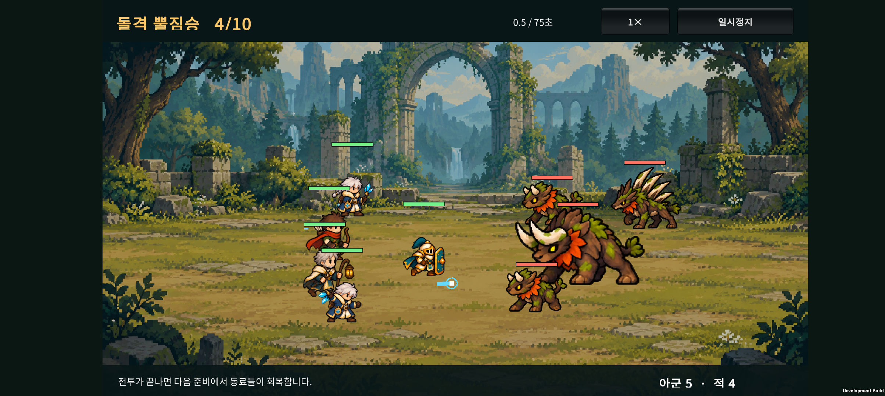
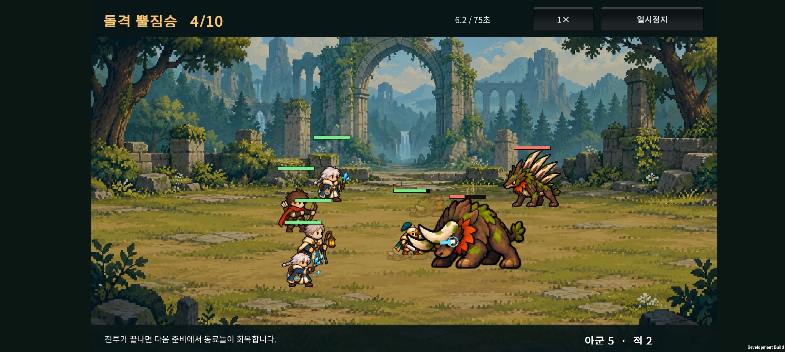
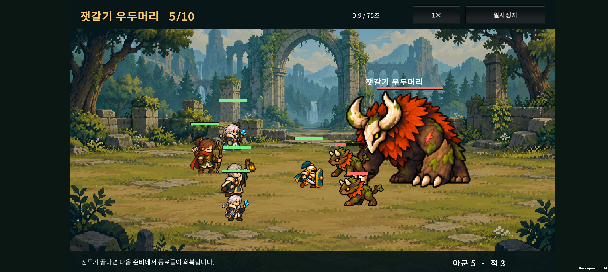
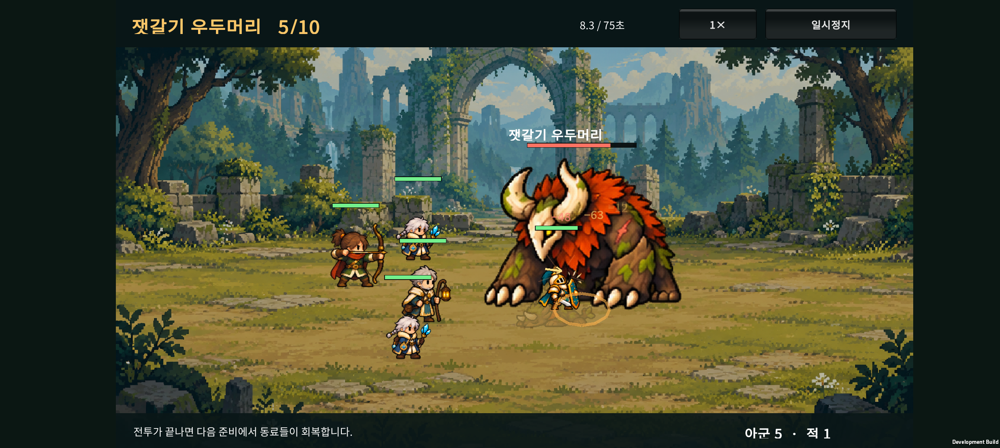

# 전투 간격과 보스 표시 규칙 · v0.20

2026-10-23 · Unity / Android

## 1. 사용자 피드백과 기준

v0.19에서 큰 적에게 가려진 아군을 다시 그리는 처리를 먼저 적용했다. v0.20에서 몸 전체를 떨어뜨려 보니 전투가 너무 흩어져 보여, 후속 피드백에 따라 **부분 겹침은 허용하고 완전히 묻히는 상황을 막는 방향**으로 간격을 줄였다.

| 대상 | 규칙 |
| --- | --- |
| 졸개끼리 | 일부 겹쳐 싸울 수 있게 밀집. 서로를 통째로 가리지 않도록 최소 간격 유지 |
| 졸개와 아군 | 부분 겹침 허용. 작은 캐릭터의 몸을 알아볼 수 있도록 간격 보정 |
| 졸개와 보스 | 부분 겹침 허용. 작은 졸개 기준으로 간격을 계산하고 보스보다 앞에 표시 |
| 큰 보스와 아군 | 겹침 허용. 살아 있는 아군은 항상 보스보다 앞에 표시 |
| 쓰러진 유닛 | 살아 있는 유닛을 가리거나 이동을 막지 않음 |

정예는 일반 적의 간격 규칙을 적용한다. 무기를 휘두르는 순간의 끝부분과 공격 이펙트까지 서로 닿지 못하게 하는 규칙은 아니다. 전투 중 캐릭터의 몸과 남아 있는 적의 수를 알아볼 수 있도록 하는 것이 기준이다.

## 2. 표시 처리

- 쓰러진 유닛 → 보스 → 나머지 살아 있는 유닛 순서로 그린다.
- 일반 유닛끼리는 발 위치에 따른 깊이 순서를 사용한다.
- 보스 호위도 보스보다 앞에 표시한다. 간격 유지와 함께 큰 보스에게 졸개가 묻히는 상황을 막는다.
- v0.19의 청록빛 반투명 재표시는 제거했다. 아군은 원래 색과 불투명도로 표시한다.
- 체력바·보호막·보스 이름은 모든 캐릭터 뒤에 마지막으로 그린다.

### 보스의 피격 반응 정리

보스가 맞을 때마다 자세를 바꾸고 흔들리는 모습이 부산스럽다는 피드백을 반영한다.

- 보스는 피해를 받아도 피격 프레임으로 전환하지 않는다.
- 보스의 피격에 따른 좌우 흔들림과 붉은 점멸을 제거한다.
- 보스가 강한 공격을 받았다는 이유로 전투를 잠깐 멈추는 효과도 제거한다.
- 피해 수치·체력 감소·타격 이펙트·소리는 유지한다. 실제 피해와 보스의 공격·돌진·광폭화·쓰러짐 동작은 그대로 작동한다.

## 3. 이동과 공격

- 일반 적의 몸 크기를 기준으로 간격을 계산한다. 졸개·가시등·정예·보스는 서로 다른 몸 크기를 사용한다.
- 이전의 추가 여백 6을 제거하고, **둘 중 작은 몸의 폭·높이를 기준으로 약 30% 겹침을 허용**한다. 큰 적의 크기를 통째로 축소하는 방식은 작은 동료가 파묻힐 수 있어 사용하지 않는다. 이 비율은 프레임별 그림 전체가 아닌 몸 간격 계산 기준이다.
- 적끼리는 옆으로 퍼지도록 하고, 큰 적 뒤에 막힌 공격자는 옆길을 통해 접근한다. 간격 보정으로 화면 밖으로 밀려나지 않도록 이동 가능한 범위를 제한한다.
- 보스와 졸개 사이에서는 졸개를 이동시킨다. 간격 보정을 위해 보스의 위치나 돌진 예고 위치를 밀지 않는다.
- 근접 기본 공격과 단일 대상 기술은 몸의 가장자리에 닿는 거리에서 사용할 수 있다. 원거리·범위 공격·지원 기술·보스의 사거리와 피해 수치는 기존 기준이다.
- 0.2초 돌진 이동 중에는 잠깐 몸을 가로지를 수 있고, 착지 후 간격을 다시 정리한다. 공격 동작의 뿔·무기 끝부분과 이펙트는 몸 간격의 기준에 포함하지 않는다.
- 살아 있는 아군끼리의 배치 간격은 이번 변경 대상에서 제외했다.

## 4. 확인 기록

- 순수 C# 전투 검사: **3,011개 통과**. 겹친 시작 위치, 여러 적의 접근, 화면 범위, 보스와 호위, 쓰러진 유닛, 근접 공격 성립, 정예 뒤의 원거리 적 우회·공격을 포함한다. 작은 동료와 정예가 일부 겹친 채 남아 있으면서 작은 몸의 식별 영역은 확보하는 경우도 검사한다.
- 원정 검사: **1,675개 통과**.
- Unity 검사 통과: 숲 그림 좌표 258개, 보스 표시 순서 12개, 실제 보스·일반 적 피격 이벤트 반응, 결과 전환, 성장 조작 17개.
- 부분 겹침 조정 APK 빌드 성공. SHA-256: `F2B3A0C01000FA08C66F6A2315A414013E4C9D0B29F51DDD2EB78673E7FCC097`.
- 로그: `unity/Logs/v020-compact-build.log` (로컬 빌드 산출물).
- Galaxy Buddy2에 업데이트 설치하고 4·5전투에서 간격과 보스 표시를 확인했다. 외형 확인용 준비 상태를 사용한 검사이며 자연 진행 기록은 아니다. 테스트 전 저장 데이터를 복원하고 원본과 바이트 단위 일치 확인을 마쳤다.

### Buddy2 화면과 영상

<video controls preload="metadata" style="width:100%;max-width:900px" src="device-evidence/wave4-compact-motion.mp4"></video>

[현재 일반 적·정예 전투 영상 · 12초](device-evidence/wave4-compact-motion.mp4) · [이전: 몸 전체 간격 확보](device-evidence/wave4-motion.mp4)

<video controls preload="metadata" style="width:100%;max-width:900px" src="device-evidence/wave5-compact-motion.mp4"></video>

[현재 보스 전투 영상 · 12초](device-evidence/wave5-compact-motion.mp4) · [이전: 몸 전체 간격 확보](device-evidence/wave5-motion.mp4)

### 난도에 미치는 영향

간격은 전투 결과에도 영향을 준다. 초기 구현에서 정예가 뒤로 밀려 첫 돌진이 빗나가고, 원거리 적이 정예 뒤에 갇히는 현상을 발견해 접근 동작을 수정했다.

간격을 완전히 확보하던 시점의 고정 시드 1001·4전투에서 적의 총 피해량은 이전 버전 590.5 → 첫 간격 구현 256.9 → 접근 수정 후 440.3이었다. 그 표본에서 정예가 기본 공격 6회·돌진 적중 2회, 원거리 적이 기본 공격 4회를 수행했다.

시드 1001~1005·기본 3명 유지 전략의 비교:

| 구분 | 4전투 승리 | 평균 남은 팀 HP | 5전투 승리 |
| --- | ---: | ---: | ---: |
| 간격 변경 전 | 0/5 | 0% | 0/5 |
| 몸 전체 간격 확보 | 5/5 | 29.2% | 0/5 |
| **현재: 부분 겹침 허용** | **5/5** | **4.8%** | **0/5** |

피해·체력·공격 주기·보상 수치는 바꾸지 않았다. 이는 작은 자동 진행 표본이며 플레이어 승률이 아니다. 전투 간격을 좁히면서 교전 압박은 커졌지만, 난도 조정이 완료됐다는 의미는 아니다. [전체 간격 표본](balance-full-clearance.json), [부분 겹침 표본](balance-partial-overlap.json).

## 5. 주요 파일

- `unity/Assets/Scripts/Core/CatalogSpacing.cs`: 몸 간격, 근접 접촉 거리, 옆길 접근.
- `unity/Assets/Scripts/Core/CatalogBattle.cs`, `CatalogSkills.cs`: 이동·공격 단계 연결.
- `unity/Assets/Scripts/Presentation/BattleVisibility.cs`: 보스와 살아 있는 유닛의 표시 순서.
- `unity/Assets/Scripts/Presentation/CatalogCombatLab.cs`, `CatalogBattleEffects.cs`: 보스 피격 자세·점멸·흔들림·피격 정지 제거.
- `unity/Assets/Editor/BossHitReactionValidation.cs`: 실제 전투 이벤트로 숲·성채 보스와 일반 적의 피격 표시 확인.
- `tests/CatalogCombat/Program.cs`: 군집·공격·우회 경로 회귀 검사.

이전 작업: [숲 적 4종 애니메이션과 실기기 영상](../design-v0.19/HANDOFF.html).
