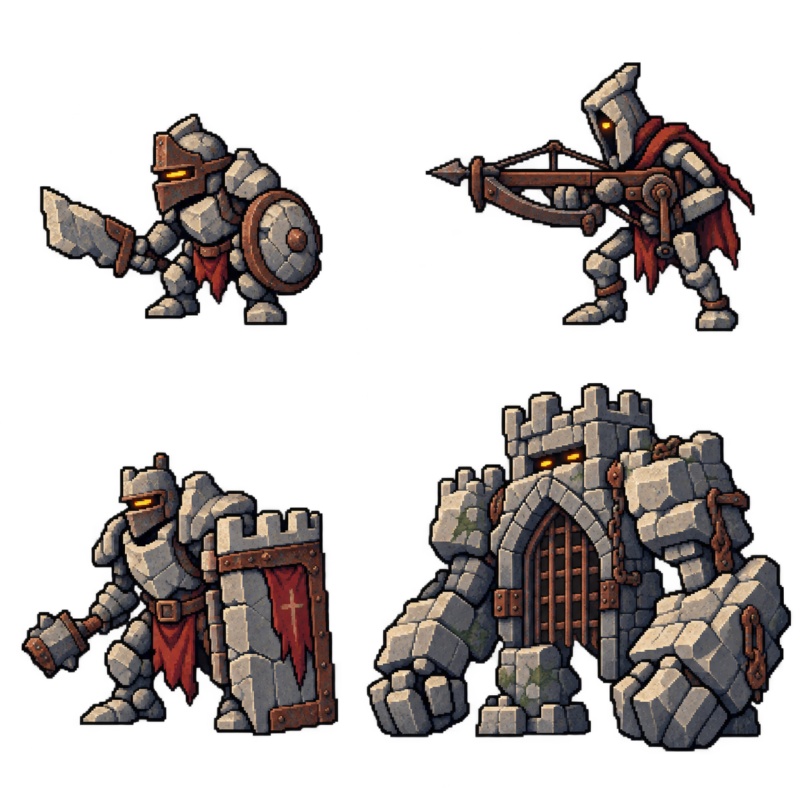
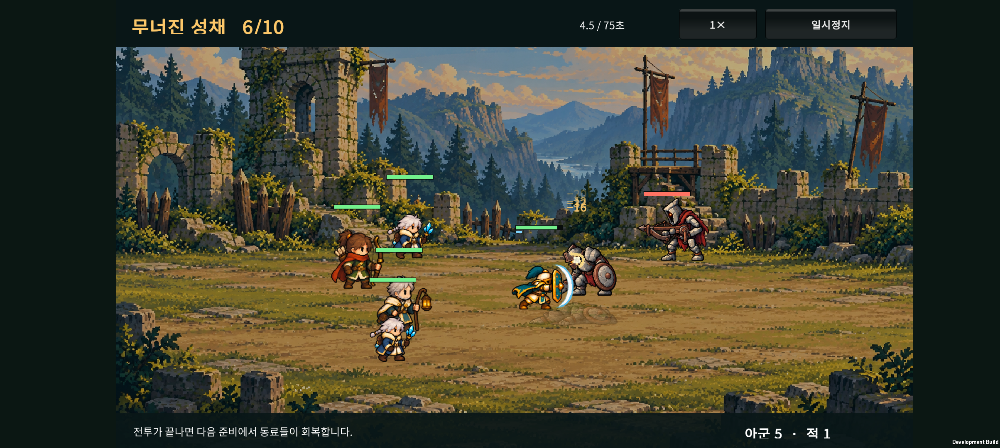
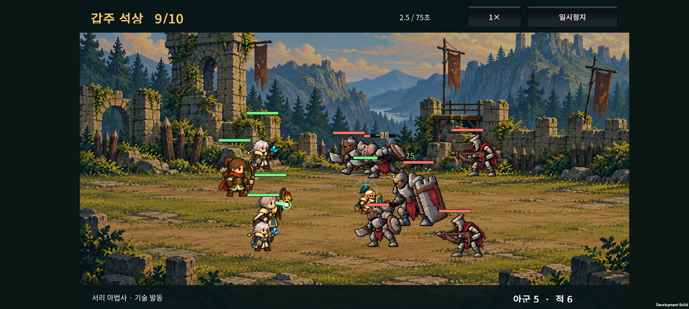
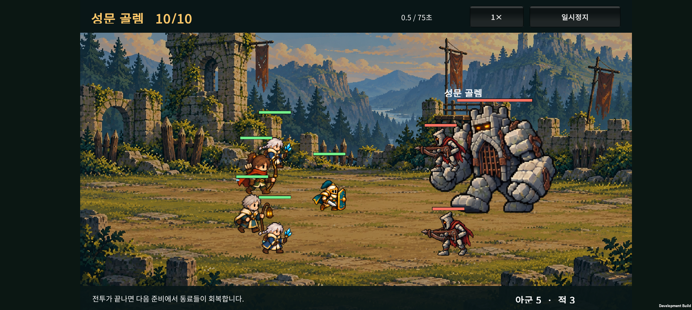
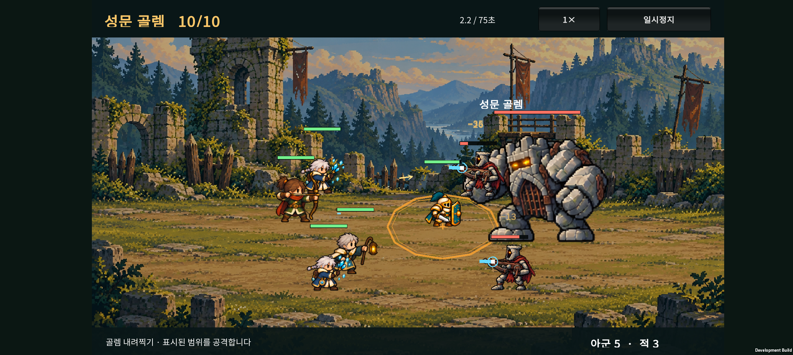
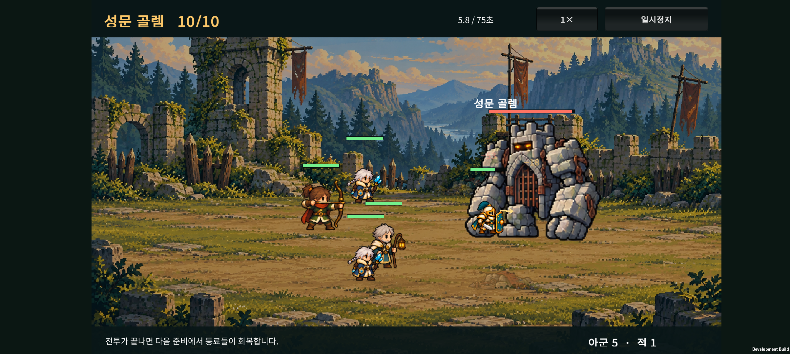

# 성채 적 애니메이션 · v0.21

2026-10-23 · Unity / Android · 성채 지역 6~10전투

## 1. 이번 작업

기존 숲 적과 전투 간격 변경을 `9946458`에 커밋한 뒤, 성채 지역 적의 외형과 동작을 제작한다.

| 적 | 외형 | 공격·준비 동작 | 기준 표시 높이 |
| --- | --- | --- | ---: |
| 돌편 보병 | 작은 돌 몸체, 둥근 방패와 짧은 돌칼 | 칼을 들어 왼쪽으로 베기 | 90 |
| 석궁 수비병 | 가느다란 돌 머리와 긴 석궁 | 왼쪽 조준, 발사 반동, 재장전 | 100 |
| 갑주 석상 · 정예 | 넓은 어깨, 성벽 모양 큰 방패와 철퇴 | 철퇴 공격, 방패를 내세운 돌진 준비 | 140 |
| 성문 골렘 | 성문과 쇠창살 가슴, 성벽 머리, 거대한 돌 주먹 | 양팔을 든 내려찍기 준비와 타격 | 244 |

높이는 1280 기준 화면 좌표에서 첫 대기 프레임의 불투명 영역 높이다. 보스가 웅크리거나 쓰러질 때 키를 다시 늘리지 않고 같은 배율로 표시한다.

## 2. 애니메이션 구성

- 독립 PNG 4장, 각 6열 × 4행의 24프레임. 총 96프레임.
- 대기 4, 일반 피격 2, 걷기 6, 공격 6, 쓰러짐 4, 특수 준비 2.
- 모든 적은 왼쪽을 향한다.
- 실제 공격 이벤트가 발생할 때 타격 자세를 재생한다.
- 정예는 돌진 예고·이동을 우선 표시한다.
- 골렘은 내려찍기 예고와 충격파 예고를 구분한다. 분노 상태에서 첫 내려찍기와 후속 충격파 사이에도 첫 타격 자세를 표시한다.
- 보스 피격 프레임은 시트에 있어도 런타임에서 사용하지 않는다. 맞을 때 흔들림·붉은 점멸·피격 정지도 적용하지 않는다.

### 전투 간격

v0.20의 부분 겹침과 표시 순서를 사용한다. 작은 졸개가 통째로 묻히지 않게 간격을 유지하며, 살아 있는 아군과 호위는 큰 보스보다 앞에 표시한다.

체력·피해·이동 속도·보상·소환 비용·성장 규칙은 이번 작업에서 조정하지 않는다.

## 3. 제작 방식

- 내장 imagegen으로 자체 시안과 포즈를 제작했다. [프롬프트 기록](ASSET-PROMPTS.md).
- 원본 PNG는 수정하지 않고, 투명 간격과 프레임의 불투명 범위만 읽어 `castle-manifest.json`을 만든다.
- 숲 적에 사용하던 렌더링·텍스처 캐시·투명도 처리와 프레임 좌표 생성기를 함께 사용한다.
- SOL이 구현하고 상위 작업에서 코드·기기 화면을 검토한다.
- 출시용 최종 원화가 아닌 첫 동작 제작본이다. 프레임 사이 장비·돌 표면의 미세한 차이는 추가 정리 대상이다.

## 4. 검증 기록

- 성채 그림·좌표·동작 매핑 검사 **264개**, 숲 그림 회귀 검사 **258개** 통과.
- 보스 표시 순서 12개, 실제 보스 피격 이벤트, 전투 종료 전환, 드래그 성장 17개 검사 통과.
- Android APK 빌드 성공. Galaxy Buddy2에 업데이트 설치하고 6·9·10전투의 외형과 표시를 확인했다.
- 실기기 확인 중 성채 정예의 안내 문구에 남아 있던 “야수”를 “갑주 석상”으로 수정했다.
- 문구 수정 후 최종 APK를 다시 빌드·설치하고 9전투를 재확인했다. 최종 APK SHA-256: `B7BA07B949233E99B746B3ADBB3A0BF2D6D740AB1C0C1C097E71567162AB04C2`.
- 빌드 로그: `unity/Logs/v021-castle-final-build.log` (로컬 산출물). 최종 검사도 위 검증 항목을 모두 통과했고 실행 중 Unity·Android 오류 로그는 없었다.
- 테스트 전 원정 저장을 복원하고 원본과 바이트 단위로 일치하는지 확인했다.
- 아래 영상은 외형 검증용 저장 상태에서 촬영했다. 자연 진행이나 난도 통계가 아니며 장시간 발열·성능 검증을 대신하지 않는다.
- 6·10전투 화면과 영상은 첫 성채 빌드, 9전투는 안내 문구 수정까지 포함한 최종 빌드에서 촬영했다. 두 빌드의 그림·전투 수치는 같다.

### 돌편 보병과 석궁 수비병 · 6전투

<video controls preload="metadata" style="width:100%;max-width:900px" src="device-evidence/wave6-motion.mp4"></video>

### 갑주 석상 · 9전투

<video controls preload="metadata" style="width:100%;max-width:900px" src="device-evidence/wave9-motion.mp4"></video>

### 성문 골렘 · 10전투

<video controls preload="metadata" style="width:100%;max-width:900px" src="device-evidence/wave10-motion.mp4"></video>

## 5. 아군 크기 질문에 대한 확인

현재 아군 30형태는 동일한 셀 배율로 그려지지만, 원본 시트 안에서 캐릭터가 차지하는 면적이 서로 다르다. 직업별 체격을 수치로 정한 설계가 아니므로 현재의 크기 차이 전체를 의도된 차이라고 볼 수 없다.

첫 대기 프레임 기준, 원정 전투의 표시 높이는 방패 기사 약 83, 수호 기사 약 70이다. 진화한 수호 기사가 약 16% 작게 표시된다. 전체 형태의 불투명 실루엣 높이는 약 70~101이며 무기·모자도 포함한 범위다.

후속 보정에서는 몸의 기준 크기를 맞추고 직업별 어깨·장비·모자 차이를 남긴다. 프레임마다 자동 확대·축소하면 움직일 때 크기가 출렁이므로 형태별 고정 배율을 사용해야 한다. 이번 성채 패치에서는 아군 표시 크기를 변경하지 않았다.

## 6. 주요 파일

- `unity/Assets/Resources/Art/Enemies/v021/`: 성채 PNG 4장과 프레임 좌표.
- `unity/Assets/Scripts/Presentation/CastleEnemyArt.cs`: 종류·크기·골렘 예고 우선순위.
- `unity/Assets/Scripts/Presentation/ForestEnemyArt.cs`: 두 지역 공통 렌더링과 자원 관리.
- `unity/Assets/Scripts/Presentation/CatalogCombatLab.cs`: 실제 공격 이벤트와 자세 연결.
- `unity/Assets/Editor/CastleEnemyArtValidation.cs`: 성채 검증과 Android 빌드.
- `unity/Assets/Editor/ForestEnemyArtValidation.cs`: 투명 간격과 불투명 범위를 읽는 공통 좌표 생성기.

이전: [전투 간격과 보스 표시 규칙](../design-v0.20/HANDOFF.html).

이전 변경의 커밋은 `9946458`이다. 이 문서의 v0.21 코드·그림·검증 기록을 이번 성채 적 커밋에 함께 포함한다. 원격 푸시는 별도다.
