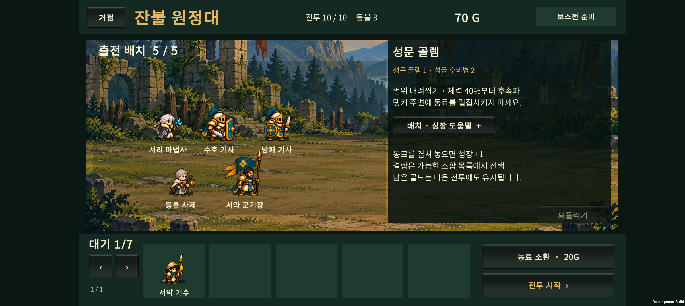
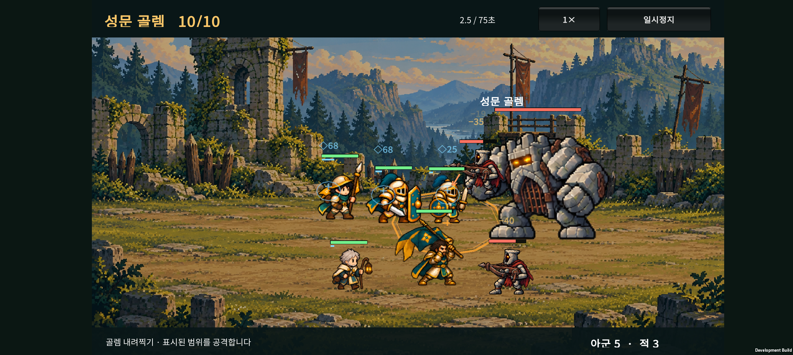

# v0.22 · 아군은 사람의 크기로 맞추기

작성: 2026-10-24 · Ember Expedition / 잔불 원정대

**서약 기수와 서약 군기장의 깃발을 키의 기준에서 제외한다. 사람의 머리·투구 본체부터 발끝까지를 기준으로 아군 30형태의 크기를 맞춘다.** 깃발·무기·깃털 장식은 그 기준에 따라 자연스럽게 더 크게 표시된다.

## 1. 문제와 수정 기준

기존에는 모든 원본 시트의 셀을 같은 배율로 그렸다. 그런데 원본에서 사람이 차지하는 크기가 달라, 깃발이 큰 기수의 몸과 일부 진화한 기사가 다른 동료보다 작았다. 직업별 체격을 의도적으로 정한 결과가 아니다.

이번에는 첫 대기 자세에서 몸의 높이를 직접 확인해 형태별 고정 배율을 저장한다. 그림 전체의 불투명 영역이나 깃발 끝을 사람의 키로 계산하지 않는다.

- 기준: 사람의 머리·투구 본체 꼭대기부터 기존 발 피벗까지.
- 제외: 깃발, 창·지팡이 끝, 투구 깃털, 별도로 솟은 머리 장식·묶은 머리, 투명 여백.
- 전투 기준 화면에서 중립 자세의 몸 높이: **84**. 실제 휴대폰 화면에서는 전체 UI 배율이 곱해진다.
- 준비 화면과 대기석은 각 화면의 기존 표시 배율을 유지하면서 같은 보정값을 사용한다. 따라서 대기석 그림은 전장보다 작게 보인다.
- 걸음·공격·쓰러짐마다 배율을 바꾸지 않는다. 한 형태는 모든 동작에서 같은 보정값을 사용한다.
- 발 위치와 좌우 방향을 유지한다. 기수의 체력바는 커진 깃발 위로 올린다.

## 2. 대표 변화

아래 높이는 깃발과 장비를 제외한 **몸**의 전투 기준 화면 높이다. 첫 대기 자세의 수동 측정값을 사용했다.

| 동료 | 기존 몸 높이 | 수정 후 | 배율 |
| --- | ---: | ---: | ---: |
| 서약 기수 | 58.1 | 84.0 | 1.445배 |
| 서약 군기장 | 60.0 | 84.0 | 1.400배 |
| 수호 기수 | 51.1 | 84.0 | 1.644배 |
| 진격 기수 | 56.3 | 84.0 | 1.493배 |
| 방패 기사 | 69.4 | 84.0 | 1.211배 |
| 수호 기사 | 56.7 | 84.0 | 1.481배 |
| 등불 사제 | 91.4 | 84.0 | 0.919배 |

서약 군기장은 몸 높이가 84인 상태에서 깃발을 포함한 전체 높이가 약 141이다. 장비까지 84에 억지로 맞추지 않는다. 머리·어깨·장비의 폭과 원본 자세 차이는 남긴다.

## 3. 휴대폰 비교

Galaxy Buddy2에서 같은 편성·배치로 촬영한다. 위 줄은 서리 마법사·수호 기사·방패 기사, 아래 줄은 등불 사제·서약 군기장이다. 대기석에는 서약 기수를 둔다.

### 수정 전

### 수정 후

### 두 기수를 함께 출전

서리 마법사를 대기석으로 옮기고 서약 기수를 전장에 배치했다. 같은 전장 배율에서 두 기수의 몸과 기사의 몸을 비교할 수 있다. 이동은 실제 드래그 입력으로 확인했다.

### 전투 표시

<video controls preload="metadata" style="width:100%;max-width:900px" src="device-evidence/wave10-motion.mp4"></video>

12초 녹화와 전투 화면 표본에서 이동·공격·깃발·체력바 위치를 확인했다. 화면은 외형 확인용 편성으로 촬영했으며 자연 진행의 난도 통계는 아니다.

## 4. 구현과 확인 범위

- `CatalogBodyScale`: 30형태의 몸 높이 자료, 고정 배율, 발 피벗 유지 계산을 공유한다.
- `CatalogArtView`: 준비 화면·대기석·상세·결합 미리보기에 적용한다.
- `CatalogCombatLab`: 실제 전투와 시험실의 동작에 적용한다. 전투 체력바는 첫 대기 자세의 전체 실루엣 위에 일정하게 둔다.
- 보정 자료가 없거나 시트 크기가 바뀌었으면 기존 배율로 표시한다.
- 원본 PNG와 전투 능력치·성장·소환·적 크기·충돌 계산은 수정하지 않는다.

원본 애니메이션의 자세·장비·체형이 프레임마다 조금 달라지는 문제는 이번 표시 배율 보정만으로 사라지지 않는다. 이번 측정은 첫 대기 자세에 대한 시각 보정이며, 향후 원화를 교체하면 기준점도 다시 확인해야 한다.

### 검증 결과

- 30형태의 자료·고정 배율·발 피벗·좌우 방향·대기/공격/쓰러짐 프레임·누락 자료 처리 검사 **460개** 통과.
- 성채 적 검사 264개, 숲 적 검사 258개, 표시 순서 12개, 드래그 성장 17개와 전투 종료·보스 피격 회귀 검사 통과.
- 아군 기존 시트는 형태당 **22개 유효 프레임**이다. 최초 검사에서 24개로 잘못 가정한 조건을 수정한 뒤 최종 빌드 검사를 통과했다. 원본 시트와 프레임 좌표는 변경하지 않았다.
- Android 빌드 성공, Galaxy Buddy2 업데이트 설치 완료.
- 준비 화면의 동일 편성 전후 비교, 대기석↔전장 드래그, 두 기수 동시 출전, 전투 중 몸·깃발·체력바 표시 확인.
- 해당 실행 중 `Unity`·`AndroidRuntime` 오류 로그 없음.
- 시험 전 원정 저장을 복원하고 원본과 바이트 단위 일치 확인.
- APK SHA-256: `76E6B044226F21EAB8C97E9D2E7C90F29E8E420DAD43F25D39378CED82F633B5`.
- 빌드 로그: `unity/Logs/v022-ally-scale-build.log` (로컬 산출물).

전투 후반 아군이 한 적에게 모이는 배치와 일부 겹침은 기존 규칙을 따른다. 이번 확인은 크기 보정 범위이며 장시간 성능·전체 전투 밸런스 검증은 포함하지 않는다.

## 5. 주요 파일

- `unity/Assets/Resources/Art/Units/v022/body-scale.json`: 30형태의 원본 몸 높이·머리 기준점·발 기준점.
- `unity/Assets/Scripts/Presentation/CatalogBodyScale.cs`: 공통 크기 보정과 HUD 높이.
- `unity/Assets/Scripts/Presentation/CatalogArtView.cs`: 준비 화면 표시.
- `unity/Assets/Scripts/Presentation/CatalogCombatLab.cs`: 전투 표시.
- `unity/Assets/Editor/AllyBodyScaleValidation.cs`: 자료·동작·발 위치 검증과 Android 빌드 진입점.

이전 성채 적 작업은 `b3a9f2c`로 커밋했다. 이번 v0.22 변경은 후속 개발분이다. [성채 적 기록](../design-v0.21/HANDOFF.html).
