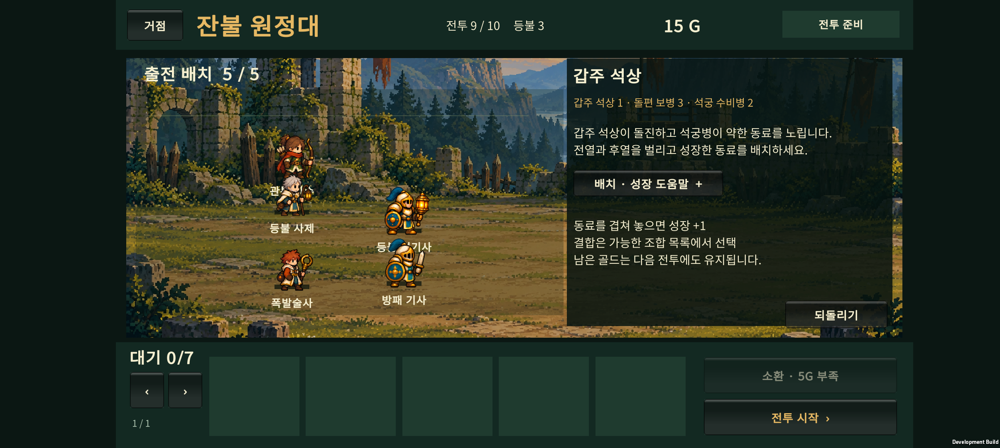
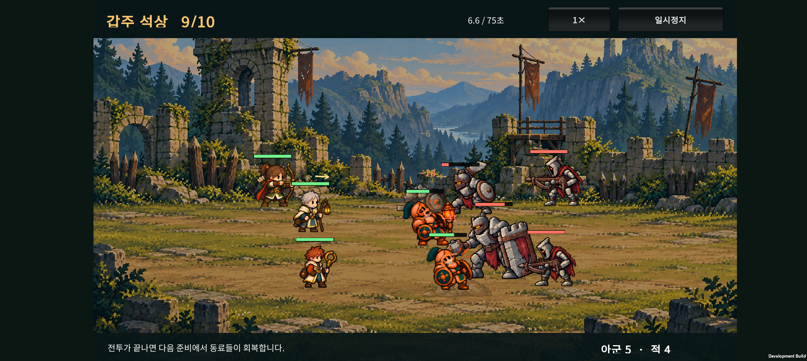
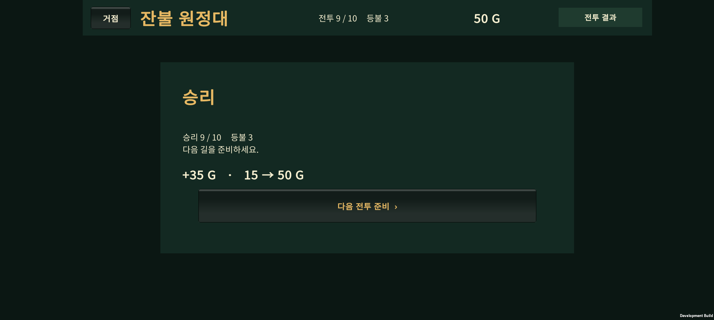
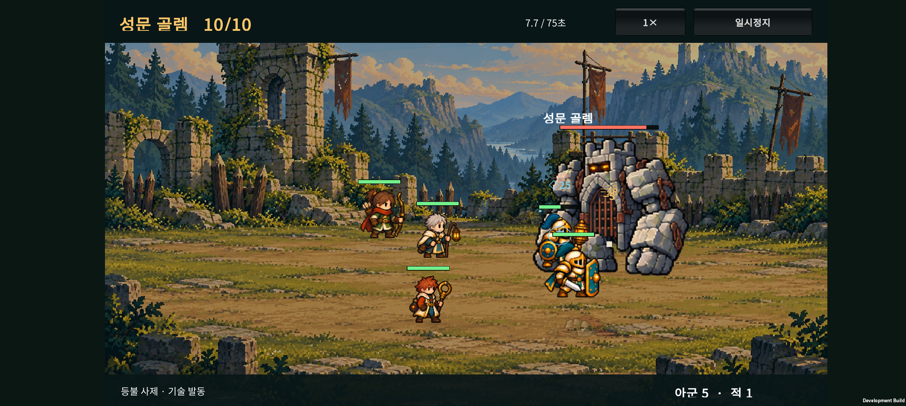
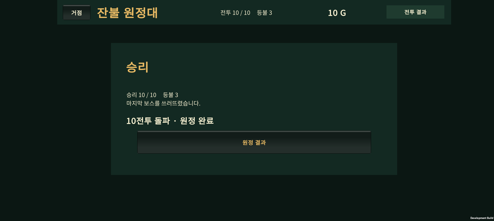

# v0.23 · 성채 일반전과 마지막 보스 난도 연결

2026-10-24 · 아군 몸 크기 보정(v0.22) 다음 작업

**6전투는 첫 보스 후 쉬어가는 구간으로 유지하고, 7~9전투의 공격 압박을 높였다. 10전투 골렘은 체력을 줄여 분기 진화·결합 편성의 공략 여지를 넓혔다.** 출시 난도 확정판은 아니다.

## 1. 이번 조정

| 구간 | 적 공격력 변경 | 의도 |
| --- | --- | --- |
| 6전투 | 변경 없음 | 첫 보스 뒤 새 지역과 편성을 확인하는 구간 |
| 7전투 | 보병 21→25, 석궁 17→24 | 성장하지 않은 팀에 더 많은 피해 |
| 8전투 | 보병 22→28, 석궁 18→25 | 늘어난 적 수와 함께 전열·회복 압박 |
| 9전투 | 보병 23→29, 석궁 20→28, 석상 35→42 | 마지막 보스 전에 성장한 편성의 필요성 확인 |
| 10전투 | 공격력 80 유지, 골렘 HP 5000→4200 | 보스 패턴을 버티는 시간을 줄여 성장 방향별 격차 완화 |

6~9전투 준비 화면에도 석궁의 약한 동료 우선 공격, 진화·전승 점검, 석상의 돌진 안내를 추가했다. 석궁의 실제 우선 대상은 사거리 안에서 남은 체력 비율이 낮은 동료다.

1~5전투, 적 수·배치·패턴, 시작 인원, 소환 비용, 승리 골드, 성장 규칙, 아군 능력치, 그림과 저장 형식은 동일하다. 이전 저장의 준비 화면 또는 중단된 전투를 이어갈 때 새 적 수치가 적용된다.

## 2. 변경 전후 자동 비교

SOL이 시드 1~40으로 조정하고, 상위 작업에서 별도 시드 **1001~1100**을 비교했다. 별도 시드 결과를 보고 다시 수치를 맞추지 않았다.

| 고정 성장 정책 | 9전투 승리 전→후 | 10전투 승리 전→후 | 10전투 평균 시간 전→후 |
| --- | ---: | ---: | ---: |
| 기본형 5명, 성장 없음 | 32→0 / 100 | 0→0 / 100 | 27.46→27.46초 |
| 분기 진화 분산 | 100→100 / 100 | 58→94 / 100 | 55.14→45.59초 |
| 기사 최종 진화 우선 | 100→100 / 100 | 100→100 / 100 | 46.50→39.72초 |
| 기사·사제 H-02 결합 우선 | 100→100 / 100 | 23→44 / 100 | 47.12→43.23초 |

평균 시간에는 패배도 포함한다. 기본형의 짧은 시간은 빠른 승리를 뜻하지 않는다. 이번 표의 세 성장 정책은 실제 무패 10전투 완료 수도 각각 94·100·44였다. 기본형 정책은 5전투부터 대부분 탈락한다.

### 일반전에서 드러나는 차이

- 8전투 기본형 5명의 평균 남은 체력은 60%→48%. 분기 편성은 99%→95%, H-02 편성은 91%→85%였다.
- 9전투 분기 편성은 95%→87%, 최종 우선 편성은 98%→92%, H-02 편성은 81%→70%였다.
- 성장한 팀의 7~9전투 평균 시간은 대체로 약 8~17초로 유지했다. 적 체력을 일괄 늘려 일반전을 길게 만들지는 않았다.
- 마지막 보스에서는 모든 성장 방향이 동일해지지는 않았다. H-02 정책의 승리는 늘었지만 여전히 다른 두 정책보다 낮다.

### 해석의 한계

고정 자동 정책은 실제 소환·흡수·진화·결합 API와 합법 예산을 사용한다. 다만 개별 전투 비교는 앞에서 패배했어도 이전 승리 보상을 받았다고 가정하며, 무패 진행 수는 `reachWins`로 따로 센다. 시작 3명 정책은 소환하지 않아 같은 팀을 반복한다.

이는 사람의 승률이나 모든 결합의 균형을 검증한 결과가 아니다. H-02 정책은 기사와 사제를 결합해 다른 역할 구성이 되며, 한 종류의 결합·분기·고정 배치만 사용한다. 강한 최종 진화 팀이 쉽게 이기는 보상도 남겼다.

v0.17의 옛 난도 표와 현재 결과는 같지 않다. 이후 전투 간격·이동 보정이 들어갔으므로 이번 기록은 v0.22의 현재 코드에서 변경 전후를 다시 측정한 값이다.

[조정 전 40개 시드](balance-before-training.json) · [조정 후 40개 시드](balance-after-training.json) · [별도 100개 시드 변경 전](balance-before-holdout.json) · [별도 100개 시드 변경 후](balance-after-holdout.json)

## 3. 검증과 휴대폰

- 기존 원정 검사 **1,675개**, 카탈로그 전투 검사 **3,011개** 통과.
- 아군 크기 검사 460개, 성채 적 264개, 숲 적 258개, 표시 순서 12개, 드래그·JSON 17개와 전투 종료·보스 피격 회귀 검사 통과.
- Android 빌드 성공, Galaxy Buddy2에 업데이트 설치.
- 최종 APK SHA-256: `2B8BF21C88132C2F00DDCCD772054AA234ED41930968E45B226C9491978AC353`.
- 빌드 로그: `unity/Logs/v023-castle-progression-build.log` (로컬 산출물).
- 기존 정책 비교에서 1~6전투의 변경 전후 결과 30행이 동일함을 확인.

### Buddy2 확인

시드 1의 H-02 정책을 실제 코어 API로 처음부터 진행해, 이전 전투를 모두 승리한 9·10전투 준비 저장을 만들었다. 그 체크포인트를 휴대폰에 넣어 확인했다. 휴대폰에서 1~10전투를 처음부터 수동 완주한 검사는 아니다.

- 9전투 준비 안내 두 줄이 잘리지 않고 표시됨을 확인.
- 9전투 승리, **35G 보상 / 15→50G**, 다음 10전투 준비 전환 확인.
- 합법적인 10전투 준비 체크포인트로 H-02·수호 기사 편성의 골렘 승리와 원정 완료 전환 확인.
- 해당 실행 중 `Unity`·`AndroidRuntime` 오류 로그 없음.
- 테스트 직전 원정 저장을 복원하고 원본과 바이트 단위 일치 확인.

화면·영상은 이 테스트 편성의 표시와 진행 확인이다. 장시간 발열·배터리·최저 프레임 측정은 포함하지 않는다.

<video controls preload="metadata" style="width:100%;max-width:900px" src="device-evidence/wave9-motion.mp4"></video>

<video controls preload="metadata" style="width:100%;max-width:900px" src="device-evidence/wave10-motion.mp4"></video>

## 4. 주요 파일과 다음 순서

- `unity/Assets/Scripts/Core/ExpeditionRun.cs`: 7~10전투 적 수치.
- `unity/Assets/Scripts/Presentation/ExpeditionScreen.cs`: 성채 준비 안내.
- `tests/ExpeditionRun/BalanceProbe.cs`: 기존 5가지 정책으로 전후 비교. 정책 코드는 변경하지 않았다.
- `docs/design-v0.23/`: 조정·검증 데이터와 기기 기록.

실제 플레이 체감과 H-02의 편성 선택은 후속 확인 대상이다. 출시 목표인 30전투는 기존 계획대로 10→20→30 순서로 확장한다. [출시 범위](../design-v0.16/early-progression-review.html).

이전 아군 몸 크기 보정은 `05babdb`로 커밋했다. 이번 성채 난도 조정은 다음 개발분이다. [v0.22 기록](../design-v0.22/HANDOFF.html).
