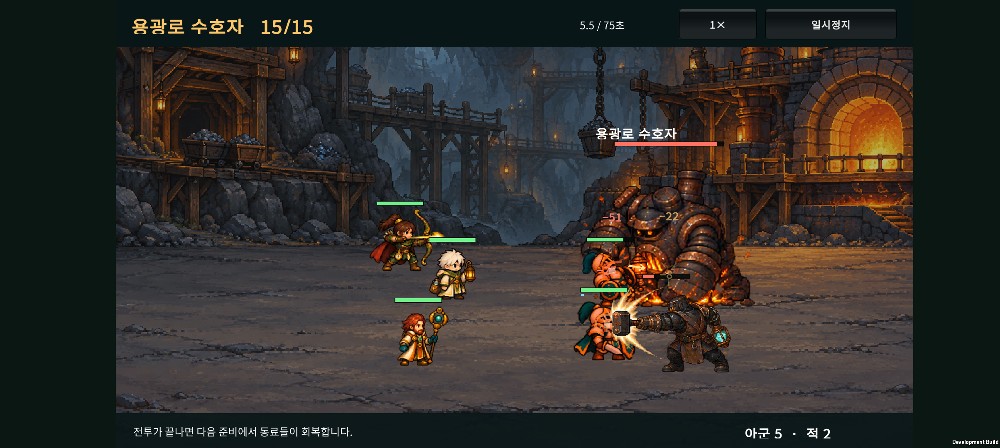
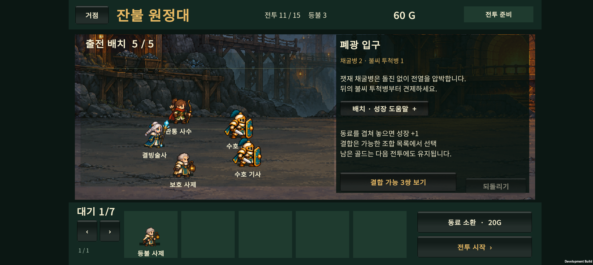
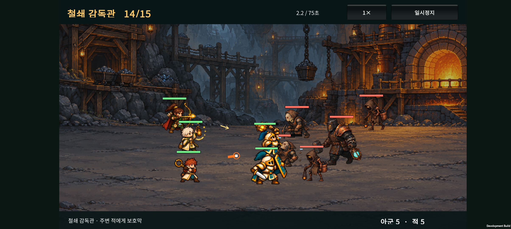
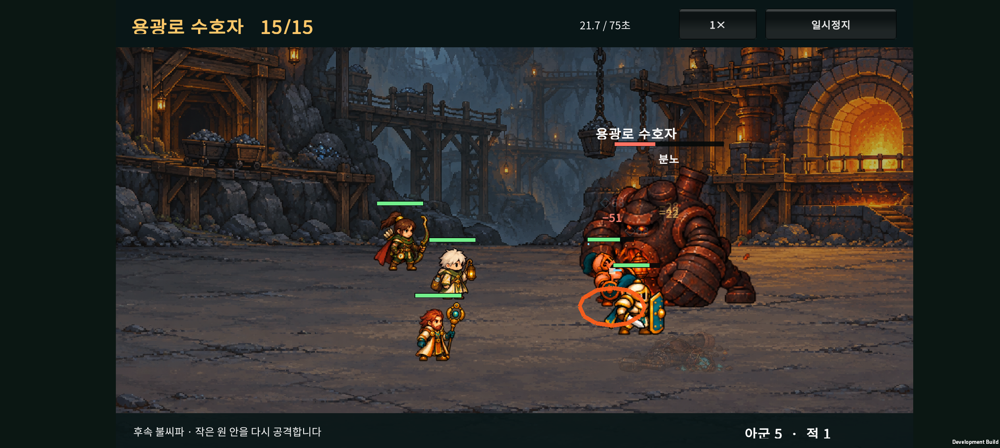
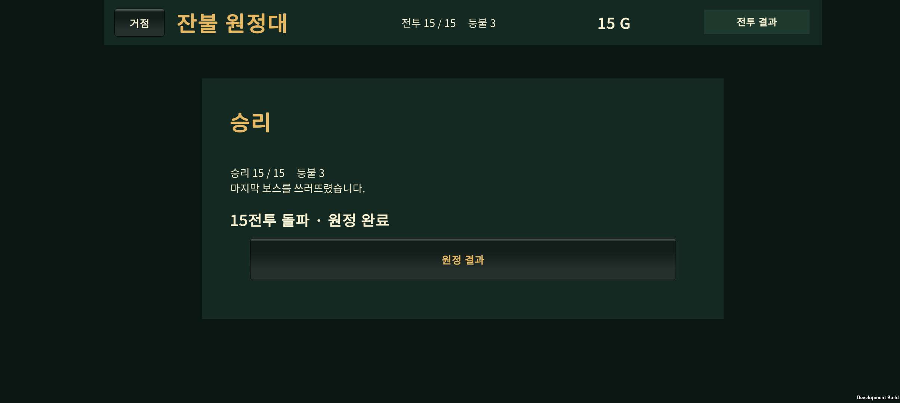

# v0.24 · 폐광·용광로, 15전투 원정

2026-10-24 · v0.23 성채 난도 조정 다음 작업

**원정을 10전투에서 15전투로 확장했다. 기존 부대를 이어서 폐광으로 들어가고, 보호막을 주는 감독관과 용광로 수호자를 상대한다.** 첫 마켓 출시 목표는 여전히 30전투다.

## 1. 이번에 플레이할 수 있는 내용

| 전투 | 장소·편성 | 승리 보상 | 역할 |
| --- | --- | ---: | --- |
| 10 | 기존 성문 골렘 | 50G | 다음 지역을 준비하는 보스 보상 추가 |
| 11 | 폐광 입구 · 채굴병 2, 투척병 1 | 30G | 보스 뒤의 휴식과 새 지역 소개 |
| 12 | 잿가루 통로 · 채굴병 2, 투척병 2 | 30G | 약해진 동료를 노리는 원거리 압박 |
| 13 | 광차 갈림길 · 채굴병 3, 투척병 2 | 35G | 전열을 잡는 적 수 증가 |
| 14 | 철쇄 감독관 · 감독관 1, 채굴병 2, 투척병 2 | 40G | 보호막을 주는 지원 적 등장 |
| 15 | 용광로 수호자 · 보스 1, 감독관 1, 투척병 2 | 완료 | 세 번째 보스, 현 시제품의 끝 |

골드는 동료 소환에 쓴다. 소환 비용은 20G다. 시작 인원·골드, 출전 5명·대기 7명, 성장·전승·진화·결합 규칙은 기존과 같다. 전투가 끝나면 다음 준비에서 동료가 회복되고, 패배하면 등불을 잃고 재도전하는 원정 규칙도 유지했다.

15전투는 현재 끝이므로 소환 골드를 따로 주지 않는다. 16전투를 확장할 때 이번 10전투처럼 완료 저장과 보상을 함께 연결해야 한다.

## 2. 폐광의 적

| 적 | 외형과 크기 | 전투 특징 |
| --- | --- | --- |
| 잿재 채굴병 | 흙 가면·가죽 후드·곡괭이, 표시 높이 90 | 돌진 없이 접근하는 근접 졸개 |
| 불씨 투척병 | 좁은 눈구멍·석탄통·투석구, 높이 100 | 사거리 안에서 남은 체력 비율이 낮은 동료 우선 공격 |
| 철쇄 감독관 | 철 가면·망치·청록색 보호 등불, 높이 145 | 주변 적에게 주기적 보호막 |
| 용광로 수호자 | 검은 철제 화로·굴뚝·거대한 양팔, 높이 244 | 범위 폭발과 분노 후 불씨파 |

높이는 화면 기준 배율이며 무기나 효과가 뻗어도 매 프레임 캐릭터를 축소하지 않는다. 적은 왼쪽을 바라본다. 보스와 겹친 아군·호위는 보스 앞에 표시하고, 일반 적 사이에는 몸 크기에 맞는 간격을 유지한다. 보스는 맞을 때 피격 포즈·밀림·히트스톱을 재생하지 않는다.

### 감독관 보호막

- 전투 시작 1.5초 뒤 처음 사용하고, 이후 7초마다 사용한다.
- 반경 2.4 안의 살아 있는 다른 아군 최대 2명을 보호한다. 보스를 먼저, 이후 남은 체력 비율이 낮은 대상부터 고른다.
- 보호량은 대상 최대 체력의 12%, 상한 180. 지속 4초다.
- 보호할 동료가 없으면 자신을 보호한다. 기존 보호막에 수치를 계속 더하지 않는다.
- 청록색 등불 시전 포즈, 보호막 수치·막대와 전투 안내로 표시한다.

### 용광로 보스

- HP 5,200 / 공격력 78 / 방어력 25. 큰 외형과 기본 공격 동작을 갖는다.
- **용광로 폭발:** 1초 예고 후 고정된 원 안을 공격한다. 반경 1.25, 피해 배율 1.55, 재사용 간격 8초.
- **체력 45%부터 분노:** 폭발 뒤 같은 중심에 더 작은 불씨파를 추가한다. 0.6초 예고, 반경 1.0, 피해 배율 1.0.
- 주황색 원과 화로를 여는 포즈로 예고하고, 충격 이벤트에 맞춰 공격 프레임을 재생한다.
- 자동 전투이므로 준비 단계에서 동료를 흩어 배치하는 것이 대응 방법이다.

## 3. 기존 저장 이어가기

저장 내부 버전을 v2에서 v3으로 올렸다. v2 데이터는 기존 10전투의 예산·단계·보상·편성 규칙으로 검증한 뒤 변환한다.

| 기존 v2 상태 | 업데이트 후 |
| --- | --- |
| 1~10전투 준비 또는 진행 중 | 같은 단계·편성·골드를 유지한다. 중단 전투는 기존 규칙대로 처음부터 다시 재생한다. |
| 10전투 승리 결과 화면 | 결과를 유지하고 새 보상 50G를 받는다. 다음 버튼으로 11전투 진입. |
| 10전투 원정 완료 | 11전투 준비로 이어지며 50G를 받는다. |
| 패배 결과 또는 원정 실패 | 추가 보상 없이 기존 상태 유지. |

부대·출전 배치·소환 난수 상태를 보존한다. v3로 저장한 뒤 다시 불러와도 50G를 중복 지급하지 않는다. 잘못된 예산이나 단계의 v2 저장을 정상 저장으로 고쳐 주는 방식은 사용하지 않는다.

실제 Buddy2의 기존 저장은 **10전투 완료 / 10G / 동료 6명**이었다. 업데이트 후 **11전투 준비 / 60G / 같은 동료와 배치**로 이어졌다. 앱을 종료·재실행해도 60G를 유지했다.

## 4. 난도 측정

SOL이 시드 1~40으로 조정하고, 상위 작업에서 별도 시드 **1001~1100**으로 확인했다. 별도 결과를 보고 수치를 재조정하지 않았다. 1~10전투의 기존 5개 정책 결과 50행은 v0.23과 모두 동일했다.

### 별도 100개 시드의 전투별 승리 수

| 고정 성장 정책 | 11전투 | 12전투 | 13전투 | 14전투 | 15전투 | 15전투 평균 시간 |
| --- | ---: | ---: | ---: | ---: | ---: | ---: |
| 시작 3명, 소환 없음 | 100 | 0 | 0 | 0 | 0 | 19.83초 |
| 기본형 5명, 성장 없음 | 100 | 100 | 80 | 6 | 0 | 24.04초 |
| 분기 진화 분산 | 100 | 100 | 100 | 100 | 100 | 45.05초 |
| 기사 최종 진화 우선 | 100 | 100 | 100 | 100 | 100 | 45.05초 |
| 기사·사제 H-02 결합 우선 | 100 | 100 | 100 | 100 | 94 | 37.41초 |

평균 시간에는 패배가 포함된다. 기본형의 짧은 시간은 빠른 승리가 아니다. 각 전투의 비교는 앞에서 졌더라도 이전 승리 보상을 받았다고 가정한다. **1전투부터 무패로 15전투까지 완료한 수는 분기 94, 최종 우선 100, H-02 우선 43회**다. 기본형·시작 3명은 0회다.

성장한 팀이 11~14전투를 빠르게 통과하는 보상은 남겼다. 성장 정책 두 가지가 후반에 같은 결과를 낼 만큼 편성 차이가 줄어드는 한계도 있다. H-02 정책은 10보스에서 44회만 통과했고 그중 43회가 15전투까지 완료했다. 그러므로 이번 표는 모든 결합의 균형이나 실제 사람의 승률을 입증하지 않는다. 다음 난도 조정에는 다양한 결합·배치와 수동 플레이가 필요하다.

[조정용 40개 시드](balance-training.json) · [별도 100개 시드](balance-holdout.json)

## 5. 검증 기록

- 순수 C# 원정 검사 1,753개, 카탈로그 전투 검사 3,011개 통과.
- 실제 v0.23 코어로 생성한 v2 저장과 기기의 원본 저장을 현재 코어로 읽어 이행·재로드·로스터 보존 확인.
- Unity: 아군 크기 460개, 폐광 적 283개, 성채 적 264개, 숲 적 258개, 표시 순서 12개, 드래그·JSON 17개와 전투 결과·보스 피격 회귀 검사 통과.
- 새 시트 4종 × 24프레임의 투명 구간·좌표·비어 있지 않은 프레임·동작 우선순위 검증.
- Unity 6000.3.24f1 Android 개발 APK 빌드 성공. Buddy2에 업데이트 설치.
- APK SHA-256: `5DA22E98EA88A120229278F5A9D7BB2A2AA957FEA8512141F8C760FD03893EDA`.
- 빌드 로그: `unity/Logs/v024-mine-expansion-build.log` (로컬 산출물).

### Buddy2 실행

11전투는 사용자의 기존 부대로 이어서 확인했다. 14·15전투는 실제 코어의 소환·성장 API를 사용하고 이전 전투를 모두 승리한 seed 1 H-02 정책 체크포인트로 확인했다. 폰에서 1~15전투를 처음부터 수동 완주한 검사는 아니다.

- v2의 10전투 완료 → 11전투 준비, 기존 부대·배치 유지와 50G 단회 지급.
- 재실행 후 60G 유지. 11전투 승리로 60→90G, 다음 12전투 준비 전환.
- 14전투 보호막 안내·막대·새 적 표시, 승리로 15→55G, 다음 15전투 준비 전환.
- 15전투 진행 중 앱 강제 종료 → 중단 안내 → 같은 편성으로 전투 재개. 골드·등불 유지.
- 용광로 폭발과 분노 후 불씨파의 예고, 보스 앞의 아군·호위 표시, 15보스 승리와 원정 완료 전환.
- 해당 실행의 `Unity`·`AndroidRuntime` 오류 로그 없음.
- 테스트 전 원본 PlayerPrefs를 복원하고 바이트 단위 일치를 확인했다. 다음 실행에서는 사용자의 원래 10전투 완료 부대로 11전투부터 이어갈 수 있다.

<video controls preload="metadata" style="width:100%;max-width:900px" src="device-evidence/wave14-motion.mp4"></video>

<video controls preload="metadata" style="width:100%;max-width:900px" src="device-evidence/resume-wave15-motion.mp4"></video>

### 제작과 확인 범위

신규 적 4장과 배경 1장은 imagegen으로 생성했다. 외부 게임의 스프라이트를 입력하지 않았고, 생성된 원본 PNG를 그대로 복사했다. 애니메이션은 이번 첫 제작본이며 추후 프레임별 형태 정돈과 스타일 통일 여지가 있다. [프롬프트와 제작 기록](ASSET-PROMPTS.md) · [파일·해시 기록](asset-records.json).

장시간 발열·배터리·최저 프레임·효과음 청취 품질은 이번 범위에 포함하지 않는다. 현재 APK는 스토어 제출용 출시 빌드가 아니다.

## 6. 다음 개발

1. 실제 플레이에서 10→15전투의 성장 선택과 난도 체감 확인. H-02 외 결합 편성 비교.
2. 16~20전투의 지역·적 역할을 설계하고, 15보스 완료 저장·보상을 연결해 확장.
3. 이후 21~30전투를 추가하고 전체 원정 길이·경제를 함께 조정.

원정 연구·광고·유료판·출시 설정은 이후 단계다. 지금 구현한 전투 수는 15이며 출시 목표 30과 구분한다.

### 주요 파일

- `unity/Assets/Scripts/Core/ExpeditionRun.cs`: 15전투 진행·편성·골드·v2→v3 이행.
- `unity/Assets/Scripts/Core/CatalogBattle.cs`: 감독관 보호막·용광로 폭발·불씨파.
- `unity/Assets/Scripts/Core/CatalogSpacing.cs`: 폐광 적 몸 크기 간격.
- `unity/Assets/Scripts/Presentation/MineEnemyArt.cs`: 새 시트 매핑과 동작 프레임.
- `unity/Assets/Scripts/Presentation/ExpeditionScreen.cs`: 지역 배경·준비 안내·15전투 결과.
- `unity/Assets/Editor/MineEnemyArtValidation.cs`: 원본에서 manifest 생성·검증·빌드 연결.

이전 개발 기록: [v0.23 성채 난도](../design-v0.23/HANDOFF.html).
