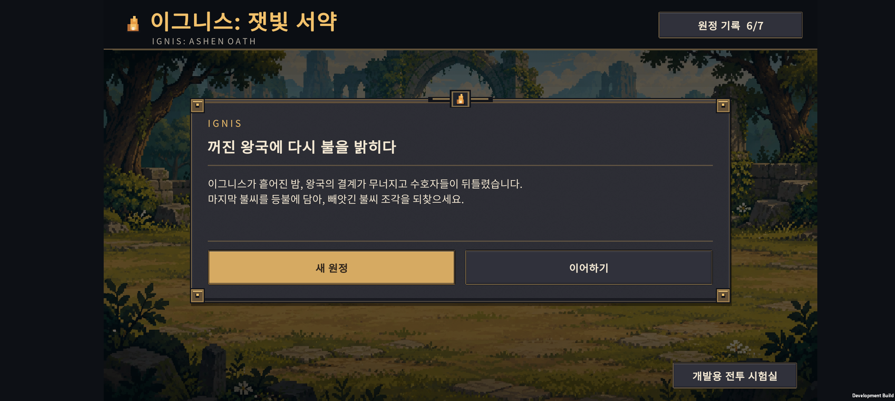
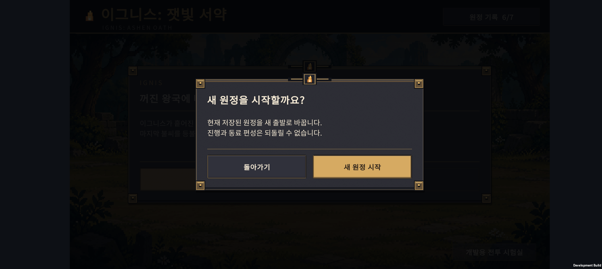
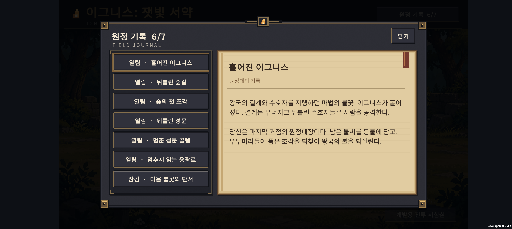
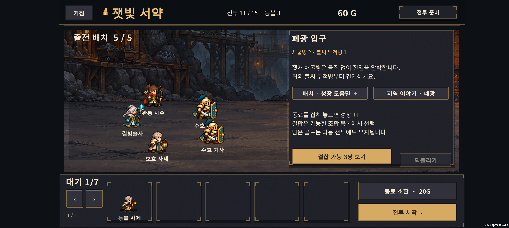

# v0.25 · 원정 이야기와 게임 UI

2026-10-24 · 15전투 확장 다음 작업

**기존 세계관을 게임에서 읽을 수 있는 원정 기록으로 연결하고, 초록색 설명 판과 기본 버튼을 숯색·황동·금색의 게임 UI로 바꿨다.** 현재 플레이 범위는 15전투다.

**게임 가칭: IGNIS: ASHEN OATH / 이그니스: 잿빛 서약.** 사용자가 제목 변경과 강렬하고 신비로운 분위기를 요청했고, 구체적인 제목은 작업용 제안으로 적용했다. 전투 화면에서는 잿빛 서약으로 줄여 쓴다. 이전 Ember Expedition 문서와 저장소 경로는 개발 이력이다.

이전 15전투 확장분은 `fe126bc`로 커밋했다. 이번 문서는 그 다음 개발분을 기록한다.

## 1. 우리 게임에는 어떤 이야기가 있나

왕국의 결계와 수호자에게 힘을 주던 마법의 불꽃 **Ignis / 이그니스**가 산산이 흩어졌다. 결계가 무너지고 수호자들은 뒤틀렸다. 불씨 조각을 품은 짐승은 거대해지고, 성문의 골렘은 돌아온 사람마저 공격한다.

플레이어는 마지막 거점의 원정대장이다. 남은 불씨를 등불에 담고 길을 나서 **각 지역의 보스가 품은 Ignis Shard / 불씨 조각을 되찾아 왕국의 불을 되살린다.** 숲의 짐승, 성채의 병사와 골렘, 끝없이 가동되는 폐광의 화로가 그 길을 막는다.

이전 [v0.8 세계관](../design-v0.8/ember-expedition-replan.md#10-세계관과-이야기)의 봉화망 설정을 수정했다. 사용자가 지적했듯 통신용 봉화가 꺼지는 사건만으로 마법 세계의 결계와 수호자 붕괴를 설명하기는 약했다. 현재 기준은 마법의 동력인 이그니스와 그 조각을 되찾는 이야기다. 홈·지역 이야기·보스 격파 기록에 반영했다.

### 로그라이트와 스토리

로그라이트라는 장르가 스토리 유무를 결정하지는 않는다. 하데스는 반복 도전과 진행되는 이야기를 함께 사용하는 예다. [개발사 공식 소개](https://www.supergiantgames.com/games/hades/)

우리 게임에는 빠른 영입·성장·배치·전투 사이에 짧은 이야기를 전달하는 방식이 맞는다. 당장은 긴 컷신이나 매 전투 강제 대화를 추가하지 않는다. 보스 결과 화면에서는 짧은 후일담을 읽고 기존 다음 버튼으로 진행하며, 자세한 기록은 원할 때 연다.

### 시스템의 세계관상 의미

| 행동 | 의미 |
| --- | --- |
| 무작위 동료 영입 | 길목에서 만난 생존자와 정찰대 합류 |
| 전승·성장 | 동료가 경험을 남기고 부대가 재편됨 |
| 진화 | 역할과 기술이 숙련되어 새로운 전투 방식 획득 |
| 특수 결합 | 두 계열의 기술을 함께 익힌 역할로 재편 |
| 전투 뒤 회복 | 등불 아래 부상자를 구조하고 재정비 |
| 전투 패배·등불 소모 | 부대를 구출하고 같은 구간을 다시 공략 |
| 등불 소진 | 더 나아가지 못하고 거점으로 철수 |
| 새 원정 | 새로운 부대를 꾸려 길을 다시 확보 |

이 표는 시스템을 설명하는 설정이다. 별도의 구조 애니메이션이나 동료 귀환 장면을 이번에 추가한 것은 아니다.

## 2. 기록 7개와 개방 조건

| 기록 | 열리는 시점 | 이야기 역할 |
| --- | --- | --- |
| 흩어진 이그니스 | 처음부터 | 결계 붕괴와 조각 회수라는 원정 목적 |
| 뒤틀린 숲길 | 원정 시작 | 조각의 영향으로 거대해진 짐승 |
| 숲의 첫 조각 | 5보스 승리 | 잿갈기에게서 첫 조각 회수 |
| 뒤틀린 성문 | 6전투 진입 | 사람을 오인하는 수호자들 |
| 멈춘 성문 골렘 | 10보스 승리 | 두 번째 조각 회수, 폐광으로 이동 |
| 멈추지 않는 용광로 | 11전투 진입 | 조각에 매여 끝없이 쇠를 녹이는 수호자 |
| 다음 불꽃의 단서 | 15보스 승리 | 세 번째 조각 회수와 다음 행선지의 단서 |

15전투 완료는 현재 공개된 구간의 완료다. 이그니스를 되살리는 전체 이야기의 결말과 구분한다. 출시 목표 30전투의 후반 지역·결말은 후속 설계 대상이다. 조각 회수는 이번에는 이야기로 전달하며 별도 조각 재화나 능력치 보너스는 추가하지 않았다.

### 게임에서 읽는 곳

- **홈:** 시작 목적 두 줄과 `원정 기록 N/7` 버튼.
- **준비 화면:** 기존 전투 조언 옆의 `지역 이야기` 버튼.
- **보스 결과:** 격파한 지역의 짧은 후일담 두 줄.
- **원정 기록 창:** 왼쪽 목록에서 고르고 오른쪽에서 읽는다. 잠긴 기록은 개방 조건만 보여준다.

기록은 원정 저장과 별도 키 `ember.expedition.story.v025`에 저장한다. 새 원정을 시작해도 이미 열린 기록은 남는다. 기존 원정 저장을 읽으면 도달한 지역·승리한 보스 기록을 소급해 연다. 패배를 보스 승리로 계산하지 않으며, 기록 개방으로 골드·부대·소환 난수는 바뀌지 않는다.

## 3. UI 변경

### 시각 기준

| 요소 | 적용 |
| --- | --- |
| 바탕 | 짙은 숯색 `#0D1015` |
| 패널 | 어두운 회색 `#21232B`, 미세한 표면 질감 |
| 프레임 | 황동 `#86704C`, 큰 창의 금속 모서리·불씨 장식·아래 그림자 |
| 주요 버튼 | 따뜻한 금색 `#D6AA62`, 어두운 글자로 대비 |
| 보조 버튼 | 회색 표면과 황동 테두리 |
| 본문 | 밝은 미색 `#F4E9D4` |
| 표식 | 작은 도트 불씨 문양과 중앙 장식 |
| 원정 기록 본문 | 양피지색 `#E1CCA1`, 짙은 갈색 글자, 붉은 책갈피 |

홈에는 기존 배경 원화를 활용했다. 홈·헤더·준비 설명·대기석·결과·재개 안내·동료 상세·성장·결합·새 원정 확인·기록 창에 같은 테마를 사용한다. 버튼은 기본 Unity 스킨 대신 일반·강조·눌림 상태를 가진 전용 9분할 배경을 쓴다.

유닛과 전투 배경 원본, 전투 계산은 변경하지 않았다. 새 UI 질감과 프레임은 코드에서 작게 생성해 재사용한다. 새 외부 아트나 폰트 파일은 추가하지 않았다.

### 화면

기록창의 금속 외곽선과 양피지 본문을 구분했고, 주요 행동은 금색 버튼으로 강조했다. 준비·확인창·잠긴 기록·보스 결과의 동작 검증 캡처는 같은 `device-evidence/` 폴더에 있으며 일부는 제목 변경 전 화면이다.

### 다이얼로그 여백 보정

사용자의 후속 피드백에 따라 본문과 버튼 영역을 분리했다. 아래 값은 물리 픽셀이 아닌 1280×720 UI 기준 좌표다.

| 항목 | 기존 | 보정 |
| --- | --- | --- |
| 홈 버튼 좌우 여백 | 75 | 32, 본문 시작선과 일치 |
| 홈 버튼 아래 여백 | 114 | 32 |
| 새 원정 확인 버튼 아래 여백 | 18 | 32 |
| 두 버튼 사이 | 홈 50 / 확인 36 | 16 |
| 기본 하단 버튼 높이 | 홈 76 / 확인 60 | 64 |
| 패널 높이 | 홈 425 / 새 원정 확인 385 | 홈 368 / 확인 300 |

하단 버튼은 창의 바닥에서 계산하므로 본문 좌표가 바뀌어도 여백이 유지된다. 홈에서 저장 오류나 이전 저장 안내가 있으면 패널 높이를 432로 늘리고, 메시지는 버튼 위에 별도로 둔다. 시작 안내와 성장 확인의 본문은 위쪽에 정렬한다.

결과·전투 재개·진화·결합 확인에도 같은 하단 기준을 적용했다. 긴 선택 목록은 전승 후보 10개, 결합 목록 4개씩 표시해 하단 페이지 버튼 자리를 확보했다. 목록의 전체 후보와 결합 규칙은 바꾸지 않았다. 상세·기록창의 닫기 버튼과 좌우 정렬도 정리했다.

구현 기준은 `ExpeditionUiTheme.WindowPadding`, `ActionGap`, `ActionHeight` 세 값과 공통 내용·하단 버튼 좌표 함수다. [보정 전 홈](device-evidence/home.png)과 [보정 후 홈](layout-evidence/home.png)을 비교할 수 있다.

### 한국어·영어 출시 기준

영어판도 출시할 계획이다. 한국어판에서 게임명과 짧은 표제에는 영어를 함께 쓸 수 있다. 조작 버튼과 긴 설명은 선택한 언어로 명확하게 읽히는 것을 우선한다.

| 한국어 | 영어 | 용도 |
| --- | --- | --- |
| 이그니스: 잿빛 서약 | IGNIS: ASHEN OATH | 새 작업용 가칭 |
| 이그니스 | Ignis | 왕국의 결계와 수호자를 지탱하던 마법의 불꽃 |
| 이그니스의 파편 | Ignis Shard | 흩어진 이그니스의 조각. 불씨·불꽃 조각도 같은 의미 |
| 원정 기록 | Field Journal | 지역·보스 이야기 기록 |
| 잿갈기 | Ashmane | 숲 보스 이름 초안 |

홈의 `IGNIS: ASHEN OATH`, `IGNIS`, 기록 창의 `FIELD JOURNAL` 표제를 반영했다. 7개 기록의 [영문 번역 데이터](localization-en.json)를 준비했다. **영문 JSON은 번역 초안이며 앱에서 아직 로드하지 않는다. 전체 UI 언어 전환도 미구현이다.**

영어판 구현 시에는 UI·직업·스킬·오류 문구를 문자열 키로 분리하고 언어 설정을 저장한다. 영어의 문장 길이에 맞춰 줄바꿈·동적 높이·스크롤을 확인한다. 현재 한국어 기준의 고정 높이 다이얼로그가 영어에도 맞는다고 가정하지 않는다. 세계관의 수집 조각과 실제 소환 재화 골드는 서로 다른 용어로 유지한다.

## 4. 검증

- 원정 기록의 개방·패배·기존 저장 소급·새 원정 유지·잘못된 기록 데이터·복사 분리 검사 23개 통과.
- Unity JsonUtility의 별도 기록 저장 왕복과 기존 v2 저장 관측 검사 통과.
- 기존 아군·적 표시, 결과 처리, 보스 피격, 드래그·JSON 검증을 같은 Android 빌드 과정에서 실행했다.

### Galaxy Buddy2 동작 확인

| 확인 항목 | 결과 |
| --- | --- |
| 기존 v2 10전투 완료 저장 | 기록 6/7 소급 개방, 15보스 기록은 잠김 |
| 새 원정 시작 | 1전투·40G로 시작, 기존 기록 6개 유지 |
| 잠긴 기록 | 이야기 본문 대신 개방 조건 표시 |
| 15보스 전투 | v0.24의 정상 진행에서 만든 15전투 준비 체크포인트로 실제 전투 승리 |
| 승리 직후 | 결과 화면에 두 줄 후일담, 기록 7/7 개방 |
| 앱 강제 종료·재실행 | 15전투 완료와 기록 7개 유지 |
| 실행 오류 | 해당 점검 구간의 Unity 오류·AndroidRuntime 오류 로그 없음 |
| 테스트 저장 복구 | 테스트 직전 원본 PlayerPrefs를 복구하고 바이트 일치 확인 |

위 동작 검증 APK의 SHA-256은 `95D150595D98563740FC280BDC24CC4C39DB7721FD1F7A497D156EEBE7368A0E`다. 이후 세계관 명칭·소개 문구·게임 가칭을 다듬는 작업은 UI 문구 수정이며, 검증 캡처에 이전 가칭이 남아 있을 수 있다. 이번 검사는 새 저장 기능과 화면 확인이며 장시간 성능 측정이나 1~15전투 전체 재밸런싱은 아니다.

이그니스 가칭 변경 시점 APK: **Unity 빌드 종료 코드 0, Buddy2 설치 성공**. SHA-256: `2F94ECAA3CD9E2A8440255548BFE621B58E43788776FF736230B9FFC1D9DDD40`. 이 설치본에서 홈·한영 표제·기록 본문·11전투 준비 화면을 확인했다. 문구 수정 뒤 순수 C# 23개 검사와 전체 기존 빌드 검증도 통과했다. 전체 영어 화면은 아직 구현·검증하지 않았다.

### 후속 패딩 보정 검증

- 현재 설치본 SHA-256: `757E3FE102E14E4DF58576AD9A7AC189B8669CB4C3691DE134BD620D9F03393A`.
- Unity Android 빌드 종료 코드 0, 기존 빌드 검증 통과, Buddy2 설치 성공.
- 실기기에서 홈·새 원정 확인·동료 상세·전승 확인·분기 진화 확인의 여백과 글자 표시를 확인했다. 새 원정 취소와 이어하기 조작도 확인했다.
- 정상 Core 명령으로 12명 부대와 성장 2 동료의 UI 확인용 저장을 만들고 Restore 검증을 거쳐 사용했다. 전승 후보 11개가 10개+1개의 두 페이지로 모두 표시되며, 마지막 페이지와 하단 버튼이 겹치지 않는다.
- 점검 구간의 Unity·AndroidRuntime 오류 로그 없음. 이번 점검 시작 시 새로 백업한 사용자의 1전투 저장을 복구하고 바이트 일치를 확인했다.
- 후속 캡처: [홈](layout-evidence/home.png), [새 원정 확인](layout-evidence/new-run-dialog.png), [전승 1페이지](layout-evidence/transfer-page1.png), [전승 2페이지](layout-evidence/transfer-page2.png), [전승 확인](layout-evidence/transfer-confirm.png), [진화 확인](layout-evidence/evolution-confirm.png).

### 확인 범위

이 변경은 원정 목적과 지역 이야기를 전달하는 첫 구현이다. NPC 대화, 음성, 컷신, 선택에 따른 이야기 분기, 16~30전투는 포함하지 않는다. 전투 수치가 바뀌지 않아 기존 v0.24 밸런스 결과를 유지한다.

## 5. 다음 순서

1. H-02 외 결합과 배치를 비교하며 후반 성장 속도를 점검.
2. 16~20전투를 확장하며 다음 조각이 있는 지역·적·보스를 연결.
3. 한국어·영어 문자열 리소스와 언어 설정을 연결하고 양쪽 화면을 확인.
4. 21~30전투와 이그니스의 결말, 전체 원정 길이를 함께 설계.

### 주요 파일

- `unity/Assets/Scripts/Core/ExpeditionStory.cs`: 이야기 본문과 별도 기록 저장.
- `unity/Assets/Scripts/Presentation/ExpeditionUiTheme.cs`: 색·패널·버튼·불씨 문양.
- `unity/Assets/Scripts/Presentation/ExpeditionScreen.cs`: 홈·준비·결과·다이얼로그 연결.
- `unity/Assets/Editor/ExpeditionStoryValidation.cs`: Unity 저장 검사와 빌드 진입점.
- `tests/ExpeditionStory/`: 순수 C# 기록 검사.

Android 검증 빌드 진입점: `-executeMethod Expedition.EditorTools.ExpeditionStoryValidation.BuildAndroid`.

이전 기록: [v0.24 폐광·용광로와 15전투](../design-v0.24/HANDOFF.html).
