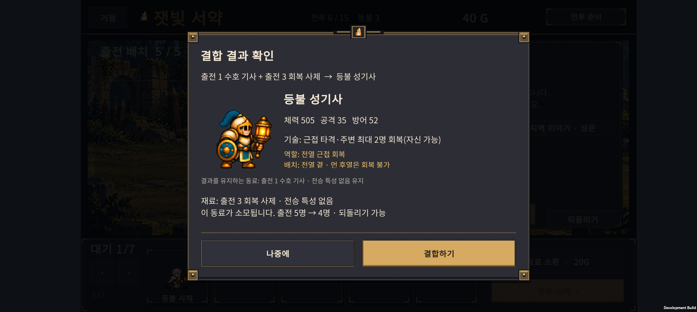
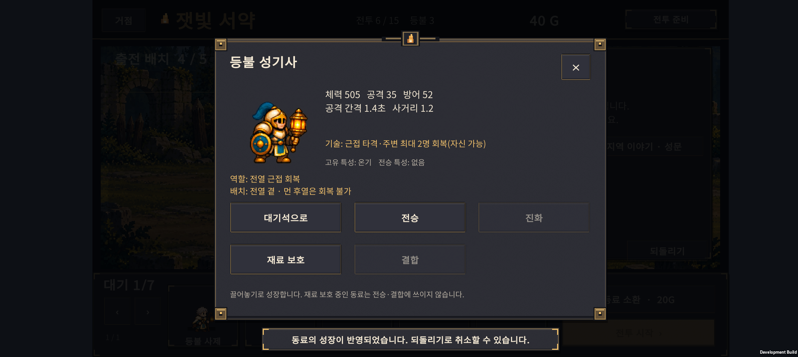

# v0.26 · 결합별 비교와 배치 안내

2026-10-24 · IGNIS: ASHEN OATH

**6종 결합을 실제 소환·성장 경로로 비교하는 도구를 추가하고, 결합 결과창과 동료 상세창에 기술·역할·배치 요령을 표시했다.** 현재 원정은 15전투다. 이번에는 전투 능력치·성장 비용·소환 확률을 변경하지 않았다.

사용자가 제안한 Easy와 완주 해금 구조는 [다른 게임 비교·추천안](difficulty-progression-review.md)에 별도로 정리했다. 난도 선택과 영구 해금은 아직 미구현이다.

## 1. 플레이 화면의 변경

| 결합 | 역할 | 안내하는 배치 요령 |
| --- | --- | --- |
| H-01 잿불 검위 | 전열 범위 공격 | 적이 모이는 앞줄 |
| H-02 등불 성기사 | 전열 근접 회복 | 전열 곁, 먼 후열은 회복 범위 밖 |
| H-03 빙결 추적자 | 후열 관통·둔화 | 적의 진로가 겹치는 뒤쪽 |
| H-04 융해술사 | 후열 범위 견제 | 뭉친 적을 겨냥하는 뒤쪽 |
| H-05 성가 기수 | 전열 근처 회복·지원 | 앞줄 곁, 동료와 너무 멀지 않게 |
| H-06 원정 유격대장 | 후열 사격 지원 | 뒷줄, 동료와 너무 멀지 않게 |

H-02는 근접 타격 뒤 가까운 아군 최대 2명을 회복하며 자신도 후보에 포함된다. 결합으로 사제 재료가 사라지므로 멀리 떨어진 후열의 회복까지 자동으로 보장하지 않는다. 안내 데이터는 한 곳에서 정의해 상세창과 확인창에 함께 쓴다.

기존의 남는 동료·소모되는 동료·전승 특성·출전 인원 변화는 계속 표시한다. 새로운 창이나 확인 단계를 추가하지 않았다. 확인창은 32px 안쪽 여백, 16px 버튼 간격, 64px 버튼 높이를 유지한다.

## 2. 측정 방법

- SOL이 비교 코드를 구현하고 시드 **1~40**을 측정했다. 상위 ASTRA 작업에서 코드를 검토하고 별도 시드 **1001~1100**을 실행했다. 별도 결과를 보고 생산 수치를 조정하지 않았다.
- 기사 최종 진화 우선 1종과 각 결합 목표 6종, 총 7개 고정 성장 정책을 비교한다. 각각 분산·밀집의 두 배치로 실행한다.
- 같은 시드의 실제 `Summon`, `Transfer`, `Evolve`, `Combine` 명령과 현재 승리 보상만 사용한다. 대상 직업의 첫 후보를 보존하고 분기 진화 2명을 만든 뒤 결합한다.
- H-02·H-05 정책은 유일한 사제를 소모한 효과와 결합체 자체의 성능을 혼동하지 않도록 예비 사제를 확보한 뒤 결합한다. 이것은 **검증 정책의 선택**이며 게임의 결합 조건을 바꾼 것이 아니다.
- 결합 후 비는 출전 자리를 채운다. 나머지 성장은 사제·기사 등을 우선한다. 정책의 자세한 우선순위는 [측정 도구 설명](../../tests/ExpeditionRun/README-hybrid-balance.md)에 있다.
- 이전 전투에서 패배했어도 후반 전투를 비교하기 위해 승리 보상을 받았다고 가정하며 진행한다. **전투별 승리, 무패 누적 통과, 결합 획득을 구분해서 해석해야 한다.** 획득률도 이 가상 후속 진행을 포함하며, 실제 무패 진행 중 획득률이 아니다.
- 모든 정책은 15전투 준비까지 소환 **23회·460G**를 썼다. 서로 다른 편성과 성장 시점을 비교하므로 결합체 하나의 순수 성능이나 사람의 승률을 뜻하지 않는다.
- 매 준비 단계의 Capture→Restore, 위치 범위·중복 좌표, 정상 명령 성공 여부를 확인한다. 각 정책·배치의 첫 시드는 재실행해 동일 결과를 확인한다. 승리 시간과 패배 시간도 분리한다.

## 3. 별도 100개 시드의 결과

아래 ‘10전투 승리’는 이전 승리 보상을 가정한 개별 전투 결과다. ‘15전투 무패 완주’는 1~15전투를 모두 연속으로 이긴 수다. 표의 결합 이름은 **그 결합을 목표로 하는 정책**을 뜻하며, 모든 시드에서 그 결합을 실제로 획득한 것은 아니다.

| 목표 정책 | 10전투 승리: 분산 / 밀집 | 15전투 무패 완주: 분산 / 밀집 | 15전투까지 결합 획득 | 획득 시 평균 전투 |
| --- | ---: | ---: | ---: | ---: |
| 기사 최종 우선 | 100 / 100 | 100 / 100 | 해당 없음 | 해당 없음 |
| H-01 잿불 검위 | 90 / 100 | 89 / 100 | 96 / 100 | 7.10 |
| H-02 등불 성기사 | 93 / 94 | 90 / 94 | 97 / 100 | 6.68 |
| H-03 빙결 추적자 | 48 / 73 | 44 / 62 | 100 / 100 | 6.83 |
| H-04 융해술사 | 49 / 52 | 40 / 35 | 96 / 100 | 7.94 |
| H-05 성가 기수 | 89 / 89 | 71 / 68 | 96 / 100 | 7.72 |
| H-06 원정 유격대장 | 41 / 48 | 37 / 40 | 99 / 100 | 7.02 |

각 수치의 분모는 100이다. 획득 시점은 분산·밀집이 같았고, 미획득 시드를 평균 획득 시점에서 제외했다. 15전투 개별 승리는 대부분 97~100회로 높았지만 위 무패 완주 수와 다르다. 후반에 가상 보상을 받은 강한 편성만 보고 원정 전체가 쉽다고 결론 내리면 안 된다.

### 해석과 다음 조정 지점

1. **H-02의 낮은 기존 결과는 편성 정책의 영향도 크다.** 기존 v0.24 정책은 사제를 결합한 뒤 대체 회복 역할을 보장하지 않았다. 이번 정책은 성장 우선순위·배치도 함께 달라졌으므로 개선을 ‘예비 사제 하나의 효과’로 단정할 수는 없다. H-02를 일괄 상향할 근거로 기존 수치만 쓰지 않는다.
2. **원거리 결합을 서두르는 경로에서 10보스 전후 병목이 남는다.** H-03·H-04·H-06은 재료 확보·성장에 투자하면서 전열 성장 시점이 늦어진다. 코드의 우선순위와 표본 경로를 바탕으로 한 원인 가설이며, 결합체 자체가 약하다는 증명은 아니다.
3. **밀집이 항상 정답은 아니다.** H-01·H-03 등에는 도움이 됐지만 H-04·H-05의 전체 무패 결과는 더 낮았다. 근처 지원 이점과 범위 공격 위험을 함께 봐야 한다. 이번 두 고정 진형이 최적 배치라는 뜻도 아니다.
4. 다음 측정에서는 **먼저 전열을 분기 진화시키고 결합하는 정책**을 같은 시드로 비교한다. 정책을 개선해도 남는 격차를 확인한 뒤 개별 스킬·수치 조정 여부를 정한다.

[구현·탐색 시드 40개](hybrid-training-before.json) · [별도 검증 시드 100개](hybrid-holdout.json)

## 4. 구현과 기기 검증

- `tests/ExpeditionRun/HybridBalanceProbe.cs`: 6종 결합의 획득 시점, 고정 성장 정책, 두 배치, 전투 결과·실제 회복·피해 기여 기록.
- `tests/ExpeditionRun/run-hybrid-balance.ps1`: 시드 범위와 출력 경로를 지정하는 실행기.
- `unity/Assets/Scripts/Presentation/ExpeditionScreen.cs`: 기술·역할·배치 안내의 공통 데이터와 화면 연결.
- Core+Presentation 정적 컴파일 통과. Unity Android 빌드 종료 코드 0.
- 기존 Unity 검증: 기록 저장·소급 관찰, 아군 크기 460개, 폐광 283개, 성채 264개, 숲 258개, 표시 순서 12개, 드래그·JSON 17개 및 전투 결과·보스 피격 검증 통과.
- Buddy2 설치 성공. 정상 원정 명령과 실제 1~5전투 승리로 생성한 6전투 체크포인트를 사용했다. H-02 결합 목록→확인→실행→상세→되돌리기 동작을 확인했다. 기술·역할 두 줄·재료 정보·하단 버튼에 잘림이나 겹침이 없었다.
- 검사 시 Unity·AndroidRuntime 오류 로그 출력 없음. 테스트 전에 새로 백업한 사용자의 **1전투·40G·기본 3명** 저장을 복구하고 바이트 일치를 확인했다.
- APK SHA-256: `11BED2840F352AB1742EEF0CB6129F651B86D83DE62AA8FDD0FB758B6F2B5517`.

전투 수치는 기존 v0.24와 같고, 30전투 전체·사람의 난도 체감·장시간 성능을 검증한 결과는 아니다. 여섯 안내의 문구는 코드와 대조했고 실기기 화면 검사는 가장 긴 H-02 문구를 대표로 사용했다.

## 5. 이어서 할 일

1. 전열 우선 성장과 결합 우선 성장을 비교해 5·10보스 병목을 분리한다.
2. [Easy·Normal·Veteran 추천안](difficulty-progression-review.md)에 따라 난도 설정과 별도 완주 기록을 설계·구현한다. 현재 15전투 완료와 출시 30전투 완주를 구분한다.
3. 16~20전투의 지역·적·보스·이그니스 이야기 조각을 확장한다.
4. 한영 문자열 리소스·언어 전환, 21~30전투와 원정 결말을 연결한다.

이전 UI·스토리·여백 변경은 `d3c5185`에 커밋했다. 이전 기록: [v0.25 이야기와 UI](../design-v0.25/HANDOFF.html).
