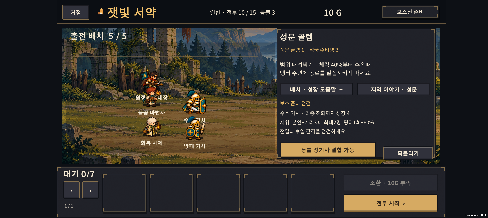
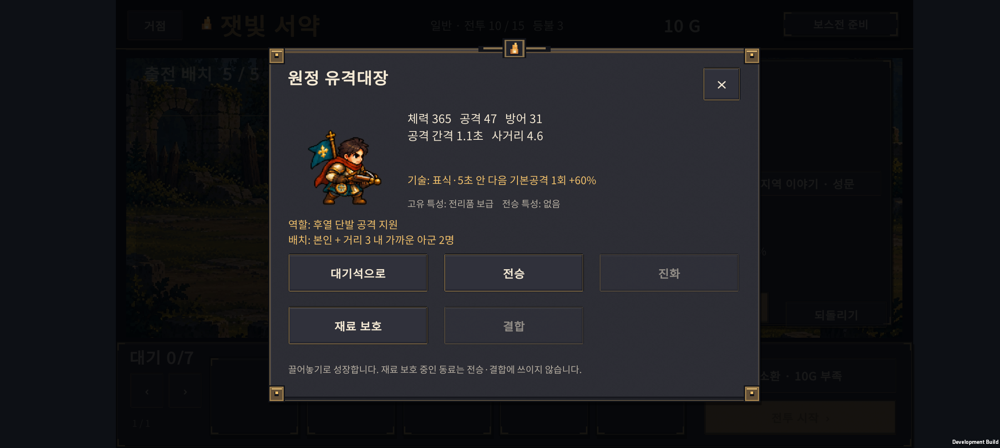

# v0.28 · 일반전 압박과 보스 준비 안내

2026-10-24 · IGNIS: ASHEN OATH

**일반전에서 성장 없이도 지나가던 구간의 적 체력·공격력을 조정하고, 보스 준비 화면에 현재 편성에 맞는 안내를 추가했다.** 현재는 Normal 15전투이며 Hard는 준비 중이다. 이전 v0.27은 `c4508de`로 커밋했다.

## 1. 일반전이 쉬웠던 부분

기본 3명 유지, 기본 5명으로 인원만 확장, 분기 성장, 기사 최종 우선, H-02 결합의 다섯 고정 정책으로 1~15전투를 비교했다. 성장한 편성은 기존 성채·폐광 일반전에서 매우 높은 체력으로 승리했고, 기본 3명조차 4전투까지 통과했다. 따라서 초반부터 성장과 소환이 필요해지는 구간을 더 분명히 했다.

| 구간 | 반영 |
| --- | --- |
| 1~2 | 조작·소환 학습 구간으로 유지 |
| 3~4 | 졸개·정예의 체력과 공격력 상승. 인원 확장·첫 진화의 가치 강화 |
| 6~8 | 성채 보병·석궁병의 교전 압박 강화 |
| 9 | 이미 성장하지 않은 편성을 막는 정예전이라 유지 |
| 11~14 | 폐광 졸개·투척병·감독관 강화. 체력만 늘리지 않고 공격력도 함께 조정 |
| 5·10·15 | 보스와 호위의 기존 수치 유지 |

적 수·배치·공격 역할, 소환 비용·확률, 승리 보상, 아군 능력치·기술은 그대로다.

### 변경한 적 수치

아래 숫자는 **체력 / 공격력**, 화살표는 기존→현재다. 방어력·공격 주기·이동 속도는 바꾸지 않았다.

| 전투 | 근접 졸개 | 원거리 졸개 | 정예 |
| --- | --- | --- | --- |
| 3 | 150/17 → 175/20 | 125/19 → 150/23 | — |
| 4 | 145/22 → 165/26 | 100/25 → 120/28 | 340/38 → 400/42 |
| 6 | 240/20 → 320/27 | 150/16 → 190/22 | — |
| 7 | 260/25 → 320/33 | 160/24 → 200/30 | — |
| 8 | 260/28 → 300/34 | 180/25 → 215/31 | — |
| 11 | 300/26 → 420/36 | 200/22 → 270/30 | — |
| 12 | 360/30 → 480/40 | 230/25 → 300/34 | — |
| 13 | 400/33 → 520/44 | 260/28 → 330/38 | — |
| 14 | 420/35 → 500/44 | 270/31 → 330/38 | 850/45 → 950/50 |

### 같은 시드 1~40의 전후 비교

| 편성 | 전투 | 승리 수: 전 → 후 | 종료 시 아군 체력 비율: 전 → 후 |
| --- | ---: | ---: | ---: |
| 기본 3명 유지 | 3 | 모두 승리 → 모두 승리 | 81% → 64% |
| 기본 3명 유지 | 4 | 모두 승리 → 모두 패배 | 5% → 0% |
| 기본 5명 유지 | 4 | 40 → 40 | 76% → 66% |
| 기본 5명 유지 | 8 | 40 → 25 | 48% → 22% |
| 기본 5명 유지 | 12 | 40 → 25 | 60% → 18% |
| 기본 5명 유지 | 13 | 25 → 0 | 22% → 0% |
| 분기 성장 | 8 | 40 → 40 | 96% → 87% |
| H-02 결합 정책 | 13 | 40 → 40 | 95% → 89% |
| H-02 결합 정책 | 14 | 40 → 40 | 93% → 87% |

기본 3명 정책은 소환을 하지 않아 시드가 바뀌어도 동일한 전투다. 이 행을 40개의 서로 다른 편성으로 해석하면 안 된다. 기본 5명 정책은 같은 시드의 실제 무작위 소환 결과를 사용한다.

별도 시드 **4001~4040**에서는 기본 3명이 4전투에서 모두 패배했고, 기본 5명은 8전투 30/40, 13전투 0/40이었다. 분기·기사 최종·H-02 성장 정책은 모든 일반전에서 40/40 승리했다. 이 성장 편성들의 3~4·6~9·11~14전투는 평균 약 **8.4~17.4초**였다.

**한계:** 성장한 편성에는 여전히 여유가 있다. 특히 최종 사제가 있는 폐광 편성은 전투 종료 전에 회복해 95~100% 체력으로 끝나는 경우가 많다. 종료 체력만으로 전투 중 압박을 판단하거나 ‘난도 완성’이라고 결론 내리지 않는다. 이번은 성장하지 않아도 통과하던 구간과 성장한 부대의 차이를 만드는 첫 조정이다. 더 긴 전투나 체력만 큰 적으로 난도를 맞추지는 않았다.

측정은 고정 자동 정책이며 사람의 승률이 아니다. 패배 후에도 가상 승리 보상을 주어 후반 전투를 비교한다. `wins`는 해당 전투의 승리, `reachWins`는 처음부터 무패로 도달한 수다. 표의 종료 체력은 패배의 0도 포함한다. JSON의 `meanSeconds`는 승패 전체 평균이므로 패배가 늘며 짧아지는 값을 속도 개선으로 해석하지 않는다.

[전 수치·1~40](regular-before.json) · [반영 수치·1~40](regular-candidate.json) · [반영 수치·별도 4001~4040](regular-holdout.json)

## 2. 보스 준비 화면

오른쪽 패널의 반복 조작 설명을, 보스전에서는 **현재 편성을 읽는 세 줄 안내**로 바꿨다. 기존 패턴 설명과 도움말 버튼은 유지한다.

- 출전 자리가 비고 대기 동료가 있으면 실제 인원을 알려준다.
- 출전 동료가 성장 조건을 충족했으면 분기·최종 진화 가능을 알려준다.
- 10전투 이후 기사가 아직 성장 중이면 다음 진화에 필요한 성장을 표시한다.
- 출전한 유격대장의 지휘 대상과 기본공격 강화도 안내한다.
- 성장·출전 변경·되돌리기 뒤 바로 갱신한다. 새로운 확인창이나 전투 시작 제한은 없다.

대기석의 동료를 출전자로 계산하거나 결합형에게 없는 최종 진화를 요구하지 않는다. 권장 편성을 강제하는 점수표도 아니다.

## 3. 빙결 추적자·유격대장 점검

기술이 발동하지 않는 결함은 확인되지 않았다. 빙결 추적자의 둔화는 **이동 감속**이며 골렘의 공격 주기를 늦추지 않는다. 유격대장 지휘는 지속 오라나 화살 추가 발사가 아니라 **본인과 거리 3 안의 가까운 아군 최대 2명이 5초 이내 사용하는 다음 기본공격 1회를 60% 강화**하는 효과다. 실제로 전열이 전진하면 후열 동료가 지휘를 받는 경우가 많았다. 게임 설명을 이에 맞췄다.

같은 소환 예산에서 다음 두 성장 순서를 비교했다.

- `FrontFirst`: 시작 기사 분기 → 결합 재료 → 기존 사제 우선 성장.
- `Balanced`: 시작 기사 분기 → 결합 재료 → 출전 기본 사제를 분기 → 시작 기사 최종 → 나머지 기존 성장. 실험 정책 이름이며 모든 조합의 정답이라는 뜻은 아니다.

### 별도 시드 3001~3040, 10보스 승리 수

각 칸은 **분산 / 밀집**, 분모는 각각 40이다. 먼저 v0.27 일반전 수치에서 성장 순서만 비교했다.

| 목표 정책 | FrontFirst | Balanced |
| --- | ---: | ---: |
| 기사 최종 우선 대조군 | 40 / 40 | 40 / 40 |
| H-01 잿불 검위 | 37 / 40 | 25 / 27 |
| H-02 등불 성기사 | 36 / 36 | 36 / 36 |
| H-03 빙결 추적자 | 28 / 30 | 34 / 32 |
| H-04 융해술사 | 39 / 39 | 40 / 40 |
| H-05 성가 기수 | 39 / 39 | 38 / 38 |
| H-06 원정 유격대장 | 13 / 18 | 21 / 29 |

H-03·H-06은 성장 배분 변경으로 나아졌지만 H-01은 나빠졌다. **모든 조합에 같은 성장 순서를 강요하지 않는다.** 아군 스킬·능력치를 일괄 상향하지 않고, 실제 선택에 필요한 설명을 먼저 보완했다. H-06의 경로 차이와 낮은 통과 수는 후속 공략·밸런스 과제로 남는다.

일반전 변경 후에도 같은 Balanced 시드의 10보스 승리와 15전투 무패 결과는 이전과 같았다. 즉 이번 표본에서는 강화한 일반전이 추가 병목을 만들지 않았다. 이는 임의 편성 모두가 안전하다는 보장은 아니다. 모든 정책은 15전투 준비까지 소환 23회·460G를 사용했다. 결합 획득·개별 전투 결과는 패배 후 가상 진행을 포함한다.

[탐색 1~40 Balanced](balance-normal-balanced.json) · [별도 FrontFirst](holdout-frontfirst.json) · [별도 Balanced](holdout-balanced.json) · [일반전 변경 후 같은 Balanced](holdout-balanced-adjusted.json) · [도구 설명](../../tests/ExpeditionRun/README-hybrid-balance.md)

## 4. 검증과 다음 순서

- SOL이 보스 안내·UI·일반전 후보값을 구현하고 ASTRA 작업에서 코드·고정 정책 비교·후속 검증을 진행했다.
- 보스 안내의 원정 비변경, 대기/출전 구분, 진화 조건, 성장·되돌리기·저장 복원 검사 **62개** 통과.
- 기존 원정 검사 **1,753개** 통과. 보스전·소환·보상 규칙을 바꾸지 않았다.
- Unity의 Normal 저장·v3 마이그레이션 26개, 이야기 기록, 아군 크기 460개, 폐광 283개, 성채 264개, 숲 258개, 표시 순서 12개, 드래그·JSON 17개 및 결과·보스 피격 검사 통과.
- Unity Android 빌드 종료 코드 0. Buddy2 업데이트 설치 성공. 실제 1~9전투 승리와 정상 성장 명령으로 생성한 H-06 체크포인트에서 보스 준비 안내·상세 설명을 확인했다. 줄 잘림이나 버튼 겹침이 없었다.
- H-06을 대기석으로 이동하면 출전 부족 안내가 나타나고 지휘 안내가 사라졌다. 되돌리기로 출전과 원래 안내가 복구됐다.
- Buddy2에서 성장한 편성으로 4전투를 직접 실행해 승리와 30G 보상 반영을 확인했다. [4전투 결과 화면](device-evidence/wave4-result.png).
- 이번 실행에서 수집한 Android 로그에는 Exception·Fatal·Unity/AndroidRuntime 오류가 없었다.
- 테스트 직전에 새로 백업한 사용자 저장을 복원했고, PlayerPrefs 파일 전체가 백업과 바이트 단위로 일치함을 확인했다. 원래 1전투·40G·기본 동료 3명의 진행 상태를 보존했다.
- APK SHA-256: `8ABA1696FA58321D2E6B8EEDFE565C33FEB16F8B3FC549731F4CEFAC961CE2C1`.

다음 콘텐츠 개발은 **Normal 16~20전투의 새 지역·적·보스·이야기**다. 기존 15전투 저장을 새 구간으로 연결하는 보상·성과 마이그레이션도 함께 다룬다. 최종 사제 이후의 일반전 여유, 결합별 성장 경로 차이는 30전투 전체 흐름과 함께 계속 점검한다.
