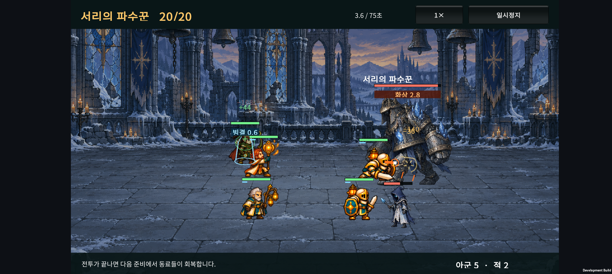
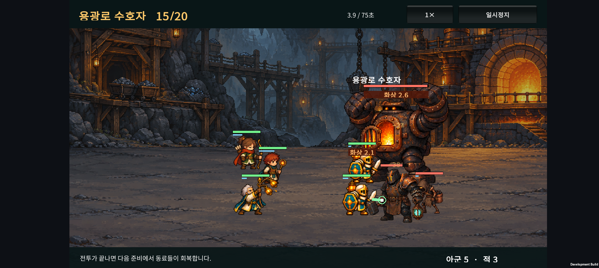
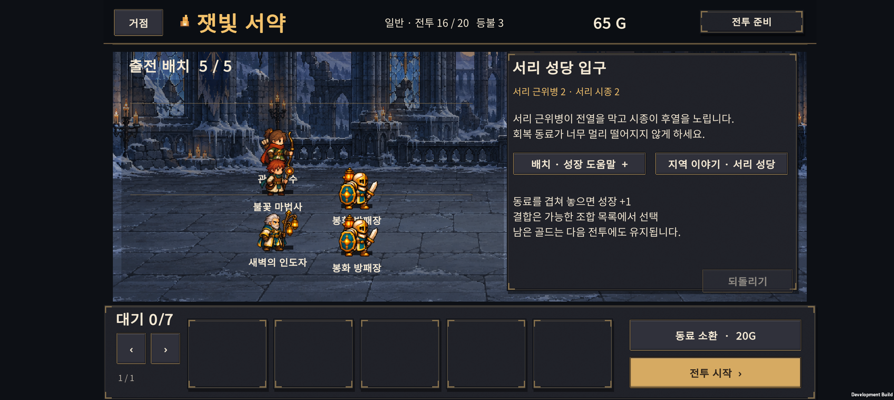
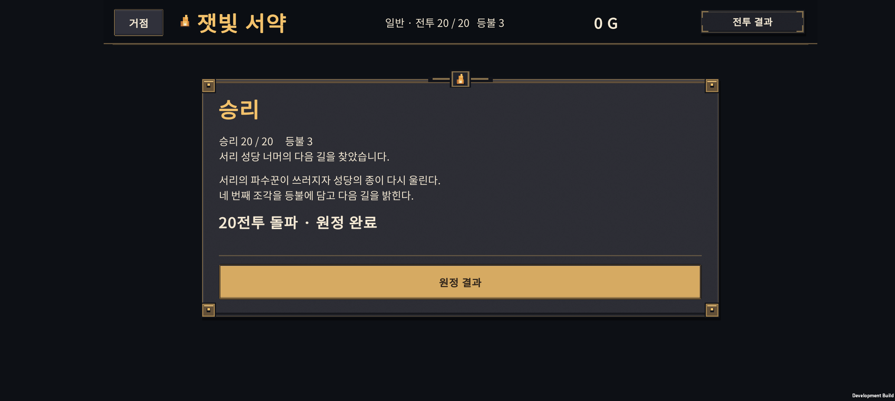

# v0.29 · 서리 성당, 빙결과 화상

2026-10-24 · IGNIS: ASHEN OATH

**Normal 원정을 20전투로 확장했다.** 네 번째 지역은 서리 성당이며, 원거리 동료를 노리는 보스와 빙결 상태를 추가했다. 요청에 따라 기존 용광로 본폭발에도 화상을 연결했다. 이전 v0.28은 `900f63f`로 커밋했다.

## 1. 플레이 범위

| 전투 | 장소·편성 | 승리 보상 |
| --- | --- | ---: |
| 15 | 기존 용광로 수호자 | 50G로 변경 |
| 16 | 서리 성당 입구 · 근위병 2, 시종 2 | 35G |
| 17 | 얼어붙은 회랑 · 근위병 3, 시종 2 | 35G |
| 18 | 서리 제단 · 근위병 3, 시종 3 | 40G |
| 19 | 찬송의 감시자 · 정예 1, 근위병 2, 시종 2 | 45G |
| 20 | 서리의 파수꾼 · 보스 1, 시종 2 | 원정 완료 |

서리 근위병은 접근하는 근접 적, 시종은 약해진 동료를 노리는 원거리 적이다. 찬송 감시자는 주변 적을 보호막으로 보호한다. 기존 채굴병·투척병·감독관의 행동 기반을 활용했으며, 세 역할 모두 완전히 새로운 AI라는 뜻은 아니다.

새로운 모습은 네 종 모두 개별 시트로 제작했다. 적은 왼쪽을 바라보고, 보스의 고정 표시 높이는 244로 일반 적보다 크다. 보스 피격 포즈·밀림은 억제하며, 겹친 아군과 호위는 보스 앞에 표시한다.

첫 마켓 목표는 여전히 30전투다. 현재 Normal 20전투만 플레이할 수 있고 Hard는 준비 중 버튼이다. 소환 비용 20G, 시작 3명·40G, 출전 5명·대기 7명, 전투 뒤 회복·패배 시 등불 차감 규칙은 유지했다.

## 2. 지역별 상태 효과

### 서리 보스 · 빙결

- 가장 먼 살아 있는 동료의 위치를 고정하고, 반경 1.1의 원을 미리 표시한다.
- 일반 상태는 1.1초 예고 후 공격력의 1.5배로 공격한다. 이후 재사용 간격은 8초다.
- 체력 40% 이하에서 다음 예고가 0.8초, 재사용 간격이 6초로 줄어든다.
- 적중하고 살아남은 동료는 **1.1초 동안 빙결**된다. 자동 이동, 기본공격, 스킬, 연사, 지속 영역의 행동과 기사 반격이 멈춘다. 방어·회복 특성은 유지한다.
- 이미 준비하던 공격의 남은 선딜과 연사·지속 영역의 다음 발동 시점을 미룬다. 해동 순간 밀린 공격이 한꺼번에 나가지 않는다.
- 청색 예고 원, 차가운 색조와 얼음 표시, 체력 막대 아래 `빙결` 남은 시간으로 구분한다.

현재 빙결은 서리 **보스**의 원형 공격에 적용한다. 모든 졸개가 반복해서 얼리는 구성은 아니다. 전투 전 후열을 분산하는 것이 대응 방법이며 전투 중 수동 회피를 요구하지 않는다.

### 용광로 보스 · 화상

- 본폭발 `FURNACE_BLAST`에 적중하고 살아남은 동료에게 **3초 화상**을 적용한다.
- 초당 기본 피해 10을 세 번 적용한다. 실제 체력 손실은 기존 피해 감소·보호막 처리에 따라 달라져 항상 30은 아니다.
- 기존 화상 슬롯 하나를 사용하며 피해를 무한 중첩하지 않는다. 강한 화상을 약한 화상이 덮어쓰지 않는다.
- 분노 후 이어지는 `FURNACE_EMBER`는 화상을 추가하거나 갱신하지 않는다.
- 체력 막대 아래 `화상` 남은 시간과 불씨 표시를 추가했다. 기존 아군 화염 기술의 화상도 이 표시를 사용한다.

## 3. 기존 저장 이어가기

새 원정 저장은 v5다. v2·v3·v4는 각 버전의 원래 전투 수와 골드 예산으로 검증한 뒤 변환한다.

| 업데이트 전 | 업데이트 후 |
| --- | --- |
| v3/v4 1~15전투 준비·진행 중 | 같은 단계·부대·배치·골드·소환 난수 유지 |
| v3/v4 15전투 승리 결과 | 결과 화면 유지, 50G 추가, 다음 버튼으로 16전투 |
| v3/v4 15전투 원정 완료 | 50G 추가 후 16전투 준비 |
| 패배 결과·원정 실패 | 보상 추가 없이 상태 유지 |
| v2 10전투 완료 | 기존 이행과 같이 50G를 받고 11전투 준비 |

새 형식으로 저장한 뒤 재실행해도 통과 보상은 중복 지급하지 않는다. 이전 15전투 완료 기록은 별도 성과 저장과 `PreviousClearWaves`로 유지한다. 새 Normal의 15전투 통과를 20전투 완료로 계산하지 않는다. Hard의 향후 해금 자격은 30전투 완료 기준이며 기능 자체는 아직 비활성이다.

이야기는 폐광에서 서리 성당으로 연결하고, 진입·보스 승리 두 장을 더해 총 9장이다. 기록 목록의 행 높이도 조정했다.

## 4. 난도 비교

SOL의 시드 1~20 후보 조정 뒤, ASTRA 작업에서 별도 시드 **5001~5040**으로 확인했다. 빙결·화상을 추가한 뒤 같은 별도 표본을 다시 실행했으며, 이 결과를 보고 수치를 추가 조정하지 않았다.

| 자동 성장 정책 | 16 / 17 / 18 / 19 / 20전투 승리 수 | 20전투까지 무패 |
| --- | --- | ---: |
| 시작 3명 유지 | 모두 0/40 | 0/40 |
| 기본형 5명, 성장 없음 | 모두 0/40 | 0/40 |
| 분기 성장 정책 | 모두 40/40 | 39/40 |
| 기사 최종 우선 | 모두 40/40 | 40/40 |
| H-02 결합 우선 | 모두 40/40 | 15/40 |

성장한 세 정책의 일반전 평균 시간은 약 9.8~20.9초, 20보스는 약 31.8~32.4초다. H-02 정책의 낮은 무패 수는 주로 이전 10보스에서 생긴 차이다. 정책 이름은 초기 성장 우선순위이며 후반 편성이 끝까지 분기형만 유지된다는 뜻은 아니다.

별도 Balanced 성장 실험에서도 최종 우선과 여섯 결합을 분산·밀집 배치로 확인했다. 20보스는 모두 40/40 승리했고, 승리 시간은 약 29.5~36.9초였다. 다만 원정 전체 무패 수는 조합·배치에 따라 18~40/40으로 달랐다. 용광로 화상 추가 후 H-01 분산의 15전투 승리 수가 38에서 35/40으로 줄어드는 영향도 관찰했다.

**아직 최종 난도는 아니다.** 충분히 성장하고 회복을 갖춘 부대는 서리 성당에도 여유가 있다. 새 패턴과 성장 필요성을 먼저 연결했으며, 최종 사제의 회복량과 10보스의 상대적 병목은 30전투 경제·길이와 함께 조정할 과제다.

자동 정책은 실제 사람의 승률이 아니다. 앞 전투에서 패배해도 이후 전투 비교를 위해 가상 승리 보상을 주는 방식이며, `wins`와 처음부터 무패인 `reachWins`를 구분해야 한다. 소환 없는 3명 정책은 시드가 바뀌어도 같은 전투다.

[기본 정책 측정](balance-holdout.json) · [여섯 결합·배치 측정](hybrid-holdout.json)

## 5. 제작과 검증

내장 imagegen으로 새 적 시트 4장과 배경 1장을 만들었다. 외부 게임 이미지는 입력하지 않았다. 처음 생성한 두 시트의 공격 프레임이 이웃 칸을 침범해 imagegen으로 간격을 수리했고, 최종 원본 PNG를 픽셀 편집 없이 복사했다. 24프레임 경계와 발 기준점은 메타데이터로 지정한다.

[전체 프롬프트](ASSET-PROMPTS.md) · [원본·파일 해시 기록](asset-records.json)

- 원정·신규 보스·빙결·화상 검사 1,858개, 기존 카탈로그 전투 3,011개 통과.
- 진행·이행 검사 109개, 이야기 24개, 준비 안내 62개 통과.
- Unity JSON v3/v4→v5 이행·Hard 경계 80개 통과.
- Unity 새 적 아트 288개, 아군 크기 460개, 폐광 283개, 성채 264개, 숲 258개, 표시 순서 12개, 드래그·JSON 17개 및 결과·보스 피격 검사 통과.

### Galaxy Buddy2 확인

새 APK를 업데이트 설치했다. 테스트 체크포인트는 실제 소환·성장 API와 전투 승리를 통해 만든 seed 1 최종 기사 우선 편성이다. 폰에서 1~20전투를 처음부터 직접 완주한 검사는 아니다.

- 이전 v4 완료 형식의 15전투·15G 체크포인트 → 같은 부대의 16전투 준비·65G. 16전투를 이겨 100G가 되고, 재실행 후에도 100G와 이전 15전투 완료 기록을 유지했다.
- 20보스의 먼 동료 위치 예고, 빙결 표시·해동과 아군·호위의 앞쪽 표시를 확인했다.
- 20보스 승리 → 원정 완료, 별도 성과 `BestWave=20`, `CompletedWaves=20`을 확인했다.
- 15보스 본폭발 후 아군 화상 표시와 시간 감소를 확인했다.
- 19전투에서 새 근위병·시종·정예를 확인했다. 공통 보호막 기술의 안내가 폐광 정예 이름으로 표시되던 부분을 발견해 실제 시전자 이름을 사용하도록 수정했다.
- 수집한 Unity·AndroidRuntime 실행 로그에서 Exception·Fatal·오류 패턴은 관찰되지 않았다.
- 테스트 직전 새로 백업한 사용자 PlayerPrefs를 복원하고 파일 전체의 바이트 일치를 확인했다. 사용자의 원래 1전투·40G·기본 3명 상태를 보존한다.

<video controls preload="metadata" style="width:100%;max-width:900px" src="device-evidence/wave20-motion.mp4"></video>

[용광로 화상 실행 영상](device-evidence/wave15-motion.mp4)

Android 개발 APK 빌드와 설치를 확인했다. 출시 빌드·장시간 발열·배터리 검사는 이번 범위가 아니다. 최종 빌드 로그는 `unity/Logs/v029-final-build.log`에 있다.

APK SHA-256: `ED2488D5E2646142EDB01E1FCE4A627D52C2E8EC24CF5C564DA3B4033C406E7C`.

## 6. 다음 순서

1. 실제 플레이에서 15~20전투의 화상·빙결 체감, 예고 가독성, 후열 분산의 가치를 확인한다.
2. Normal 21~25전투를 확장하고 이전 20전투 완료 저장과 보상을 연결한다.
3. 26~30전투를 완성한 뒤 원정 전체 길이·소환 경제·최종 성장·회복량을 함께 맞춘다.

Hard 구현·광고·스토어 배포 설정은 그 뒤다.
