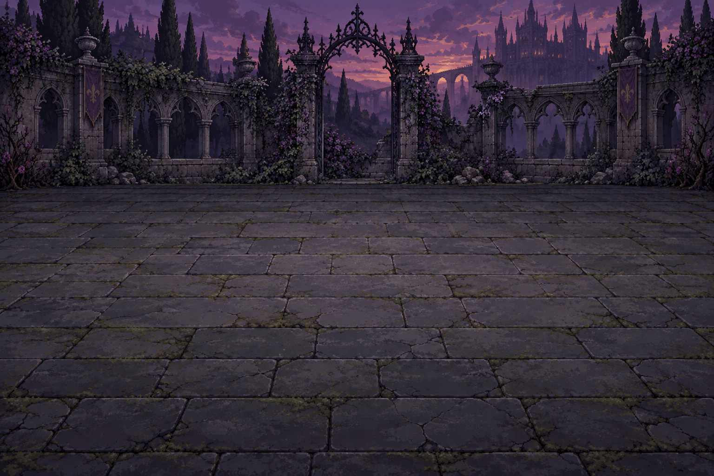
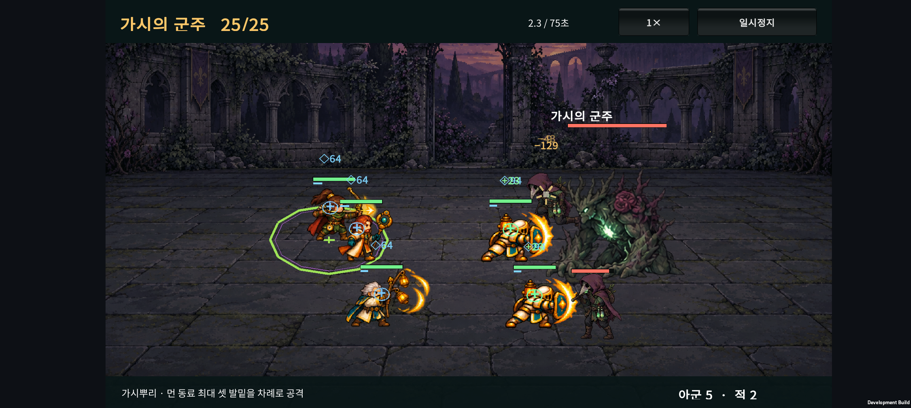
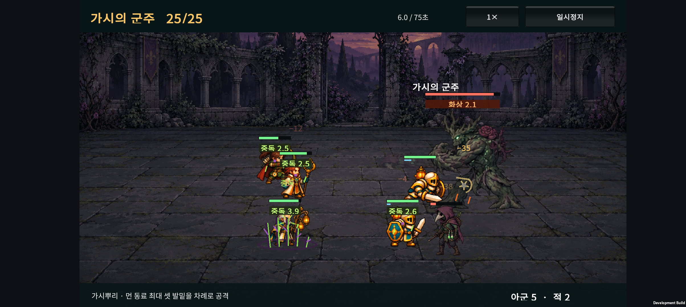
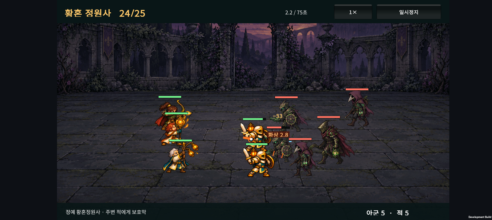
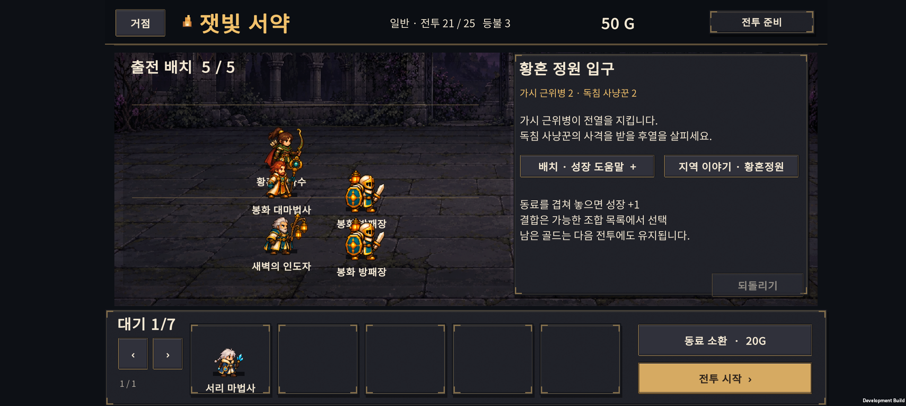
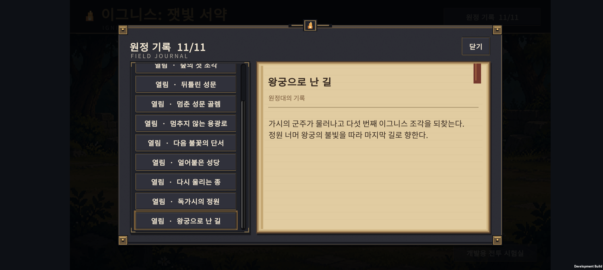

# v0.30 · 황혼 정원과 가시의 군주

2026-10-24 · IGNIS: ASHEN OATH

이전 서리 성당·빙결·화상 작업은 **`568b510`**으로 커밋했다. 이번 작업은 Normal을 **25전투**까지 확장하고, 후열의 발밑에서 가시가 연속으로 솟는 보스를 추가한다. 첫 출시 목표는 30전투이며 Hard는 준비 중 버튼이다.

## 1. 새 지역

| 전투 | 편성 | 승리 보상 |
| --- | --- | ---: |
| 20 | 기존 서리의 파수꾼 | 50G로 변경 |
| 21 | 가시 근위병 2 · 독침 사냥꾼 2 | 40G |
| 22 | 가시 근위병 3 · 독침 사냥꾼 2 | 40G |
| 23 | 가시 근위병 3 · 독침 사냥꾼 3 | 45G |
| 24 | 정예 황혼정원사 1 · 근위병 2 · 사냥꾼 2 | 50G |
| 25 | 가시의 군주 1 · 사냥꾼 2 | 원정 완료 |

근위병은 기존 근접 이동 행동을, 정원사는 기존 주변 보호막 행동을 활용한다. 독침 사냥꾼과 가시의 군주는 새 역할을 추가했다. 사냥꾼은 약해진 동료를 우선 노리는 원거리 공격을 하며, 세 번째 기본공격 명중마다 독을 남긴다.

기존 1~20전투의 적 편성과 능력치는 유지했다. 시작 3명·40G, 소환 20G, 출전 5명·대기 7명, 전투 뒤 회복·패배 시 등불 차감 규칙도 유지한다. 25전투까지 모든 승리 보상과 시작 골드를 합하면 905G로, 최대 45회 소환이 가능하다.

## 2. 보스 · 가시의 군주

사용자가 제안한 **먼 대상 공격과 지형에서 솟는 공격**을 이번 보스의 특징으로 선택했다.

1. 첫 특수 패턴은 전투 시작 약 2초 뒤 준비한다. 행동 선딜 중이면 준비가 끝난 뒤 시작한다.
2. 보스에서 먼 살아 있는 동료부터 최대 3명을 고르고, 그 순간의 서로 다른 대상 위치를 기억한다.
3. 첫 위치에 녹색·보라색 원을 1.05초 예고한 뒤 가시뿌리가 솟는다.
4. 충격 후 0.35초 뒤 두 번째 위치의 예고를 시작한다. 세 번째까지 같은 순서로 공격한다.
5. 마지막 충격 후 8초 뒤 다음 묶음을 준비한다. 체력 40% 이하에서는 다음 예고가 0.8초, 재사용 간격이 6초로 줄어든다.

동료가 1~2명만 남았다면 그 수만큼 공격한다. 이미 기억한 위치는 대상이 움직이거나 죽어도 바뀌지 않는다. 보스가 쓰러지면 남은 공격은 취소된다.

각 충격의 반경은 1.25, 기본 피해 계수는 공격력의 1.1배다. 맞고 살아남으면 4초 독을 받는다. 기본 능력치는 체력 7,000 / 공격력 100 / 방어력 32다. 가시 분출은 실제 충격 좌표에서 다섯 가닥이 솟아 약 0.6초에 가라앉는 연출이며, 전장 이동을 막는 영구 장애물은 아니다.

**대응은 전투 전 배치다.** 후열 동료를 한곳에 몰아두면 여러 충격에 함께 노출될 수 있다. 후열 분산과 보호막·체력을 조합하는 편이 유리할 수 있으나, 회복 범위와 화력 집중도 함께 고려해야 한다. 전투 중 손으로 이동해 원을 피하는 조작은 없다.

보스는 왼쪽을 바라보며 표시 높이 250으로 크게 보인다. 기존 보스의 피격 포즈·밀림 억제와 아군·호위가 앞에 보이는 표시 순서를 유지한다.

## 3. 중독 규칙

- 지속 시간 4초, 받는 회복량 **35% 감소**. 사제 치유·자기 회복·흡혈 등 공통 회복 처리를 통과하는 효과에 적용한다. 보호막은 감소하지 않는다.
- 사냥꾼의 독은 초당 기본 피해 6, 보스의 독은 14다. 실제 피해는 기존 피해 감소·보호막 규칙을 따른다.
- 독은 하나의 슬롯이며, 여러 독의 피해나 회복 감소를 합산하지 않는다. 더 약한 독이 강한 독을 덮거나 갱신하지 못한다.
- 같은 강도 이상은 지속을 갱신한다. 기존 피해 틱 간격은 유지해 연속 피격으로 피해가 계속 뒤로 밀리지 않는다. 독의 마지막 피해 틱이 끝나도 재적용 시점부터 4초 동안 회복 감소가 유지된다.
- 화상·빙결과 독은 별개로 공존한다. 표시도 함께 보이며, 죽거나 전투가 끝나면 중독 표시가 사라진다.

해독 아이템·독 면역 직업은 아직 추가하지 않았다. 이번 범위는 독 압박과 배치·보호막의 가치 확인이다.

## 4. 저장과 이야기

새 원정 저장은 **v6**다. 이전 파일은 각 버전의 원래 전투 수와 골드 예산으로 검증한 뒤 변환한다.

| 기존 상태 | 업데이트 후 |
| --- | --- |
| v5 준비·전투·중간 결과 | 같은 단계·부대·배치·골드·소환 난수 유지 |
| v5 20전투 승리 결과 | 결과 화면 유지, 50G 추가, 다음 버튼으로 21전투 |
| v5 20전투 원정 완료 | 50G 추가, 21전투 준비 |
| 패배 결과·원정 실패 | 보상 추가 없이 상태 유지 |
| v3/v4 15전투 완료 | 기존과 같이 50G를 받고 16전투로 연결 |
| v2 10전투 완료 | 기존과 같이 50G를 받고 11전투로 연결 |

v6 재저장·재실행은 보상을 다시 지급하지 않는다. 기존 15·20전투 완료 기록은 유지하고, 현재 원정의 20전투 통과를 25전투 완료로 잘못 기록하지 않는다. Hard의 향후 자격 기준은 30전투 완료이며 현재 플레이 기능은 비활성이다.

이야기는 서리 성당 → 황혼 정원 → 왕궁으로 연결한다. 지역 진입·보스 승리 기록을 더해 총 11장이다. 원정 기록 목록은 스크롤할 수 있고, 선택한 새 기록이 보이는 위치로 열린다.

## 5. 난도 확인

SOL 구현 뒤 시드 1~20의 후보 측정을 진행했고, ASTRA 검증에서 독 갱신 시 회복 감소가 일찍 끝나는 문제를 수정한 뒤 **5001~5040**으로 측정했다. 이 별도 결과를 보고 추가 수치 조정은 하지 않았다.

| 자동 성장 정책 | 21 / 22 / 23 / 24전투 승리 수 | 25보스 승리 수 | 25전투까지 무패 |
| --- | --- | ---: | ---: |
| 시작 3명 유지 | 모두 0/40 | 0/40 | 0/40 |
| 기본형 5명 유지 | 모두 0/40 | 0/40 | 0/40 |
| 분기 성장 우선 | 모두 40/40 | 40/40 | 39/40 |
| 기사 최종 우선 | 모두 40/40 | 40/40 | 40/40 |
| 기존 H-02 결합 우선 | 모두 40/40 | 25/40 | 11/40 |

별도 Balanced 성장의 최종·6결합 × 분산·밀집 14정책에서는 25보스가 12정책 40/40, H-03 밀집 37/40, H-06 밀집 33/40이었다. 승리 평균은 약 34.0~44.9초다. 분산이 항상 최선은 아니며, 회복 범위와 공격 집중에 따라 밀집 쪽이 빨라지는 편성도 있다.

**남은 균형 문제:** 충분히 성장하고 회복을 갖춘 팀은 21~22 일반전이 여전히 여유롭다. 기존 결합 우선 정책은 25보스에서 시간 초과 3/40도 발생했다. 26~30전투를 완성한 뒤 전체 소환량·회복량·일반전 압박과 10보스 병목을 함께 맞춰야 한다.

표는 사람의 승률이 아니다. 자동 정책은 앞 전투 패배 후에도 이후 구간 비교를 위해 가상 승리 보상을 받으며, `wins`와 처음부터 무패인 `reachWins`를 구분한다. 이번 일반 정책의 기존 1~20전투 결과 100행은 v0.29의 같은 시드 결과와 모두 같았다.

[일반 정책 측정](balance-holdout.json) · [결합·배치 측정](hybrid-holdout.json)

## 6. 제작·검증

내장 imagegen으로 적 4종과 배경 1장을 독립 생성했다. 외부 게임 이미지를 입력하지 않았으며, 원본 PNG를 픽셀 편집 없이 프로젝트에 복사했다. 각 시트 24프레임의 투명 여백·경계와 고정 크기를 manifest로 검증했다. 가시 분출은 기존 코드 기반 전투 이펙트를 확장했다.

[전체 프롬프트](ASSET-PROMPTS.md) · [원본·파일 해시 기록](asset-records.json)

- 원정·보스·독 검사 1,964개, 기존 카탈로그 전투 3,011개 통과.
- 저장·성과 이행 205개, 이야기 25개, 준비 안내 62개 통과.
- Unity JsonUtility 이행·성과 175개, 정원 아트·패턴 284개 통과.
- 기존 서리 288, 아군 크기 460, 폐광 283, 성채 264, 숲 258, 표시 순서 12, 드래그·JSON 17개 및 결과·보스 피격 검사 통과.
- v5의 준비·전투·승리 결과·패배 결과·완료·실패 6개 fixture는 커밋된 v0.29 원정 코드를 실행해 저장한 테스트 상태다. 해당 상태의 전투 결과는 저장 규칙 검사를 위해 승패를 지정했으며 실제 플레이 난도 증거로 사용하지 않는다.
- Android 개발 APK 빌드 성공. 로그: `unity/Logs/v030-build.log`.

APK SHA-256: `A73420656F3D7735A109A2564FE0A0BA02FDB152B8067648F7F825EFA6BE64DC`.

### Galaxy Buddy2

새 APK를 업데이트 설치했다. seed 1의 최종 기사 우선·Balanced·분산 배치로 실제 소환·성장 API와 전투 승리를 거친 체크포인트를 만들었다. 폰에서 1~25전투를 처음부터 직접 완주한 검사는 아니다.

- 25보스에서 후열 위치의 순차 예고, 발밑 가시 분출, 중독 시간 감소, 적의 왼쪽 방향과 아군이 앞에 보이는 것을 확인했다.
- 25보스 승리 → 원정 완료까지 진행해 `Version=6`, `ContentWaves=25`, `BestWave=25`, `CompletedWaves=25`를 확인했다.
- 이전 v5 완료 형식의 20전투·0G 체크포인트 → 같은 부대의 21전투 준비·50G. 21전투 승리 뒤 90G가 되었고, 재실행해도 90G와 이전 20완료 기록을 유지했다.
- 24전투에서 근위병·사냥꾼·정예의 애니메이션과 보호막, 중독 표시를 확인했다.
- 원정 기록 11/11에서 마지막 장이 보이는 위치로 열리고, 스크롤바를 끌어 첫 장까지 이동하는 것을 확인했다.
- 수집한 Unity·AndroidRuntime 로그에서 Exception·Fatal·오류 패턴은 관찰되지 않았다.
- 테스트 직전 백업한 사용자 PlayerPrefs를 복원하고 전체 파일 바이트 일치를 확인했다. 원래 1전투·40G 상태를 보존했다.

<video controls preload="metadata" style="width:100%;max-width:900px" src="device-evidence/wave25-motion.mp4"></video>

[24전투 실행 영상](device-evidence/wave24-motion.mp4) · [25전투 완료 화면](device-evidence/garden-completed.png)

검증 범위는 개발 APK와 기능·표시 확인이다. 출시 빌드·장시간 발열·배터리 검사는 이번 범위가 아니다.

## 7. 다음 순서

1. Normal 마지막 지역 26~30전투와 30보스, 기존 25완료 저장 이행.
2. 전체 원정 길이·일반전 압박·소환 경제·회복량 조정.
3. 실기기 장시간 성능·발열, 출시용 저장·광고·스토어 설정. Hard는 그 뒤다.
