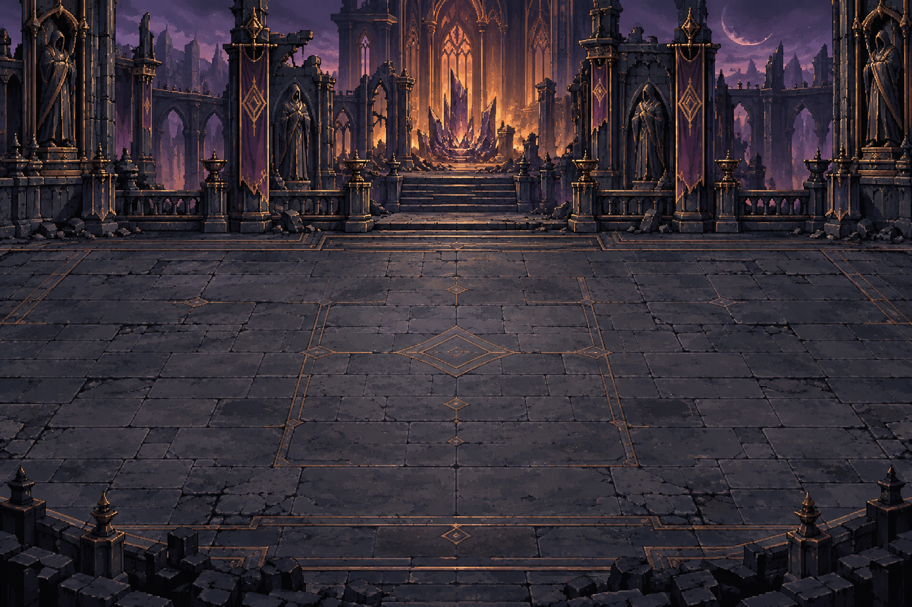
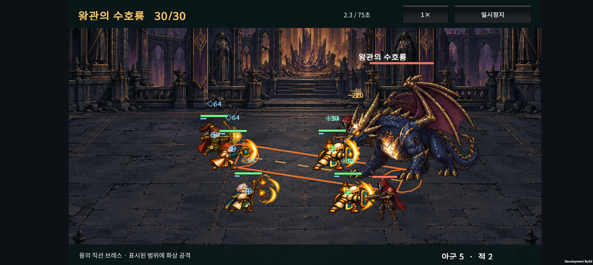
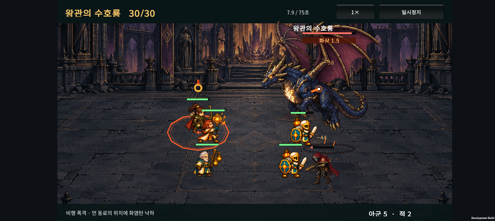
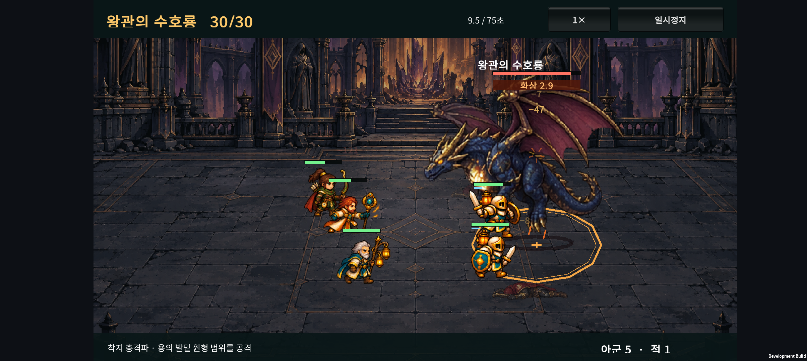
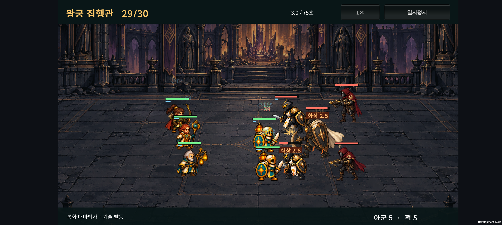

# v0.31 · 잿빛 왕궁과 왕관의 수호룡

2026-10-24 · IGNIS: ASHEN OATH

이전 황혼 정원 작업은 **`683d218`**로 커밋했다. 이번에는 Normal의 마지막 지역 **잿빛 왕궁 / Ashen Palace, 26~30전투**를 연결했다. 큰 용 보스가 **직선 브레스 → 후열 비행 폭격 → 착지 충격파**를 반복한다. 첫 출시 목표였던 30전투 경로가 연결됐으며, 전체 난도·연출·출시 준비는 계속 다듬는다. Hard는 준비 중 버튼이다.

## 1. 마지막 지역의 편성과 보상

| 전투 | 편성 | 승리 보상 |
| --- | --- | ---: |
| 25 | 기존 가시의 군주 | 50G로 변경 |
| 26 | 왕궁 근위병 2 · 왕궁 석궁병 2 | 45G |
| 27 | 왕궁 근위병 3 · 왕궁 석궁병 2 | 50G |
| 28 | 왕궁 근위병 3 · 왕궁 석궁병 3 | 50G |
| 29 | 왕궁 집행관 1 · 근위병 2 · 석궁병 2 | 55G |
| 30 | 왕관의 수호룡 1 · 석궁병 2 | Normal 원정 완료 |

근위병은 근접 전열, 석궁병은 약해진 동료를 노리는 원거리 공격, 집행관은 주변 적에게 보호막을 주는 역할이다. 세 일반 적은 기존 행동을 재사용하며 왕궁 전용 그림과 수치를 갖는다.

1~25전투의 적 수치·전투 규칙은 유지했다. 시작 3명·40G, 소환 20G, 출전 5명·대기 7명, 전투 후 회복과 패배 시 등불 차감도 동일하다. 시작 골드와 30전투 전체 승리 보상 합계는 **1,155G**, 최대 57회 소환 후 15G가 남는다.

## 2. 큰 보스 · 왕관의 수호룡

기본 수치는 **체력 9,000 / 공격력 112 / 방어력 36**이다. 그림의 기준 표시 높이는 300으로 이전 정원 보스 250보다 커졌다. 검은 비늘·금빛 왕관 뿔·어두운 붉은 날개로 왕궁 적들과 인상을 맞췄다.

| 순서 | 동작 | 예고와 판정 |
| --- | --- | --- |
| 1 | 직선 브레스 | 가장 가까운 동료 방향을 고정. 1.1초 예고 후 길이 5.5·반폭 0.65의 캡슐 범위를 공격한다. |
| 2 | 지상 공방 | 4초간 기본공격과 이동을 한다. |
| 3 | 이륙 | 가장 먼 동료의 현재 위치를 기억하고 0.7초 동안 몸이 올라간다. |
| 4 | 비행 폭격 | 기억한 후열 위치에 반경 1.2 원을 1.1초 예고한 뒤 화염탄을 떨어뜨린다. |
| 5 | 착지 충격파 | 보스 자신의 지상 위치에 반경 1.55 원을 0.9초 예고하면서 내려온 뒤 충격파를 낸다. |
| 6 | 지상 복귀 | 6초 동안 공방한 뒤 다음 브레스를 준비한다. |

첫 패턴 준비는 약 2초 후이며 진행 중인 기본공격 선딜이 있으면 그 뒤 시작한다. 브레스·착지는 공격력 1.15배, 폭격은 1.25배의 기본 피해를 사용하며 기존 방어·보호막 규칙을 적용한다. 브레스에 맞고 살아남으면 기존 화상 규칙으로 초당 기본 피해 8, 3틱을 받는다.

체력 40% 이하에서는 이후 브레스·폭격 예고가 0.9초, 착지 예고가 0.7초, 다음 묶음까지 지상 공방이 4초로 줄어든다. 이미 시작한 예고는 갑자기 줄이지 않는다. 기억한 공격 좌표는 대상이 이동하거나 죽어도 유지된다. 보스 사망 시 남은 패턴은 취소한다.

**비행은 짧은 저공 체공이다.** 본체와 체력 표시가 최대 60px 올라가고 그림자는 지상에 남으며, 두 날개 포즈를 교대로 사용한다. 비행 중에도 근접·원거리·스킬 피해를 받는다. 공중 무적이나 특정 직업 필수 조건은 없다. 공중에서는 지상 좌표를 이동하지 않으며 내려오면 기본 공방을 재개한다.

보스는 왼쪽을 보고, 피격 동작으로 계속 흔들리지 않는다. 아군과 호위 석궁병을 보스보다 앞에 그리는 기존 표시 순서를 유지한다. 공격 효과·투사체 목표·피해 숫자도 보스의 높이에 맞춘다.

### 플레이어의 대응

전투 중 직접 이동 조작은 없다. **전투 전 후열 분산, 전열 내구력, 회복·보호막과 화력 조합**으로 대응한다. 브레스에 한 줄로 몰린 부대, 폭격에 함께 들어오는 후열, 착지 원 안에 모인 근접 부대가 각기 다른 압박을 받는다. 다만 회복 범위와 화력 집중 때문에 분산이 항상 정답은 아니다.

## 3. 저장과 원정 완료

새 원정 저장은 **v7**이다. 이전 파일은 버전별 원래 전투 수·골드 예산·부대·되돌리기 이력까지 검증한 다음 변환한다.

| 기존 상태 | 업데이트 후 |
| --- | --- |
| v6 준비·전투·중간 결과 | 같은 단계·부대·배치·골드·소환 난수 유지 |
| v6 25전투 승리 결과 | 결과 화면 유지, 50G 추가, 계속 버튼으로 26전투 |
| v6 25전투 완료 | 50G 추가 후 26전투 준비 |
| 패배 결과·원정 실패 | 추가 보상 없이 상태 유지 |
| v5 20전투 완료 | 기존처럼 50G를 받고 21전투로 연결 |
| v3/v4 15전투 완료 · v2 10전투 완료 | 기존 구간 연결 유지 |

v7 재저장·재실행은 추가 보상을 중복 지급하지 않는다. 이전 15·20·25전투 완료 기록은 보존한다. 현재 원정에서 25전투를 통과한 것만으로 Normal 전체 완료를 기록하지 않는다.

**30전투 승리 시 Normal 완료와 향후 Hard 도전 자격을 기록한다.** 현재 Hard 선택 버튼과 시작 기능은 비활성이다. 왕궁 진입과 마지막 보스 승리 이야기를 추가해 원정 기록은 총 13장이다. 마지막 이야기는 이그니스가 왕궁 결계에 돌아오는 장면으로 첫 원정을 마무리한다.

## 4. 난도 확인

SOL 구현 후 시드 1~20으로 후보를 측정했고, ASTRA는 별도 시드 **5001~5040**으로 검사했다. 별도 결과를 보고 이번 수치를 다시 맞추지는 않았다.

| 자동 성장 정책 | 26 / 27 / 28 / 29전투 승리 수 | 30보스 승리 수 | 30전투까지 무패 |
| --- | --- | ---: | ---: |
| 시작 3명 유지 | 모두 0/40 | 0/40 | 0/40 |
| 기본형 5명 유지 | 모두 0/40 | 0/40 | 0/40 |
| 분기 성장 우선 | 40 / 40 / 35 / 34 | 40/40 | 28/40 |
| 기사 최종 우선 | 40 / 40 / 35 / 34 | 40/40 | 29/40 |
| 기존 H-02 결합 우선 | 40 / 40 / 35 / 37 | 16/40 | 8/40 |

기사 최종 우선은 26→29전투 평균 소요가 약 14.3→34.3초, 30보스가 49.1초였다. 별도 Balanced 성장의 최종·6결합 × 분산·밀집 14정책에서 30보스 승리는 **36~40/40**, 승리 평균 **47.6~56.4초**였다.

**남은 균형 문제:** 일부 편성은 28~29 일반전이 30보스보다 더 위험하다. Balanced H-03 분산·H-05 양쪽·H-06 양쪽에는 시간 초과 3~4/40이 남았다. 회복이 충분한 최종 편성은 보스에게 비교적 안정적이고, 기존 결합 우선은 이전 구간 병목과 30보스 양쪽에서 손실이 크다. 다음 조정은 30전투 전체의 소환량·회복량·성장 순서·일반전과 보스의 압박 차이를 함께 본다.

이 표는 사람의 승률이 아니다. 자동 정책은 구간 비교를 위해 패배 이후에도 가상 승리 보상을 받고 다음 구간을 시험한다. `wins`와 실제로 처음부터 무패로 도달한 `reachWins`는 다르다. 일반 정책의 기존 1~25전투 **125행은 v0.30의 같은 시드 결과와 모두 일치**했다.

[일반 정책 측정](balance-holdout.json) · [결합·배치 측정](hybrid-holdout.json)

## 5. 아트와 검증

내장 imagegen으로 적 4종과 배경 1장을 독립 생성했다. 근위병 검광이 인접 프레임을 침범한 첫 시트는 imagegen으로 수정했다. 최종 PNG는 생성 원본과 바이트가 같으며 스크립트로 픽셀을 편집하지 않았다. 4×24프레임의 컷과 고정 배율은 manifest로 검사한다. 브레스·화염탄·착지 효과는 코드로 그린다.

[프롬프트와 수정 기록](ASSET-PROMPTS.md) · [원본·SHA256 기록](asset-records.json)

- 원정·보스 규칙 2,052개, 기존 카탈로그 전투 3,011개 검사 통과.
- 저장·성과 이행 346개, 이야기 26개 검사 통과.
- Unity JsonUtility 저장·성과 315개, 왕궁 아트·패턴 271개 검사 통과.
- 기존 정원 284, 서리 288, 아군 크기 460, 폐광 283, 성채 264, 숲 258, 표시 순서 12, 드래그·JSON 17개 및 결과·보스 피격 검사 통과.
- v6 저장 fixture 6종은 커밋된 v0.30 원정 코드에서 생성했다. 저장 검사용 승패 지정 자료이며 사람의 플레이 난도 증거로 사용하지 않는다.
- 첫 Unity 검증에서 테스트용 최종 기사 편성의 분기 누락을 발견해 수정하고 다시 통과했다. 전투 중 직접 회피를 할 수 있는 것처럼 읽히던 새 안내 문구도 실제 자동전투에 맞게 수정했다.

Android 개발 APK 빌드 성공. 최종 로그는 `unity/Logs/v031-final-build.log`다. APK SHA-256: `250C17E2DA019D29C1B8922DF5B64164F14985836DAF0DB8318E6FB7AC437F86`.

### Galaxy Buddy2

새 APK를 업데이트 설치했다. seed 1의 최종 기사 우선·Balanced·분산 정책으로 실제 소환·성장 API와 전투 승리를 거친 26·29·30전투 체크포인트를 만들었다. 폰에서 1~30전투를 처음부터 직접 완주한 검사는 아니다.

- 30보스의 직선 예고, 후열 폭격, 몸체 상승과 지상 그림자, 착지 예고·복귀를 확인했다. 아군과 호위가 보스 앞에 보인다.
- 30전투 승리 → 원정 완료에서 `Version=7`, `ContentWaves=30`, `BestWave=30`, `CompletedWaves=30`을 확인했다. Hard 도전 자격 문구가 바뀌어도 버튼은 비활성이며 눌러도 현재 완료 저장은 유지된다.
- 이전 v6 완료 형식의 25전투·5G 저장이 같은 부대의 26전투 준비·55G로 이어진다. 26전투 승리 후 100G가 되고 재실행해도 100G와 과거 25완료 기록을 유지한다. 읽을 때 메모리에서 변환하고 기존 저장 동작에서 v7을 기록한다.
- 원정 기록 13/13에서 마지막 장과 마무리 이야기가 열린다. 긴 마지막 장 제목은 목록에서 줄바꿈되며 후속 UI 정리 대상이다.
- 실기기에서 분노와 화상 글자가 같은 위치에 겹치는 것을 발견해 상태 표시 아래로 분노를 옮겼다.
- 최종 수정 APK에서 29전투의 근위병·석궁병·집행관, 30전투의 세 패턴과 분노·화상 표시 분리를 다시 확인했다. 수집한 Unity·AndroidRuntime 로그에서 Exception·Fatal·오류 패턴은 관찰되지 않았다.
- 테스트 직전 백업한 사용자 PlayerPrefs를 복원하고 전체 파일 바이트 일치를 확인했다. 원래 1전투·40G 상태를 보존했다.

<video controls preload="metadata" style="width:100%;max-width:900px" src="device-evidence/wave30-motion.mp4"></video>

[Normal 완료 화면](device-evidence/normal-completed.png) · [Hard 준비 중 화면](device-evidence/hard-disabled.png) · [25완료에서 이어지는 준비](device-evidence/migrated26.png) · [13장 원정 기록](device-evidence/journal13.png)

[29전투 실행 영상](device-evidence/wave29-motion.mp4) · [분노·화상 표시 수정](device-evidence/status-spacing.png) · [저장 이행 실제 값](device-evidence/migration-result.json)

검증 범위는 개발 APK의 기능·화면 확인이다. 출시 빌드·장시간 프레임·발열·배터리·효과음 청취 평가는 이번 검사에 포함하지 않는다.

## 6. 다음 작업

1. **Normal 30전투 전체 플레이 흐름과 난도**: 초반 진입, 10보스 병목, 후반 일반전, 최종전 회복·시간 초과를 함께 조정한다.
2. **비행 보스 연출 다듬기**: 두 포즈의 첫 비행 모션을 실제 플레이 감상에 맞춰 보강하고 효과음·브레스 타격감을 확인한다.
3. 원정 연구·도감 해금과 장기 성장 범위를 정한 뒤 구현한다.
4. 장시간 Buddy2 성능·발열·저장 복구·광고 및 무료/유료 배포 준비를 진행한다.

이번 v0.31 변경은 작업 트리에 남아 있다. 이번 요청으로 만든 커밋은 이전 v0.30의 `683d218`이며 푸시는 수행하지 않았다.
