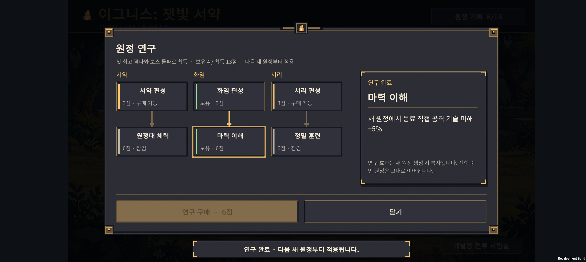
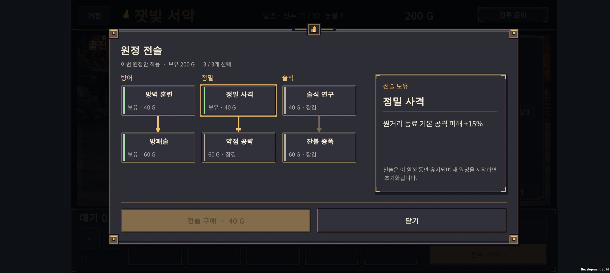
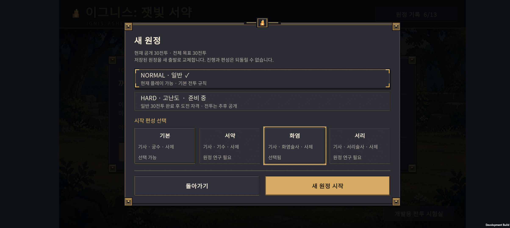
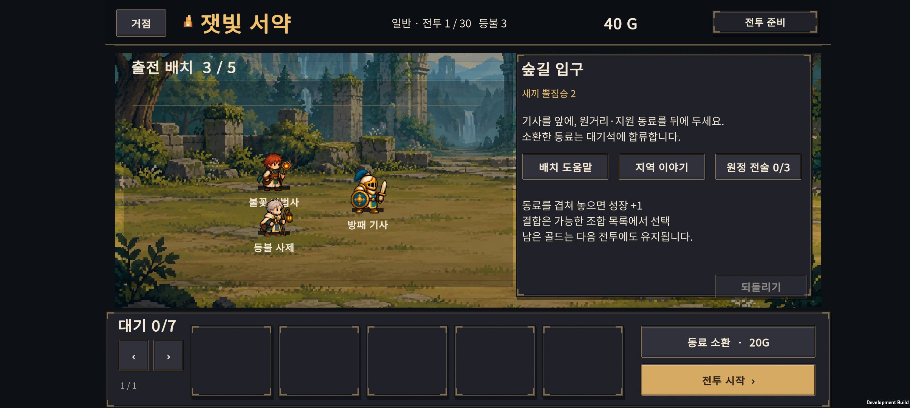

# v0.32 · 영구 연구와 원정 전술

2026-10-24 · IGNIS: ASHEN OATH

이전 왕궁·비행 수호룡 작업은 **`f430538`**로 커밋했다. 이번 작업은 **거점의 영구 연구**, **원정에서 골드로 선택하는 전술**, **일반전 난도 조정**이다. Normal은 30전투이며 Hard는 준비 중 버튼으로 유지한다.

## 1. 두 성장 시스템의 역할

| 구분 | 영구 연구 / Research | 원정 전술 / Tactics |
| --- | --- | --- |
| 위치 | 거점의 원정 연구 | 전투 준비의 원정 전술 |
| 재화 | 첫 돌파로 얻는 연구 포인트 | 소환과 공유하는 원정 골드 |
| 유지 | 새 원정·실패·앱 재시작 후에도 유지 | 해당 원정에만 유지, 새 원정에서 초기화 |
| 적용 | 다음에 새로 시작하는 원정부터 | 구매 후 해당 원정의 다음 전투부터 |
| 형태 | 3갈래 × 2노드, 부모 연구 필요 | 3갈래 × 2노드, 최대 3개 선택 |
| 목적 | 시작 편성을 늘리고 작은 능력 보정 제공 | 현재 유닛 조합에 맞춘 집중 투자 |

현재 진행 중인 원정은 시작할 때의 영구 연구 목록을 보관한다. 거점에서 추가 연구를 구매해도 진행 중인 원정의 능력이나 시작 조건은 바뀌지 않는다. 원정 전술은 구입 확정 후 준비 행동의 되돌리기로 환불되지 않는다.

## 2. 영구 연구 트리

연구 포인트는 **새로운 최고 격파 기록 1전투당 1점**, **5의 배수 보스 최초 격파 시 추가 1점**이다. 30전투까지 총 36점이며, 현재 6개 노드를 모두 배우는 데 27점이 든다. 남은 9점은 보관된다. 반복해서 같은 전투를 깨거나 패배하는 것만으로 포인트를 추가 지급하지 않는다.

기존 최고 기록에는 같은 규칙으로 소급 지급한다. 저장한 최고 기록과 구입 목록에서 잔여 포인트를 계산하므로 결과창 재접속·이어하기·다시 시작으로 보상을 중복 수령할 수 없다. 새 최고 기록을 세운 뒤 원정에 실패해도 이미 얻은 연구 포인트는 남는다.

| 갈래 | 첫 노드 · 3점 | 다음 노드 · 6점 |
| --- | --- | --- |
| 서약 | 서약 편성: 기사 · 기수 · 사제 | 원정대 체력: 모든 동료 최대 체력 +5% |
| 화염 | 화염 편성: 기사 · 화염술사 · 사제 | 마력 이해: 동료 직접 공격 기술 피해 +5% |
| 서리 | 서리 편성: 기사 · 서리술사 · 사제 | 정밀 훈련: 모든 동료 기본 공격 피해 +5% |

기본 **기사 · 궁수 · 사제** 편성은 연구 없이 선택할 수 있다. 모든 시작 편성은 3명·40G이며, 소환의 기본 직업 풀과 확률은 동일하다. 화염·서리·서약은 플레이 방향을 바꾸는 선택지다. 위 세 능력 보정은 배우면 어느 시작 편성에도 적용된다. 반복해서 레벨을 올리는 노드는 없으며 각 노드 1회 구매다.

## 3. 원정 전술 트리

| 갈래 | 6전투부터 · 40G | 11전투부터 · 60G |
| --- | --- | --- |
| 방어 | 방벽 훈련: 근접 동료 최대 체력 +12% | 방패술: 보호막이 있는 동료의 피해 +15% |
| 정밀 | 정밀 사격: 원거리 동료 기본 공격 피해 +15% | 약점 공략: 표식 또는 둔화 상태인 적에게 피해 +18% |
| 마력 | 술식 연구: 동료 직접 공격 기술 피해 +15% | 잔불 증폭: 동료 화상 피해 +30% |

상위 노드는 해당 갈래의 첫 노드가 필요하다. 한 원정에 최대 3개까지 고르므로 세 갈래의 기본기를 모두 선택하거나, 한 갈래를 완성하고 다른 기본기를 더할 수 있다. 모두 고르는 방식은 아니다. **기본 전술 하나는 소환 2회, 상위 전술 하나는 소환 3회 비용**이다.

- 구매는 전투 준비 상태에서만 가능하다. 전투 중·결과창에서는 구매할 수 없다.
- 이미 배운 노드, 골드 부족, 단계 미달, 부모 미습득, 선택 한도 초과는 골드를 차감하지 않는다.
- 전술 구입은 소환 난수에 영향을 주지 않는다.
- 표식과 둔화가 함께 있어도 약점 공략은 한 번만 적용한다.
- 직접 공격 기술 보정은 기본공격·화상·중독·회복·보호막 수치에 적용하지 않는다.
- 아군 강화는 적의 공격이나 적이 거는 화상에는 적용하지 않는다.

전술 6개는 영구 연구가 없어도 사용할 수 있다. 시작 편성에 따라 투자할 갈래가 달라지며, 골드가 적을 때는 먼저 소환·전승·진화를 진행하는 편이 유리할 수 있다.

## 4. 비교에서 채택한 기준

- **Hades:** 거울 능력에는 Darkness를 사용하고, 해당 원정의 은혜와 코인은 사망하면 사라진다. 영구 성장과 원정 빌드를 구분하는 참고 사례다. [공식 가이드](https://www.playstation.com/en-sg/games/hades/tips-and-tricks-to-survive-your-first-hades-encounters/)
- **Rogue Legacy 2:** 골드로 저택과 능력을 키우는 영구 성장 트리가 있다. 연결된 연구를 열어가는 만족감을 참고하되, 우리 첫 버전은 직접 능력 보정의 크기를 제한한다. [공식 소개](https://news.xbox.com/en-us/2022/04/29/rogue-legacy-2-tips-and-tricks/)
- **The Last Flame:** 개발자는 공격력 +10% 같은 영구 능력치 성장 대신 선택지 확대를 설명했다. 오토배틀의 조합 이해가 중요한 비교 사례다. [개발자 답변](https://steamcommunity.com/app/1830970/discussions/0/592886117969199485/)
- **Slotbound:** 영구 성장과 원정 중 코어·아이템을 구분해야 한다. 데모 플레이 리뷰는 원정 보상 재화로 생명과 상위 유닛 확률 등을 강화한다고 설명한다. 모든 기능이 같은 골드를 쓴다고 단정하지 않는다. [데모 리뷰](https://todaywegame.gg/demos/slotbound)

우리의 목표는 **연구가 적어도 좋은 조합으로 Normal 완주가 가능하고, 연구를 모두 해도 부실한 편성은 후반에서 어려움을 겪는 것**이다. 이 목표는 아래 자동 정책 실험과 사람의 실제 플레이를 함께 보며 계속 조정한다.

## 5. 저장과 검증 범위

원정 저장은 **v8**, 영구 성과·연구 저장은 **v2**다. 기존 PlayerPrefs 키를 유지하며 원정 v2~v7과 성과 v1을 이행한다. 이전 원정은 전술·영구 연구 효과 없이 기존 기본 편성을 유지한다. v7의 30전투 완료는 추가 골드를 다시 지급하지 않는다. 기존 10·15·20·25전투 완료의 구간 확장 보상은 기존 규칙을 따른다.

원정 저장에는 전술 구매 비용을 포함해 골드 예산을 검증한다. 연구 목록의 중복·존재하지 않는 ID·부모 누락·포인트 초과를 거부한다. 전술·영구 연구·시작 편성·배치·소환 난수는 저장 후에도 복원한다.

현재 v7 이행 자료는 커밋 `f430538`의 원정 코드가 직접 저장한 준비·전투·승리 결과·패배 결과·완료·패배 6종이다. 이 자료는 저장 검증용이며 실제 승률 증거가 아니다.

## 6. 난도 조정과 실험 결과

1·2전투는 첫 조작을 익히는 난도로 유지하고, 3·4전투와 6전투 이후 일반전, 15·20·25·30전투 보스를 강화했다. 후반 첫 후보가 지나치게 어려워 26~29전투 일반 적은 v0.31 대비 체력 +15%·공격력 +10%로 한 번 보정했다. 그 뒤 코드를 고정하고 조정에 사용하지 않은 난수 9001~9040으로 확인했다.

다음 수치는 **고정 자동 정책의 실험 결과**다. 단일 전투 검사는 앞선 전투를 졌더라도 이전 보상을 받았다고 가정해 이어가며, 실제로 연속 승리한 경우는 별도 집계한다. 그러므로 단일 전투 승리 횟수는 30전투 완주 횟수나 사람의 승률을 뜻하지 않는다. 전투 제한 시간은 실제 게임과 같은 75초다. 이 실험은 기본 시작 편성·영구 연구 효과 없음 기준이다.

| 자동 정책 | 확인 결과 | 해석 |
| --- | --- | --- |
| 초기 3명 유지, 성장 없음 | 4전투 0/40 승리 | 초기 편성을 그대로 두고 통과하기 어려워짐 |
| 기본 직업 5명, 성장 없음 | 4전투 37/40, 5전투 4/40 | 인원만 늘리는 것으로 첫 보스가 보장되지 않음 |
| 성장 중심, 전술 없음 | 30전투 단독 23/40, 1~30 연속 승리 7/40 | 영구 연구·전술 없이도 해당 성장 정책의 완주 사례 있음 |
| 성장 중심, 전술 3개 조기 구입 | 30전투 단독 31/40, 연속 승리 3/40 | 최종 전투에는 도움이 되지만 중간 성장 지연이 큼 |
| 결합 6종 각각, 분산·밀집 배치 비교 | 모든 결합 정책의 연속 승리 0/40 | 다양한 결합 빌드의 완주 가능성은 아직 입증하지 못함 |

전술을 일찍 산 정책은 15전투 단독 승리가 7/40으로, 전술 없는 성장 정책의 15/40보다 낮았다. 후반 전투만 보고 전술을 필수 구매로 안내하면 중간 구간에서 성장 재화가 부족해질 수 있다. 결합별 성장 순서·편성·회복량·시간 초과를 다음 조정의 우선 대상으로 남긴다. **현재 Normal 전체 밸런스는 완성 상태가 아니다.** 별도 난수 결과를 보고 이번 수치를 다시 맞추지는 않았다.

새 시작 편성도 난수 1~20으로 첫 5전투를 확인했다. 5명 편성에서 성장을 진행한 정책의 연속 승리는 기본·화염·서리 20/20, 서약 18/20이었다. 같은 편성을 성장 없이 두면 첫 보스까지 연속 승리는 기본·화염 4/20, 서약·서리 0/20이었다. 시작 편성 해금만으로 초반 승리를 보장하지 않는 방향이지만, 이 역시 특정 자동 정책 결과다.

- [일반 정책 별도 난수 원본](balance-holdout.json)
- [결합·배치별 별도 난수 원본](hybrid-holdout.json)
- [시작 편성 실험 결과](starting-formations.txt)
- 재현: `tests/ExpeditionRun/run-balance.ps1 -FirstSeed 9001 -Count 40 -ReportPath docs/design-v0.32/balance-holdout.json`
- 재현: `tests/ExpeditionRun/run-hybrid-balance.ps1 -FirstSeed 9001 -Count 40 -GrowthOrder Balanced -ReportPath docs/design-v0.32/hybrid-holdout.json`
- 시작 편성: `tests/ExpeditionResearch/run-starting-formations.ps1`

## 7. 구현 검증과 실기기 화면

| 검증 | 결과 |
| --- | --- |
| 순수 C# 원정 | 2,052개 검사 통과 |
| 순수 C# 전투 | 3,011개 검사 통과 |
| 연구·전술 | 61개 검사 통과 |
| 성과·저장 이행 | 421개 검사 통과 |
| Unity 실제 JsonUtility | 340개 검사 통과 |
| 코드 검토 | 저장 이행·중복 보상·골드 예산·되돌리기·아군 효과 경계를 검토했고 차단 결함을 발견하지 못함 |
| Galaxy Buddy2 | 연구 구매·전술 구매·앱 프로세스 재시작·새 편성 선택·첫 전투 승리 확인 |

최종 Android APK를 Unity 6000.3.24f1에서 빌드하고 Buddy2에 업데이트 설치했다. 빌드 로그는 `unity/Logs/v032-final-build.log`, APK는 `unity/Builds/Android/expedition-combat-prototype.apk`다. 로그와 APK는 Git 추적에서 제외한다. 최종 APK SHA-256: `8F79F239856DDE6AB8559D27BF31F208406E4191D5005DBD678E615754B663DC`.

기존 v1 최고 기록 4인 계정이 연구 4점을 받는 화면을 확인했다. 이어 임시 최고 기록 11인 검증 자료로 화염 편성·마력 이해를 구매하고, 진행 중 원정에는 소급 적용되지 않는 것을 확인했다. 11전투 준비에서 전술 3개를 사면 340G가 200G로 줄며, 앱을 종료하고 다시 열어도 구매 내역과 골드가 유지됐다.

새 원정을 화염 편성으로 시작하면 기사·화염술사·사제, 40G, 전술 0개가 되고 영구 연구만 이어졌다. 첫 전투 승리 후에는 60G가 됐으며, 이미 격파한 전투여서 연구 포인트는 다시 생기지 않았다. [실기기 저장 상태 확인 기록](device-checks.jsonl).

최종 APK에서도 수정한 안내와 화염 편성을 확인했다. 조회한 최근 2,500개 로그 범위의 Unity·AndroidRuntime 기록에는 Exception·FATAL·Unity 오류 항목이 없었다. 검증이 끝난 뒤 테스트 직전에 백업한 **사용자의 전체 PlayerPrefs를 바이트 일치로 복원**했다. 원래 5전투의 진행과 설정은 보존했고 임시 연구 구매·검증용 기록은 남기지 않았다.

아래 화면은 Galaxy Buddy2의 실제 실행 캡처다. 연구·전술 구입 확인용 임시 진행 상태를 사용했다. 새 편성에 맞춰 1·2전투 안내도 특정 궁수 대신 원거리·지원 동료를 설명하도록 수정했다.

### 영구 연구

### 원정 전술

### 새 원정의 시작 편성

장시간 프레임 유지·발열·배터리와 30전투 전체의 사람 플레이는 이번 검증에 포함하지 않았다.

## 8. 다음 작업

영구 연구 6개와 원정 전술 6개는 게임에 연결했다. 다음 우선순위는 **결합 편성의 중간 구간 생존과 30전투 완주**, **전술 구입 시점과 성장 비용**, **실기기에서 전체 원정 플레이**다. 유물 시스템, 연구 트리 확장, Hard 전투는 후속 개발이다.
