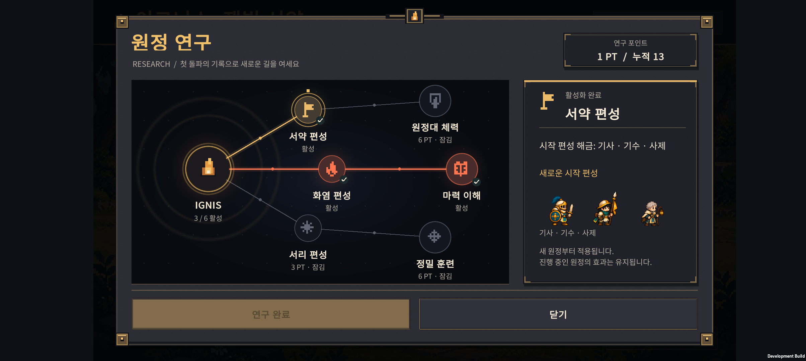
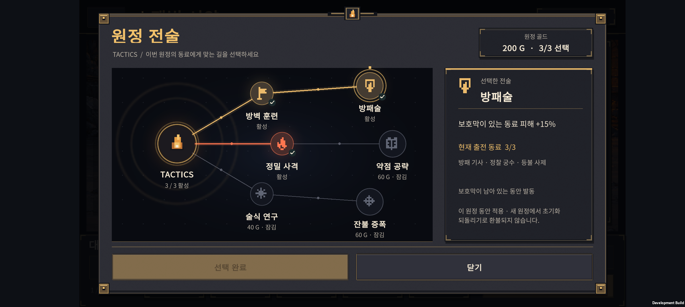
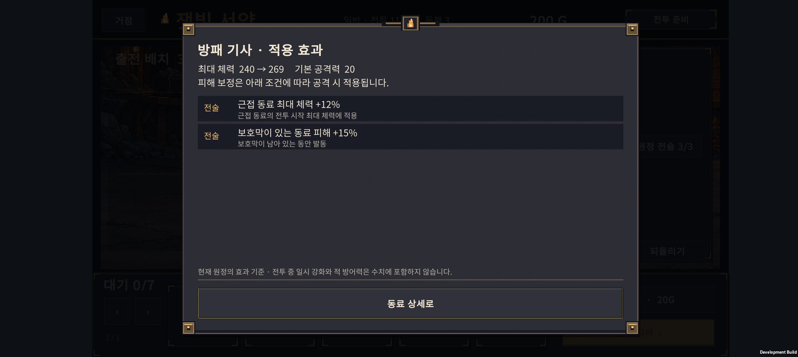
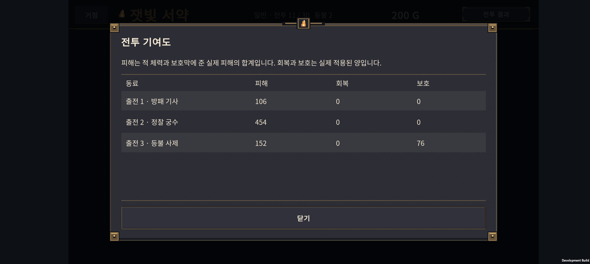

# v0.33 · 연구 보드와 빌드 판단

2026-10-24 · IGNIS: ASHEN OATH

연구·전술을 노드와 경로가 보이는 보드로 바꾸고, 현재 동료에게 적용되는 효과와 전투 기여도를 추가했다. Normal 30전투는 실제 패배·재도전·재화 지출을 포함해 비교했다. **여러 결합 빌드의 완주를 확인했지만 H-01·H-05는 추가 조정이 필요하다.**

## 1. 연구와 전술 화면



- 중앙 IGNIS에서 세 갈래로 뻗는 원형 노드와 연결선으로 구성했다. 실제 구매 노드는 기존대로 6개이며 연결선 위의 작은 점은 장식이다.
- 배운 경로는 갈래별 색과 밝은 선, 잠긴 경로는 얇은 회색 선으로 표시한다. 선택한 노드는 바깥 고리, 배운 노드는 체크 표시를 갖는다.
- 오른쪽은 선택한 연구 설명과 시작 편성, 아래는 일정한 여백을 둔 구매·닫기 버튼이다. 노드를 누르면 선택하고, 아래 버튼으로 구매를 확정한다.
- 아이온2 데바니온의 **경로·활성 상태·선택 상세를 함께 보는 구성**을 참고했다. 원작의 이미지·아이콘은 사용하지 않고 자체 도형과 도트 문양으로 구현했다. [참고 화면이 포함된 인벤 기사](https://www.inven.co.kr/webzine/news/?news=311893&site=aion2).
- 첫 기기 확인에서 연결선이 화면 밖으로 튀는 결함이 있었다. 화면 배율이 적용된 GUI에서 회전 기준점이 어긋난 것이 원인이었다. 논리 좌표의 이동·회전을 기존 화면 행렬에 합성하도록 수정하고 **최종 APK의 연구·전술 양쪽에서 노드에 정확히 연결됨을 확인했다.** 위 이미지는 수정 후 실기기 화면이다.



전술 상세는 현재 출전 동료 중 적용 가능한 인원·이름과 발동 조건을 보여준다. 보호막 잔존, 표식·둔화 대상, 직접 공격 기술, 화상 등 조건을 구분한다. 적용 가능한 동료가 없으면 알려준다. 기본 40G는 소환 2회, 상위 60G는 소환 3회 비용으로 안내한다.

영구 연구의 다음 새 원정 적용, 전술 최대 3개, 원정 종료 시 초기화, 구매 환불 불가, 선행 노드와 단계 조건은 [v0.32 규칙](../design-v0.32/HANDOFF.md)을 유지한다. 현재 6노드는 첫 범위이며 대규모 트리를 전부 구현한 상태는 아니다.

## 2. 효과와 전투 기여도



동료 상세의 **적용 효과**에서 기본 최대 체력과 연구·전술 적용 후 최대 체력을 비교한다. 실제 전투 유닛 생성 경로로 계산하며, 조건부 피해 증가를 기본 공격력 숫자에 섞지 않는다. 진행 중인 원정은 시작 당시 보관한 연구 목록으로 표시하므로 거점에서 나중에 산 연구가 잘못 표시되지 않는다.



전투 결과의 **전투 기록**은 출전 동료별 피해·회복·보호를 보여준다.

| 항목 | 집계 기준 |
| --- | --- |
| 피해 | 적 체력과 보호막에 적용한 실제 피해, 초과 피해 제외 |
| 회복 | 실제 회복한 체력 |
| 보호 | 제공한 보호막이 실제로 흡수한 피해 |

전투 이벤트를 관찰하므로 난수나 전투 결과를 바꾸지 않는다. 기록은 **현재 앱 실행 중 완료한 같은 원정의 마지막 전투**만 제공한다. 앱을 재시작하면 기여도 기록은 사라지며, 새 전투·새 원정에 이전 표가 붙지 않는다. 영구 기록 저장은 후속 범위다.

## 3. 밸런스 변경

실제 전투 수치 변경은 **29전투 왕궁 근위의 공격력 107.8 → 90**이다. 체력·보호막·다른 적은 그대로다. H-04 조합이 전투 29까지 도달하고도 이 지점에서 무너지는 현상을 확인해 해당 병목만 조정했다. 전술 가격과 효과는 유지했다.

조정용 Balanced 시드 1~20에서 H-04·전술 미구매 완주는 1/20 → 3/20이 되었고, 일반 최종 진화 편성은 13/20을 유지했다. 이후 수치를 고정하고 별도 시드로 아래 검증을 진행했다.

## 4. 실제 원정 1,120회 비교

시드 **19001~19040**, 성장 정책 **Balanced**, 7개 편성 정책 × 4개 지출 정책 × 각 40회다. 아래 값은 각 조건의 **30전투 완주 횟수 / 40회**다. 고정된 자동 플레이 정책의 비교이며 사람의 승률을 뜻하지 않는다.

| 목표 편성 | 전술 없음 | 일찍 구매 | 11전투부터 구매 | 편성에 맞춘 기본 1개 |
| --- | ---: | ---: | ---: | ---: |
| 일반 최종 진화 | 15 | 18 | 18 | 12 |
| H-01 · 화염+기사 | 0 | 0 | 1 | 0 |
| H-02 · 기사+사제 | 6 | 5 | 7 | 5 |
| H-03 · 궁수+서리 | 1 | 0 | 4 | 7 |
| H-04 · 화염+서리 | 3 | 0 | 11 | 0 |
| H-05 · 기수+사제 | 0 | 0 | 0 | 0 |
| H-06 · 궁수+기수 | 0 | 2 | 7 | 2 |

- H 계열의 모든 완주는 **해당 결합체를 실제로 출전시킨 원정**이었다. 보고서의 `completedWithHybrid`와 `completedWithoutHybrid`로 구분한다.
- H-02·H-03·H-04·H-06에서 완주 경로를 확인했다. H-04는 늦은 전술 구매, H-03는 편성에 맞춘 단일 전술에서 결과가 개선됐다.
- 일찍 전술을 사는 것이 언제나 손해는 아니다. 일반 최종 진화 편성은 15 → 18회였고, H-03·H-04에서는 성장 재료 부족과 지출 순서가 불리하게 작용할 수 있다. 현재 가격을 일괄 인하하지 않았다.
- H-01은 한 조건에서 1회, H-05는 전 조건에서 0회다. 두 빌드의 결합 시점·공격 기여·재료 소비를 다음에 다뤄야 한다. 모든 빌드가 균형 잡혔다고 볼 수 없다.

### 검사 방식

새 원정 생성 → 정상 소환·성장·진화·결합·배치·전술 구매 → 전투 → 실제 승패 처리 → 다음 준비를 실행한다. 준비마다 저장·복원을 거치고, 패배하면 골드를 주지 않고 등불을 차감하며 같은 전투를 재도전한다. 재도전 배치를 바꾸고 75초 미완료는 패배로 처리한다. 같은 시드의 재현성도 검사한다.

예전 `HybridBalanceProbe`는 패배한 전투 뒤에도 승리 보상을 가정해 후반 구간을 비교하므로 그 결과를 완주 횟수로 읽으면 안 된다. 이번 표는 별도 `EndToEndBalanceProbe`의 실제 원정 결과다. 영구 연구로 능력을 올린 계정 전체에 대한 검증은 별도 범위다.

[전체 비교 데이터](balance-holdout.json) · [검사 코드](../../tests/ExpeditionRun/EndToEndBalanceProbe.cs) · [실행 안내](../../tests/ExpeditionRun/README-end-to-end-balance.md)

```powershell
./tests/ExpeditionRun/run-end-to-end-balance.ps1 -FirstSeed 19001 -Count 40 -GrowthOrder Balanced -Spending all -ReportPath docs/design-v0.33/balance-holdout.json
```

이번 보고서는 완주 데이터를 모은 뒤 기존 시드 결과에서 결합체 동반 완주/미동반 완주 집계 필드를 추가했다. 같은 집계를 생성기에도 반영했으며 추가 전투를 돌리거나 이 시드에 맞춰 수치를 다시 조정하지 않았다.

## 5. 검증과 기기 상태

| 검사 | 결과 |
| --- | --- |
| 원정 Core | 2,052개 검사 통과 |
| 영구 연구·원정 전술 | 61개 검사 통과 |
| 직업 전투 | 3,011개 검사 통과 |
| 전투 기여도 | 6개 검사 통과: 이벤트 구분·중복·적 제외·구독 해제·실제 피해 등 |
| Unity 저장 JSON | 340개 검사 통과, 이전 저장 호환 유지 |
| Unity 드래그 입력·JSON | 17개 검사 통과 |
| 최종 Android 빌드 | Unity 6000.3.24f1, 종료 코드 0 |
| Galaxy Buddy2 | 연구 선택·선행 잠금·구매, 전술 구매·한도, 효과 상세, 전투 기여도, 재시작 후 구매 유지 확인 |
| 연결선 | 최종 APK에서 연구·전술 모두 시각 확인 |

UI 확인에는 임시 11전투 저장을 사용했다. 해당 화면의 승패는 밸런스 표에 포함하지 않는다. 테스트 전 원본 PlayerPrefs 전체를 백업했고, 종료 후 **바이트 단위로 동일하게 복원**했다. 사용자 원정·성과·설정은 보존했다. 마지막 앱 실행 로그 범위에서 Unity 예외나 AndroidRuntime 크래시는 발견되지 않았다. 장시간 성능·발열 및 사람의 Normal 30 연속 플레이는 이번 검증 범위가 아니다.

최종 APK: `unity/Builds/Android/expedition-combat-prototype.apk`

SHA-256: `A3C86E1675660A4CA13CDEA30B77CDEABC925BAA4059534A48FE1666E62510C5`

## 6. 다음 작업

1. H-01·H-05의 결합 전후 손익과 실제 전투 역할을 개선한다.
2. 플레이어가 Normal 30을 진행하며 소환·성장·전술 선택을 이해하고 고민하게 되는지 확인한다.
3. 그 결과에 따라 연구 분기 확대와 유물을 설계한다. Hard 전투는 Normal 완성 이후 진행한다.

구현은 SOL, 효과 조건·저장·계측 검토는 ASTRA로 분담했다. ASTRA가 찾은 효과 창 하단 문구 겹침을 수정했다. 이번 변경은 v0.32 커밋 `48418d6` 이후의 v0.33 작업이다.
