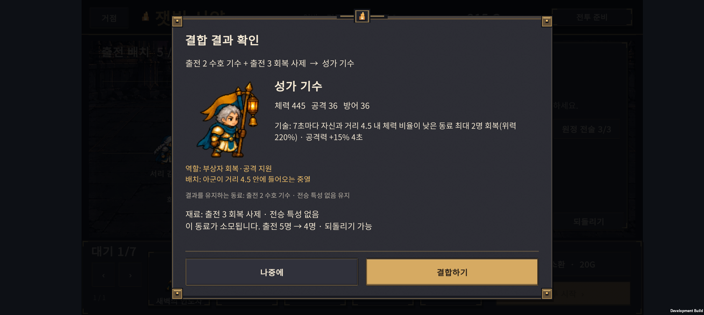
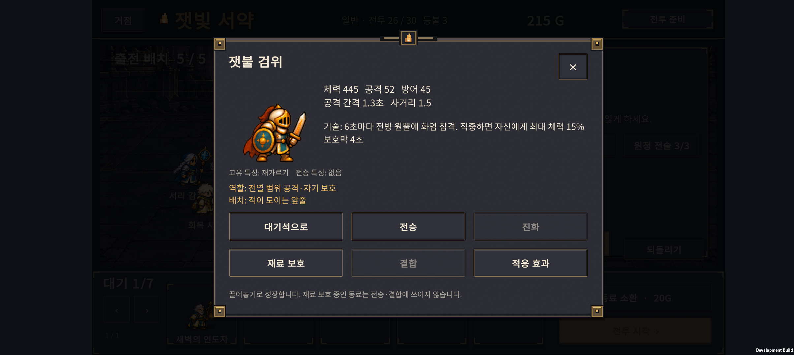
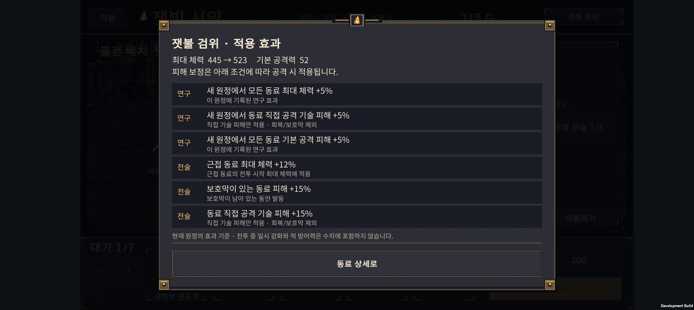
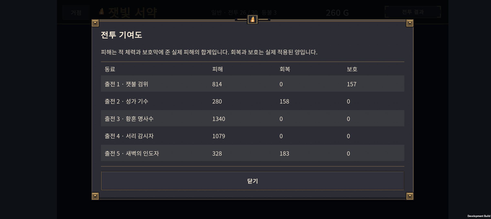

# v0.34 · 결합체 역할 보완과 Normal 난도 점검

2026-10-24 · IGNIS: ASHEN OATH

잿불 검위의 전열 생존력과 성가 기수의 회복 대상을 개선했다. 신규·연구 계정을 나누어 같은 조건으로 Normal 30을 비교하고, 길어진 기술 설명과 동료 상세·결합 확인 창의 여백을 정리했다. **두 결합체 모두 독립 시드에서 실제 결합 후 완주를 확인했다. 성가 기수의 편성 의존성과 후반 난도 편차는 남아 있다.**

## 1. 결합했을 때 역할이 좋아지도록

| 항목 | 이전 | 이번 변경 |
| --- | --- | --- |
| 잿불 검위 최대 체력 | 405 | 445 |
| 잿불 검위 방어 | 39 | 45 |
| 잿불 검위 기술 | 6초 주기의 화염 범위 공격 | 기존 공격 후 자신의 최대 체력 15% 보호막, 4초 |
| 성가 기수 기술 주기 | 8초 | 7초 |
| 성가 기수 회복 계수 | 위력 180% | 시전 시점 위력 220% |
| 성가 기수 대상 | 자신 + 거리 3.2 내 가까운 동료 2명 | 자신 + 거리 4.5 내 체력 비율이 낮은 동료 최대 2명 |
| 성가 기수 공격력 강화 | 같은 대상 +15%, 4초 | 유지 |

잿불 검위는 방패 기사를 재료로 소비하면서 잃던 전열 방어 능력을 자기 보호막으로 일부 보완한다. 부대 전체에 보호막을 주지는 않는다. 타깃이 죽거나 사거리 밖으로 벗어나 기술이 취소되면 보호막도 생기지 않는다. 이미 남아 있는 보호막을 반복해서 쌓지 않는다.

성가 기수는 가까운 멀쩡한 동료 때문에 더 다친 동료를 놓치는 문제를 줄인다. 범위 밖의 동료는 대상이 아니고, 자신 이외 대상은 최대 2명이다. 자기 공격력 강화 후 다른 동료의 회복량만 증가하던 순서를 수정해, 세 대상에 같은 시전 시점 위력을 사용한다. 실제 연속 발동 간격에는 7초 대기와 다음 시전의 약 0.25초 준비 동작이 함께 들어간다.

다른 직업·적·소환 가격·전술 가격과 저장 버전은 변경하지 않았다. H-01/H-05의 기술 설명을 카탈로그에서 읽어 실제 능력과 UI 문구를 함께 관리한다.

## 2. UI 정렬과 글자 영역

- 동료 상세 창을 화면 중심에 맞췄다. 기술 설명은 여러 줄 영역을 확보하고, 고유·전승 특성 및 역할 안내와 분리했다.
- 상세 버튼 6개는 같은 폭의 3열 × 2행으로 정렬하고 가로·세로 간격을 16으로 통일했다.
- 결합 확인 창을 넓혀 기술·재료 설명이 잘리지 않도록 했다. 아래 두 버튼과 창 하단 사이에는 공통 여백 32를 유지한다.
- 연구 노드는 원형 아이콘뿐 아니라 제목·비용 문구를 눌러도 선택된다. 인접 노드와 입력 영역이 겹치지 않도록 원형 영역의 위아래 경계를 조정했다.
- UI 검토에서 최대 6개 적용 효과, 5명 전투 기여도, 긴 기술 설명을 확인 대상으로 삼았다. 배운 경로·잠긴 경로 연결선의 좌표 계산은 v0.33 수정본을 유지한다.

아래는 최종 APK의 Galaxy Buddy2 화면이다. 패널 중심은 노치 영역을 제외한 화면 안전 영역을 기준으로 맞춘다.

[성가 기수 상세](screenshots/song-detail.png) · [연구 노드의 문구 터치 확인](screenshots/research-touch.png)

## 3. 변경 전후 비교

Balanced 자동 정책, 시드 1~12를 사용했다. 신규/연구 계정 × 일반 최종 진화/H-01/H-05 × 전술 미구매/조기/지연/맞춤의 24조건으로, 변경 전 288회·변경 후 288회다. 변경 전은 v0.33의 Core와 카탈로그 복사본을 같은 새 검사기로 실행했다.

| 계정·정책 | 변경 전 완주 / 12 | 변경 후 완주 / 12 |
| --- | ---: | ---: |
| 신규 · 일반 최종 진화 · 전술 없음 | 10 | 10 |
| 신규 · 잿불 검위 · 지연 전술 | 0 | 4 |
| 신규 · 성가 기수 · 전술 없음 | 0 | 6 |
| 신규 · 성가 기수 · 맞춤 전술 | 0 | 5 |
| 연구 · 잿불 검위 · 전술 없음 | 1 | 6 |
| 연구 · 성가 기수 · 전술 없음 | 2 | 7 |

위 표는 핵심 조건의 요약이며 모든 조건은 [변경 전](balance-before.json)·[변경 후](balance-after.json) 데이터에 남겼다. 일반 최종 진화 정책의 결과는 두 버전에서 동일했다.

## 4. 별도 시드 576회

수치를 고정한 뒤 시드 **34001~34024**를 사용했다. 표의 각 값은 **24회 중 30전투 완주 수**다. 이 결과를 본 뒤 수치를 다시 바꾸지 않았다.

### 연구 없는 신규 계정

| 편성 정책 | 전술 없음 | 조기 구매 | 11전투부터 구매 | 맞춤 기본 전술 1개 |
| --- | ---: | ---: | ---: | ---: |
| 일반 최종 진화 | 10 | 13 | 13 | 7 |
| 잿불 검위 | 0 | 0 | 6 | 3 |
| 성가 기수 | 3 | 0 | 1 | 2 |

### 현재 연구 6개를 완료한 계정

| 편성 정책 | 전술 없음 | 조기 구매 | 11전투부터 구매 | 맞춤 기본 전술 1개 |
| --- | ---: | ---: | ---: | ---: |
| 일반 최종 진화 | 13 | 17 | 19 | 17 |
| 잿불 검위 | 6 | 10 | 14 | 11 |
| 성가 기수 | 4 | 3 | 3 | 6 |

두 계정 모두 기본 기사·궁수·사제 3명과 같은 시드로 시작한다. 연구 계정은 27포인트로 현재 연구 6개를 모두 연 상태이며, 다른 시작 편성의 효과는 섞지 않았다. 여러 원정을 거쳐 연구 포인트를 버는 과정 자체를 모의한 것은 아니다.

H 계열 완주는 전부 목표 결합체를 실제로 출전한 원정이었다. 결합체 없이 완주한 경우는 0회다. **고정된 자동 플레이 정책의 진단 결과이며 사람의 승률이나 완벽한 균형을 뜻하지 않는다.** 지출 정책에 따라 연구가 없어도 완주 경로는 있지만, 성가 기수는 아직 일반 최종 진화 편성보다 불리한 조건이 많다.

[독립 시드 전체 데이터](balance-holdout.json) · [실행 안내](../../tests/ExpeditionRun/README-end-to-end-balance.md)

## 5. Normal 난이도 흐름에서 확인한 점

일반 최종 진화·전술 미구매 정책의 독립 시드를 기준으로 봤다. 아래 초회 승리 비율은 **해당 전투까지 도달한 원정만** 분모로 사용한다.

| 전투 | 신규 초회 승리 | 연구 초회 승리 | 해석 |
| --- | ---: | ---: | --- |
| 1~4 | 각 24/24 | 각 24/24 | 이 자동 정책에서는 입문 구간이 안정적 |
| 23 | 20/24 | 24/24 | 후반 일반전부터 연구 효과 차이가 나타남 |
| 25 보스 | 15/22 | 19/24 | 후반 구간의 뚜렷한 고비 |
| 29 | 2/12 | 13/20 | 신규 계정에서 배치·재도전 의존도가 큼 |
| 30 보스 | 8/10 | 8/18 | 연구 계정도 도달만으로 승리가 보장되지 않음 |

30전투 시간 초과는 신규 2회·연구 6회였다. 연구 계정이 더 많이 도달하고 조기 탈락하던 편성도 포함하므로, 단순한 최종 보스 승률 비교로 연구가 불리하다고 해석하면 안 된다. 29전투에서 패배 후 배치를 바꾸는 재도전 효과도 결과에 포함된다.

계획대로 성장시키는 자동 편성의 초반 결과만으로 초반 전체가 적절하다고 단정하지 않았다. 반대로 이 자료만으로 적 전체를 일괄 강화하지도 않았다. 다음 플레이 점검은 **성가 기수의 실전 기여, 신규 계정 23~30전투, 29전투의 배치 가독성**에 집중한다. Hard와 추가 유물은 이후 범위다.

## 6. 검증 기록

- HybridCombat 15개: 보호막 비중첩·자기 대상, 실제 준비/발동 경로의 사거리 이탈·타깃 사망, 부상자 우선·거리·인원 제한, 회복량 일치, 실제 재시전 간격.
- CatalogCombat 3,011개, ExpeditionRun 2,052개, ExpeditionResearch 61개 통과.
- 기존 전투 Review 109개 통과. TimingReview의 오래된 Reflection 호출이 추가된 Burn 오버로드를 구분하지 못하던 테스트 문제를 수정했다. 게임 Core를 바꿔 통과시키지 않았다.
- ASTRA가 발견한 H-05 자기 버프 적용 순서와 연구 노드 입력 영역 경계 문제를 반영했다.
- 저장·복원, 패배 시 등불 소모, 승리 때만 재화 획득, 같은 시드의 재현성을 유지한다. 전투별 도달·초회 승리·재도전·시간 초과 집계를 추가했다.

최종 Unity 빌드는 종료 코드 0으로 완료됐다. 실제 Unity JsonUtility 저장 호환 340개, 드래그 입력·JSON 17개를 포함한 기존 Android 빌드 검증도 통과했다.

Galaxy Buddy2에서 동료 상세 두 종류, 결합 확인과 실제 결합, 출전 인원 복구, 효과 6개, 전투 기여도 5행을 확인했다. 연구 문구 하단을 누르는 동작과 인접 원형 노드 위쪽을 누르는 동작이 각각 올바른 노드를 선택했다. 글자 잘림이나 하단 버튼 침범은 발견하지 못했다.

별도 UI 확인용 26전투 저장에서 결합 후 실제 전투를 실행해 잿불 검위의 보호 157, 성가 기수의 회복 158이 집계됐다. 이 임시 편성·진행도는 밸런스 통계에 포함하지 않는다. 원본 PlayerPrefs 전체를 테스트 전에 새로 백업했고, 종료 후 **바이트 단위 동일성을 확인하며 복원**했다. 마지막 실행 로그 범위에서 Unity 예외·AndroidRuntime 크래시는 발견되지 않았다. 장시간 성능·발열과 사람의 30전투 연속 플레이는 이번 검증 범위가 아니다.

최종 APK: `unity/Builds/Android/expedition-combat-prototype.apk`

SHA-256: `038A93AF9A1D043A30DC554A3F450C1A941BB7121A566F045E21015410190B85`

기준 커밋은 v0.33 `09dae1b`이며 이번 기록은 그 이후의 v0.34 변경을 다룬다. 이전 v0.7 문서의 별도 수정은 보존했다.
