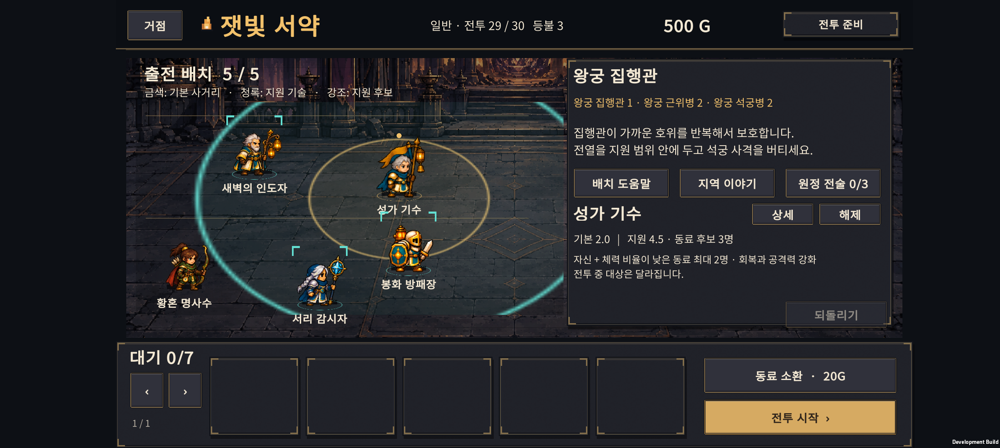
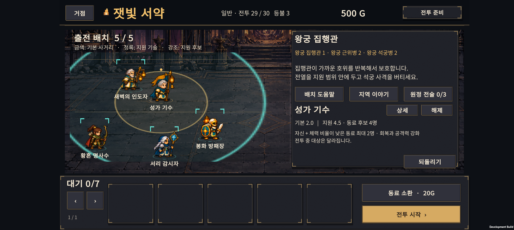
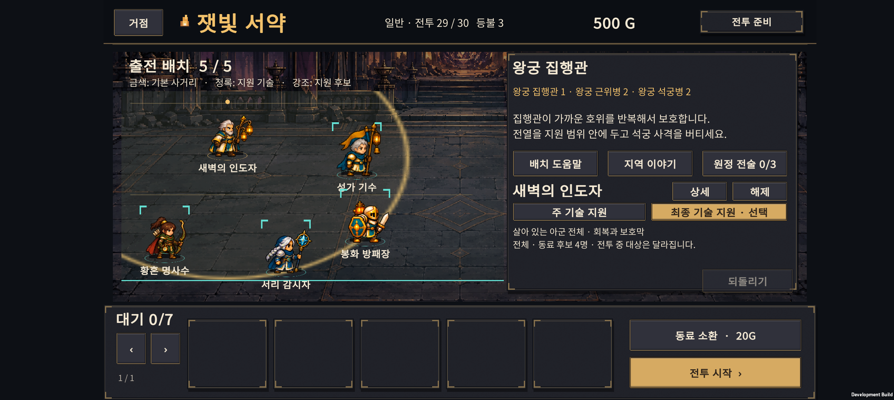
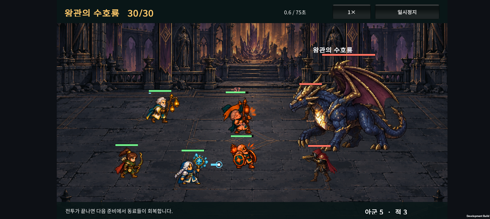
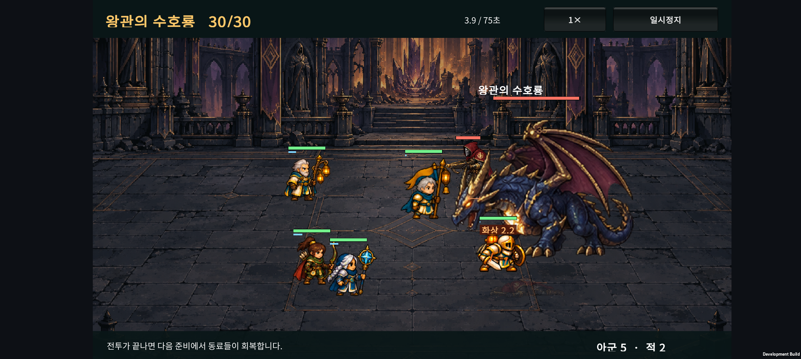
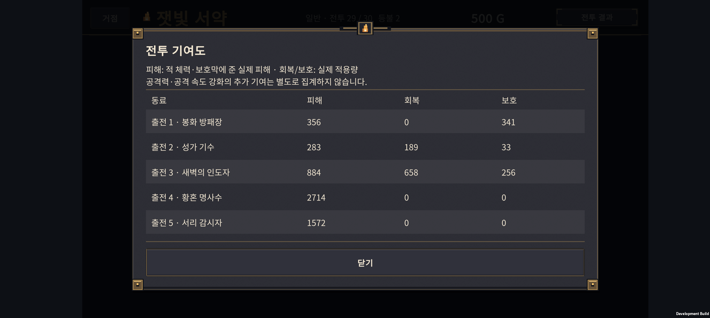

# v0.35 · 배치 범위와 후반 전투의 판단 정보

2026-10-25 · IGNIS: ASHEN OATH

출전 동료를 누르면 기본 사거리와 지원 기술의 범위를 보여준다. 지원받을 수 있는 동료를 강조하고, 최종 진화의 주 기술과 최종 기술을 구분했다. **29전투의 급격한 차이는 반복 보호막과 아군 배치의 상호작용으로 확인했다. 이번에는 적 수치를 낮추지 않고, 준비 단계에서 그 차이를 판단할 수 있게 개선했다.**

## 1. 준비 화면 조작

| 조작 | 동작 |
| --- | --- |
| 출전 동료 한 번 누르기 | 동료 선택, 사거리·지원 기술 범위 표시 |
| 같은 동료 다시 누르기 / 오른쪽 상세 | 기존 동료 상세 창 열기 |
| 다른 동료 누르기 | 범위 선택 전환 |
| 동료 끌기 | 이동 중 위치를 기준으로 범위·지원 후보 갱신 |
| 주 기술 / 최종 기술 | 최종 진화가 가진 두 지원 기술의 범위 전환 |
| 해제 | 범위 선택 해제 |
| 대기석 동료 누르기 | 기존처럼 바로 상세 창 열기 |

금색은 기본 사거리, 청록은 선택한 지원 기술이다. 준비판의 가로·세로 축 비율에 맞춘 타원으로 표시한다. 전체 지원은 범위를 임의의 원으로 제한하지 않고 배치 영역과 전체 동료를 강조한다.

**강조된 동료는 배치상 지원 가능한 후보이며, 다음 발동의 확정 대상이 아니다.** 실제 전투에서는 이동, 생존 여부, 체력 비율, 기존 보호막, 인원 제한에 따라 대상이 달라진다. 특성으로 생기는 조건부 지원은 이 기술 범위와 별개다. 금색은 기본 사거리의 기준이며 근접 공격의 몸체 접촉 예외나 공격 기술의 피격 영역 전체를 나타내지는 않는다.

H-05는 자신과 범위 4.5 안에서 체력 비율이 낮은 다른 동료 최대 2명을 지원한다. H-02는 공격 기술 발동 조건이 있고 자신을 포함한 총 2명을 회복한다. H-06도 공격 대상이 필요하며 자신과 가까운 다른 동료 최대 2명의 다음 기본 공격을 강화한다. 이 차이를 설명에 반영했다.

F-PR/F-BA의 최종 기술은 전체 지원이지만 유지한 진화 분기는 제한된 범위를 쓴다. F-KN은 주 기술의 방어 분기가 2.0, 최종 기술이 2.5다. 반격 분기를 선택한 F-KN은 최종 지원만 표시한다. 사거리 안내와 실제 지원 기술은 같은 Core 반경 값을 참조한다.

드래그 중에는 임시 좌표만 계산한다. 범위 확인, 기술 탭 전환, 취소 동작으로 저장·재화·난수·성장 이력이 바뀌지 않는다. 다른 원정으로 바뀌거나 선택한 동료가 사라지면 선택을 정리한다.

## 2. 29전투 수치를 유지한 이유

| 비교 | 28전투 | 29전투 |
| --- | ---: | ---: |
| 적 기본 체력 합 | 6,865.5 | 6,992 |
| 원시 기본 공격 DPS 합, 근사 | 287 | 251 |
| 주요 차이 | 근위병·석궁병 압박 | 집행관이 가까운 호위를 반복 보호 |

위 DPS는 명중·방어·이동·기술을 제외한 수치 비교다. 29전투의 체력 합은 약 1.8% 높지만 기본 화력은 약 13% 낮다. 집행관이 7초마다 가까운 두 호위에게 주는 보호막과 전열 붕괴가 실제 전투 시간을 바꾼다.

훈련 시드 1의 동일 최종 진화 편성에서는 넓은 배치로 29전투에 패배하고, 모인 재배치에서 약 31초 만에 승리했다. 재배치 승리의 남은 체력은 평균 약 75%였다. 첫 배치의 후열 세 명은 체력 피해 약 1,862를 받았지만 재배치에서는 받지 않았다. 전열이 지원을 받으며 버티는 동안 후열이 공격할 수 있는 차이다. [해당 사례의 전체 원정 기록](formation-case-seed1.json)

따라서 이번에는 적·직업 능력치, 소환·전술 가격, 연구 효과, 전투 AI와 저장 형식을 유지했다. 24·29전투의 안내는 현재 조작으로 할 수 있는 지원 거리·장기전 준비 중심으로 수정했다. 배치 판단의 결과를 남겨 두고 이를 미리 읽을 수 있게 하는 것이 이번 변경의 목적이다.

## 3. 별도 시드에서의 후반 난도

독립 시드 **35001~35024**, Balanced 자동 성장, 전술 미구매, 기본 기사·궁수·사제 시작이다. 3편성 × 2계정 × 24시드, 총 144개 원정을 실행했다. 연구 계정은 현재 연구 6개를 모두 완료한 상태다. 연구를 얻는 과정이나 다른 시작 편성은 모의하지 않았다.

| 자동 편성 정책 | 신규 계정 완주 / 24 | 연구 계정 완주 / 24 |
| --- | ---: | ---: |
| 일반 최종 진화 | 15 | 18 |
| 잿불 검위 H-01 중심 | 2 | 10 |
| 성가 기수 H-05 중심 | 4 | 4 |

**사람의 승률이나 게임 간 난도 비교 수치가 아니다.** 고정된 성장·구매 정책과 패배 후 재배치가 포함된 진단 결과다. 이번 기능은 정보를 표시하므로 동일 자동 정책의 전투 결과를 개선했다고 주장하지 않는다. 전투 수치가 같아 전후 대량 검사를 중복 실행하지 않았다.

일반 최종 진화·신규 계정의 해당 전투 도달 원정 대비 초회 승리:

| 전투 | 초회 승리 / 도달 |
| --- | ---: |
| 23 / 24 | 각각 24 / 24 |
| 25 보스 | 18 / 24 |
| 26 / 27 | 각각 18 / 18 |
| 28 | 15 / 18 |
| 29 | 5 / 15 |
| 30 보스 | 7 / 15 |

초회 패배와 최종 원정 실패는 다르다. 등불을 써서 재도전할 수 있고, 후반 표본에는 앞 구간을 통과한 편성만 포함된다.

성가 기수는 기술이 정상 발동했다. 시드 35002의 28전투에서는 기술 3회, 실제 회복 약 458과 체력 피해 약 406을 기록했다. 같은 편성의 F-PR은 약 690 회복, F-AR은 약 3,027 피해였다. 이 편성에서는 서리·화염 등 후열 화력 한 자리를 지원가로 바꾸는 손익이 컸다. **공격력 강화의 간접 기여는 별도 집계하지 않으므로 낮은 개인 피해만으로 약하다고 단정할 수 없다.** 전투 기여도 창에도 이 집계 범위를 알린다.

[일반 편성 데이터](balance-final.json) · [H-01 데이터](balance-h01.json) · [H-05 데이터](balance-h05.json) · [검사 실행 안내](../../tests/ExpeditionRun/README-end-to-end-balance.md)

## 4. 다른 게임보다 쉬운가

Slotbound는 소환·흡수·분기 성장에 아이템과 코어 시너지를 더해 일반 심판 웨이브와 보스를 넘는 구조를 공식적으로 소개한다. 준비 선택의 가짓수와 상호작용은 비교할 수 있지만, 공식 소개만으로 우리 게임보다 얼마나 어렵다고 판정할 수는 없다. [Slotbound 공식 Steam 소개](https://store.steampowered.com/app/4459590/___Slotbound/?l=english)

Monster Train은 기본 진행 외에 25단계 Covenant 난도를 제공한다. 기본 모드와 숙련자용 추가 난도를 구분하는 사례다. [Monster Train 공식 Steam 소개](https://store.steampowered.com/app/1102190/Monster_Train/)

현재 우리 자동 정책에서는 초반과 여러 일반전이 안정적이고 25·28~30에서 고비가 두드러진다. 이는 난도 압박이 구간별로 고르지 않다는 근거다. 서로 다른 게임의 초보자 플레이를 같은 조건으로 비교한 자료는 없으므로 “다른 로그라이트보다 확실히 쉽다”는 결론은 보류한다. Normal에서 배치와 성장 선택을 이해할 수 있게 만든 뒤, 사람의 플레이 기록으로 초·중반의 선택 부담을 조정한다. Hard는 후속 범위다.

## 5. 보스 뒤 졸개의 부분 가림

보스를 항상 졸개보다 뒤에 그리던 정렬이 원인이었다. 보스 뒤쪽에 선 졸개도 몸 전체가 앞에 표시되어, 보스 몸통 위에 떠 있는 것처럼 보일 수 있었다.

- 살아 있는 적끼리는 보스를 포함해 발 위치의 깊이 순서로 그린다. 보스 뒤 졸개는 자연스럽게 일부 가려진다.
- 아군 가독성을 위해 살아 있는 아군은 적보다 앞에 표시한다. 같은 팀 안에서는 발 위치를 따른다.
- 뒤에 그려진 졸개의 화면 경계가 보스 경계에 85% 이상 겹칠 때만 원래 발 위치에 작은 주황색 지면 표식을 남긴다. 몸 전체를 보스 앞으로 다시 그리지 않는다.
- 전투 위치, 이동, 공격 판정, 그림자와 체력바의 위치를 바꾸지 않는다. 비행 보스는 현재 떠오른 높이를 가림 계산에 반영한다.
- 85%는 현재 프레임의 사각형 경계 중첩을 이용한 근사다. 투명 픽셀까지 판독하는 완전 가림 검사는 아니다.

[25전투의 보스·호위 화면](screenshots/boss25-4000.png)

## 6. 검증과 남은 작업

최종 Unity Android 빌드가 종료 코드 0으로 완료됐다. Galaxy Buddy2에 최종 APK를 설치했다.

- 준비 범위 검사 11개 통과: 거리 경계, 실제 지원 발동, 최대 대상 수, 부상자 조건, 전체 지원과 분기 구분.
- 기존 CatalogCombat 3,011개, ExpeditionRun 2,052개, HybridCombat 15개 통과.
- Unity Editor 입력 검사 26개, Unity JSON 저장 호환 340개, 적 정렬·부분 가림 검사 18개를 통과했다.
- 폰에서 범위 선택, 최종 기술 탭, 드래그 후 후보 3→4명 갱신, 재실행 후 이동 좌표 보존을 확인했다. 준비 패널의 글자·범례·버튼은 확인한 화면에서 잘리지 않았다.
- 29전투 도중 앱 재시작 후 같은 편성과 전투 시작 상태로 재개했다. 실제 패배 뒤 등불 3→2, 획득 골드 0, 보유 500G 유지와 기여도 5행을 확인했다. 이는 임시 UI 편성으로, 밸런스 통계에 포함하지 않았다.
- 최종 APK의 25·30전투에서 보스와 호위의 깊이 및 부분 가림을 확인했다. 거의 전체 가림 때의 표식 조건은 Editor 경계 검사로 확인했다. 모든 애니메이션 프레임의 픽셀 가림을 전수 검사한 것은 아니다.
- 원본 PlayerPrefs 전체를 새로 백업한 뒤 테스트했고, 종료 후 바이트 단위 동일성을 확인하며 복원했다. 앱은 종료 상태다. 마지막 테스트 앱의 Unity/AndroidRuntime 로그에서 예외·크래시 항목은 발견하지 못했다.
- 지원 효과를 실제로 받은 횟수·버프 기여를 보여주는 기능과 여러 지원가를 함께 쓴 편성의 최적화는 후속 검토 대상이다.
- 사람의 Normal 30전투 연속 플레이 및 장시간 발열·성능 검증은 별도 필요하다.

최종 APK: `unity/Builds/Android/expedition-combat-prototype.apk`

SHA-256: `9AAB148940F4CA1CF5179DB53B4201C794969B56FAB6F9D8FEB6F6B1C4781242`

기준 커밋은 v0.34 `924ac60`이다. v0.35 변경은 아직 커밋하지 않았다. 기존 v0.7 문서의 별도 수정은 보존했다.
