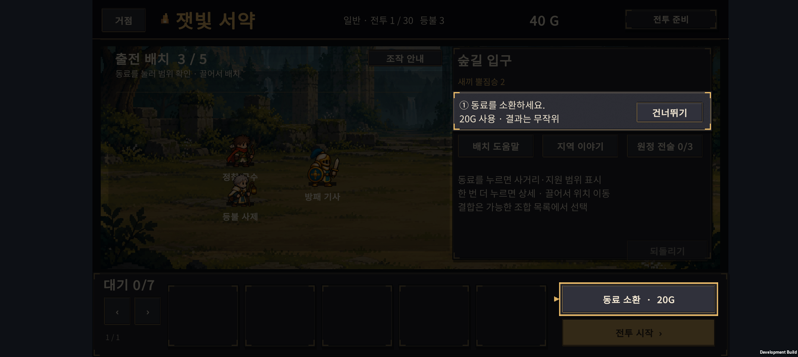
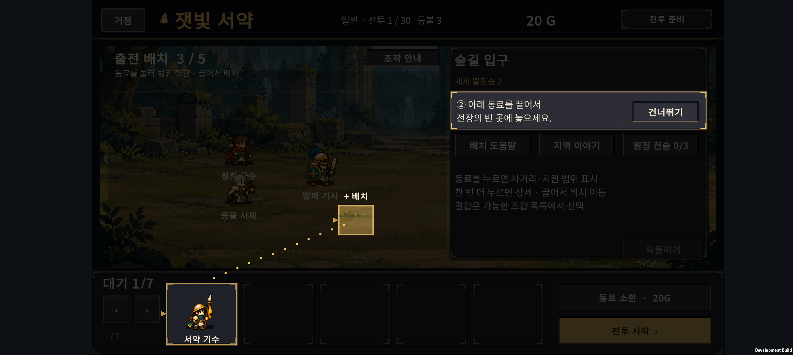
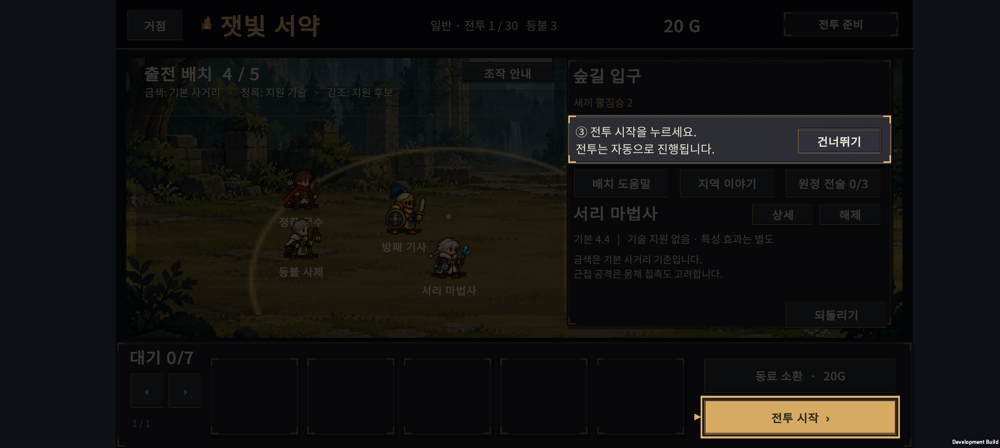
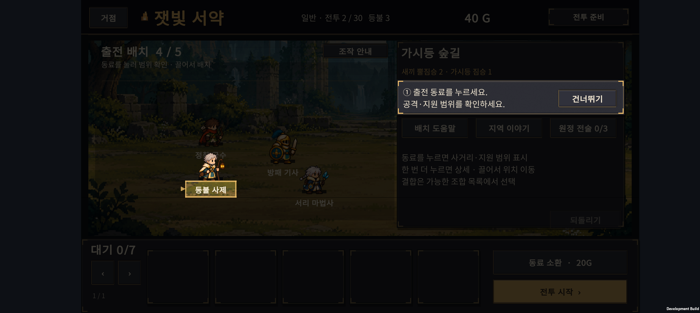
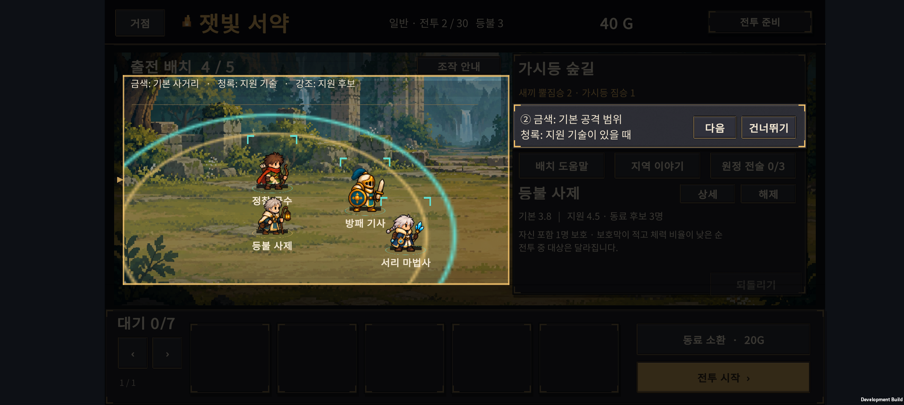

# v0.36 · 첫 원정 조작 안내

2026-10-25 · IGNIS: ASHEN OATH

처음 플레이할 때 실제 1·2전투에서 눌러야 할 버튼과 조작 대상을 강조한다. **안내 대상과 설명을 밝게 남기고 나머지 화면을 어둡게 덮는 스포트라이트 방식**이다. 실제 원정을 진행하며 소환·출전 배치·범위 확인을 배운다.

## 1. 안내 순서

| 구간 | 안내 | 플레이어가 하는 일 |
| --- | --- | --- |
| 첫 전투 | 동료 소환 | 강조된 소환 버튼으로 동료를 얻는다. |
| 첫 전투 | 출전 배치 | 대기석의 동료를 전장 빈 곳으로 끌어놓는다. |
| 첫 전투 | 전투 시작 | 출전한 동료로 자동 전투를 시작한다. |
| 두 번째 전투 | 동료 선택 | 전장에 있는 동료를 눌러 사거리와 지원 범위를 본다. |
| 두 번째 전투 | 범위 확인 | 금색 기본 사거리와 청록색 지원 범례를 확인한다. |
| 두 번째 전투 | 전투 시작 | 필요하면 위치를 조정한 뒤 다음 전투를 시작한다. |

한 번에 한 가지 행동을 보여준다. 안내 중에는 대상과 안내 카드의 조작을 받으며, 어두운 곳을 잘못 눌러 다른 행동이 실행되지 않도록 한다. `건너뛰기`를 누르면 자유롭게 조작할 수 있다. 이미 행동했거나 현재 편성에서 수행할 수 없는 단계는 상태에 맞게 안내한다.

소환·시작 단계는 해당 버튼을, 배치 단계는 대기 동료와 놓을 위치를 밝게 남긴다. 동료를 끌 때도 드래그 중인 모습이 가려지지 않는다. 설명과 다음·건너뛰기 버튼은 어두운 화면 위의 별도 카드에 표시한다.

## 2. 표시와 저장

- 기존에 플레이한 계정에는 자동 안내를 강제로 표시하지 않는다.
- `건너뛰기`는 현재 전투의 안내를 닫는다. 1전투 안내를 건너뛰어도 2전투 안내는 남아 있다.
- 전장 제목 옆 `조작 안내`로 다시 볼 수 있다. 1·2전투는 현재 상태에 맞는 단계부터, 3전투 이후는 현재 동료의 범위 확인 안내만 표시한다. 안내를 다시 열어도 원정을 초기화하지 않는다.
- 진행 중인 원정과 별도의 안내 상태를 저장한다.
- 소환은 기존처럼 실제 골드와 난수를 사용한다. 안내용 무료 동료나 확정 결과를 추가하지 않는다.
- 게임의 원정 저장 형식, 유닛 능력치와 전투 난도는 변경하지 않는다.

## 3. 범위

이번 안내는 첫 조작을 익히는 데 집중한다. 성장·진화·결합·전술 트리의 모든 규칙을 첫 화면에서 설명하지 않는다. 이후 처음 해당 선택을 할 때 필요한 안내를 추가할 수 있다.

초보자 첫 완주까지 걸리는 시간은 아직 실측하지 않았다. 이 안내를 적용한 실제 신규 플레이에서 소환·배치에 머무는 시간, 안내 건너뛰기, 첫 패배 구간을 확인한 뒤 난도를 판단한다.

## 4. 검증

- Unity Editor 안내·스포트라이트 검사 55개 통과: 신규·기존 계정, 안내 저장 값, 소환 후 상태, 재화 부족, 출전 정원, 건너뛰기와 다시 보기, 원정 데이터 불변, 겹친 강조 구역의 마스크 면적과 입력 허용 범위 검사.
- 기존 Unity 저장 마이그레이션 340개, 드래그·범위 입력 검사 26개, 전장 가림 검사 18개 통과.
- 독립 코드 검토에서 발견한 배치 안내 좌표의 실제 드롭 범위 불일치를 수정했다. 안내 지점은 실제 드롭 후 좌표가 바뀌지 않는 범위에서, 동료가 점유하지 않은 곳을 찾는다.
- 스포트라이트 추가 검토에서 거점 입력 차단, 밝은 배치 구역 가장자리의 성장 오동작, 버튼 밖에서 놓았을 때 입력 상태가 남을 수 있는 경로를 수정했다.

Galaxy Buddy2 실기기 확인:

- 기존 원정·성과가 있는 계정은 2전투 준비 화면에서도 자동 안내가 나타나지 않았다.
- 임시 신규 계정은 1전투 소환 안내부터 시작했다. 실제 20G를 사용해 무작위 동료를 대기석에 얻었다.
- 소환 직후 강제 종료·재실행 후에도 같은 동료와 20G가 유지되었고, 배치 안내부터 이어졌다.
- 표시된 빈자리로 드래그하면 출전 인원이 3명에서 4명으로 바뀌고 전투 시작 안내로 전환되었다.
- 실제 1전투 승리 후 2전투로 진행했다. 2전투 준비 상태에서 재실행하고 동료 선택·범위 표시·다음 버튼을 확인했다.
- 2전투 안내를 건너뛰고 재실행해도 자동 안내가 다시 나타나지 않았다. `조작 안내`로 다시 열고 진행할 수 있었다.
- 확인한 안내 본문과 다음·건너뛰기·조작 안내 버튼의 글자가 화면 안에 들어왔다. 전투 시작 버튼과 기존 설명 영역을 가리지 않았다.
- 스포트라이트 상태에서 어두운 전투 시작 버튼·다른 동료를 눌러도 실행되지 않았다. 밝은 소환 버튼에서 누른 뒤 바깥으로 손을 떼면 소환이 취소되고, 이어서 건너뛰기 버튼을 한 번 눌러 닫을 수 있었다.
- 배치 안내 중 대기 동료를 기존 동료 위에 오래 겹쳤다가 놓아도 성장 재료로 소모되지 않았다. 표시된 빈자리로 드래그하면 정상 배치되었고, 끄는 모습도 밝게 표시되었다.
- 준비 상태에서 재실행했을 때 거점의 이어하기가 정상 작동했다. 2전투에서는 밝게 보이는 사제의 머리를 눌러 범위 안내로 넘어가고, 다음 버튼으로 시작 안내까지 진행했다.
- 검사 종료 후 기존 PlayerPrefs 전체를 바이트 단위로 동일하게 복원하고 앱을 종료했다. 설치된 APK는 이번 빌드다.

Android 최종 빌드 성공: `unity/Logs/v036-spotlight-final-build.log`. 마지막 실행의 Unity·AndroidRuntime 로그에서 예외를 발견하지 않았다. 최종 APK에서도 캐릭터의 얼굴과 배치 글자를 강조선이 가리지 않는지 확인했다. 별도 장시간 성능 검사나 사람의 학습 효과 측정은 이번 작업에 포함하지 않았다.

APK SHA-256: `1B6E9197555E84F6DE7CFC175338E4D129DD39603D2D2BED53C2394701047CF6`.
