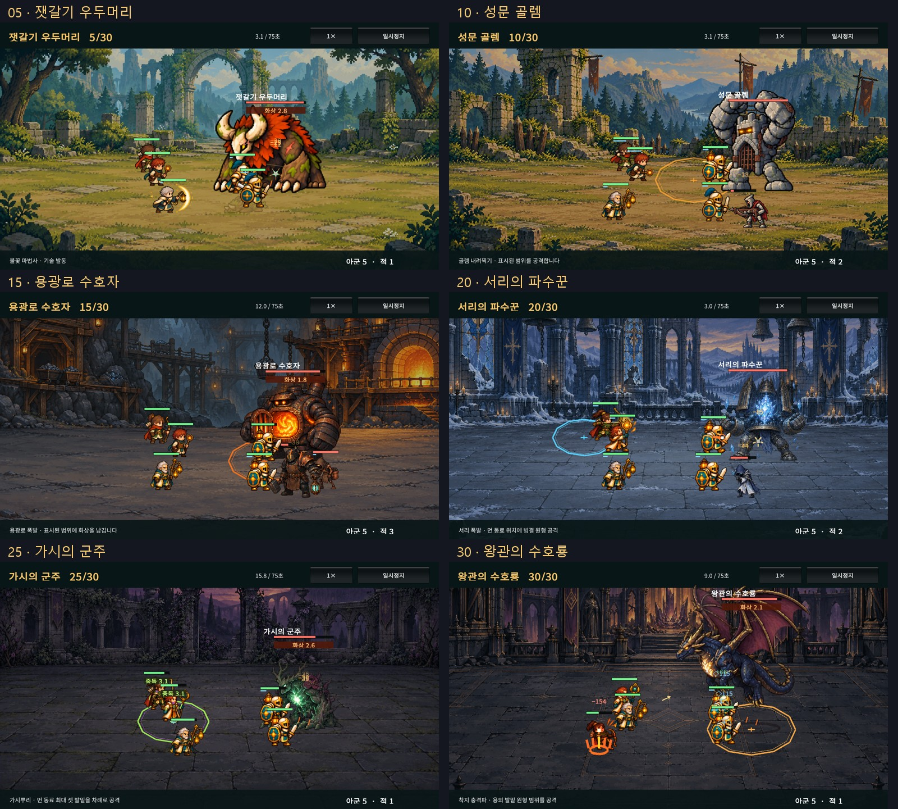
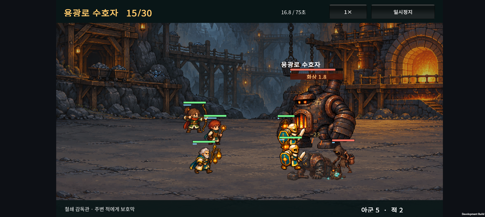
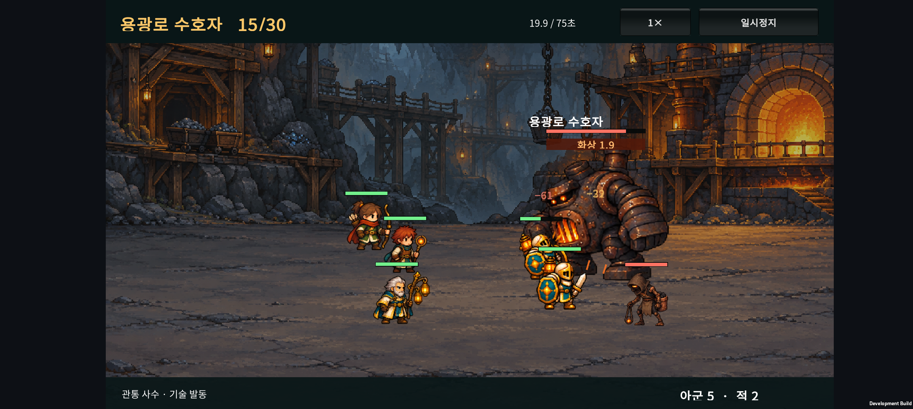
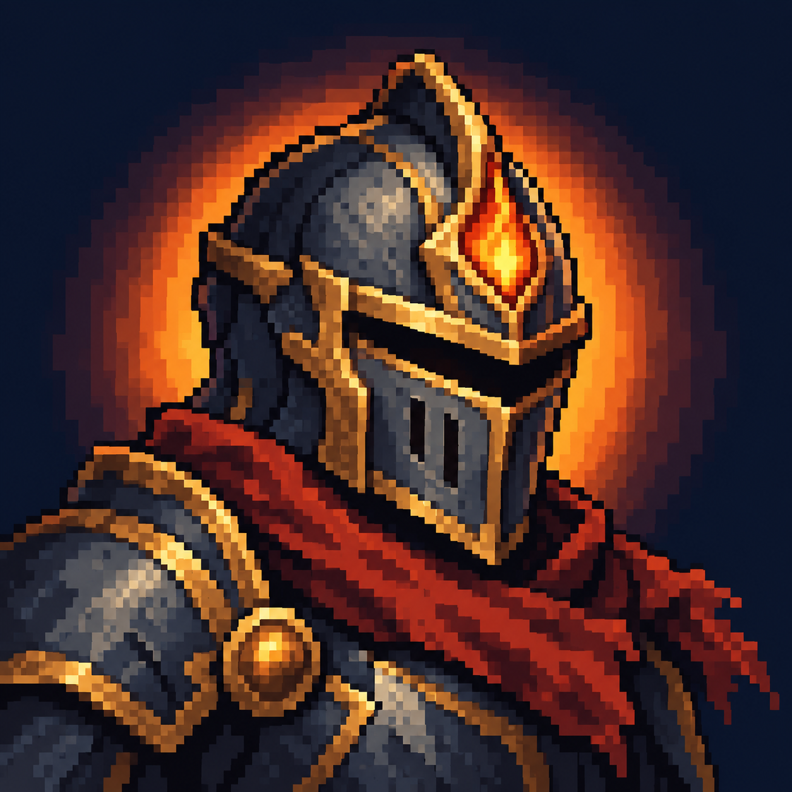

# v0.37 · 전투 화면 점검과 앱 아이콘

2026-10-25 · IGNIS: ASHEN OATH

**검토 결론: 지역 배경과 보스의 크기는 유지하고, 전투 중 겹치는 정보와 불필요한 움직임을 먼저 정리한다.** 지속 피해의 반복 피격과 시체 잔상은 수정했다. 피해 숫자·상태 표시, 어두운 적의 대비, 전투 HUD는 다음 개선 순서다. 아이콘은 기사 투구와 이그니스 불꽃을 결합한 초안을 만들었다.

## 1. 확인 방법과 범위

Galaxy Buddy2의 실제 앱에서 1~30전투의 장면을 확인했다. 일반전은 시작 약 2초·6초, 보스 5·10·15·20·25·30전투는 약 24초의 화면 녹화와 여러 시점의 캡처를 사용했다. 5·15전투는 짧은 간격의 녹화 프레임으로 공격·피격 흐름도 확인했다. 짧은 전투는 6초 전에 결과 창으로 전환됐다.

전투 준비 데이터는 현재 Core의 정상 소환·성장·배치·승패 처리로 만든 자동 정책의 체크포인트다. 시드 1은 29전투에서 한 번 패배하고 재배치하여 총 31회 전투로 완주했다. [자동 진행 기록](progression-trace.json)

**휴대폰에서 구매와 배치를 직접 선택하며 30전투를 연속 완주한 플레이테스트는 아니다.** 장면을 빠짐없이 비교하기 위해 전투별 체크포인트를 불러왔다. 자동 정책의 완주는 사람의 승률이나 초보자 난도 추정에 사용하지 않는다. 일반 최종 진화 중심의 한 편성이며, 30형태의 모든 기술·모든 조합을 전수 확인한 것도 아니다.

1~19전투의 최초 캡처는 v0.36 설치본, 20~30전투와 15·19전투 재확인은 아래 v0.37 설치본이다. 첫 점검 전 원본 PlayerPrefs 전체를 새로 백업했다. 빌드 종료 시 ADB가 잠시 재시작되어 20전투 직전에 캡처가 중단됐고, 재연결 후 원본 복구를 확인한 뒤 20전투부터 이어갔다. 당시 손상된 19전투의 6초 캡처도 다시 촬영·확인했다.

## 2. 발견한 문제와 처리

| 우선순위 | 관찰 / 코드 근거 | 판단과 처리 |
| --- | --- | --- |
| 수정 완료 | 화상·중독의 매초 피해도 직접 타격과 같은 피격 상태를 만들고, 공격 동작보다 우선한다. | BURN·POISON 이벤트는 몸의 피격 타이머를 새로 만들거나 덮지 않는다. 피해 숫자·체력·상태 효과는 유지한다. 이미 받은 직접 타격의 피격 타이머도 그대로 자연 감소한다. |
| 수정 완료 | 쓰러진 유닛의 투명도 하한이 24%여서 긴 전투에서 시체가 계속 남는다. 용광로 16초 장면에서 쓰러진 적과 전열이 겹친다. | 사망 동작을 0.45초까지 선명히 보여준 뒤 1.05초까지 사라지게 한다. 사망한 유닛의 시각 시간은 빙결 상태에 붙잡히지 않는다. |
| 다음 1순위 | 보스 근처에 피해 숫자·화상 표시·체력바가 밀집한다. 용광로와 후반 밀집 배치에서 특히 복잡하다. 비행 중에는 용의 날개·이름·체력바가 화면 상단에 몰린다. | 보스 체력 정보를 고정 위치로 옮기고, 같은 대상의 짧은 연속 피해를 묶거나 숫자 위치를 분산하는 방안을 검토한다. 상태 아이콘과 남은 시간의 영역도 분리한다. 아직 적용하지 않았다. |
| 다음 2순위 | 폐광의 갈색 적·검은 장비, 정원의 어두운 녹색 적이 배경과 비슷한 밝기로 보인다. | 적 외곽의 밝은 가장자리나 뒤쪽 바닥의 국소 대비를 보정한다. 전체 적을 크게 키우기 전에 실루엣을 먼저 읽히게 한다. 아직 아트 수정하지 않았다. |
| 다음 3순위 | 전투의 상하단 초록 패널과 기본 회색 버튼이 거점의 잿빛·금장 UI와 다르다. 일부 성채 돌진 안내는 인간형 적에게도 ‘야수’라고 말한다. | 전투 HUD를 공통 테마로 맞추고, 돌진 안내는 적 이름·행동 기준으로 통일한다. 아직 적용하지 않았다. |
| 추가 관찰 | 투사체 표시가 선딜 마지막 구간에서 현재 표적 위치를 매 프레임 따른다. | 이동 표적에서 경로가 급히 변할 가능성이 있다. 정적 코드에서 찾은 후보이며, 이번 관측만으로 심한 궤적 오류라고 확정하지 않았다. 적중 시점과 발사 포즈를 함께 검토한 뒤 수정한다. |

두 캡처는 같은 편성의 서로 다른 진행 시점이다. 프레임 단위로 동기화한 전후 비교는 아니며, 살아 있는 적의 수와 쓰러진 적의 잔상을 함께 확인했다.

[정원 적의 대비와 상태 표시](screenshots/garden-visibility.png) · [비행 중 상단에 몰리는 보스 정보](screenshots/drake-flight.png)

보스의 일반 피격 흔들림을 없앤 기존 정책, 적의 왼쪽 방향, 살아 있는 아군의 전면 표시, 적끼리 발 위치에 따른 부분 가림은 유지했다. 이번 수정은 표시 코드이며 능력치·AI·공격 시점·재화·난도를 변경하지 않는다.

## 3. 유지할 부분과 다음 목표

- 숲→성채→폐광·용광로→서리 성당→황혼 정원→왕궁의 배경·색 변화가 명확하다.
- 졸개·정예·보스의 크기 차이가 읽힌다. 보스를 다시 크게 키우는 일보다 정보 겹침을 줄이는 일이 우선이다.
- 보스의 돌진·원형 공격 예고와 큰 공격 포즈가 일반 공격과 구별된다.
- 지원가와 원거리 동료가 후열에 남고 전열이 앞으로 접근하는 구도는 읽힌다. 같은 직업이 몰리면 몸과 체력바가 겹치므로 정보를 모두 크게 표시하는 방식은 피한다.

위 평가는 화면의 가독성과 연출에 대한 제작 판단이다. 사람의 플레이 만족도나 장시간 발열·프레임 안정성을 측정한 결과는 아니다. Android 화면 녹화에는 소리가 포함되지 않아 이번에는 사운드 믹싱을 평가하지 않았다.

**다음 개발 제안: 전투 HUD와 피해·상태 표시 정리 → 어두운 적 실루엣 보완 → 투사체·발사 타이밍 점검.** 새로운 유닛이나 보스를 늘리기 전에 현재 전투를 더 쉽게 읽을 수 있게 하는 순서다.

## 4. 앱 아이콘 방향

추천은 **도트 기사 투구 + 이그니스 불꽃**이다. 기사 실루엣으로 장르를, 주황색 불꽃으로 게임의 상징을 전달한다. 어두운 남색·검은 금속·금장·붉은 스카프를 사용하고 작은 글씨는 넣지 않았다.

[96·64·48 px와 원형 잘림 미리보기](icon/preview.html)

| 방향 | 장점 | 판단 |
| --- | --- | --- |
| 기사 + 불꽃 | 중세 전투와 게임의 상징이 함께 보임 | 1안으로 추천 |
| 불꽃 문장만 | 간결하고 UI 상징으로 확장하기 쉬움 | 장르 표현이 약해 타이틀·연구 문장에 적합 |
| 동료 3명 | 파티 게임이라는 의미가 분명함 | 작은 크기에서 얼굴·무기가 뭉칠 위험 |

사용자가 이 시안을 앱 아이콘으로 확정했다. 승인한 그림 원본을 그대로 앱 자산으로 가져와 기본 아이콘과 Android 아이콘에 연결한다. 별도의 적응형 전경·배경 분리, 단색 아이콘, 스토어 등록 이미지는 후속 제작 범위다.

내장 `image_gen` 사용. 기존 게임 캐릭터나 로고를 입력·참조하지 않고 새로 생성했다. [전체 제작 프롬프트](icon/prompt.txt) · 원본 파일 `icon/ignis-knight-concept.png`.

## 5. 검증과 기록

- SOL이 표시 변경을 구현하고 ASTRA가 별도로 코드 검토했다. Editor 검사의 public 필드 접근 문제를 찾아 수정했다.
- Unity Android 빌드 종료 코드 0. 실제 Core 화상·중독 이벤트가 피격 타이머를 덮지 않는지, 사망 마지막 프레임과 알파가 유지·감소하는지 검사했다.
- 기존 전투 정산의 한 번만 콜백·일시정지·초기화 검사, 전장 가림 18개, 안내 55개와 저장·아트 검증을 같은 빌드에서 통과했다.
- 사망 표시 검사는 프레임/알파 함수와 이벤트 연결을 검증한다. 모든 배속·모든 기술의 시각 품질을 증명하는 검사는 아니다. 독립 개발 랩의 시체 표시는 이번 수정 범위 밖이다.
- 수정 APK를 Buddy2에 설치했다. 정원 중독·용광로 화상 상태에서도 공격 동작이 진행되고, 쓰러진 호위의 잔상이 계속 남지 않는 것을 기기 캡처와 15전투 녹화 프레임에서 확인했다.
- 20~30·15전투 점검과 마지막 19전투 재확인의 Unity·AndroidRuntime 로그에서 예외·크래시 항목을 발견하지 않았다.
- 점검 종료 후 원본 PlayerPrefs를 바이트 단위로 동일하게 복원했다. 기존 2전투 준비·60G·기사/궁수/사제 3명 기록이며, 앱은 종료 상태다. 새 APK는 설치되어 있다.
- 아이콘 미리보기의 96·64·48 px와 원형 잘림을 직접 확인했다. 이미지 로딩 정상, 1280 px 너비에서 가로 넘침 없음.

대표 캡처는 이 문서에 보관했다. 전체 90장 장면과 여섯 보스 녹화, 짧은 간격의 추출 프레임은 `.local-tools/v037-review/`에 남겼으며 Git에 포함하지 않는다.

빌드 로그: `unity/Logs/v037-combat-review-build.log`

전투 검토 APK SHA-256 (아이콘 적용 전): `457A65EFF5E905CDBDC0D13570B00074C194F8FD06DDE868D2E71D3F914E71AB`

## 6. 아이콘 확정과 현재 저장 구조

아이콘 원본: `unity/Assets/Art/Branding/ignis-app-icon.png`. 승인한 생성 이미지와 동일한 파일이다. 빌드 준비 시 기본 아이콘과 Android Legacy·Round 슬롯을 다시 연결해 다음 빌드에도 유지한다. 별도 적응형 레이어는 추가하지 않고 시스템의 기존 아이콘 표시 경로를 사용한다. [Unity 아이콘 설정 API](https://docs.unity3d.com/6000.3/Documentation/ScriptReference/PlayerSettings.SetPlatformIcons.html)

- 아이콘의 Unity 가져오기 형태를 `Texture2D`로 고정했다. 원본 이미지의 픽셀은 변경하지 않았다.
- Unity Android 빌드 종료 코드 0. 튜토리얼·전장 가림·피격과 사망 표시·저장·아트 검증을 다시 통과했다.
- 생성된 Android Manifest의 기본·원형 아이콘 참조와 여섯 크기 리소스를 확인했다.
- Buddy2에 새 APK를 설치하고 [Android 앱 정보 화면의 실제 아이콘](icon/buddy2-app-info.png)을 확인했다. 설치 전후 PlayerPrefs가 바이트 단위로 동일하다.
- 아이콘 적용 빌드 로그: `unity/Logs/v037-icon-build.log`
- 아이콘 적용 APK SHA-256: `3F49D7988CD6ECA7A8B239ACCF13864400964BD24AB6D859F93A4E5DAC9C9ECD`

현재 진행 데이터는 **Unity PlayerPrefs에 JSON으로 저장**한다. 별도 SQLite 데이터베이스나 서버 DB 연결은 없다.

| 데이터 | 저장 방식 |
| --- | --- |
| 진행 중 원정·전투 단계·골드·동료·배치·성장·원정 전술 | `ember.expedition.run.v013`의 JSON |
| 최고 진행·완주·영구 연구 | `ember.expedition.progress.v027`의 JSON |
| 개방한 이야기 기록 | `ember.expedition.story.v025`의 JSON |
| 튜토리얼 완료 상태 | `ember.expedition.tutorial.v036`의 정수 |
| 직업 능력치·기술·스테이지 규칙 | 앱에 포함된 콘텐츠 JSON과 C# 코드 |

계정 로그인, 자체 서버, 클라우드 동기화와 기기 간 기록 이전 기능은 아직 구현하지 않았다. 앱이 제공하는 별도 백업·복원 기능도 없다. OS가 제공할 수 있는 백업과는 별개로, 현재 프로젝트에서 삭제·기기 교체 후 복구를 보장하는 경로는 없다. 이 요청에서는 저장 방식을 변경하지 않는다.

v0.35~v0.37의 준비 범위·튜토리얼·전투 정리와 아이콘 적용을 함께 커밋한다. 기존 v0.7 문서의 별도 편집은 포함하지 않는다. 푸시는 요청하지 않아 실행하지 않는다.
