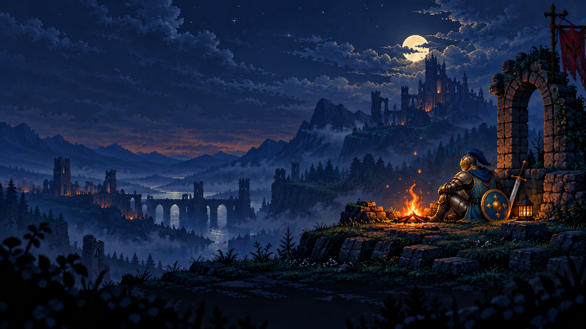
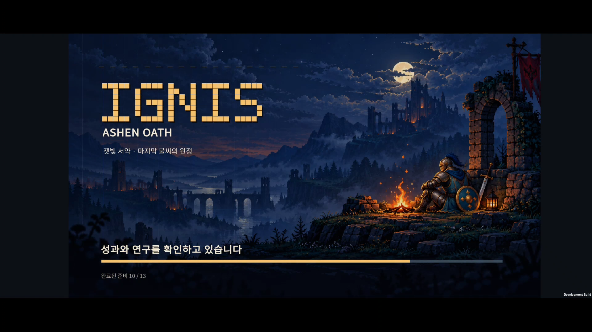

# IGNIS v0.38 — 도트 스플래시와 시작 준비

## 1. 화면 방향

폐허가 된 왕국, 달빛 아래 성, 모닥불 곁에 앉은 기본 기사 `B-KN`. 어두운 남색과 주황 불씨로 승인한 앱 아이콘과 분위기를 연결했다.

초기 시안의 검은 갑옷·붉은 천을 두른 인물은 플레이 가능한 유닛과 외형이 달랐다. 최종 그림에는 실제 기본 기사 `B-KN`의 금빛 장식, 푸른 투구 장식과 천, 청록색 둥근 방패를 가져왔다. 단, 게임 내 작은 캐릭터의 귀여운 비율을 그대로 확대하지 않는다. 사용자가 선호한 최초 시안의 성인 기사 비율, 묵직한 갑옷, 모닥불 곁에서 쉬는 자세와 고요한 분위기를 유지했다. 배경의 도트 스타일을 유지하면서, 기사의 체형과 재질을 더 사실적으로 표현했다.

- 왼쪽: 사각 도트로 그린 IGNIS 제목, ASHEN OATH와 한글 부제.
- 오른쪽: 기사와 모닥불, 천천히 올라가는 작은 도트 불씨.
- 하단: 현재 준비 작업과 실제 완료 비율을 보여주는 하나로 이어진 금색 로딩바. 사용자 피드백에 따라 조각 사이 간격을 없앴다.
- Unity 로고는 표시하지 않는다. 엔진이 시작되는 동안에는 우리 배경을, 게임 코드가 실행되면 실제 로딩 상태를 표시한다.

## 2. 로딩 동작

동료 자료, 여섯 지역 배경, 이야기 기록, 연구 성과, 진행 중 원정, 튜토리얼 상태, 동료 그림 준비를 순서대로 처리한다. 배경은 `Resources.LoadAsync`로 읽고 단계 사이에 화면이 그려질 수 있게 한다.

**13개 준비 단계의 실제 완료 수**를 표시한다. 데이터 용량에 따른 다운로드 퍼센트는 아니다. 서버 접속이나 업데이트 확인 문구는 넣지 않았다.

완료되면 `준비 완료`를 0.3초 표시하고 기존 시작 메뉴로 넘어간다. 전투 후 메뉴로 돌아올 때는 스플래시를 반복하지 않는다. 준비 중에는 게임 조작과 원정 저장을 막고, 핵심 초기화 오류에는 다시 시도 버튼을 표시한다. 손상된 원정 저장은 기존 복구 안내를 유지한다.

## 3. 아트와 구현

- 배경: `unity/Assets/Resources/Art/Branding/ignis-splash-v1.png`.
- 제작: 내장 `image_gen`으로 배경 생성 후, 프로젝트 자체 유닛 원본 `unity/Assets/Resources/Art/Units/v010/B-KN.png`에서 장비와 색상 특징을 가져왔다. 최종 그림은 최초 배경을 편집해 성인 기사 비율을 유지했다. 다른 게임의 캐릭터·로고는 참조하지 않았다.
- [최종 수정 프롬프트 — 사실적인 기사와 유닛의 특징](splash-knight-realism-prompt.txt).
- 제작 이력: [최초 생성](splash-prompt.txt) → [작은 캐릭터 비율의 중간 시안](splash-knight-edit-prompt.txt) → 최초 시안의 체형과 분위기를 유지한 최종 수정.
- 런타임: `ExpeditionStartupScreen.cs`, 초기화 연동: `ExpeditionScreen.cs`.
- 빌드 설정: `StartupArtSetup.cs`. 같은 이미지를 엔진 시작 배경과 런타임 로딩 배경에 사용한다.
- 배경 그림 속 기사 자체는 정지 이미지다. 움직이는 불씨와 진행 표시는 코드로 그린다.

## 4. 검증

- Unity Android 빌드 성공. 최초 통합 빌드에서 기존 저장·튜토리얼·전투 정산·피격·가림·아트 검사를 통과했다.
- SOL이 런타임 로딩과 화면을 구현하고 ASTRA가 초기화 순서와 실제 화면을 검토했다. 배경 그라데이션이 겹쳐 세로선처럼 보이던 문제를 수정했다.
- 사용자 피드백에 따라 13개로 나뉘던 로딩 표시를 간격 없는 한 줄로 변경했다. 색이 채워지는 길이는 실제 완료 단계 비율이다.
- Buddy2에서 배경 표시 → 지역 그림 로딩 → 준비 완료 → 기존 시작 메뉴의 이어하기까지 확인했다. 제목·문구·로딩바 잘림은 보이지 않았다.
- Unity의 기본 로고는 계속 꺼져 있다. 배경 전용 네이티브 표시 구간에는 2초짜리 빈 로고 항목을 사용한다. Android/엔진이 그림을 표시할 수 있기 전의 짧은 단색 부팅 구간은 남는다.
- 사실적인 기사로 수정한 최종 빌드를 Buddy2에 설치해 다시 확인했다. 녹화의 3.2초 표본에서 배경, 6.4초에서 로딩, 6.8초에서 준비 완료, 7.2초에서 시작 메뉴가 보였다. 녹화는 실행 명령보다 먼저 시작했으며, 이는 한 기기의 한 번 측정으로 일반적인 성능 수치는 아니다.
- 확인 후 테스트 전 PlayerPrefs를 바이트 단위로 동일하게 복원했다.

[준비 완료](screenshots/ready.png) · [로딩 전 배경](screenshots/native-background.png)

스플래시 수정 검증 빌드 로그: `unity/Logs/v038-splash-realism-build.log`.

해당 검증 APK SHA-256: `F6C8518B49DFF743C529EEAD752A43538AA1904CC01FEFF76C832B9A3D9DEF1D`.

## 5. 앱 아이콘 통일

사용자 요청에 따라 스플래시와 같은 기사를 앱 아이콘에 반영했다. 기존 아이콘의 붉은 천·이마 불꽃 장식을 푸른 투구 장식과 천으로 바꾸고, 금빛 투구 테두리와 무게감 있는 금속 질감을 살렸다. 얼굴과 투구 중심의 구도로 작은 크기에서도 인상이 남도록 했다.

- [아이콘 미리보기 — 96·64·48 px와 원형 잘림](icon/preview.html).
- 원본: `unity/Assets/Art/Branding/ignis-app-icon.png` (1254 × 1254).
- `AppIconSetup`의 기본 아이콘 및 Android Legacy·Round 슬롯은 같은 파일을 사용한다.
- 내장 `image_gen`으로 기존 아이콘을 편집하고, 승인한 스플래시를 캐릭터 참조로 사용했다. [제작 프롬프트](icon/prompt.txt).
- 브라우저의 96·64·48 px 미리보기에서 얼굴과 푸른 장식의 구분, 원형 마스크에서 주요 얼굴 영역이 남는 것을 확인했다.
- Android 빌드 성공 후 Buddy2에 업데이트 설치했다. [앱 정보 화면](screenshots/icon-app-info.png)에서 새 아이콘 적용을 확인했고, 기존 PlayerPrefs는 확인 전과 바이트 단위로 동일하게 보존했다.

최신 빌드 로그: `unity/Logs/v038-icon-build.log`.

아이콘 교체 APK SHA-256: `AB2CC8A1B0F434DB77C26AFFC07E908EF154A5CB9DEFDBBEFE038FC447457DFE`.
