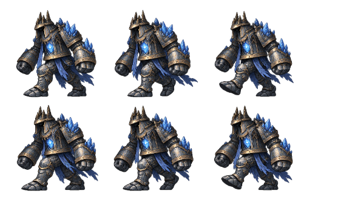
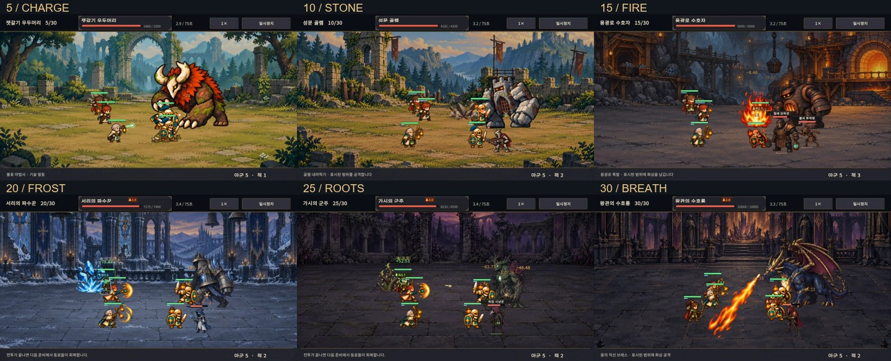
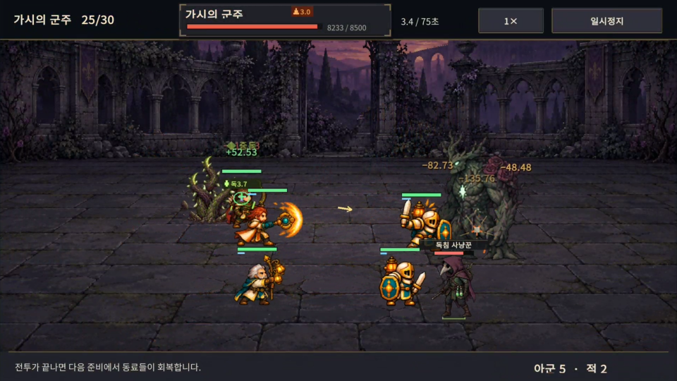
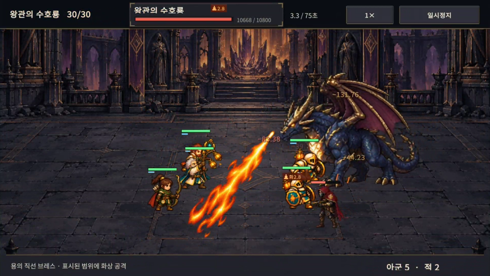
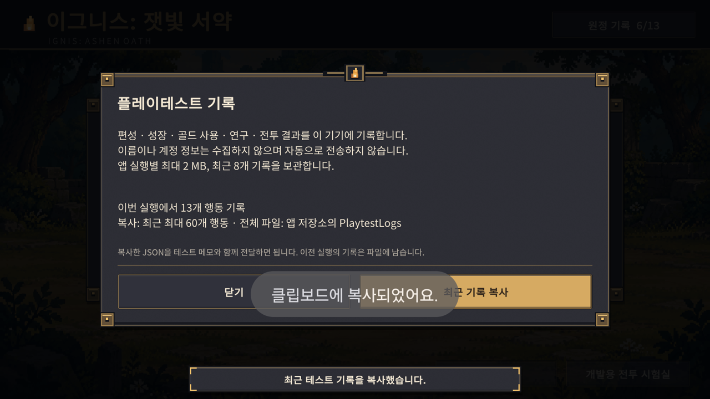
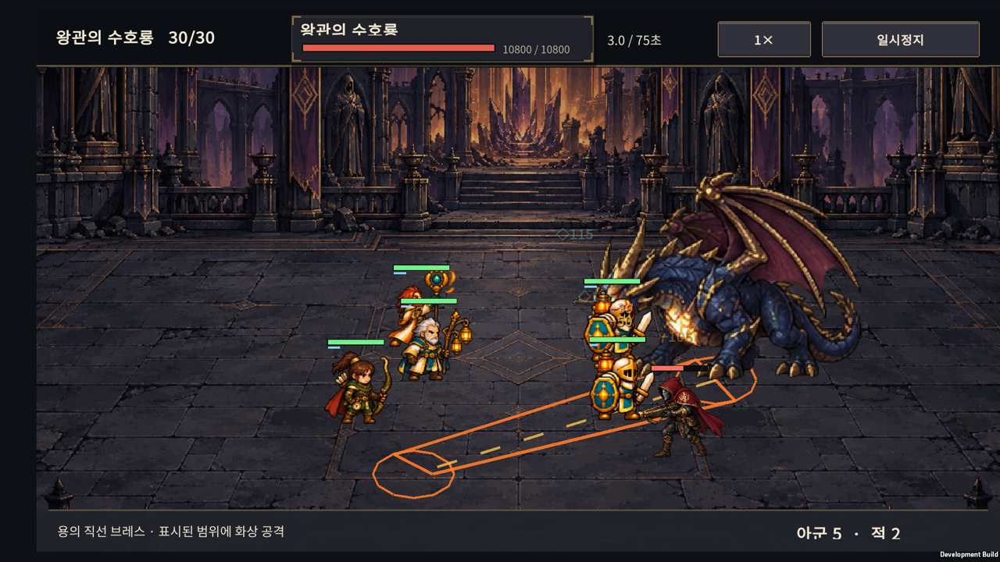

# v0.39 · 전투 정보·보스 공격 효과·플레이테스트 기록

2026-10-25 · IGNIS: ASHEN OATH / 이그니스: 잿빛 서약

[출시 준비 계획](../release-readiness-v0.38.html)의 1단계 작업이다. 보스 정보를 읽기 쉽게 만들고, 이후 사람 플레이테스트를 분석할 수 있는 최소 기록 기능을 연결했다. Normal 30전투의 능력치·골드 비용·보상·난도와 공격 계산은 그대로다.

## 1. 변경한 것

| ID | 변경 | 범위 |
| --- | --- | --- |
| B01 | 보스 이름·HP·상태를 상단 고정 패널에 표시 | 비행과 공격 중에도 위치가 고정된다. 몸 위 중복 보스 정보는 제거했다. 시간·배속·일시정지 버튼은 별도 영역이다. |
| B02 | 직접 타격과 화상·중독 피해를 구분 | DOT는 이름·색·위치로 구분하며 같은 대상·같은 상태의 0.22초 이내 표시만 합산한다. 빙결·화상·중독에는 서로 다른 작은 도형을 쓴다. 실제 피해 계산은 합치지 않는다. |
| B03 | 폐광·정원 일반 적에 작은 명판과 발 표식 추가 | 어두운 배경에서 적의 위치를 파악하기 쉽게 했다. 보스 뒤 호위의 자연스러운 가림과 아군 전면 표시 정책을 유지한다. |
| B04 | 지원 기술에 나오던 공격 효과 교정 | 기본 원거리 공격에만 선딜 투사체와 발사음을 표시하고, 같은 팀 대상의 지원 기술에는 근접 베기 효과를 만들지 않는다. |
| B05 | 기기 안에 진단 JSONL 저장, 최근 기록 복사 | 개발 빌드의 거점 → **테스트 기록 → 최근 기록 복사**. 계정·서버 연결 없이 동작한다. |

직접 피해 숫자는 같은 대상의 최근 타격을 최대 6개 위치에 나누고 어두운 그림자를 추가했다. 화면 위·아래 경계에서는 전체 배치를 함께 이동한다. 극단적인 밀집 상황의 모든 겹침을 없애는 방식은 아니며, 숫자 표시는 기존처럼 동시에 최대 24개다.

## 2. 보스마다 다른 공격 효과

사용자의 추가 요청에 따라 기존 6종의 고유 공격을 눈으로 구분하기 쉽게 강화했다. 새로운 피해 패턴을 추가하거나 난도를 올린 작업은 아니다. 기존 패턴의 **예고 → 실제 타격 → 잔여 효과**를 분리했다.

| 보스 | 기존 고유 공격 | 이번 시각 보완 |
| --- | --- | --- |
| 잿갈기 우두머리 · 5전투 | 경로를 예고한 돌진 | 흙먼지 구름과 돌조각이 터졌다 흩어지는 프레임 애니메이션 |
| 성문 골렘 · 10전투 | 내려찍기, 분노 후 후속 충격파 | 바위 덩어리가 솟고 부서지며 가라앉는 애니메이션 |
| 용광로 수호자 · 15전투 | 폭발, 분노 후 불씨파 | 화염 폭발 프레임을 사용하고 본공격과 후속 공격의 높이·크기를 구분 |
| 서리의 파수꾼 · 20전투 | 원형 서리 공격·빙결 | 입체적인 얼음 결정이 솟고 조각으로 깨지는 애니메이션 |
| 가시의 군주 · 25전투 | 여러 지정 지점의 독가시 | 굵은 나무껍질·이끼·가시가 그려진 덩굴의 발생 → 성장 → 붕괴 |
| 왕관의 수호룡 · 30전투 | 직선 브레스, 비행 낙화, 착지 공격 | 입에서 뻗는 불꽃, 낙하 불덩이, 착탄 폭발을 각각 프레임으로 재생 |

효과는 실제 공격 이벤트의 좌표를 받아 그린다. 위험 범위와 예고 시간, 피해·화상·빙결·독 계산은 유지했다. 낙하 불꽃은 일반/분노 상태의 실제 경고 시간에 맞춰 내려온다. **투명 PNG 시트 6장**을 캐시하고 프레임 UV를 바꿔 재생한다. 4열 × 2행의 시트이며, 낙하 불꽃 시트는 위 4프레임을 낙하·아래 4프레임을 착탄에 사용한다. 기존 효과 24개 상한 안에서 동작하며 매번 파티클 오브젝트나 텍스처를 생성하지 않는다.

처음 구현한 선·도형 기반 공격 효과는 사용자의 “여전히 선처럼 보인다”는 피드백을 받아 교체했다. 바닥 위험 범위의 선은 조작 정보로 남겼고, 보스 공격 본체는 실제 이미지 애니메이션으로 바꿨다. 기본 공격·상태 표시의 작은 선 효과는 이번 교체 범위 밖이다. 화염 폭발 시트는 용광로·수호룡 착탄·착지에 재사용하며 연출 크기가 다르다. 신규 피해 패턴을 추가한 작업은 아니다.

에셋은 built-in `image_gen`으로 생성했으며 원본과 [생성 프롬프트](ART-PROMPTS.md)를 보관했다. 런타임은 Point 필터·밉맵 없음·Clamp·최대 1024px로 가져온다. 보스별 주요 타격 효과를 확인한 1차 통합이며 장시간 성능 측정과 추가 아트 보정은 남아 있다.

[도트 공격 애니메이션 미리보기](boss-effects-preview.html)에서 시트의 프레임 동작을 반복 재생할 수 있다.

### 얼음 보스 디자인 선택 · 보행은 미완성

사용자는 서리 보스의 기존 걷기가 어색하다고 지적했고, 회색 갑옷·짙은 남색 천·옅은 얼음빛을 가진 아래 시안을 첨부해 선택했다. **디자인·색감만 선택되었으며 보행은 아직 미완성이다.** 원본 6프레임은 같은 쪽 다리가 앞선 자세를 반복해 자연스러운 양발 교차가 부족하다. 시험 연결은 제거했고 기기에는 기존 보행을 유지했다. 나중에 생성한 채도가 높은 파랑·금색 시안은 적용하지 않았다.

- [선택한 디자인의 보행 시안 미리보기 · 미완성](frost-walk-preview.html).
- 미리보기는 발바닥 접지를 맞추고 원본 신체 높이 459px을 게임 기준 244로 환산해 8fps로 재생한다. 접지 보정만으로 양발 교차 문제는 해결되지 않는다.
- 원본의 두 행 사이 분할선은 y=490이다. 원본과 프레임 manifest, 미사용 렌더러는 다음 제작을 위한 초안으로 보관했다.
- 원본 첫 프레임을 다리별로 잘라 회전하는 HTML 실험도 했다. 다리·천의 절단 경계와 빈틈이 보여 게임에는 적용하지 않았다.
- 다음 제작에는 반대쪽 발이 앞서는 자세, 발이 교차하는 중간 자세, 디딤발이 지면을 지지하는 구간이 필요하다. 선택한 색감과 체형을 기준으로 한다.

## 3. 테스트 기록 사용법

1. 앱에서 새 원정을 시작해 플레이한다.
2. 문제를 발견하면 화면과 상황을 적는다. 거점의 **테스트 기록**을 연다.
3. **최근 기록 복사**를 누르고 테스트 메모에 붙여 넣는다. 자동 전송은 없다.
4. 한 원정 전체를 분석할 때는 전체 JSONL 파일을 함께 보관한다. 앱 실행이 여러 번이었다면 각 실행의 파일이 필요하다.

### 기록하는 정보

- 스키마 `ignis-playtest-1`, 개발 버전 `v0.39`, 앱 버전, 무작위 세션/원정 구분자.
- 새 원정의 생성 시드, 단계·현재 RNG 상태·출전 및 대기 편성·성장·전승·배치.
- 시작 편성과 원정에 적용한 영구 연구, 원정 안에서 구매한 전술.
- 소환·성장·진화·결합·되돌리기·배치·전술 구매 후 상태와 골드 변화.
- 승패, 등불, 보상, 실제 전투 시뮬레이션 시간, 거점 복귀와 앱 백그라운드/복귀.

### 보관 범위와 해석

- 개발 빌드에서만 기록한다. 이름·계정·휴대폰 고유 식별자·연락처는 수집하지 않는다.
- `Application.persistentDataPath/PlaytestLogs`에 실행별 JSONL을 저장한다. 현재 Android 앱에서는 `/sdcard/Android/data/com.expeditionprototype.combatdemo/files/PlaytestLogs`다.
- 최근 **8개 앱 실행**, 실행별 **최대 2 MB**. 새 실행이 시작되면 오래된 진단 파일부터 정리한다. 게임 저장은 이 정리 대상이 아니다.
- 복사는 최근 최대 **60개 이벤트 / 180 KiB**까지다. 일부만 복사되면 `recentEventsOnly: true`로 표시한다. 전체 원정 기록이라고 해석하지 않는다.
- 원래 시드를 저장하지 않았던 기존 원정은 `restored_checkpoint`, `initialSeedKnown: false`다. 현재 RNG를 원래 시드라고 표기하지 않는다. 앱을 다시 켜도 새 진단 구간으로 시작하므로 여러 구간의 자동 연결은 아직 없다.
- 내보낸 `state`는 게임의 `ExpeditionRun.Restore`에 넣어 해당 시점 이후 전투·소환을 재현할 수 있다. 이전 되돌리기 이력은 생략하므로 과거 행동의 취소까지 복구하는 게임 백업은 아니다.
- `hasState: true`인 이벤트만 상태 스냅샷으로 읽는다. 앱 포커스·백그라운드 이벤트는 상태가 없는 메타데이터다. Unity 직렬화가 null 클래스에 기본값 객체를 만들 수 있으므로 `state.Wave`만 보고 집계하지 않는다.
- `battleSeconds`는 게임 속도 기준이다. `foregroundSeconds`는 앱이 전면에 있는 누적 실제 시간이며 메뉴와 게임 내 일시정지를 포함한다. 앱이 뒤로 간 시간은 제외한다. 준비·휴식 시간의 정밀 분리는 관찰 메모로 보완한다.
- `battle_win/loss`는 실제 결과 콜백에서만 남긴다. `battle_exit`, `app_background`, `run_replaced`를 패배로 집계하지 않는다. 강제 종료는 마지막 이벤트 뒤에 기록 없이 끝날 수 있다.
- 용량 한도와 쓰기 오류는 기록 화면에 알리고 진단만 멈춘다. 원정 저장·게임 진행을 멈추지 않는다. 강제 종료 시 마지막 JSONL 행은 불완전할 수 있으므로 분석할 때 마지막 손상 행을 제외한다.

## 4. 검증 기록

SOL이 전투 표시를 구현하고 ASTRA가 Core 영향과 진단 구조를 검토했다. 내보낸 이력을 `null`로 생략하면 게임의 복원 검사가 거부하는 문제를 발견해 **빈 배열**로 수정했다. 내보내기 → 복원 → 동일 랜덤 소환과 전투 결과 검사를 추가했다.

자동 검사는 진단 저장·복사·용량/파일 수 제한·I/O 실패 격리·시드 구분·골드 변화·전투 결과 보존, 보스 HUD 영역, DOT 합산, 일시정지와 1회 정산, 발 기준 가림 정책을 다룬다.

### 자동 검사와 빌드

- 진단 검사 **93개** 통과: 로그가 게임 상태·RNG를 바꾸지 않음, 소환 비용과 보상, 내보낸 상태의 복원·다음 소환·전투 결과 재현, 용량 제한과 쓰기 오류 격리.
- HUD·숫자 배치와 **10개 보스 공격 이벤트 → 효과 연결** 검사 통과. 상하 경계의 숫자 6개 배치가 서로 겹치는 문제도 수정했다.
- 스프라이트 원본 **6장·48개 프레임**, 투명 경계와 Unity의 Point·Clamp·1024px 가져오기 설정 검사 통과. 먼지 시트 상단의 불규칙한 빈 간격은 별도 분할 좌표로 처리한다.
- 일시정지·재시작·결과 콜백 1회 정산 검사, 발 기준 표시 순서·호위 표식 **18개** 검사 통과.
- 최종 Android 개발 APK 빌드 성공. `Core` 파일 변경은 없다. 대표 상태의 동일 시드 검사이며, 모든 조합의 난도 불변을 전수 검사했다는 의미는 아니다.
- 기기 검증을 마친 공격 시트 빌드 로그: `unity/Logs/v039-sprite-build.log`. 보행 시험 빌드 `unity/Logs/v039-walk-build.log`는 컴파일만 통과했으며 시각 품질 미달로 설치하지 않았다.
- APK: `unity/Builds/Android/expedition-combat-prototype.apk`.
- 기기에서 검증한 APK SHA-256: `C4A6D6C1F293DE28ECD6BAE3CC17138B911101890C244947F9288CFE3CC7B24E`. 기본 APK 경로에도 이 파일을 복원했다. 보행 시험 APK는 배포 대상이 아니다.

### Buddy2 확인 범위

- 여섯 보스와 14·24·29전투의 밀집 장면을 1배속/2배속으로 캡처했다. 보스 HP·이름·상태가 비행과 공격 중에도 상단에 남고, 배속·일시정지와 겹치지 않는지 확인했다.
- 선 효과를 스프라이트로 교체한 최종 APK에서 여섯 보스 전투를 다시 녹화했다. 바위·화염·얼음·덩굴의 프레임과 접지, 수호룡의 입에서 나오는 브레스·비행 낙화·착탄을 확인했다. 숲의 먼지는 배경색과 비슷해 다른 속성 공격보다 대비가 약하며, 추가 아트 보정 후보로 남긴다.
- 같은 Buddy2에서 16:9 화면 크기를 임시로 적용해 보스 HUD와 조작 영역도 확인했다. 이는 다른 물리 기기 시험을 대신하지 않는다.
- 새 원정 → 소환 → 전투 → 앱 백그라운드/복귀 → 승리 → 거점 → 기록 복사 흐름을 확인했다. 실제 로그에서 소환 −20G, 승리 +20G, 전투 시간, 원래 시드 유무, 백그라운드 이벤트의 `hasState: false`를 확인했다.
- 테스트는 미리 준비한 QA 체크포인트를 사용했다. 사용자의 저장 파일은 시작 전 백업으로 복원하고 바이트 단위 일치를 확인했다. 화면 크기도 원래 값으로 복원했다.

### 실제 기기 화면

[Buddy2 수호룡 전투 녹화 · 브레스 → 비행 → 낙화 → 착지](screenshots/dragon-battle.mp4)

## 5. 남은 작업

### 보스 크기 기준에 대한 사용자 의견

사용자는 **5전투 보스의 체감 크기가 적절하다**고 평가했다. 현재 기준 실루엣 높이는 5·10·15·20전투 244, 25전투 250, 30전투 300이다. 숫자가 같아도 몸통 폭과 자세 때문에 체감 크기는 다르다. 이후 크기를 조정한다면 5전투의 몸통·화면 점유를 기준으로 비교하고 날개·뿔·장식 때문에 몸체가 작아지지 않게 한다. 이번에는 크기 수치를 변경하지 않았다.

- 신규 플레이어 5~8명의 첫 조작과 실제 원정 플레이를 관찰한다. 이번 체크포인트 시험은 사람의 난도·완주율 통계가 아니다.
- 움직이는 표적을 따라가는 투사체 표현은 유지했다. 실제 청취를 통한 사운드 품질·지연, 장시간 프레임·발열·메모리, 다른 물리 기기는 별도 검증이 필요하다.
- 출시 빌드·광고·영어·설정·게임 저장 복구 작업은 [출시 준비 계획](../release-readiness-v0.38.html)에 남아 있다.
- 진단 파일 공유 UI와 여러 앱 실행의 원정 자동 연결은 향후 필요성을 보고 확장한다. 현재는 복사와 로컬 파일 추출 방식이다.

## 6. 관련 구현

- 전투 표시: `unity/Assets/Scripts/Presentation/CatalogCombatLab.cs`, `CatalogBattleEffects.cs`, `BossSpriteEffects.cs`.
- 공격 시트: `unity/Assets/Resources/Art/Effects/v039/`.
- 얼음 보스 보행 초안(런타임 미연결): `unity/Assets/Resources/Art/Enemies/v039/frost-boss-walk.png`, 같은 폴더의 접지·프레임 manifest, `FrostBossWalkArt.cs`.
- 로컬 기록: `PlaytestLog.cs`, `PlaytestRecorder.cs`, `ExpeditionPlaytestScreen.cs`.
- 행동 연결: `ExpeditionScreen.cs`, `ExpeditionResearchScreen.cs`.
- Unity 검사/빌드 진입점: `Expedition.EditorTools.PlaytestLogValidation.ValidateAndBuild`.
