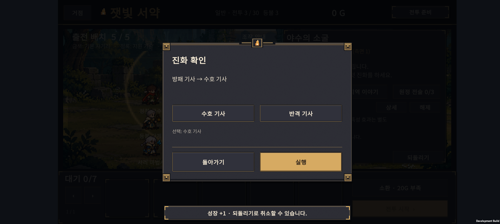
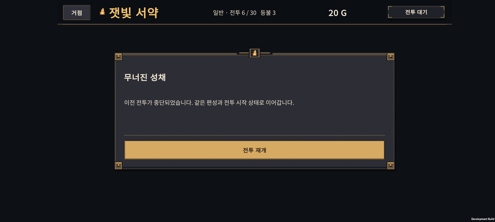
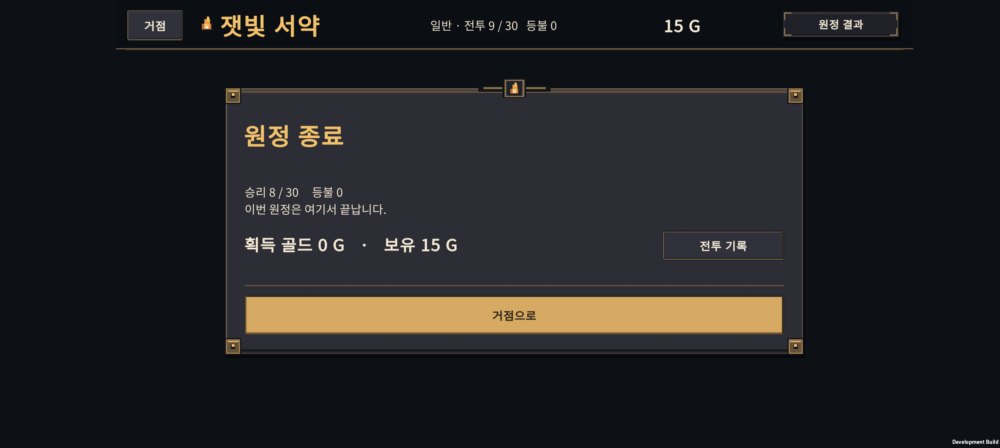
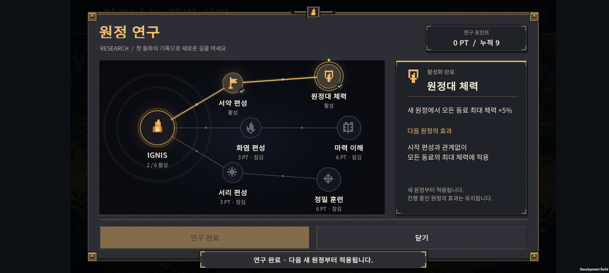

# v0.40 · 새 원정부터 종료까지 연속 검증

2026-10-25 · 기준 게임 코드 `fca7761` · Normal 30전투 · Galaxy Buddy2

**3,360개 연속 원정, 재도전을 포함한 77,836회 전투를 검사했다.** 자동 정책 965개 원정이 30전투를 완료했고 2,395개는 등불 소진으로 끝났다. 이는 고정된 자동 행동의 결과이며 일반 이용자의 완주율을 뜻하지 않는다.

## 1. 이번 검사의 범위

- 매번 `ExpeditionRun.New`에서 시작한다. 골드로 소환하고 실제 재료를 소비해 성장·진화·결합한다.
- 승리한 전투만 보상을 받고, 패배하면 등불이 줄어든다. 등불 소진 또는 30전투 완료까지 계속한다.
- 일반 최종 진화 정책 1종과 결합체 목표 정책 6종, 전술 지출 방식 4종, 연구 상태 3종, 시작 편성 4종, 성장 우선순위 2종을 조합했다. 전 항목의 완전한 곱집합은 아니며 아래 행렬을 사용했다.
- 저장·재시작 전용 112개 원정에서는 준비·전투·결과·다음 단계마다 JSON 저장을 거쳤다. 실제 Unity 직렬화 및 Android 화면 조작은 별도로 확인한다.
- 휴대폰은 신규 계정에서 조작 안내부터 진행했다. 단계 체크포인트를 주입하지 않는다. 기존 사용자 데이터는 별도 백업한다.

| 검사 묶음 | 시드 | 원정 수 | 완료 | 전투 시도 |
| --- | --- | ---: | ---: | ---: |
| 표준 시작 · 균형 성장 · 연구 없음/전체 | 40001–40032 | 1,792 | 605 | 43,803 |
| 표준 시작 · 전열 우선 성장 · 연구 없음/전체 | 42001–42008 | 448 | 86 | 9,995 |
| 전투마다 저장·재시작 · 연구 없음/전체 | 41001–41002 | 112 | 30 | 2,569 |
| 화염 시작 · 시작 편성 해금만 | 43001–43006 | 168 | 34 | 3,679 |
| 화염 시작 · 연구 전체 | 43001–43006 | 168 | 74 | 4,364 |
| 서리 시작 · 시작 편성 해금만 | 43001–43006 | 168 | 10 | 3,043 |
| 서리 시작 · 연구 전체 | 43001–43006 | 168 | 39 | 3,774 |
| 전술 시작 · 시작 편성 해금만 | 43001–43006 | 168 | 28 | 2,985 |
| 전술 시작 · 연구 전체 | 43001–43006 | 168 | 59 | 3,624 |
| **합계** | | **3,360** | **965** | **77,836** |

동일 시드 결정성 재실행 336회는 원정·전투 합계에서 제외했다. 저장 경계 검사 수에는 이 재실행이 포함된다. 8,022회 패배 중 396회는 75초 제한에 걸렸다. 원시 보고서는 첫 시드의 전체 행동을 남기고 나머지는 실패 전투를 보관한다. 전투 합계는 흔적 축약 전에 계산한다.

## 2. 저장·진행 검사

**저장 경계 조건 50,138개 통과.**

| 확인 항목 | 확인 내용 |
| --- | --- |
| 준비 저장 | 편성·배치·성장·골드·난수 상태·전술·시작 편성·연구 효과 유지 |
| 전투 중 재시작 | 저장된 전투 시작 편성으로 재시작. 중단하지 않은 60Hz 전투와 종료 시간·승패·각 유닛 HP/보호막 일치 |
| 전투 중 금지 행동 | 소환·다음 전투·전술 구매 거절, 상태 변경 없음 |
| 결과 정산 | 승리 보상 한 번, 패배 등불 한 번. 결과를 재처리해도 추가 정산 없음 |
| 결과 화면 재시작 | 승패·보상 유지, 다음 단계 진행 한 번만 허용 |
| 영구 성과 | 실제 첫 격파 수에 맞는 연구 포인트, 중복 관찰 시 재지급 없음 |
| 이야기 | 관찰·저장·복원 후 중복 해금 없음 |
| 원정 종료 | 완료/실패 종료 상태에서 전투·소환·되돌리기 거절, 30전투 실제 완료 시에만 Hard 도전 자격 |

초기 검사에서 JSON 항목 순서가 달라지는 경우를 상태 손실로 잘못 판단했다. 검사기의 객체 키 순서를 정규화해 다시 돌렸고 모두 통과했다. 배열 순서와 값은 계속 비교한다. 게임의 저장 규칙을 완화한 것은 아니다.

기존 자동 회귀 검사 9종도 **5,665개 검증 통과**: 전투 3,011 / 원정 2,052 / 성과 421 / 준비 안내 62 / 연구 61 / 이야기 26 / 결합 전투 15 / 준비 미리보기 11 / 전투 보고서 6.

실제 Unity `JsonUtility` 통합 검사도 **5,180개 검증 통과**. 시드 40001–40008의 8개 원정에서 6개 완료, 2개 패배를 모두 저장·복원했다. 이 8개는 엔진 직렬화 경로를 다시 확인한 표본이므로 위 3,360개 합계에 중복 가산하지 않았다. 기존 Unity 검사에는 초창기 성장 정책이 남아 사제와 최종 궁수를 성장시키지 못했고 30전투 완료 조건을 충족하지 못했다. 현재 성장 규칙을 사용하는 정책으로 보완하고, 소환·성장·진화·배치의 반환값도 검사하도록 했다. 로그: `unity/Logs/v040-run-json-verified.log`.

## 3. 밸런스에서 드러난 점

### 일반 진화가 결합체 목표보다 안정적이다

표준 시작·균형 성장·같은 32개 시드에서 **11전투부터 전술을 하나씩 사는 정책**을 비교했다. 각 값의 분모는 32개 원정이다.

| 성장 목표 | 연구 없음: 완료 | 연구 전체: 완료 |
| --- | ---: | ---: |
| 일반 최종 진화 | 26/32 | 27/32 |
| H-01 잿불 검위 | 10/32 | 22/32 |
| H-02 등불 성기사 | 9/32 | 22/32 |
| H-03 빙결 추적자 | 5/32 | 25/32 |
| H-04 융해술사 | 13/32 | 24/32 |
| H-05 성가 기수 | 7/32 | 7/32 |
| H-06 원정 유격대장 | 3/32 | 17/32 |

H-01 완료에는 목표 결합체를 만들지 못한 원정이 각 계정에 1개씩 포함된다. 나머지 표의 완료는 해당 목표를 실제 배치했다. 결합은 두 자리를 한 유닛으로 합치므로 대체 인원·회복 역할·성장 투자 시점이 함께 바뀐다. **이 표만으로 개별 유닛의 능력치가 부족하다고 단정할 수 없다.** 특히 H-05와 H-06은 전용 배치와 보조 편성을 먼저 비교할 가치가 있다.

### 전술을 빨리 사는 것이 항상 유리하지 않다

- 일반 진화 정책은 6전투부터 구매할 때 연구 없는 계정도 26/32 완료했다.
- H-04는 같은 조기 구매에서 1/32, 11전투부터 구매하면 13/32였다. 목표 결합체 확보도 19/32에서 30/32로 달랐다.
- H-05는 조기 구매에서 0/32, 전술을 사지 않으면 8/32였다.
- 해석: 소환·성장에 필요한 골드와 전술 가격이 경쟁한다. 조기 구매 정책은 가능한 방어 계열을 순서대로 사는 단순 정책이며, 모든 전술 선택의 최적화를 대신하지 않는다.

### 난도는 고르게 상승하지 않는다

표준 시작·균형 성장·연구 없는 계정 896개 원정을 집계했다. **해당 전투에 도착한 원정의 첫 도전 승률**이다. 후반에는 앞 구간에서 살아남은 편성만 남는다.

| 전투 | 도달 / 첫 도전 승리 | 첫 도전 승률 | 관찰 |
| --- | --- | ---: | --- |
| 1–7 | 각 896 / 896 | 100% | 성장 규칙을 아는 정책은 안정적으로 통과 |
| 9 | 861 / 601 | 69.8% | 첫 큰 압박 |
| 10 | 796 / 597 | 75.0% | 초반 보스에서 추가 이탈 |
| 11–12 | 각 629 / 629 | 100% | 보스 이후 압박이 크게 낮아짐 |
| 15 | 629 / 425 | 67.6% | 재도전 포함 시간 초과 80회 |
| 20 | 495 / 495 | 100% | 살아남은 정책에서는 보스 압박이 낮음 |
| 25 | 487 / 398 | 81.7% | 후반 편성 점검 구간 |
| 28 | 438 / 257 | 58.7% | 보스 전 일반전의 큰 난도 상승 |
| 29 | 323 / 230 | 71.2% | 앞 전투의 이탈 후에도 추가 압박 |
| 30 | 255 / 141 | 55.3% | 최종 보스 |

후반만 일괄 약화하거나 초반만 일괄 강화하기보다, 쉬는 구간의 길이·9전투 첫 압박·15전투 시간 초과·28전투 급상승을 나눠 다듬는 편이 적절하다. 전열 우선 성장 묶음은 다른 시드를 사용했으므로 두 성장 방식의 차이를 순수한 원인 효과로 해석하지 않는다.

### 시작 편성도 차이가 난다

동일한 6개 시드 × 7개 성장 목표 × 4개 지출 방식에서, 시작 해금만 가진 계정의 완료는 화염 34/168, 전술 28/168, 서리 10/168이었다. 연구를 모두 적용하면 각각 74/168, 59/168, 39/168이었다. 해금 자체가 상위 호환은 아니지만, 서리 시작은 빌드별 보완 실험이 필요하다. 각 정책당 시드가 6개로 적고 고정 정책에 대한 결과라는 제한이 있다.

## 4. Buddy2 실제 조작

기기: Galaxy Buddy2 / SM-M236L. 기존 v0.39 최종 APK를 사용했다. SHA-256: `27460957CBE7CA24AF9AB26952F4074045C6DEA32B37AC6F796BE99E0474B48B`.

**첫 원정은 실제 8승 후 9전투에서 세 번 패배해 끝났다.** 초기 시드는 `3851270000`, 연구 없는 표준 시작이다. 체크포인트·골드·승리 주입 없이 터치와 드래그로 진행했다. 이번 기기 원정은 30전투 완주 검증이 아니며, 완료 경로는 위 Core 자동 원정에서 검증했다.

| 흐름 | 실제 확인 |
| --- | --- |
| 1–2전투 안내 | 소환, 새 동료 배치, 범위 확인, 다음 안내, 전투 시작까지 진행 |
| 성장·진화 | 대기 동료를 길게 올려 성장. 3전투 전 수호 기사, 6전투 전 최종 기사, 7전투 전 사제 분기 진화 |
| 준비 중 종료 | 4전투 준비에서 강제 종료·앱 재시작·이어하기. 저장 전체 값 일치 |
| 전투 중 종료 | 6전투 진행 중 강제 종료. 안내 화면에서 전투 재개 후 정상 승리. 재개 전 골드·편성·등불 동일 |
| 패배·재도전 | 9전투에서 등불 3→2→1→0, 골드 15G 유지. 같은 편성으로 재도전한 결과이며 배치 수정 실험은 아님 |
| 원정 종료 복원 | 종료 후 앱을 다시 열어도 종료 상태·8승·골드 15G·등불 0 유지 |
| 성과·연구 | 첫 격파 8 + 보스 구간 1 = 9PT. 서약 편성 3PT와 체력 연구 6PT를 실제 구매해 0PT |
| 다음 원정 | 해금한 기사·기수·사제 편성 선택 가능. 새 원정은 1전투·40G·등불 3으로 시작하며 두 연구 효과 ID를 저장 |

끝 편성은 최종 기사·기본 궁수·보호 계열 진화 사제·기본 서리 마법사 2명이다. 전술 구매와 특수 결합은 이 기기 원정에서 실행하지 못했고, 해당 흐름은 Core 행렬과 기존 회귀 검사에서 다뤘다. 사제는 자동 정책의 회복 분기와 다른 기본 선택 분기 `E-PR-G`를 사용했다. 이 한 번의 패배를 보편적인 9전투 난도로 해석하지 않는다.

시험 구간의 logcat에서 Unity 예외·Android 치명 오류를 찾지 못했다. **사용자 PlayerPrefs는 시험 직전 백업으로 복원하고 바이트 단위 일치를 확인했다.** 앱은 종료 상태로 두었다.









### 실제 플레이에서 찾은 개선점

- **배속 선택 유지:** 전투를 새로 열 때마다 1배로 초기화된다. 2배로 보는 사람에게 반복 조작이 된다. 같은 원정에서는 선택을 유지하고 앱 설정 저장 여부를 정하는 것이 좋다.
- **종료 보상 문구:** 패배로 원정이 끝나면 ‘획득 골드 0G’가 보인다. 현재 값은 마지막 전투 보상이므로 이번 원정의 누적 수입으로 오해할 수 있다. 종료 화면에는 누적 성과와 소멸하는 원정 골드를 명확히 구분하는 요약이 필요하다.
- **진화 분기 정보:** 첫 진화 화면에는 두 이름과 선택 결과만 보여 역할 차이를 판단하기 어렵다. 회복/보호 등 핵심 차이를 같은 화면에서 볼 수 있어야 한다.
- **패배 후 조언:** 9전투에서는 탱커 최종 진화만으로 후열과 전체 화력을 해결할 수 없었다. 피해 기록과 준비 화면이 다음 행동을 더 직접적으로 안내하면 좋다.

## 5. 다음 작업 우선순위

1. **첫 성장·첫 진화·첫 전술 안내.** 1–2전투 조작 안내 다음에 재료를 길게 올려 성장시키는 방법, 진화 분기의 차이, 소환과 전술의 골드 경쟁을 설명한다.
2. **결합체 공략과 비용 검토.** H-05/H-06부터 결합 전후 인원·힐러 유무·대체 인원·배치를 맞춘 실험을 하고, 손해가 재현되는 부분만 조정한다.
3. **난도 곡선 조정 후보.** 9–10·15·28–30전투를 각각 검토한다. 사람의 첫 원정 관찰 결과와 함께 판단한다.
4. **신규 플레이어 5–8명.** 어디서 멈추고, 무슨 정보를 보고 결정하며, 패배 이유를 이해하는지 실제로 관찰한다.

이번 자동 검사는 처음 해보는 사람의 이해도·조작 부담·재미·광고 피로도를 측정하지 못한다. 다른 물리 기기, 장시간 발열·메모리, 오디오 체감, 출시 빌드·광고·영어는 [출시 준비 계획](../release-readiness-v0.38.html)의 별도 검증 항목이다.

## 6. 재현과 자료

- [합계·정책별 결과 JSON](data/summary.json)
- [전투별 조건부 승률 CSV](data/wave-rates.csv)
- [9개 원시 보고서 ZIP](data/run-reports.zip)
- [실기기 조작·전투 결과 로그 요약](data/device-journey.json)
- [회귀·Unity 검사 결과](data/validation.txt)
- [검사기 사용법](../../tests/ExpeditionRun/README-end-to-end-balance.md)
- 주요 변경: `tests/ExpeditionRun/EndToEndBalanceProbe.cs`, `run-end-to-end-balance.ps1`, `unity/Assets/Editor/ExpeditionRunValidation.cs`. 이번 변경은 검사기와 기록이며 전투 능력치·APK는 기존 버전이다.

```powershell
./tests/ExpeditionRun/run-end-to-end-balance.ps1 -FirstSeed 40001 -Count 32 -GrowthOrder Balanced -Account all -Spending all -Policy all -ReportPath .local-tools/v040-balanced.json
./tests/ExpeditionRun/run-end-to-end-balance.ps1 -FirstSeed 41001 -Count 2 -GrowthOrder Balanced -Account all -Spending all -Policy all -Interruptions -ReportPath .local-tools/v040-interruptions.json
./tests/ExpeditionRun/run-end-to-end-balance.ps1 -FirstSeed 42001 -Count 8 -GrowthOrder FrontFirst -Account all -Spending all -Policy all -ReportPath .local-tools/v040-front-first.json
# 위 표의 나머지 여섯 묶음: Starter tactical/ember/frost × Account unlocked/researched
./tests/ExpeditionRun/run-end-to-end-balance.ps1 -FirstSeed 43001 -Count 6 -GrowthOrder Balanced -Starter frost -Account unlocked -Spending all -Policy all -ReportPath .local-tools/v040-frost-unlocked.json
```

시드가 같아도 정책·시작 편성·연구 상태가 다르면 별도 시나리오다. 무작위 소환의 모든 가능한 결과, 모든 진화 분기·배치·전술 조합을 전수 검사했다는 뜻은 아니다.
