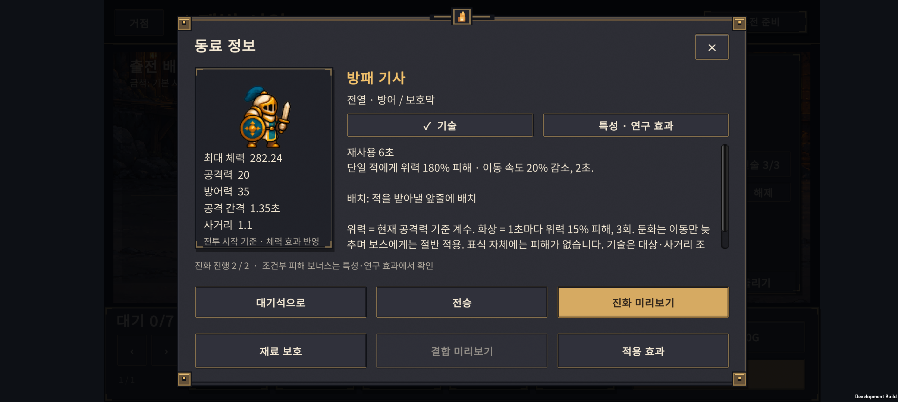
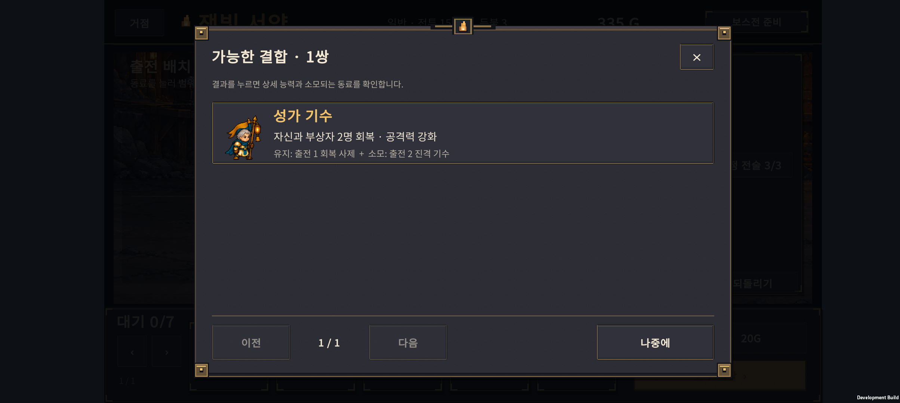
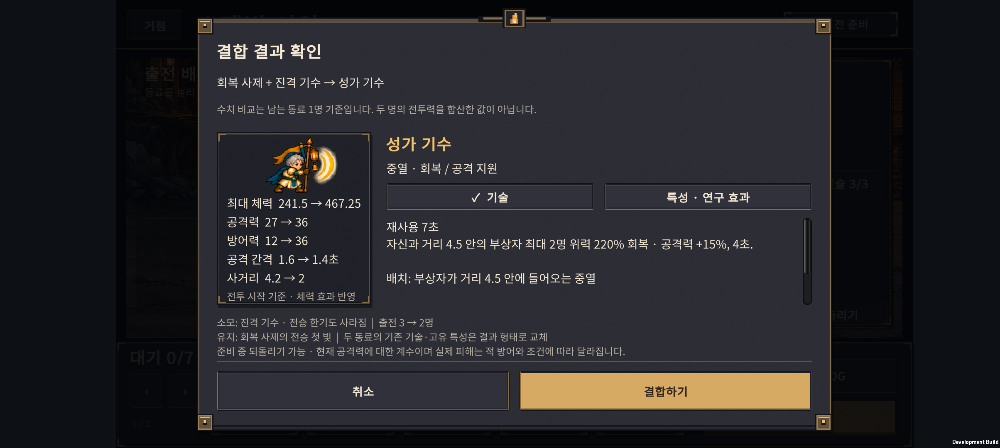

# v0.41 · 보고 선택하는 진화와 결합

2026-10-25 · IGNIS: ASHEN OATH · Unity 6.3 · Galaxy Buddy2

**동료 30형태의 외형·스탯·기술 설명을 게임 안에 연결했다. 진화와 결합을 확정하기 전에 결과와 잃는 것을 확인할 수 있다.**

## 1. 이번 변경

| 화면 | 제공하는 정보 |
| --- | --- |
| 동료 상세 | 대기·공격 도트 애니메이션, 역할, 최대 체력·공격력·방어력·공격 간격·사거리 |
| 기본 → 분기 진화 | 두 결과의 도트와 역할 카드, 선택한 결과의 기술, 현재 동료 대비 스탯 변화 |
| 분기 → 최종 진화 | 새 최종 기술과 **유지되는 분기 기술** 모두 표시 |
| 결합 목록 | 결과 도트·이름·능력 요약, 남는 동료와 소모되는 동료. 한 페이지 3쌍 |
| 결합 확인 | 결과 능력, 재료 동료·전승 특성 소멸, 남는 전승 특성, 출전 인원 변화 |
| 특성·연구 효과 탭 | 고유·전승 특성의 조건과 수치, 현재 원정에 적용되는 연구·전술 |

기술 설명에는 재사용 시간, 대상·최대 인원, 공격력 계수, 거리·범위, 지속 시간을 넣었다. 긴 설명은 손가락으로 스크롤할 수 있다. 확정·취소 버튼은 아래에 고정했다.

### 동료 상세



### 두 진화 분기 비교


### 최종 형태가 유지하는 기술


### 결합 목록과 결과





## 2. 수치와 설명의 기준

- 최대 체력에는 현재 원정의 연구·전술을 적용한다. 비교 수치는 실제 전투 유닛을 만드는 같은 코드에서 계산한다.
- 공격력과 **조건부 피해 보너스**는 구분한다. 방패술 등은 항상 공격력에 더해지는 수치가 아니므로 조건과 함께 효과 탭에 표시한다.
- 기술의 `위력 220%`는 현재 공격력에 대한 계수다. 실제 피해는 적 방어력·상태·연구·일시 강화에 따라 달라진다.
- 둔화는 이동 속도를 줄인다. 공격 불가인 빙결과 구분하며 보스에게는 둔화가 절반 적용됨을 설명한다.
- 반격 기사는 보호막이 피해로 깨지는 조건과 2.5초 재사용을 표시한다.
- 결합 수치의 화살표는 **남는 동료 1명 → 결과 1명** 비교다. 두 유닛의 총 전투력 비교가 아님을 설명한다.
- 결합 시 두 동료의 기존 기술·고유 특성은 결과 형태로 교체된다. 남는 동료의 전승 특성만 유지되며, 재료의 전승 특성은 사라진다.
- 원정의 복제본에서 실제 진화·결합 연산을 실행해 결과를 계산한다. 원본 저장·난수·골드·되돌리기 기록은 건드리지 않는다. 동일한 미리보기는 재사용한다.

## 3. 검증 결과

| 검사 | 결과 |
| --- | --- |
| 미리보기 계산 | **306개 유효 사례, 1,887개 조건 통과** |
| 계산 범위 | 30형태 × 효과 3상태, 분기 진화 12종·최종 진화 12경로 × 효과 3상태, 결합 6종 × 재료 순서 2 × 출전 상태 4 × 효과 3상태 |
| 추가 거절 검사 | 보호된 재료, 성장 부족 진화 거절 |
| 기존 회귀 | 원정 2,052개, 결합 전투 15개, 배치 미리보기 11개 조건 통과 |
| Unity | 30형태의 설명·이미지·제목 줄바꿈, 최종 분기 기술, 미리보기 재사용·원본 보존 등 **217개 조건 통과** |
| Buddy2 진화 | 분기 변경·취소 후 데이터 동일, 반격 기사 확정, 되돌리기로 전체 원정 데이터 복원 |
| Buddy2 결합 | 성가 기수 확정, 재료 제거·전승 유지·출전 3→2명 일치, 되돌리기로 전체 데이터 복원 |
| Buddy2 화면 | 일반 상세, 두 진화 카드, 최종 기술·분기 기술, 결합 목록·확인, 개별 동료에서 연 결합 목록·취소, 터치 스크롤 확인 |

Unity 글자 높이 검사에서 이름 영역이 좁은 문제를 발견해 높이를 늘린 뒤 통과했다. 최종 APK는 Buddy2에 설치했다. 검사 뒤 원래 PlayerPrefs 전체를 바이트 단위로 일치하게 복원하고 앱을 종료했다.

**검증 범위:** 이번 실기기 검사는 UI용 QA 체크포인트를 사용했다. 단계·성장 상태는 시험용이며 정상 플레이 완주나 밸런스 증거가 아니다. 연속 원정·난도 결과는 [v0.40 기록](../design-v0.40/HANDOFF.html)을 참고한다. 전투 수치·성장 비용·난도는 이번에 조정하지 않았다. 영어 문구와 다른 해상도·기기의 실기기 검증은 남아 있다.

## 4. 실행과 파일

```powershell
./tests/UnitPreview/run.ps1
./tests/ExpeditionRun/run.ps1
./tests/HybridCombat/run.ps1
./tests/PreparationPreview/run.ps1
```

Unity 배치 실행: `Expedition.EditorTools.UnitPreviewValidation.ValidateAndBuild`

- 정보 문구: `unity/Assets/Scripts/Core/CatalogUnitInfo.cs`
- 결과 계산: `unity/Assets/Scripts/Core/ExpeditionUnitPreview.cs`
- 화면: `unity/Assets/Scripts/Presentation/ExpeditionUnitPreviewScreen.cs`
- 도트 표시: `unity/Assets/Scripts/Presentation/CatalogArtView.cs`
- APK: `unity/Builds/Android/expedition-combat-prototype.apk`
- APK SHA-256: `9CA1E3D389B50FEC2120AC97C24F693E6DDFAC0FCA237CCB0945461F6D96C5DF`

## 5. 다음 우선순위

1. 첫 성장·진화 시점에 미리보기를 자연스럽게 열어주는 짧은 안내.
2. 새 이용자가 설명을 보고 역할에 맞게 배치·성장하는지 관찰.
3. 관찰 결과와 v0.40 기록을 함께 보고 결합체 효용·후반 난도 조정.

선택의 결과를 이해한 뒤 빌드를 실험할 수 있는 정보량을 기준으로 삼는다.
