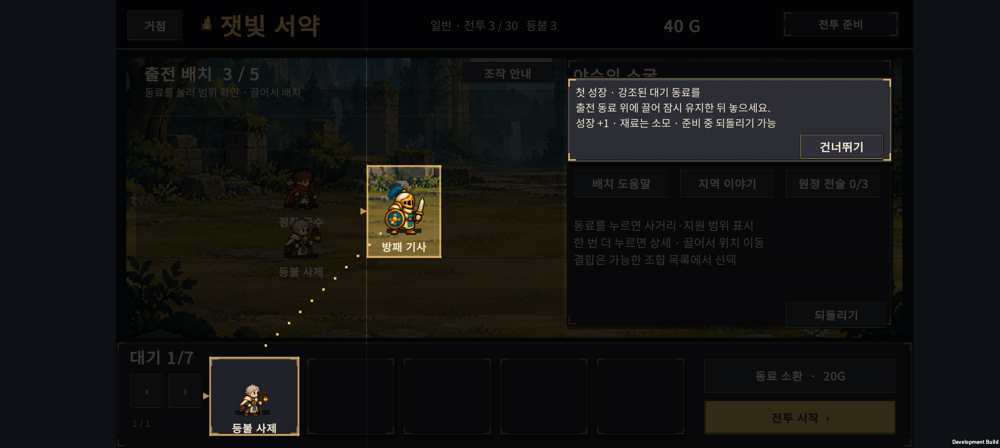
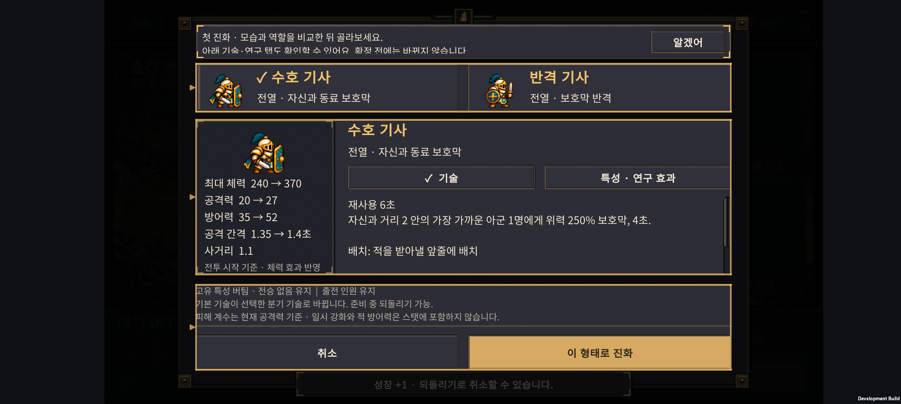
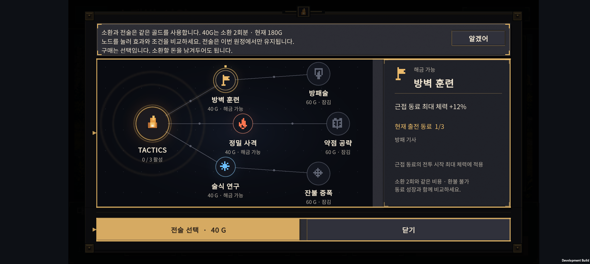
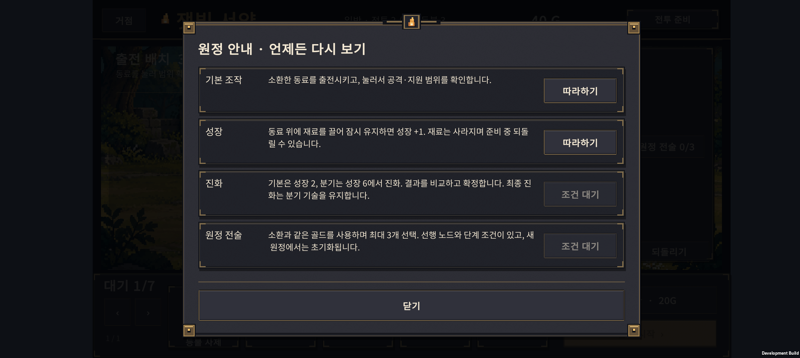
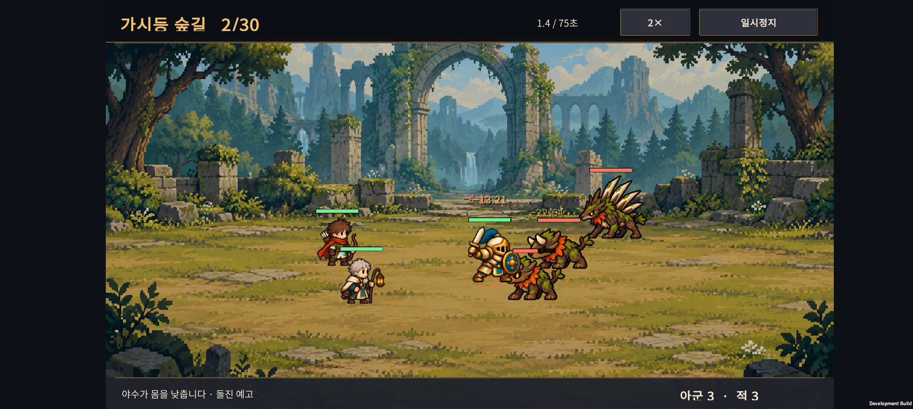
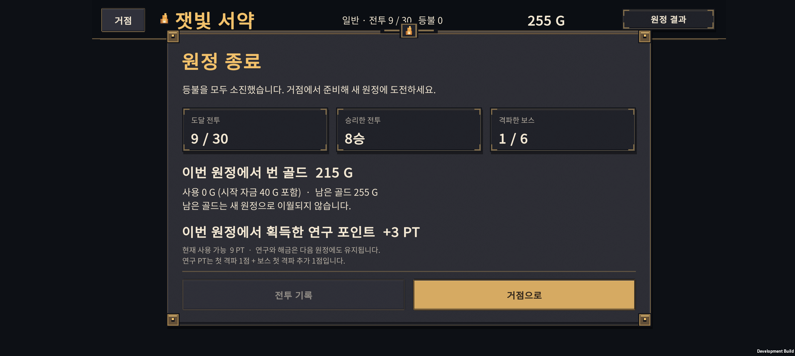
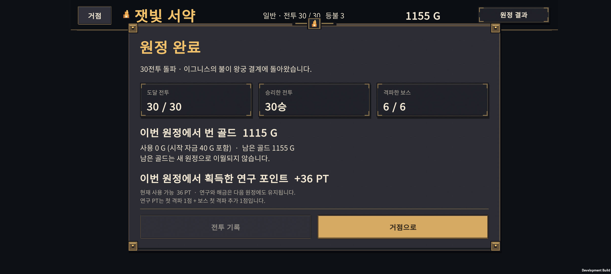

# v0.42 · 첫 성장 안내와 원정 편의 개선

2026-10-25 · IGNIS: ASHEN OATH · Unity 6.3 · Galaxy Buddy2

**v0.40·v0.41을 `1f3dd9f`로 커밋한 뒤, 성장·진화·전술의 첫 안내와 배속 저장·원정 결과 정리를 구현했다.**

## 1. 필요한 순간에 보여주는 안내

| 안내 | 등장 조건과 동작 |
| --- | --- |
| 첫 성장 | 3전투 이후 준비 중, 사용할 수 있는 대기 동료와 성장할 출전 동료가 있을 때 표시. 두 동료만 밝게 비추고 드래그 방향을 보여준다. |
| 첫 진화 | 성장 조건을 채운 동료가 있으면 비교 화면으로 연결. 도트·역할·스탯·기술을 살펴보고 직접 확정한다. |
| 첫 전술 | 실제 구매 가능한 전술이 생기면 보드를 안내. 소환과 같은 골드를 쓰고 이번 원정에서만 유지됨을 설명한다. 구매하지 않고 닫아도 된다. |
| 안내 다시 보기 | 준비 화면의 **조작 안내**에서 기본 조작·성장·진화·전술 설명을 다시 읽는다. 현재 조건이 맞으면 따라하기도 가능하다. |

기존 1·2전투 조작 안내를 먼저 보여준다. 새로운 안내는 전투 중에는 표시하지 않는다. 건너뛰기와 완료 여부를 저장하며, 다시 보기는 완료 기록을 지우지 않는다. 기존 원정에 진화한 동료나 구매한 전술이 있으면 해당 안내는 이미 익힌 것으로 처리한다.

성장 예시는 보호되지 않은 **기본형 대기 동료**만 재료로 제안한다. 출전 중인 동료나 진화·결합한 대기 동료를 안내용으로 소모시키지 않는다. 안내가 가리키지 않은 곳에 잘못 놓으면 성장하지 않는다.

### 드래그 성장



### 진화 결과 비교



### 전술과 소환의 비용 비교



### 다시 읽을 수 있는 설명



## 2. 배속과 원정 결과

### 전투 배속 유지

- 같은 원정에서는 선택한 **1× / 2×**를 다음 전투에서도 유지한다.
- 앱을 강제 종료하고 이어가도 저장한 배속을 사용한다.
- 새 원정은 1×로 시작한다. 개발용 전투 시험실의 배속은 본편 저장에 영향을 주지 않는다.



### 원정 종료 요약

마지막 등불을 잃었거나 30전투를 완료하면 다음 정보를 표시한다.

- 도달 전투, 승리한 전투 수, 격파한 보스 수.
- 이번 원정의 승리 보상으로 번 골드, 사용한 골드와 잔액. 시작 자금 40G는 번 골드에서 제외한다.
- 이번 원정에서 새로 획득한 연구 PT와 현재 사용 가능한 PT.
- 골드는 새 원정으로 이월되지 않고 연구·해금은 유지된다는 설명.
- 실제 전투 기록이 있을 때 열 수 있는 기록 버튼과 거점 복귀 버튼.





연구 PT는 기존 규칙인 **각 전투 첫 격파 1점 + 보스 첫 격파 추가 1점**을 따른다. 이미 깬 전투를 다시 깼다고 중복 지급하지 않는다. 새 원정을 시작할 때의 최고 기록을 보관해 이번 원정 획득량을 계산한다. 기존 저장에는 그 기준이 없으므로 획득량을 추정하지 않고 **이전 저장은 개별 집계 없음**이라고 표시한다.

저장 형식 Version 8에 선택 필드를 추가했다. 이전 저장도 불러오며, 배속 필드가 없거나 유효하지 않으면 1×로 복원한다. 연구 기준 필드가 없거나 유효하지 않으면 개별 집계만 생략한다.

## 3. 검증 결과

| 검사 | 결과 |
| --- | --- |
| 신규 코어 검사 | **5,744개 조건 통과**: 안내 대상·보호·성장 조건, 재실행, 골드 집계, 배속, 이전 저장 복원 |
| 연구 PT 집계 | 시작 최고 기록 0~30 각각에 대해 30전투 진행·저장 복원·중복 관찰 검사 |
| 기존 회귀 | 원정 **2,052개**, 영구 진행 **421개**, 유닛 미리보기 **1,887개** 조건 통과 |
| Unity | 기존 조작 안내 **55개**, 신규 안내·포인터·배속·글자 높이 **20개** 조건 통과 |
| Buddy2 성장 | 어두운 전투 시작 버튼의 입력 차단, 건너뛰기 후 데이터 보존, 안내 다시 보기, 재료 소모·성장 +1 확인 |
| Buddy2 진화 | 성장 후 비교 화면 연결, 반격 기사 선택·확정 확인. 안내 문구의 위아래 여백 보완 |
| Buddy2 전술 | 안내 열기·확인·닫기 전후 전체 원정 저장이 동일함을 비교. 강제 구매 없음 |
| Buddy2 배속 | 2× 선택 → 앱 종료·재실행 → 다음 전투에서 2× 표시 및 저장값 확인 |
| Buddy2 결과 | 9전투 패배 종료: 8승·보스 1·획득 215G·신규 3PT. 30전투 완료: 30승·보스 6·획득 1,115G·신규 36PT 확인 |

**검증 범위:** 안내·종료 상태를 빠짐없이 확인하기 위해 QA 체크포인트를 사용했다. 여기의 30전투 완료 화면은 사람이 정상 플레이로 완주했다는 증거가 아니다. 전투 수치나 난도는 변경하지 않았고, 밸런스 판단은 [v0.40 기록](../design-v0.40/HANDOFF.html)과 신규 플레이어 관찰을 함께 사용해야 한다.

최종 APK를 Buddy2에 설치했다. 실기기 검사 뒤 원래 PlayerPrefs 전체를 바이트 단위로 일치하게 복원하고 앱을 종료했다. 영어 문구와 다른 기기에서의 실기기 검증은 후속 범위다.

## 4. 실행과 주요 파일

```powershell
./tests/ExpeditionLearning/run.ps1
./tests/ExpeditionRun/run.ps1
./tests/ExpeditionProgress/run.ps1
./tests/UnitPreview/run.ps1
```

Unity 배치 실행: `Expedition.EditorTools.ExpeditionLearningValidation.ValidateAndBuild`

- 안내 조건: `unity/Assets/Scripts/Core/ExpeditionLearning.cs`
- 안내 화면: `unity/Assets/Scripts/Presentation/ExpeditionLessonsScreen.cs`
- 종료 화면: `unity/Assets/Scripts/Presentation/ExpeditionSummaryScreen.cs`
- 저장·집계: `unity/Assets/Scripts/Core/ExpeditionRun.cs`
- APK: `unity/Builds/Android/expedition-combat-prototype.apk`
- APK SHA-256: `6600FEC197C9956D043C9948FF014502C598433FFA1FB2301E45F0513B5132D7`

## 5. 다음 작업

1. 처음 보는 플레이어가 도움 없이 소환 → 성장 → 진화를 이해하는지 관찰한다. 안내를 건너뛰는 이유와 소모·역할 정보를 오해한 지점을 기록한다.
2. 전술과 소환 중 무엇을 선택했는지, 결합 뒤 실제로 전투가 유리해졌는지를 전투 기록과 함께 확인한다.
3. 관찰 결과와 v0.40의 정책별 결과를 근거로 결합체 효용과 후반 난도를 조정한다.

안내 구현 검증과 실제 사용자의 이해도 검증은 별도로 진행한다.
