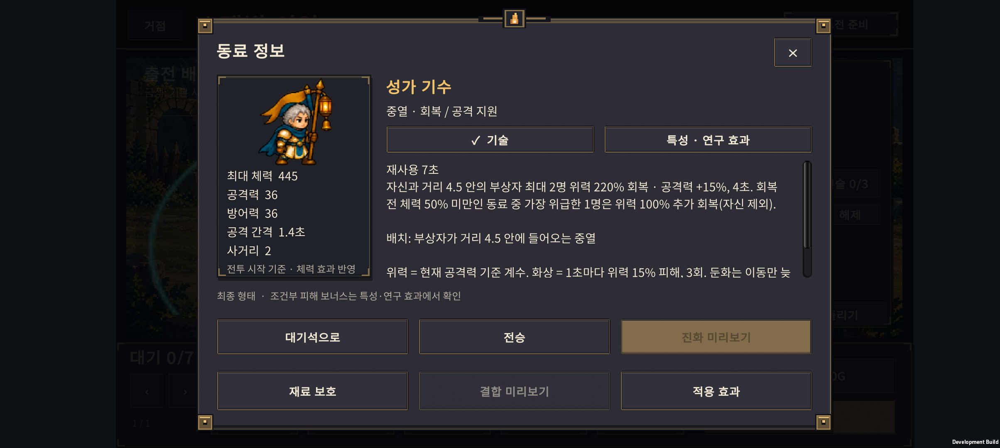
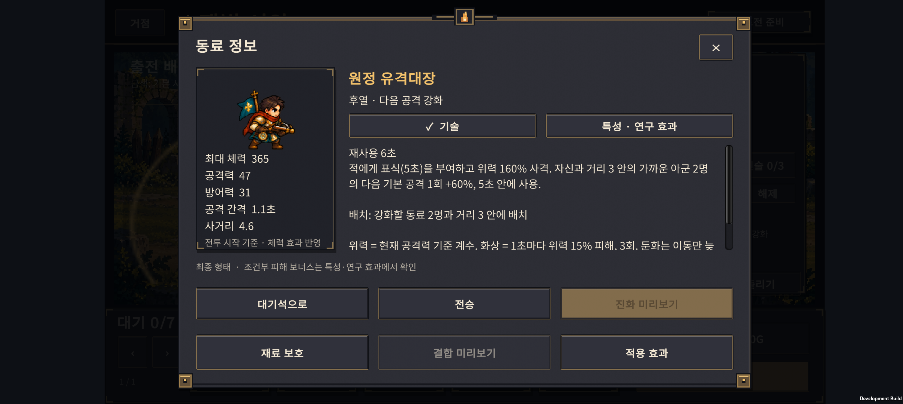
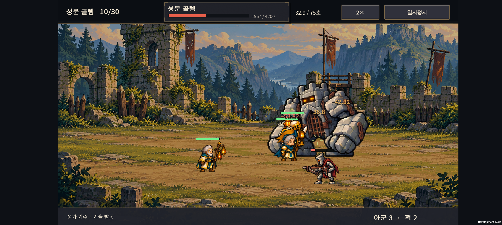
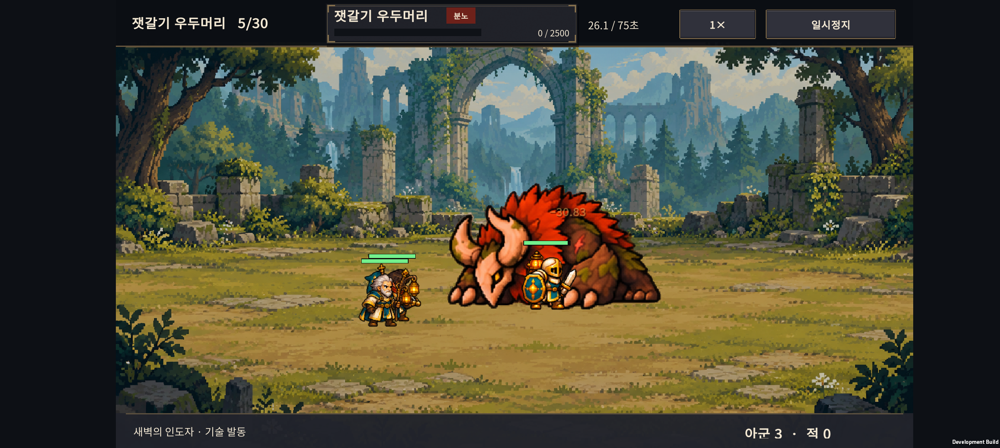
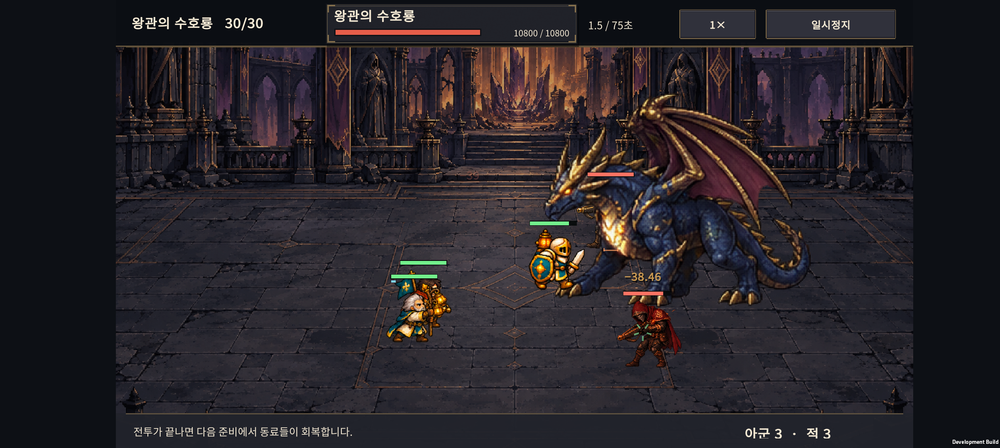

# v0.43 · 결합 전후 같은 투자 비교

2026-10-25–26 작업 · IGNIS: ASHEN OATH · Normal 30전투

**이전 v0.42를 `5ca7d21`로 커밋했다. 성가 기수·원정 유격대장의 결합 전후를 같은 재료량으로 비교하고, 긴급 회복과 지휘 사격을 보완했다.**

## 1. 무엇을 바꿨나

| 결합체 | 변경 | 목적 |
| --- | --- | --- |
| 성가 기수 · H-05 | 기존 자신+동료 2명 회복에, **회복 전 체력이 50% 미만인 가장 위급한 동료 1명에게 위력 100% 추가 회복**. 자신 제외, 사거리 4.5 안 | 한 명에게 피해가 몰릴 때의 회복 공백 보완 |
| 원정 유격대장 · H-06 | 지휘 기술이 **표식(5초) 부여 후 위력 160% 직접 사격**. 자신과 가까운 동료 2명의 다음 기본 공격 +60%도 유지 | 궁수의 공격 기술을 소모한 대가를 지휘 기술의 직접 화력으로 보완 |
| 설명·연구 표시 | 동료 상세·결합 요약을 갱신. 유격대장의 직접 사격을 술식 연구·마력 이해 적용 대상으로 표시 | 실제 전투 규칙과 선택 화면 정보 일치 |
| 상단 보스 체력바 | 이름·체력 숫자·상태 표시에 전용 글자 스타일 적용. 기본 패딩·자동 줄바꿈을 제거하고 세로 중앙 정렬, 상태 칸 높이 20→26, 체력 숫자 너비 115→130 | 한글과 남은 시간·큰 HP 숫자의 잘림 방지 |

성가 기수의 추가 회복량도 시전 당시 공격력을 기준으로 계산한다. 기본 회복과 추가 회복에는 기존의 최대 HP 제한·치유 감소·회복 증가 규칙을 적용한다. 체력이 정확히 50%인 동료는 추가 회복 대상이 아니다. 비율이 같으면 가까운 동료를 우선한다.

## 2. 비교 방법

**동일한 준비 상태를 복제해 세 가지 선택을 비교했다.**

| 선택 | 출전 | 대기 동료 |
| --- | --- | --- |
| 두 명 유지 | 공통 동료 3명 + 진화한 재료 2명 = 5명 | 그대로 대기 |
| 결합만 실행 | 공통 동료 3명 + 결합체 = 4명 | 그대로 대기 |
| 결합 후 빈자리 채움 | 공통 동료 3명 + 결합체 + 이미 가진 기본 동료 = 5명 | 기존 대기 동료를 투입 |

모든 선택은 **동일한 대기 동료까지 이미 소유한 상태**다. 결합 쪽에 공짜 소환이나 추가 골드를 주지 않았다. 분기 진화 2명과 결합체는 모두 모집 동료 6명분을 사용한다. 공통 동료의 성장·배치와 적·연구 효과는 같다. 결합 후 투입하는 동료는 소모된 동료의 자리를 사용한다.

- 결합체 2종 × 전투 11개 × 공통 편성 4종 × 재료 분기 4쌍 × 배치 3종 × 연구·전술 상태 2종.
- **버전당 2,112개 비교 사례, 6,336회 전투. 변경 전후 총 12,672회.** 결정성 확인용 22회는 별도다.
- 전투: 9·10·14·15·19·20·24·25·28·29·30. 일반전과 보스전을 함께 포함했다.
- 공통 편성은 탱커+회복, 탱커+공격, 두 탱커, 마법 중심 등으로 나눴다. 기본 대기 동료는 공통 사제가 있으면 궁수, 없으면 사제다.
- 배치는 밀집·분산·결합 기준 동료의 전진 배치다. 결합 후에만 최적 배치로 바꾸지는 않았다.
- 연구·전술 없음과 영구 연구 전체+정밀 사격(11전투부터 약점 공략 포함)을 비교했다. 두 효과를 합친 상태이므로 영구 연구만의 효과를 뜻하지 않는다.

**이 검사는 결합 직전 선택의 손익을 분리하는 전투 실험이다.** 실제 모집 난수와 재료 확보 시점은 별도의 연속 원정 검사에서 확인했다. 단계별 공통 동료 성장은 통제한 시험 조건이며, 모든 소환 결과에서 그 가격에 해당 편성을 확보할 수 있다는 뜻은 아니다. 변경 전후의 두 명 유지 결과 2,112개가 완전히 같은지도 비교했다.

## 3. 결합의 손익

각 행의 분모는 1,056개 비교 사례다. 수치는 해당 전투를 이긴 횟수다.

| 선택 | 성가 기수 변경 전 → 후 | 유격대장 변경 전 → 후 |
| --- | ---: | ---: |
| 두 명 유지 | 315 → 315 | 290 → 290 |
| 결합 후 4명 | 220 → 284 | 160 → 204 |
| 결합 후 기존 대기 동료 투입 | **404 → 436** | **308 → 408** |

**빈자리를 채우는 것이 중요하다.** 조정 후에도 네 명으로 그대로 싸우는 선택은 이 행렬에서 두 명을 유지하는 것보다 승리가 적었다. 결합체를 만들었다는 이유만으로 전투력이 자동 상승하지는 않는다.

### 화력·회복·생존

아래는 기존 대기 동료를 투입한 5명 편성의 평균이다. ‘두 명 유지’와의 동일 사례 비교 자료는 [집계 JSON](data/summary.json)에 포함했다.

| 지표 | 성가 기수 변경 전 → 후 | 유격대장 변경 전 → 후 |
| --- | ---: | ---: |
| 초반 팀 DPS | 157.6 → 158.5 | **168.2 → 178.1** |
| 전투당 실제 회복량 | **667.2 → 755.1** | 543.4 → 537.5 |
| 공통 동료 3명의 초반 평균 HP 비율 | 79.0% → 79.5% | 76.5% → 76.9% |
| 종료 시 팀 잔여 HP 비율 | **21.5% → 24.4%** | **16.9% → 20.4%** |

초반 지표는 첫 20초 또는 전투 종료까지 측정한다. 회복량은 실제로 채운 HP이며 초당 회복량이 아니다. 전투 길이와 받은 피해가 달라지므로 회복 총량만으로 우열을 판단하지 않는다. 피해는 초과 피해를 제외하고 보호막 흡수량을 포함한다. 종료 시 HP 평균에는 패배도 포함한다.

연구·전술이 없는 유격대장은 기존에 **두 명 유지 108승 대 결합+보충 76승**이었다. 조정 후 결합+보충은 **116승**이다(각 528사례). 연구 효과에 크게 기대던 문제는 줄었지만 압도적인 상위 선택이 된 것은 아니다.

### 아직 손해인 상황

- 성가 기수: 두 명 유지로 이기던 전투를 결합 후 잃는 사례는 **75→74개**다. 새로 이기게 된 사례는 조정 후 195개다. 전체 효용은 좋아졌지만 기존의 불리한 조합 대부분을 해소한 것은 아니다.
- 성가 기수의 손해는 특히 **15·19·29전투**에 남았다. 수호 기수의 피해 감소나 보호 사제의 보호막을 회복으로 바꾸는 비용이 있다.
- 유격대장: 두 명 유지로 이기던 전투를 잃는 사례는 **66→49개**로 줄었다. 조정 후 새로 이긴 사례는 167개다.
- **25전투 정원 보스**는 유격대장으로 바꾼 뒤 불리해지는 경우가 여전히 많다. 이 구간에서는 공격력만큼 회복·피해 감소와 배치가 중요하다.
- 성가 기수는 지원할 동료를 사거리 안에 두고, 유격대장은 강화할 공격 동료들과 가까이 두는 것이 기본이다. 대체 회복·방어 없이 재료의 역할을 없애는 결합은 신중하게 선택해야 한다.

승리 횟수를 더 올리기 위해 모든 상황의 약점을 없애지는 않았다. 다음 조정은 위에 남은 구간과 편성을 기준으로 진행한다.

## 4. 새 원정부터 종료까지 교차 확인

전투 행렬을 본 뒤 **별도 시드 54001–54016**으로 실제 골드 소환·성장·결합·패배 종료를 진행했다. 결합 목표 2종 × 연구 2상태 × 지출 정책 4종 × 16시드 = 버전당 256개, **전후 512개 연속 원정**이다.

각 값은 동일한 64개 자동 원정 중 30전투 완료 횟수다.

| 목표 | 영구 연구 없음 | 영구 연구 전체 |
| --- | ---: | ---: |
| 성가 기수 | 9 → 10 / 64 | **21 → 30 / 64** |
| 원정 유격대장 | **7 → 21 / 64** | **24 → 40 / 64** |

성가 기수는 연구 없는 신규 계정의 개선 폭이 작다. 특히 전술을 6전투부터 빨리 구매하는 정책은 조정 후에도 0/16 완료였다. 이 결과는 기술 위력 외에 재료 확보·성장 순서·골드 지출 경쟁을 더 봐야 한다는 근거다.

각 정책은 고정된 자동 행동이다. 동일한 시드도 정책과 연구가 다르면 별도 시나리오이며, 이 수치를 사람의 완주율로 해석하면 안 된다. 조기 결합 강제나 전술 조기 구매를 권하는 결과도 아니다.

## 5. 구현 검증과 실기기

| 검사 | 결과 |
| --- | --- |
| 결합 전투 규칙 | 20개 조건 통과. 추가 회복 1명·50% 경계·자기 회복 제외·동률·최대 HP 제한, 직접 사격·후속 강화·처치 회복 확인 |
| 전투 회귀 | 3,011개 조건 통과 |
| 원정·미리보기 | 원정 2,052개, 유닛 정보·미리보기 1,887개, 준비 범위 11개, 전투 기록 6개 조건 통과 |
| 상세 회귀 | 편성·경계·타이밍 등 109개 조건 통과 |
| Unity | 30형태의 정보·이미지와 신규 설명·연구 적용 대상 등 **220개 조건 통과**, Android 빌드 성공 |
| 보스 상단 UI | 실제 6종 보스의 이름·최대 HP, `99999 / 99999`, 분노와 상태 4칸의 글자 크기·영역 겹침 검사 통과 |
| Galaxy Buddy2 | 두 결합체의 상세 설명과 10전투 전투 진행 확인. 유격대장 시험 편성은 승리 결과와 보상 저장까지 확인. 최종 APK에서 5전투 이름·분노 표시, 30전투 `10800 / 10800` 체력 숫자가 잘리지 않는 것도 확인 |







### 보스 체력바 글자 잘림 수정

보스 패널의 작은 글자 칸에 기본 GUI 패딩과 줄바꿈이 적용되어 있었다. 이름·상태·체력을 각각 전용 스타일로 분리하고, 이름 높이 29→34·상태 칸 높이 20→26으로 조정했다. 체력 숫자는 오른쪽 정렬과 130 너비를 사용한다. 이름과 네 개 상태 칸, 체력바와 숫자는 서로 겹치지 않도록 배치했다.





실기기 화면은 QA 체크포인트다. 정상 모집으로 만든 편성이나 밸런스 증거로 사용하지 않았다. 수치와 조건은 Core 검사로 확인했고, 폰에서는 표시·전투 진행·오류 여부를 확인했다. 해당 확인 구간에서 Unity 예외·Android 치명 오류가 없었다. 원래 PlayerPrefs는 전체 백업으로 복원하고 바이트 일치를 확인했다.

- APK: `unity/Builds/Android/expedition-combat-prototype.apk`
- SHA-256: `6601CF6192CFBFBEB15558663CB762BB8C28FCC2FD3D4C2A5C58A9C671503D13`
- v0.42 커밋: `5ca7d21`. 이번 v0.43 작업은 별도 변경분이다.

## 6. 재현과 다음 판단

- [검사기와 통제 조건](../../tests/HybridValue/README.md)
- [집계 JSON](data/summary.json)
- [결합 전후 원시 결과: 변경 전](data/paired-before.json.gz) · [변경 후](data/paired-after.json.gz)
- [성가 기수 연속 원정: 변경 전](data/journey-h05-before.json.gz) · [변경 후](data/journey-h05-after.json.gz)
- [유격대장 연속 원정: 변경 전](data/journey-h06-before.json.gz) · [변경 후](data/journey-h06-after.json.gz)

```powershell
./tests/HybridValue/run.ps1 -ReportPath .local-tools/paired.json
./tests/HybridCombat/run.ps1
./tests/ExpeditionRun/run-end-to-end-balance.ps1 -FirstSeed 54001 -Count 16 -Policy H-05 -Account all -Spending all -ReportPath .local-tools/journey-h05.json
./tests/ExpeditionRun/run-end-to-end-balance.ps1 -FirstSeed 54001 -Count 16 -Policy H-06 -Account all -Spending all -ReportPath .local-tools/journey-h06.json
```

변경 전 기준은 커밋 `5ca7d21`의 Core와 콘텐츠다. 이번 검사기는 변경 전에는 추가되지 않았으므로 그 Core와 함께 컴파일해 비교한다. 결과에는 모든 사례의 편성·분기·배치·효과·재료량과 세 선택의 지표를 저장했다.

**다음 우선순위:** 신규 플레이어의 결합 선택을 관찰하고, 성가 기수의 15·19·29전투와 유격대장의 25전투에서 대체 방어 편성·성장 순서를 비교한다. 결합 후 빈자리와 사라지는 회복·방어 역할을 사용자가 이해하는지도 함께 확인한다.
