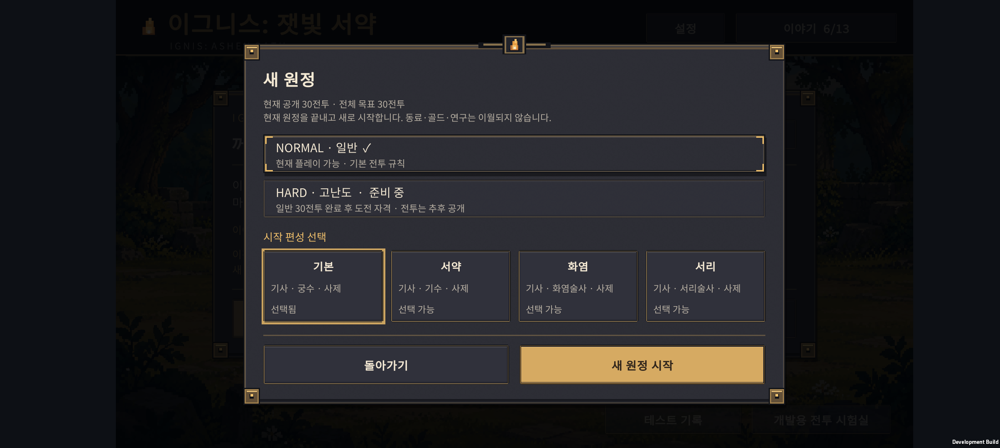
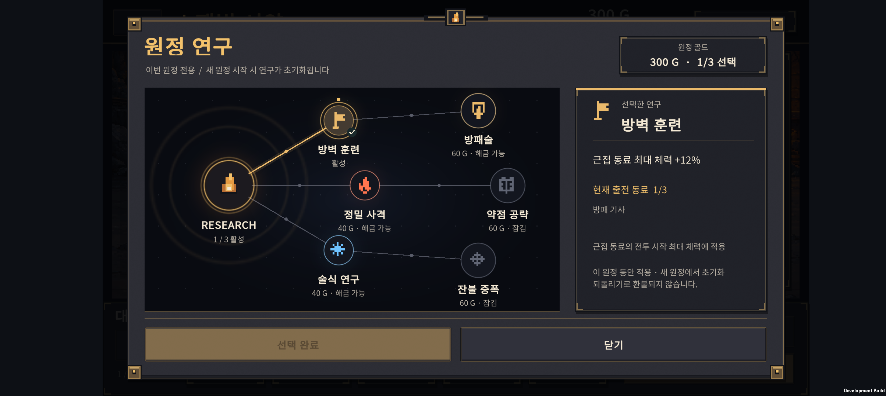
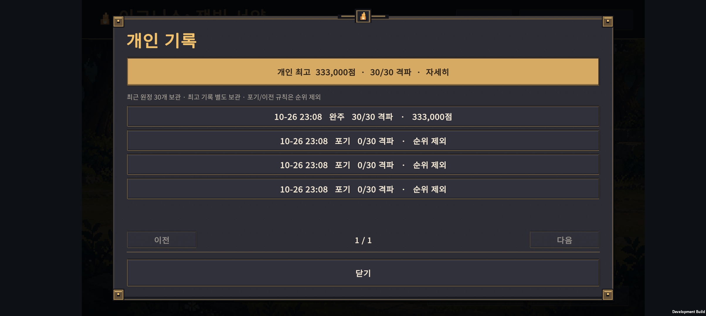
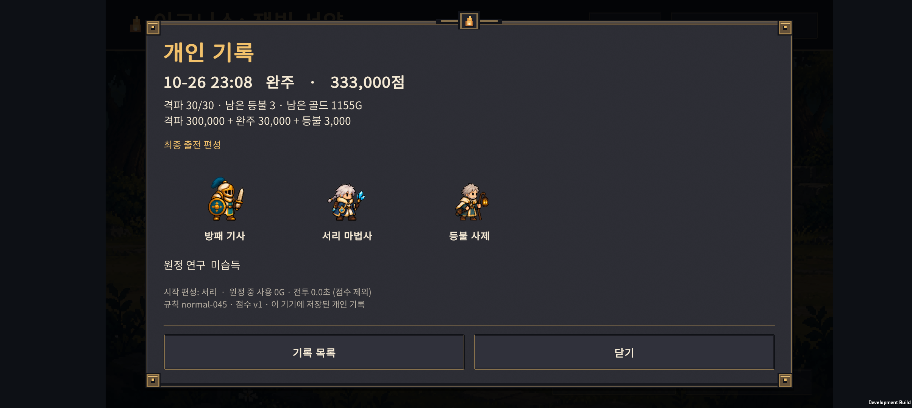

# v0.45 · 매 원정 새로 시작하는 연구와 개인 기록

2026-10-26 · IGNIS: ASHEN OATH · Normal 30전투

**새 원정은 영구 능력치 보너스 없이 40G·연구 0개로 출발한다.** 골드로 찍는 원정 연구는 같은 원정에서 유지되고, 새 원정을 시작할 때 초기화된다. 개인 최고 점수와 최근 기록을 연결했다.

[합의한 개편 기준](expedition-reset-plan.html) · [자동 전투 상세 결과](balance-results.md) · [결과 JSON](balance-results.json)

## 달라진 플레이 규칙

| 항목 | 구현한 동작 |
| --- | --- |
| 새 원정 | 기본·서약·화염·서리 모두 선택 가능. 기본 동료 3명, 40G, 등불 3개, 연구 0개 |
| 영구 강화 | 새 원정에 체력·피해 보너스를 전달하지 않음. 예전 PT 지급·구매 중단 |
| 원정 연구 | 기존 골드 전술을 통합된 연구로 표시. 3계열·6노드 중 최대 3개 |
| 연구 가격 | 기초 40G, 상위 60G. 기초 6전투, 상위 11전투와 선행 연구 필요 |
| 다음 전투·패배 재도전·이어하기 | 같은 원정의 동료·성장·골드·연구 유지 |
| 새 원정으로 전환 | 진행 중 원정은 포기 기록으로 남기고, 연구·동료·재화를 새로 시작 |
| 계속 남는 정보 | 이야기·성과·설정·안내 완료 상태·개인 기록 |

연구를 구매하지 않고 동료 소환·성장에 투자하는 선택도 가능하다. 이번 변경에서는 유닛/적 전투 수치와 연구 비용을 조정하지 않았다.

## 휴대폰 화면

Galaxy Buddy2(2408×1080)에서 직접 조작·캡처했다. 아래 11전투 연구와 30전투 기록은 **저장 및 화면 확인용으로 만든 시험 데이터**다. 기본 동료로 30전투를 실제 완주했다는 의미가 아니다.

### 같은 시작 선택권



### 연구 구매 후 재접속

340G에서 방벽 훈련을 구매하면 300G·연구 1개가 된다. 강제 종료 후 이어하기에서도 유지되며, 새 원정에서는 40G·연구 0개로 돌아오는 것을 저장 파일과 화면에서 확인했다.



### 개인 최고와 최근 원정

최근 30개를 보관하고 최고 점수는 별도 보존한다. 목록에서 결과를 누르면 최종 출전 동료·연구·격파 수·등불·지출·전투 시간·규칙 버전을 확인한다. 페이지 버튼과 하단 구분선이 겹치던 부분도 수정했다.





## 점수 규칙

**격파 전투 수 × 10,000 + 30전투 완주 보너스 30,000 + 남은 등불 × 1,000**

- 30전투·등불 3개 완주: 333,000점.
- 전투 진행 중 표시는 잠정 점수이며, 완주하거나 등불을 모두 소진했을 때 기록한다.
- 진행 중 새 원정으로 바꾸면 ‘포기’로 보관하고 최고 점수에서 제외한다.
- 같은 원정 종료는 한 번만 등록한다. 동점은 기존 최고 기록을 유지한다.
- 준비 시간·배속·피해·회복·남긴 골드에 추가 점수를 주지 않는다. 전투 시간은 정보용이다.
- 현재는 **기기 안의 개인 기록**이다. 온라인 순위·서버 검증은 아직 없다.

시작 조건의 누적 강화 차이는 제거했지만, 무작위 소환 운과 편성의 강약은 남는다. 만점 동점이 생기기 쉬운 초기 산식이므로 온라인 순위 도입 전에 별도 검토가 필요하다.

## 이전 저장 보존

v0.44 이전 원정은 ‘이전 규칙 원정’으로 표시하고 원래 보너스를 유지해 이어할 수 있다. 새 점수 순위에는 포함하지 않는다. 업데이트 후 새 원정부터 새 규칙을 사용한다.

예전 연구 ID와 남은 PT는 이행 확인용으로 보관하며 새 원정 재화·보너스로 환산하지 않는다. 기존 PlayerPrefs 이행과 A/B 저장·백업·손상 보관은 유지한다. 새 형식은 계정 v2 / 원정 v9 / 성과 v3 / 개인 기록 v1이다.

Unity가 없는 최고 기록을 빈 객체로 복원하는 문제가 검사 중 발견되어, `HasBest`와 `HasRun`을 따로 저장하도록 수정했다. 빈 계정도 실제 Unity 직렬화 왕복 검사를 통과했다.

## 검증 결과

| 검사 | 결과와 범위 |
| --- | --- |
| 신규 원정·연구·기록 코어 | 1,201조건 통과. 실제 첫 전투 80쌍, 30전투 저장 경로, 30개 패배 종료 경계 포함 |
| 기존 기능 회귀 | 원정 2,052 · 성과 410 · 이전 연구 61 · 계정 저장 150 · 학습/요약 5,744조건 통과 |
| Unity 통합 | 저장/설정 18조건 + 실제 새 원정·기록·빈 계정 등 17조건 통과 |
| 자동 전투 비교 | 4편성·3성장 정책·3연구 계열·4지출 방식의 유효 조합 432회 |
| 별도 시드 확인 | 추가 8회, 저장·전투 재시작 동일성 3,280조건 통과 |
| Buddy2 | 기존 PlayerPrefs 이행, 이전 규칙 이어하기, 새 원정, 연구 구매/재접속/초기화, 개인 기록 목록/상세 조작 확인 |

자동 원정 440회는 실제 전투 계산으로 진행했다. 코어 저장 경로와 UI용 강제 승패 데이터는 이 수에 포함하지 않았다. 반복 체크 수는 고유한 버그 유형 수나 사람이 플레이한 횟수가 아니다.

실기기 확인 전 원본 저장·설정을 백업했으며, 완료 후 시험 데이터를 제거하고 원본 파일을 바이트 단위로 복원·확인했다.

## 밸런스에서 확인한 점

기본 편성/최종 진화 중심/방어 연구에서 미구매 4/8, 조기 구매 6/8, 지연 구매 6/8 완주였다. 반면 성가 기수 확보 정책에서는 조기 구매 0/8, 지연 구매 2/8이었다. 연구 구매를 먼저 하는 것이 항상 정답은 아니다.

서리 편성은 이번 고정 정책에서 상대적으로 약했다. 정밀 연구/최종 진화/지연 구매에서는 비교 시드 2/4, 별도 시드 1/4로 완주했지만, 다른 정책 다수가 실패했다. **사람의 승률로 해석하거나 서리가 무조건 불가능하다고 결론내릴 수는 없다.**

기본 최종 진화, H-01, H-05를 목표로 하는 세 정책 모두 전체 비교 안에서 완주 사례가 있다. 실제 플레이어가 그 경로를 이해할 수 있는지는 별도 관찰이 필요하다.

## 다음 우선 작업

1. 서리 시작 편성의 6~20전투 성장 선택과 화력 부족을 재현하고 원인을 좁힌다.
2. 술식 연구의 적용 대상·효과와 소환 두세 번을 포기하는 비용이 납득되는지 비교한다.
3. 처음 플레이하는 사람에게 새 원정·이어하기·연구 초기화가 명확한지 확인한다.

자동 결과만으로 전체 적을 낮추지 않는다. 다른 편성·시드에서도 효과를 확인한 뒤 필요한 역할과 구간만 조정한다. Hard 전투, 온라인 순위, 영어 전체 번역은 이번 범위에 포함되지 않는다.

## 실행과 변경 파일

```powershell
./tests/ExpeditionReset/run.ps1
./tests/ExpeditionRun/run-end-to-end-balance.ps1 -FirstSeed 45201 -Count 4 -Spending delayed -Policy final -Starter frost -ResearchBranch precision -Interruptions -ReportPath .local-tools/v045-holdout.json
```

Unity 통합 검사와 APK 생성: `Expedition.EditorTools.ExpeditionResetValidation.ValidateAndBuild`.

- [원정과 규칙](../../unity/Assets/Scripts/Core/ExpeditionRun.cs)
- [개인 기록·점수 검증](../../unity/Assets/Scripts/Core/ExpeditionHistory.cs)
- [통합 저장](../../unity/Assets/Scripts/Presentation/ExpeditionPersistence.cs)
- [기록 화면](../../unity/Assets/Scripts/Presentation/ExpeditionRecordsScreen.cs)
- [연구 화면](../../unity/Assets/Scripts/Presentation/ExpeditionResearchScreen.cs)

APK: `unity/Builds/Android/expedition-combat-prototype.apk` — 내부 테스트용 Development Build. 최신 파일의 크기와 SHA-256은 [빌드 정보](build-info.json)에 기록한다.
