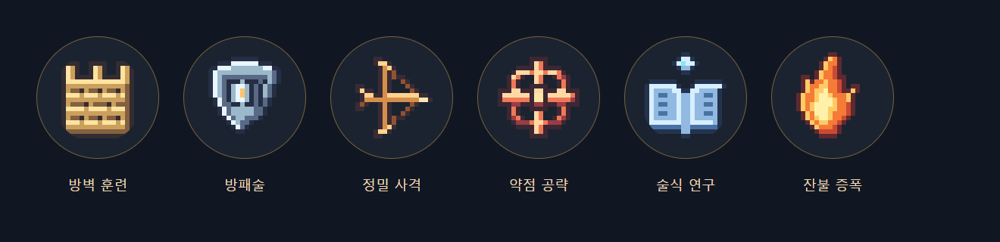
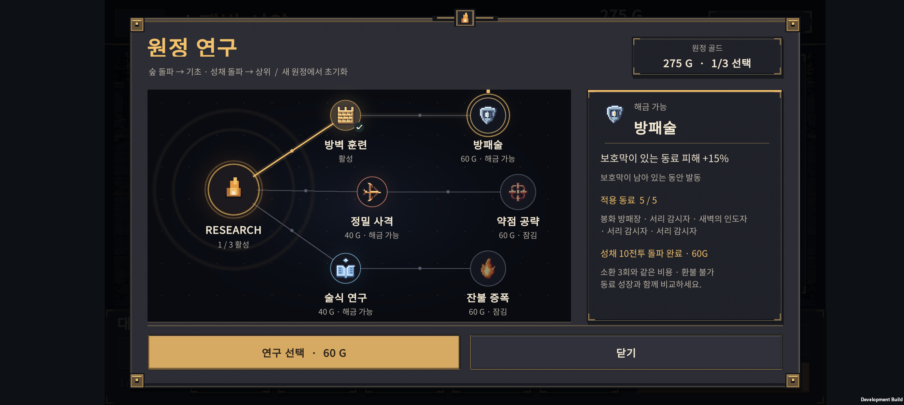
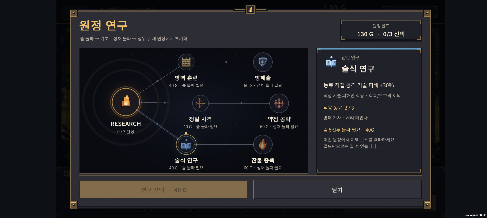
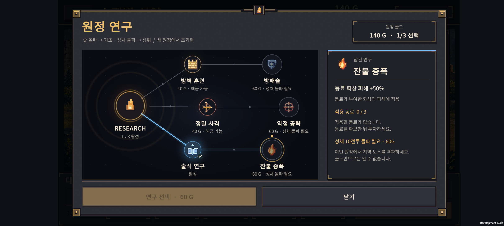
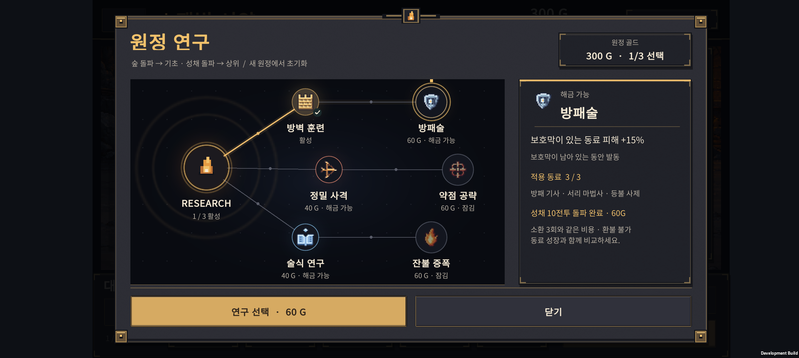
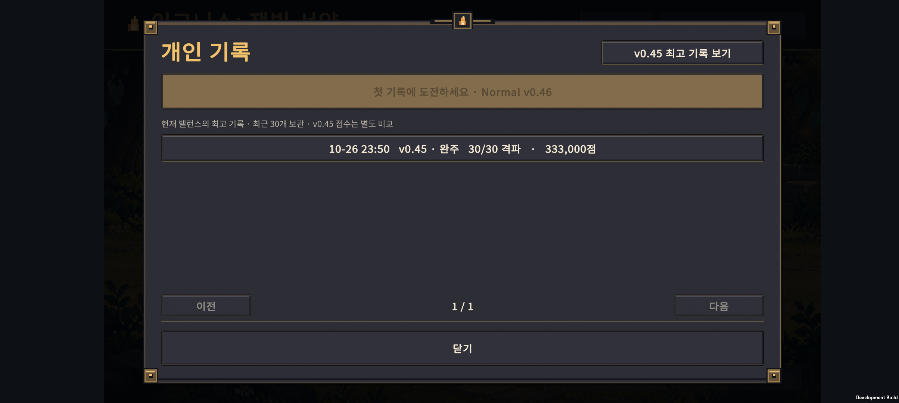
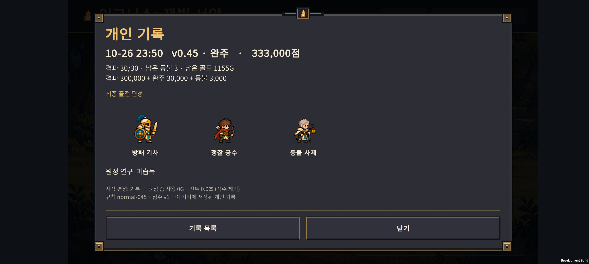

# v0.46 · 지역을 돌파해서 여는 원정 연구

2026-10-27 · IGNIS: ASHEN OATH · Normal 30전투

**연구는 이번 원정의 지역 보스 격파와 골드를 함께 요구한다. 새 원정을 시작하면 연구와 지역 해금 모두 초기화된다.** 서리 기술과 술식 연구를 조정하고, 변경 전후 자동 원정 26,880회를 비교했다. 일부 개선과 일부 악화를 모두 확인했으므로 이번 수치는 출시 확정 밸런스가 아니다.

[전체 비교 표](balance-results.md) · [집계 JSON](balance-results.json) · [시드별 결과](seed-results.jsonl) · [재현 방법](../../tests/ResearchRegions/README.md)

## 연구가 열리는 조건

| 연구 | 이번 원정에서 필요한 조건 | 가격 |
| --- | --- | --- |
| 기초: 방벽 훈련·정밀 사격·술식 연구 | 숲 보스, 5전투 격파 | 각 40G |
| 상위: 방패술·약점 공략·잔불 증폭 | 성채 보스, 10전투 격파 + 연결된 기초 연구 | 각 60G |
| 선택 한도 | 6개 중 최대 3개, 준비 중 구매 | 환불 없음 |

골드만 많거나 보스전에 도착한 것만으로는 열리지 않는다. 보스를 이겨야 한다. 같은 원정의 재도전·이어하기는 연구를 유지하고, 새 원정은 40G·연구 0개·지역 잠금으로 돌아간다. 영구 계정 해금은 아니다.

기존에도 구매 가능한 시점은 6·11전투였다. 이번에는 그 기준을 **실제 격파 수로 검사**하고, 화면에 ‘숲/성채 돌파 필요’와 가격·선행 연구를 함께 표시했다. 새로운 상위 노드를 추가하거나 기존 해금 시점을 뒤로 미룬 변경은 아니다.

## 휴대폰에서 확인한 화면

Galaxy Buddy2(2408×1080)에 새 APK를 설치해 직접 조작했다. **아래 사진은 잠금·구매·기록 화면 확인용 시험 저장 데이터다. 보스를 실제 전투로 격파한 플레이 기록이 아니다.** 실제 전투 계산을 사용한 밸런스 검사는 뒤의 별도 항목이다.

### 연구 문양과 글자 배치 수정

기존 8픽셀 단색 기호를 직접 그린 20픽셀 컬러 도트 6종으로 바꿨다. 성벽·방패·활·조준점·마법서·불꽃으로 효과를 구분한다. 계열의 금색·주황·파란색 연결선은 유지하고, 문양에는 금속·나무·마법·불꽃의 색을 따로 넣었다. 외부 게임의 이미지나 아이콘을 사용하지 않았다.



투명 여백을 뺀 그림의 경계로 원의 중앙에 정렬하고 정수 배율로 표시한다. 노드 이름·가격 칸의 높이와 여유 공간도 늘렸다. 오른쪽 설명은 실제 폰 글꼴로 높이를 계산해 이어서 배치하며, 긴 동료 이름이나 조건은 안쪽을 위아래로 밀어 끝까지 읽는다. 하단 구매·닫기 버튼은 고정된다.



위 편성도 글자 배치 검사용 시험 데이터다. 실제 완주 결과가 아니다.

### 골드가 충분해도 숲을 돌파하기 전에는 잠김



구매를 눌러도 골드와 연구가 변하지 않는 것을 확인했다. 숲 돌파 후에는 술식 연구를 구매할 수 있고, 180G에서 140G로 줄며 연구 1개가 저장됐다. 강제 종료 후 이어하기에서도 유지됐다.

### 기초 연구를 샀어도 성채를 돌파해야 상위 연구가 열림



성채 돌파 후에는 상위 연구를 구매할 수 있다. 방패술 구매로 300G에서 240G, 연구 1개에서 2개가 됐다. 새 원정으로 전환하면 40G·연구 0개로 초기화됐다.



위 사진은 구매 전 상태다. 구매 후 수치와 초기화는 저장 파일에서도 확인했다. 검증을 마친 뒤 시험 데이터를 제거하고 사용자의 원본 저장·설정을 바이트 단위로 복원했다.

## 이번에 조정한 전투 수치

| 항목 | v0.45 | 새 원정 v0.46 |
| --- | --- | --- |
| 술식 연구: 직접 공격 기술 피해 | +15% | +30% |
| 잔불 증폭: 아군 화상 피해 | +30% | +50% |
| 서리 마법사 B-IC 기술 계수 | 1.3 | 1.6 |
| E-IC-F 기술 계수 | 1.7 | 2.2 |
| E-IC-S 기술 계수 | 1.9 | 2.1 |
| F-IC 기술 계수 | 2.6 | 3.1 |

계수는 기술에 적용되는 공격력 배율이다. 해당 원정의 실제 수치와 기술 설명을 함께 바꿨다. 술식 연구는 일반 공격·회복·보호막 전체를 강화하는 효과가 아니며, 잔불 증폭은 아군의 화상에 적용된다.

적 능력치, 골드 보상, 연구 가격, 소환 가격, 서리 기술의 사거리·재사용 시간·둔화 시간은 그대로다. 이번 변경으로 서리 기술에 추가 빙결이나 공격 속도 감소를 넣지는 않았다.

## 자동 원정 26,880회 비교

실제 게임의 전투 계산과 합법적인 소환·성장·결합·연구 구매로 진행했다. 패배 시 등불을 소모하고, 승리한 경우에만 보상을 받으며, 종료한 원정을 강제로 이어가지 않았다.

| 묶음 | 시드 | 변경 전 | 변경 후 |
| --- | --- | --- | --- |
| 조정용 | 46001–46020 | 4,480회 | 4,480회 |
| 별도 검증용 | 47001–47040 | 8,960회 | 8,960회 |
| 합계 | 서로 다른 시드 60개 | 13,440회 | 13,440회 |

총 **497,293회 전투 시도**가 포함된다. 원정 수는 ‘4개 시작 편성 × 7개 성장 목표 × 8개 지출 경로 × 시드 × 변경 전후’의 합계다. 26,880명의 플레이나 26,880개의 독립 시드라는 뜻은 아니다.

- 성장 목표: 최종 진화 중심, H-01~H-06 각 결합체 확보 중심.
- 지출 경로: 방어 계열의 미구매·조기·지연·선별 구매, 정밀·술식 계열의 조기·지연 구매.
- 조기 구매는 6전투부터, 지연 구매는 11전투부터 전투당 한 개씩. 선별 구매는 5명을 확보한 뒤 역할에 맞는 기초 연구 하나를 선택한다.
- 전원 같은 성장 순서 정책을 사용했다. 모든 분기 진화·배치·소환 판단을 탐색한 것은 아니다. 같은 시드라도 여러 정책에서 비슷한 편성이 나올 수 있다.

### 별도 40시드에서 확인한 대표 경로

| 시작·성장 목표·연구 투자 | 변경 전 완주 | 변경 후 완주 |
| --- | --- | --- |
| 화염 / 최종 진화 / 술식 지연 | 7/40 | 17/40 |
| 서리 / 최종 진화 / 정밀 지연 | 17/40 | 21/40 |
| 서리 / H-04 / 정밀 지연 | 14/40 | 20/40 |
| 서리 / H-05 / 정밀 지연 | 0/40 | 4/40 |
| 기본 / 최종 진화 / 연구 미구매 | 16/40 | 16/40 |
| 기본 / 최종 진화 / 방어 지연 | 18/40 | 20/40 |
| 기본 / H-05 / 방어 조기 | 1/40 | 1/40 |
| 서리 / 최종 진화 / 방어 조기 | 12/40 | 8/40 |

서리와 술식의 일부 경로는 개선됐다. 그러나 연구를 일찍 많이 구매하는 것이 항상 이득이 되지는 않았고, **서리 최종 진화 + 방어 조기 구매는 악화됐다.** 약한 경로가 있다는 이유만으로 적 전체를 낮추지는 않았다.

전체 별도 검증 8,960쌍 중 격파 수가 증가한 경우 843, 감소한 경우 60, 같은 경우 8,057이었다. 기존 실패에서 완주로 바뀐 경우 222, 기존 완주에서 실패로 바뀐 경우 13이었다. 전체 완주는 1,084회에서 1,293회로 늘었다. 이 혼합 표본의 비율을 사람의 승률이나 목표 난도로 사용하지 않는다.

### 악화 경로도 재현했다

서리/최종 진화/방어 조기/시드 47007을 두 버전으로 다시 실행했다. 13전투까지 동료·성장·연구·배치는 같았지만, 기존 버전은 13전투 승리, 새 버전은 패배였다. 새 버전은 재도전에서 배치를 바꿔 13전투를 이겼으나, 이후 15전투에서 75초 제한으로 종료했다. 남은 아군 체력 비율은 약 50.8%였다.

이는 단순히 모든 전투가 쉬워졌다는 결론이 틀렸음을 보여준다. 피해량 변경이 처치 시점·공격 대상·기술 순서에 영향을 줄 수 있다는 가설은 남아 있지만, 이 결과만으로 원인을 확정하지 않는다. **13전투의 전투 이벤트 순서와 15전투의 배치별 화력 공백을 다음 조정 우선 대상으로 남긴다.**

[재현한 기존 버전 전체 경로](regression-v045.json) · [재현한 새 버전 전체 경로](regression-current.json)

## 기존 원정과 최고 점수 보존

진행 중인 v0.45 원정은 기존 기술·연구 수치를 유지한다. 새 원정부터 v0.46 수치가 적용된다. 밸런스가 바뀐 점수를 섞지 않도록 v0.45 최고 기록은 별도 버튼으로 보존하고, 현재 최고 기록은 v0.46끼리 비교한다. 최근 기록 목록은 두 버전 모두 보관한다.





**이 사진의 ‘최종 출전 편성’ 3명과 333,000점은 기록 저장·이행 검사용 시험 데이터다. 기본 세 명으로 30전투를 완주했다는 증거가 아니다.** 실제 출전은 최대 5명이며, 원정 종료 당시 출전한 동료가 기록에 표시된다.

원정 저장은 v10 / RulesVersion 2, 개인 기록은 v2다. 이전 v8·v9 원정과 v1 개인 기록을 읽어 보존한다. 최근 30개에서 밀려난 뒤에도 두 버전의 최고 기록을 각각 유지한다. 계정 저장 형식은 v2를 유지한다.

## 검증 범위

| 검사 | 결과 |
| --- | --- |
| 지역 조건·계수·이전 기록 이행 | 1,236조건 통과. 보스 패배·격파·골드·재시작·새 원정·버전 분리 포함 |
| 기존 코어 회귀 | 초기화 1,201 · 연구 61 · 원정 2,052 · 계정 150 · 성과 410 · 안내/요약 5,744 · 동료 정보 1,887 · 전투 3,011 · 보고서 6조건 통과 |
| 실제 Unity 직렬화·화면 문구·저장 통합 | 저장/설정 18 + 초기화/기록 17 + 지역/버전 21조건 통과 |
| 실제 적용 코드와 비교용 실행 파일 | 896회 재실행 결과 일치. 기존 프로필은 변경 전, 새 프로필은 조정 후보와 일치 |
| 별도 중단·이어하기 | 32회 원정, 11,261개 저장·전투 재시작·중복 보상 방지 검사 통과 |
| 악화 경로 상세 재현 | 시드 47007, 기존/신규 각 1회. 13전투 승패 분기와 15전투 제한시간 확인 |
| Android | Unity 빌드 성공. Buddy2 설치·연구 잠금/구매/재접속/초기화·기록 버튼 확인 |

896회 재실행·32회 중단 검사·2회 상세 재현은 주 비교 26,880회에 더해 부풀리지 않았다. UI용 강제 승리 데이터와 코어 조건 검사의 수도 실제 자동 원정 수에 포함하지 않았다. 자동 정책 첫 시드의 결정성 확인을 위한 내부 반복 역시 합계에서 제외했다.

개발용 30형태 시험실의 직접 전투 생성 기본값은 이전 비교 프로필을 유지한다. 이번 수치의 플레이 확인은 본편 **새 원정**으로 한다. 코어 검사 통과는 체감 재미·처음 접하는 사람의 이해·장시간 기기 성능 검증을 대신하지 않는다.

## 다음에 남은 일

1. 악화된 서리 방어 조기 경로의 13전투 이벤트 순서와 15전투 시간 초과를 분석하고, 배치 변화에도 안정적인 역할 균형을 확인한다.
2. H-05 등 지원 결합체와 조기 연구의 투자 손실이 전략의 대가인지, 안내 부족 또는 수치 문제인지 분리한다.
3. 실제 신규 플레이어에게 연구의 지역 조건·골드 비용·원정 초기화가 이해되는지 관찰한다. 사람의 첫 완주 시간과 실패 이유를 따로 수집한다.

온라인 순위·추가 연구 노드·Hard 전투는 이번 변경에 포함하지 않았다.

## 실행 파일과 재현

[APK 빌드 정보·SHA256](build-info.json)

APK 경로: `C:/Users/whwog/project/game/unity/Builds/Android/expedition-combat-prototype.apk`

```powershell
./tests/ResearchRegions/run.ps1
./tests/ResearchRegions/run-matrix.ps1 -FirstSeed 47001 -Count 40 -Rules v045 -Output .local-tools/recheck-before
./tests/ResearchRegions/run-matrix.ps1 -FirstSeed 47001 -Count 40 -Rules current -Output .local-tools/recheck-after
```

변경 전 기준 커밋: `fa95c57`. 전체 표와 시드별 결과를 함께 보관했다. APK는 개발용 빌드이며 Git 추적 대상이 아니다.
