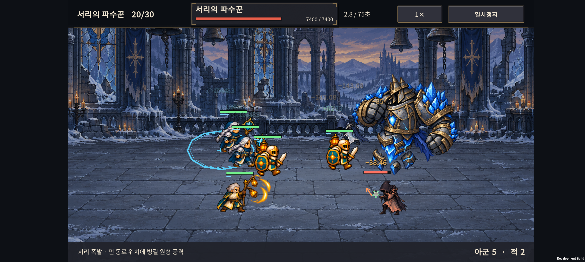
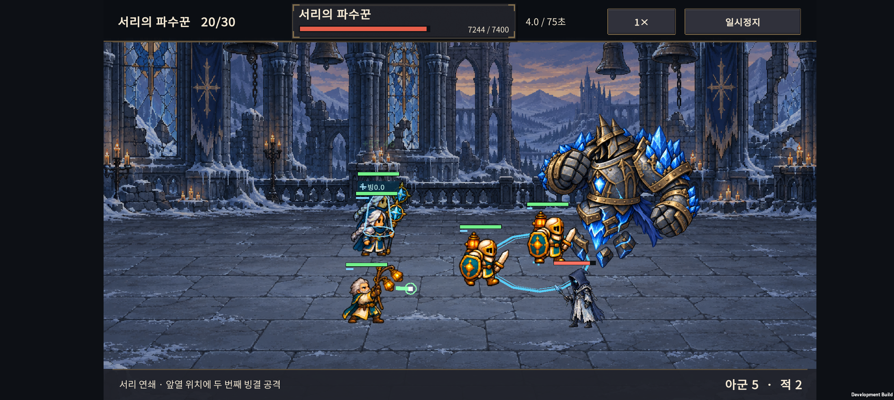
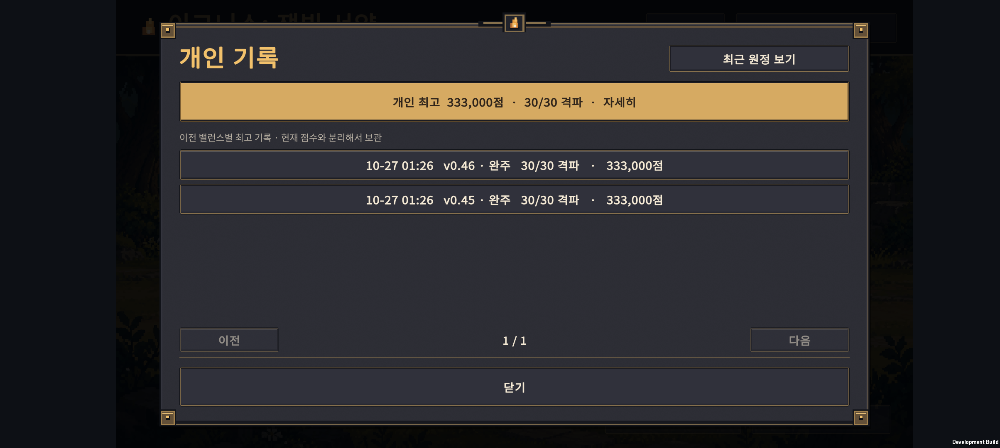
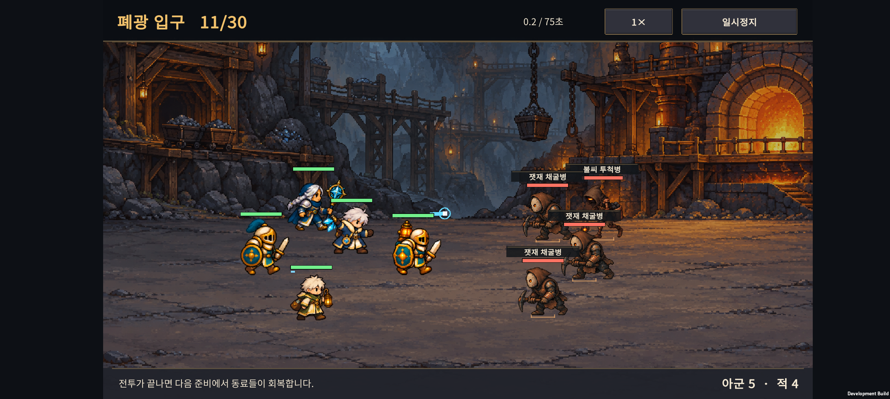
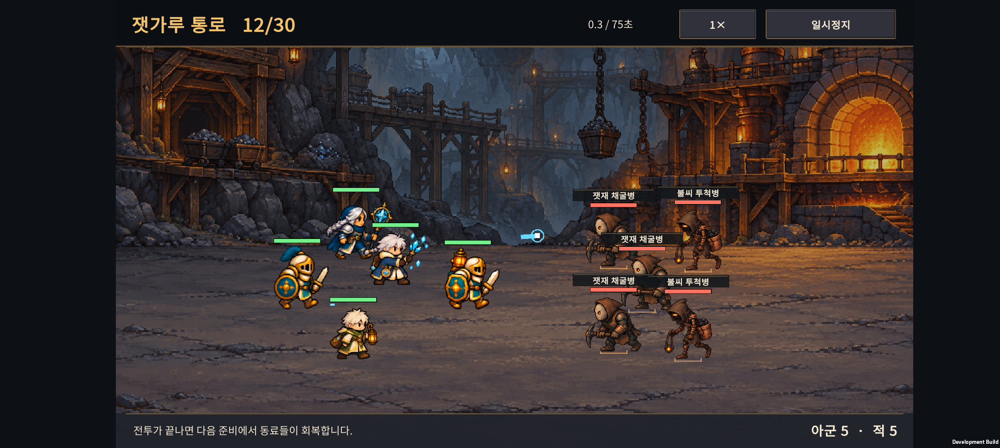

# v0.48 · 폐광 난도 흐름과 서리 보스 연쇄 공격

2026-10-27 · IGNIS: ASHEN OATH

**11~14전투의 압박을 높이고, 17→18의 급상승을 줄였다. 20보스에는 후열 다음 앞열을 노리는 두 번의 빙결 공격을 적용했다.** 새 원정부터 적용하며, 진행 중인 원정은 원래 난도와 연구 수치를 유지한다.

별도 시드의 원정 3,584회·69,227회 전투 시도를 비교했다. 폐광과 서리 보스의 압박은 늘었지만, 18전투의 급격한 장벽을 줄여 전체 자동 완주는 소폭 증가했다. **모든 전투가 완벽하게 순차 상승하는 상태는 아니며, 15보스의 큰 격차는 남아 있다.**

[이전 난도 진단](../design-v0.47/difficulty-audit.html) · [요약 데이터](summary.json) · [시드별 원정 결과](balance-results.json) · [같은 편성 비교](fixed-party.json) · [APK 빌드 정보](build-info.json)

## 실제 변경

| 전투 | 변경 | 의도 |
| --- | --- | --- |
| 11 | 채굴병 2→3, 개별 체력 550→480·공격 50→45 | 약한 졸개 한 명을 더해 전열 압박을 이어감 |
| 12 | 채굴병 2→3, 개별 체력 620→540·공격 55→50 | 투척병 둘과 함께 점진적으로 부담 증가 |
| 13 | 채굴병 체력 700→750·공격 60→65, 투척병 체력 450→480·공격 51→55 | 전열 유지와 후열 보호를 요구 |
| 14 | 감독관 체력 1200→1450·공격 66→80, 채굴병 체력 660→710·공격 59→64, 투척병 체력 450→500·공격 51→57 | 정예전이 앞 일반전보다 압박을 유지하도록 보강 |
| 17 | 시종 체력 590→650·공격 61→75 | 후열 압박을 앞당김 |
| 18 | 시종 체력 660→620·공격 67→61 | 원거리 셋의 집중 화력으로 생기던 급상승 완화 |
| 20 | 시종 체력 380→600·공격 46→62, 보스 연쇄 공격 | 전열·후열을 함께 관리 |

능력치는 적 한 명 기준이다. 15·20보스 본체 체력은 각각 6,000·7,400으로 유지했다. 1~10·16·19·21~30의 적 능력치·편성, 소환 비용·보상·아군 능력치는 바꾸지 않았다.

### 20보스: 후열 → 앞열 빙결 연쇄

1. 가장 먼 동료의 위치를 예고하고 공격한다.
2. 첫 대상과 다른 동료 중 보스에게 가장 가까운 동료의 위치에 두 번째 원을 표시한다.
3. 두 번째 원은 **항상 1.1초 예고** 후 공격한다. 두 원 모두 예고 위치를 고정하며 이동한 대상을 추적하지 않는다.
4. 동료가 하나뿐이면 두 번째 공격을 생략한다. 보스가 죽으면 연쇄를 취소한다.

각 공격은 공격력의 150%→180%, 빙결은 1.1→0.9초다. 두 공격 종료 후 일반 7초·분노 5초 간격을 둔다. 첫 예고는 기존처럼 일반 1.1초·분노 0.8초다. 기존 도트 얼음 분출 효과와 별도의 두 번째 공격 안내를 연결했다.

아래 화면은 Buddy2의 **강제 진행한 UI 검사용 원정**이다. 일반 플레이의 편성이나 클리어 증거가 아니다.





## 별도 시드 검증

조정에 사용하지 않았던 시드 48101~48108에서 4개 시작 편성, 7개 성장 목표, 연구 계열과 구매 시점을 조합했다. 실제 패배는 등불을 쓰고 승리한 경우에만 골드·진행도를 얻는다.

| 같은 시나리오 | v0.46 | v0.48 |
| --- | --- | --- |
| 자동 원정 수 | 1,792 | 1,792 |
| 완주 | 356 | 382 |
| 실제 전투 시도 | 34,378 | 34,849 |
| 평균 격파 수 | 16.60 | 16.90 |

83개는 격파 수가 늘고, 64개는 줄고, 1,645개는 같았다. 기존 실패에서 완주로 바뀐 경우 36개, 기존 완주에서 실패로 바뀐 경우 10개였다. **사람의 승률이 아니며, 전체가 더 어려워졌다는 결과도 아니다.** 쉬운 전투의 압박을 늘리는 동시에 지나치게 급격한 장벽을 줄였다.

아래는 해당 전투에 도달한 원정의 모든 시도에서 측정한 종료 평균 체력이다. 사망한 동료는 0으로 포함하며 다음 전투로 체력이 이월된다는 뜻은 아니다. 뒤쪽 전투는 앞에서 살아남은 편성만 포함되므로 이 표만으로 난도 순서를 단정하지 않는다.

| 전투 | v0.46 → v0.48 종료 체력 | 해석 |
| --- | --- | --- |
| 11 | 98.3% → 97.4% | 여전히 완충 구간 |
| 12 | 95.4% → 92.0% | 소폭 압박 증가 |
| 13 | 84.9% → 74.8% | 전열·후열 관리 필요 증가 |
| 14 | 89.5% → 72.1% | 앞 일반전보다 압박이 풀리던 경향 개선 |
| 17 | 89.4% → 83.1% | 후열 압박을 앞당김 |
| 18 | 33.0% → 46.9% | 급격한 집중 화력 완화 |
| 20 | 88.5% → 61.5% | 생존 압박이 약했던 보스 보강 |

20전투 첫 시도 승리 비율은 99.8%→97.1%, 평균 시간은 40.4→45.2초였다. 이미 성장해서 도달한 편성은 대체로 이기지만 전열·후열 피해가 늘었다. 시간 초과도 2→10건으로 늘어 후속 관찰이 필요하다.

## 같은 편성으로 다시 비교

별도 시드 48201~48204의 실제 원정 144회에서 준비 상태를 복제했다. 성장·연구·배치·시작 체력을 고정하고 적 규칙만 바꾸거나 인접 전투에 넣었다. 실제 진행 3,768회와 **고립된 비교 전투 8,526회**를 구분했다. 비교 전투에는 보상과 추가 소환이 없다.

18전투 준비에 도달한 동일한 128개 편성으로:

| 적 편성 | v0.46 승리 | v0.48 승리 |
| --- | --- | --- |
| 18 일반전 | 72/128 | 91/128 |
| 19 정예전 | 변경 없음 | 61/128 |
| 20 보스 | 122/128 | 64/128 |

20보스가 18보다 크게 수월하던 현상은 줄었다. 다만 **19→20은 61→64로 완전히 단조 증가하지 않는다.** 집중 공격과 범위 공격에 유리한 편성이 다른 점도 있으므로 승리 수 하나만 목표로 추가 강화하지 않았다. 조정에 사용한 49501~49504에서는 18→19→20이 82→62→55였지만 그 결과만 보고 완전 해결로 판정하지 않는다.

13·14전투도 같은 편성에서 종료 체력이 각각 92.5→87.0%, 94.1→84.8%로 내려갔다. 반면 13전투 준비 편성으로 15보스에 곧장 도전하면 여전히 41/141 승리였다. 실제 진행의 중간 성장 기회가 없는 비교이므로 실제 15보스 승률과는 다르지만 구간 격차가 남았음을 보여준다.

## 적용하지 않은 안

- 이전의 여러 지역 일괄 증원안은 반영하지 않았다.
- 서리 연쇄 150%·기존 간격은 보스 압박이 충분하지 않았다.
- 서리 연쇄 210%·주기 간격 5.5/4초는 같은 18전투 준비 편성의 보스 승리를 9/112까지 줄여 새로운 장벽이 됐다. 반영하지 않았다.
- 최종안은 180%·주기 간격 7/5초이며 별도 시드 검증 후 채택했다.

조정 중 같은 시드로 반복한 144회씩의 세 후보 실행과 첫 시드 결정성 재실행을 독립적인 별도 검증 표본으로 부풀리지 않았다.

## 저장·기록과 화면

새 원정은 **RulesVersion 3 / normal-048 / 원정 저장 v11**이다. v0.45·v0.46의 진행 중인 원정은 원래 규칙으로 이어진다. 현재 최고 점수와 이전 점수를 비교하지 않으며, 이전 최고 기록은 밸런스 버전마다 각각 보존한다. 기록 저장은 v3, 계정 저장 외곽 형식은 v2다.

‘이전 버전 최고 기록’에서 v0.45·v0.46 기록을 각각 열 수 있다. 최근 30개 목록에서 밀려나도 해당 버전 최고 기록은 남는다. 아래 점수는 저장 이행용 시험 데이터다.







휴대폰의 기존 저장 두 슬롯·손상 보관 파일·PlayerPrefs를 사전에 백업했고, 확인 후 원래 바이트로 복원했다. 실기기 검증은 배치·예고·문구·기록 화면의 짧은 확인이며 장시간 발열·프레임 측정은 아니다.

## 검사 결과

| 항목 | 결과 |
| --- | --- |
| 신규 규칙·기존 원정 보존 | 1,449조건: 이전 30전투 편성·능력치·좌표, 버전 유지, 연쇄 대상·예고·빙결·사망 취소, 버전별 최고 기록 |
| 기존 코어 회귀 | 원정 2,052 · 성과 410 · 저장 150 · 초기화/기록 1,201 · 안내/요약 5,744 · 연구 1,236 · 전투 3,011 · 보고서 6조건 통과 |
| 중단·재접속 | 16개 원정, 6,222개 저장·재시작·보상 경계 검사 통과 |
| Unity 실제 직렬화·통합 | 저장/설정 18 · 초기화/기록 17 · 이번 규칙 77조건 통과 |
| Android | APK 빌드·Buddy2 설치, 11·12 배치와 20 연쇄 예고·빙결, 기록 화면 확인 |

## 남은 조정

1. **15보스의 시간 초과와 성장 격차**: 체력 추가 대신 15전투 도달 편성의 화력·성장을 비교한다. 이번 자동 비교에서도 시간 초과 215건이 남았다.
2. **19→20의 편성별 상성**: 보호·회복·밀집 배치에 따른 차이가 납득되는지 확인한다.
3. **21·26 지역 초입의 완화 폭**: 이번에는 변경하지 않았다. 해당 지역만 따로 작은 증원안을 비교한다.
4. 실제 신규 플레이어의 이해·배치 선택과 Buddy2 장시간 성능을 확인한다.

## 재현

```powershell
./tests/DifficultyCurve/run-regression.ps1
./tests/ResearchRegions/run-matrix.ps1 -FirstSeed 48101 -Count 8 -Rules v046 -Output .local-tools/v048/holdout-before
./tests/ResearchRegions/run-matrix.ps1 -FirstSeed 48101 -Count 8 -Rules current -Output .local-tools/v048/holdout-after
./tests/DifficultyCurve/run.ps1 -FirstSeed 48201 -Count 4 -ComparePrevious -ReportPath .local-tools/v048/holdout-fixed.json
node tests/DifficultyCurve/analyze.cjs .local-tools/v048/holdout-before .local-tools/v048/holdout-after .local-tools/v048/holdout-fixed.json docs/design-v0.48
```

APK: `C:/Users/whwog/project/game/unity/Builds/Android/expedition-combat-prototype.apk`

이번 변경은 아직 커밋·푸시하지 않았다.
