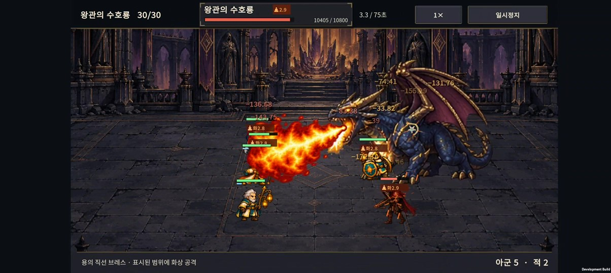
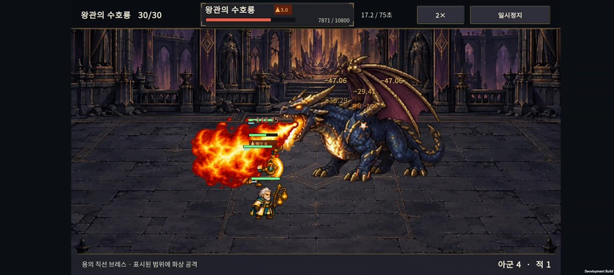
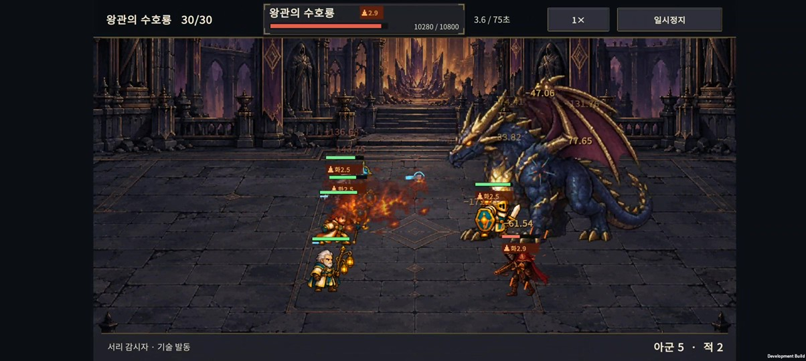

# v0.49 · 수호룡 브레스의 화염과 잔불

2026-10-28 · IGNIS: ASHEN OATH

사용자가 제시한 [영상의 첫 용 장면](https://www.youtube.com/watch?v=Kbf8yqauzF0)을 직접 재생하고 프레임 단위로 확인했다. 작은 입구에서 크게 퍼지는 불꽃, 밝은 내부와 주황색 외곽, 분출 뒤 검붉은 연기라는 특징을 새 효과에 반영했다. 영상 속 이미지나 캐릭터를 게임 자산으로 가져오지는 않았다.

[애니메이션·실기기 영상 보기](breath-preview.html) · [원본 도트 시트](../../unity/Assets/Resources/Art/Effects/v049/dragon-breath.png) · [생성 프롬프트](asset-prompt.txt)

## 적용한 변경

- 브레스 전용 8프레임 투명 시트를 새로 제작했다. 기존보다 불꽃 내부를 조밀하게 채우고, 끝부분이 큰 덩어리로 부풀도록 했다.
- 기존 높이 135~180 기준의 납작한 표현을 250~320 기준으로 바꿨다. 이는 여백을 포함한 시트의 표시 높이이며 실제 보이는 불꽃 높이와는 다르다.
- **0.44초 분출 → 0.32초 잔불·연기**로 나눴다. 분출 중에는 6개의 불꽃 프레임, 종료 뒤에는 2개의 연기 프레임을 사용한다.
- 프레임마다 다른 불꽃의 시작점을 측정해서 용의 실제 턱에 붙였다. 완전히 퍼진 불꽃 끝은 예고했던 목표 지점에 맞춘다.
- 연기는 마지막 분출 위치에 남고, 용의 이동을 따라다니지 않는다. 연기 프레임에 남아 있던 입구 쪽 밝은 점은 UV 잘라내기로 숨긴다.
- 용이 죽거나 없어지면 효과를 그리지 않는다. 번쩍임 감소 설정도 적용한다.

브레스의 피해량·화상·공격 범위·예고 시간·공격 주기는 변경하지 않았다. 위로 솟는 불꽃의 높이는 지면 판정 폭을 의미하지 않으며 기존 바닥 예고를 유지한다. 전투 규칙은 계속 `normal-048`이다.

## 검증

Unity에서 새 시트를 포함한 6개 효과 시트의 투명 경계·빈 프레임·가져오기 설정을 검사했다. 입 기준점, 3가지 길이·3가지 폭·5가지 조준 각도, 고정된 끝점, 연기와 입 사이 간격 및 QA 편성 생성 등 **1,113개 조건**을 통과했다.

기존 실제 브레스 이벤트를 사용하는 검사도 통과했다. 분출이 끝나면 용의 입 애니메이션을 강제로 유지하지 않으며, 기존 3개 턱 자세·3개 깊이의 위치 검사와 비행 크기·높이 검사도 통과했다.

Buddy2에 새 APK를 설치하고 24초 전투를 녹화했다. 1배속과 2배속의 분출 전후를 각각 0.1초 간격으로 추출해, 입 연결·화염 확대·연기 분리·소멸을 확인했다. 녹화 구간의 Unity/AndroidRuntime 로그에서 Exception·FATAL·Error는 발견하지 않았다. 장시간 성능이나 평균 FPS를 측정한 결과는 아니다.

APK 빌드 성공 및 체크섬은 [빌드 정보](build-info.json)에 남겼다. 실기기 확인 후 기존 저장 슬롯·손상 백업 슬롯·PlayerPrefs를 원래 바이트와 일치하도록 복원하고 앱을 종료했다.

실기기 영상은 30전투로 강제 진행한 별도 QA 편성이다. 정상 플레이의 난도나 클리어 가능성을 입증하는 자료가 아니다.

## 구현 메모

- 이미지 생성: built-in `image_gen`, 실제 투명 알파 유지. 최초 생성 뒤 프레임 가장자리와 여백을 한 번 수정했다. 프롬프트는 위 링크에 보관했다.
- 원본: `unity/Assets/Resources/Art/Effects/v049/dragon-breath.png`, 1774×887. 모바일 가져오기 최대 변 1024, Point 필터, 밉맵 없음.
- 매 프레임 텍스처를 생성하지 않고 시트 UV를 선택한다. 불꽃과 연기는 순서대로 한 장씩 그린다.
- 검사·빌드 진입점: `Expedition.EditorTools.DragonBreathPlumeValidation.ValidateAndBuild`.
- v0.47·v0.48 작업과 별개로 이번 변경은 공격 연출만 다뤘다. 대규모 난도 시뮬레이션을 다시 수행하지 않았다.
