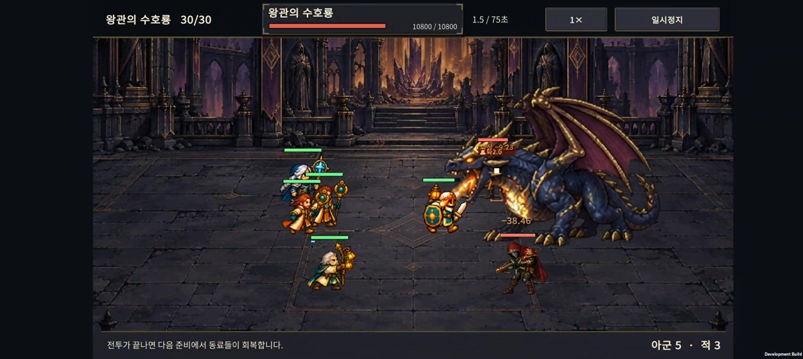
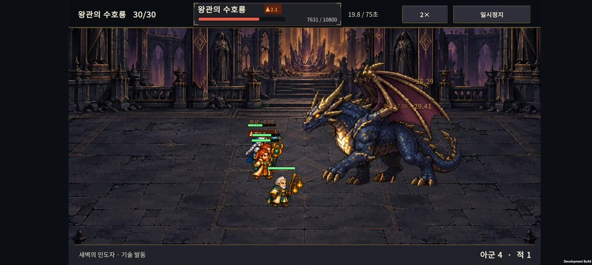
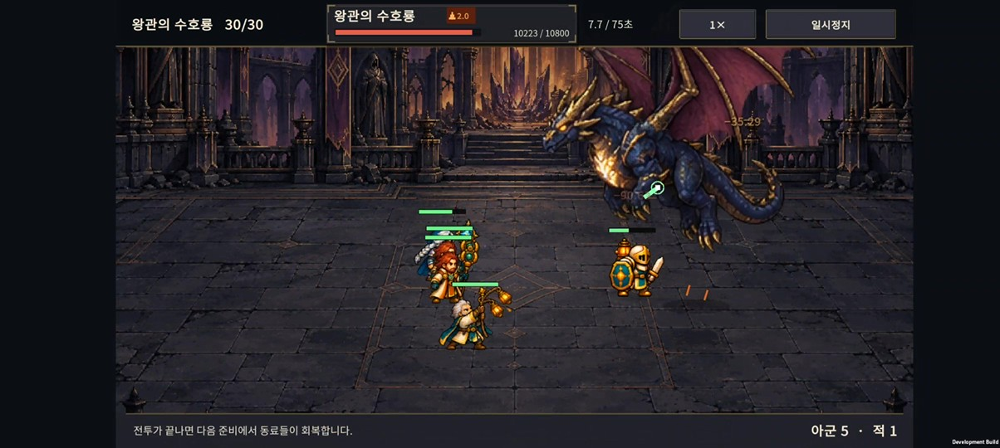

# v0.50 · 수호룡의 전투 거리

2026-10-28 · IGNIS: ASHEN OATH

**용이 아군 후열까지 들어오던 원인은 1.1 거리의 근접 기본 공격이었다. 기본 공격을 3.2 거리의 짧은 화염탄으로 바꿔 몸이 파고드는 상황을 줄였다.**

- 아군이 멀리 있으면 접근하다 3.2 거리에서 멈춰 공격한다. 계속 오른쪽에 고정되는 방식은 아니다.
- 가까이 오는 아군을 밀거나 용이 뒤로 도망가지 않는다. 아군 근접 캐릭터가 먼저 붙으면 겹침은 여전히 가능하다.
- 기본 공격력 145·기본 간격 1.8초·이동 속도 0.48은 유지했다. 짧은 화염탄은 실제 입에서 출발해 타격 직전까지 날아간다.
- 화염탄에는 기존 도트 화염 시트의 4개 프레임을 사용했다. 새로운 선형 빔을 추가하지 않았다.
- 큰 브레스의 길이 5.5·반폭 0.65, 비행 폭격·착지 충격파의 범위와 주기는 유지했다.

단순히 접근만 멈추는 안은 기본 공격을 거의 없애 전투가 너무 쉬워져 채택하지 않았다. 공격 사거리를 늘리면 실제로 공격할 기회도 늘어난다. **공격력과 간격이 같아도 기존 난도와 동일하다는 뜻은 아니다.**

## 검사와 비교

- 수호룡 이동·재조준·보스 패턴·이전 규칙 보존: 495개 조건.
- 원정 2,052 · 전투 3,011 · 난도/기록 1,450 · 계정 저장 150 · 초기화/기록 1,201 · 진행도 410개 조건 통과. 위 이동 검사를 포함해 총 **8,769개 조건**이다.
- 별도 QA 편성의 배치 3종 × 능력치 배율 3종 × 전열 생존/제거 2종 × 기존/변경 규칙을 조합해 36회 전투를 비교했다.
- 비교 편성의 승리는 기존 18개 중 2개, 변경 후 0개였다. 시간 초과는 양쪽 모두 0개. 용의 평균 기본 공격 횟수는 8.17→10.5회였다. 이 한 편성군에서는 더 어려워졌으므로 출시 전 합법 성장 빌드로 재평가할 항목이다.
- 전투 종료 시 용의 X 범위는 기존 −1.61~−0.66에서 변경 후 0.59~1.89였다. 이 좌표는 같은 QA 조건의 결과이며 모든 전투에서 고정된 위치를 뜻하지 않는다.

[검사 결과·36회 비교 원시 자료](spacing-checks.json) · [재현 도구](../../tests/DrakeSpacing/README.md)

## 저장과 적용 범위

새 원정은 전투 규칙 4, 저장 형식 12, 점수 버전 `normal-050`을 사용한다. 진행 중인 기존 원정은 원래 규칙을 유지한다. 기존 `normal-048` 최고 기록은 이전 버전 기록으로 보존하고 새 버전 기록과 섞지 않는다. 원정 기록 형식 1~3을 계속 읽으며 새 저장은 형식 4다.

이전 버전의 30전투를 이어 하면 용의 기존 접근 방식이 유지된다. 새 행동은 새 원정 또는 별도의 개발 검사용 30전투에서 확인한다.

## Buddy2 확인

새 APK를 Galaxy Buddy2에 설치하고 별도 30전투 QA 편성으로 24초를 녹화했다. 1배속·2배속에서 이동 중단, 입에서 나가는 짧은 화염탄, 비행과 착지, 전열 사망 뒤의 거리를 확인했다. 이 영상은 특정 편성의 동작 확인이며 정상 원정의 완주 검증은 아니다.

아군 근접 유닛은 스스로 다가가므로 이후에는 용과 겹칠 수 있다.

Unity 직렬화·기존 원정·버전별 기록 검사, 기존 브레스의 1,113개 기하/시트 검사와 Android 빌드를 통과했다. 녹화 구간의 Unity/AndroidRuntime 필터 로그에서 예외는 검출되지 않았다. 원래 휴대폰의 저장 슬롯과 PlayerPrefs는 검사 후 바이트 단위로 복원·대조했다.

APK: `unity/Builds/Android/expedition-combat-prototype.apk` · [빌드 정보·SHA-256](build-info.json)

## 남은 조정

- 정상 성장 빌드의 30전투 완주율로 화염탄 도입 후의 압박을 다시 비교한다. 이번 QA 결과만으로 출시 난도를 확정하지 않는다.
- 근접 동료가 먼저 붙는 경우와 후열끼리 모이는 경우의 가독성은 별도 과제다.
- 참고 영상에서 논의한 체력바·전투 HUD 미술 개편은 이번 거리 수정에 포함하지 않았다.
