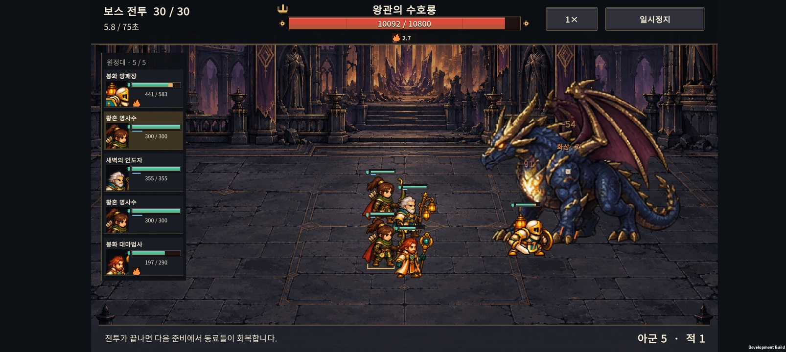
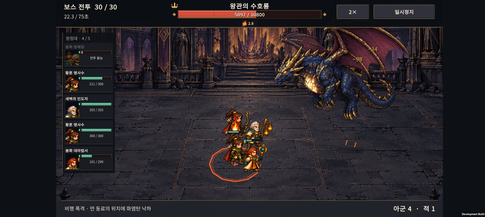
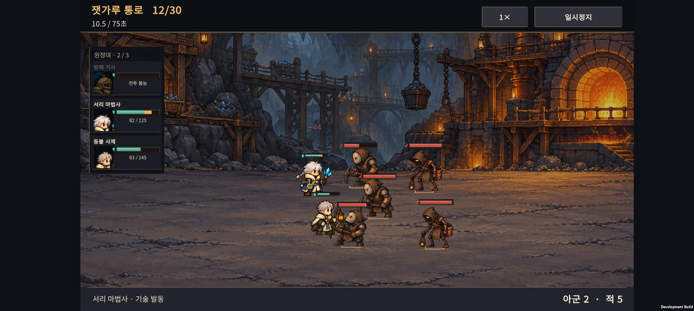

# v0.51 · 전투 HUD 정리와 보스 난도 재검증

2026-10-28 · IGNIS: ASHEN OATH

보스 이름과 체력을 중앙에 정렬하고, **화면 왼쪽에 아군 초상화·체력·상태이상을 고정하는 목록**을 추가했다. 게임 규칙과 공격 수치는 변경하지 않았다. 전투 규칙은 `normal-050`, 원정 저장은 v12이며 UI는 진행 중인 기존 원정에도 적용된다.

## 전투 화면

- 중앙의 긴 붉은 보스 체력바: 금속색 픽셀 테두리, 양쪽 장식, 체력 수치, 짧게 남았다 줄어드는 피해 잔상.
- 보스 이름과 상태이상 줄은 각각 중앙 정렬. 분노·빙결·화상·중독이 동시에 있어도 이름이나 체력 수치와 겹치지 않는다.
- 전투 번호와 시간은 왼쪽, 배속과 일시정지는 오른쪽에 배치했다.
- 왼쪽 아군 목록은 전투 중 순서를 유지한다. 실제 캐릭터의 대기 스프라이트에서 상체를 보여주며 이름·현재/최대 체력·보호막·빙결/화상/중독을 함께 표시한다. 쓰러져도 목록에서 빠지지 않고 ‘전투 불능’으로 남는다.
- 아군 카드를 누르면 해당 캐릭터 발밑을 잠깐 표시한다. 같은 직업이 여러 명일 때 화면에서 찾는 보조 수단이다.
- 전장 위 아군 체력바는 체력이 줄었거나 보호막이 있을 때만 작게 보조한다. 아군 상태 아이콘은 왼쪽 목록에 모으고, 적 체력바와 상태 아이콘은 머리 위에 유지한다.
- 아군은 청록색과 방패 모양, 적은 붉은색과 사선 모양으로 구분한다. 보호막은 파란 보조 막대다.
- 빙결·화상·중독은 가로로 놓인 컬러 도트 아이콘으로 표시한다. 길게 쌓이던 상태 설명을 줄였다. 보스는 아이콘 옆에 남은 초도 표시한다.
- 전장 체력바가 겹치면 가까운 빈 자리로 옮기고 원래 위치까지 가는 가는 연결선을 표시한다.
- 왼쪽 목록이 캐릭터를 덮지 않도록 전장 표시 영역을 오른쪽에 확보했다. 캐릭터의 렌더링 크기와 실제 전투 좌표는 유지하고 가로 화면 투영을 조정했다. 바닥 원형 예고와 충격 효과의 가로 폭도 같은 투영 비율을 사용한다.
- 0.1초 안에 같은 유닛이 받는 직접 피해는 합산 표시하며, 숫자는 정수 중심으로 표시한다. 실제 피해 계산은 그대로다. 피해 숫자도 체력바와 다른 숫자의 자리를 피한다.
- 유닛 이름은 일시정지 시 표시한다. 보스 예고 문구와 남은 아군·적 수는 하단에 유지했다.
- 움직임 감소 설정에서는 체력의 피해 잔상 이동도 생략한다.

새 외부 미술 자산을 가져오지 않고 게임 코드로 픽셀 테두리와 아이콘을 그린다.

## 정상 원정의 15·30전투 비교

4개 시작 편성 × 7개 성장 정책 × 3개 연구 계열 × 2개 연구 구매 시점 × 4개 시드로 **672개 원정·14,080회의 실제 진행 전투**를 실행했다. 패배는 등불을 소비하며, 승리를 강제하거나 보상을 추가하지 않았다. 실제 도달한 편성으로 **1,254회의 별도 비교 전투**도 수행했다.

같은 시드를 여러 정책으로 사용한 시나리오다. 672개의 독립적인 무작위 시드나 사람의 플레이 표본이 아니다. 성장 순서는 Balanced로 고정했으며 모든 전략을 탐색한 결과도 아니다. 완주는 128/672였지만 이 비율을 사람의 클리어 확률로 사용하면 안 된다.

| 같은 편성으로 비교 | 15전투 도달 편성 407개 | 30전투 도달 편성 220개 |
| --- | ---: | ---: |
| 현재 적·현재 배치 승리 | 210 (51.6%) | 112 (50.9%) |
| 같은 적·밀집 배치 승리 | 358 (88.0%) | 121 (55.0%) |
| 비교 기준 | 14전투 적: 406 (99.8%) | 이전 근접 용: 146 (66.4%) |
| 현재 전투 시간 초과 | 15 | 0 |

15와 30은 각각 해당 전투에 실제 도달한 편성이므로 모집단이 다르다. 두 열을 그대로 비교해 난도의 순서를 판단하지 않는다. 15전투의 비교 기준은 성장 없이 바꿔 넣은 14전투 적이며, 30전투의 비교 기준은 같은 30전투의 이전 용이다.

### 15보스: 배치에 따른 차이가 크다

같은 투자로 배치만 바꾸자 승리 수가 210→358로 늘었다. 특히 일반 최종 진화 정책은 34/91→89/91이었다. **이 표본에서는 체력이나 제한 시간만 바꾸는 것보다 회복·보호를 받는 위치와 공격 집중을 안내하는 작업이 우선이다.** 어느 효과가 얼마나 기여했는지 개별적으로 끈 실험은 하지 않았으므로 원인을 하나로 단정하지 않는다.

시간 초과 15개 편성의 보스 잔여 체력은 평균 7.8%였다. 전체 보스 체력을 즉시 낮출 근거로 쓰기보다 이 편성들의 화력·성장 선택을 따로 확인한다. 이전 문서의 시간 초과 건수와는 표본 수·구성이 달라 직접 증감 비교하지 않는다.

### 30보스: 원거리 기본 공격의 난도 영향이 확인됐다

같은 220개 편성에서 이전 용의 승리는 146개, 현재 용은 112개였다. 이전에 이기다 지는 편성이 44개, 반대로 새로 이기는 편성이 10개다. 사거리 확대가 모든 편성에 동일하게 작용하지는 않는다.

일반 최종 진화 정책은 53/71→31/71, 원정 유격대장 목표 정책은 23/33→15/33이었다. 성가 기수 목표의 7/7 승리는 표본이 작아서 안정적인 우세로 일반화하지 않는다. 이번에는 수치를 바꾸지 않았다. 다음 비교는 원거리 기본 공격의 위력·간격 후보를 같은 도달 편성과 별도 시드에 적용하되, 큰 브레스와 비행 패턴의 특색은 보존하는 방식이 적절하다.

[원시 결과](boss-balance.json) · [요약·정책별 수치](balance-summary.json) · [재현 도구](../../tests/BossGate/README.md)

## 검증

Unity에서 30개 전투 제목, 보스 6종 이름·체력, 아군·적 수 78가지 조합, 예고 문구와 4개 상태 칸의 글자 크기를 검사했다. 추가 **484개 조건**으로 피해 잔상의 감소·회복·연속 피해·움직임 감소, 화면 가장자리에서 겹친 12개 체력 표시의 배치, 상태 줄의 중앙 정렬, 30형태의 목록 이름과 체력 수치, 목록과 전장의 분리를 확인했다.

Android APK 빌드·Buddy2 설치를 완료했다. 최종 목록이 적용된 빌드에서 5·12·15·30전투를 확인했고, 30전투는 1배속·2배속을 확인했다. 카드 선택·보호막·화상·전투 불능 표시, 이름과 수치의 잘림을 확인했다. 15·30은 위 자동 원정에서 실제 도달한 편성이고, 5·12는 별도 화면 검사용 편성이다.

최종 확인 구간의 Unity/AndroidRuntime 로그에서 예외·오류는 검출되지 않았다. 이 검증은 짧은 조작과 화면 점검이며 장시간 FPS·발열 측정이나 30전투를 사람이 완주한 결과는 아니다. 원래 휴대폰 저장 슬롯과 PlayerPrefs는 검사 후 바이트 단위로 복원·대조했다.

APK: `unity/Builds/Android/expedition-combat-prototype.apk` · [빌드 정보·SHA-256](build-info.json)

## 다음 우선순위

1. 15전투 준비 안내가 배치의 실제 효과를 충분히 설명하는지 신규 플레이어로 확인.
2. 30보스의 원거리 기본 공격 위력·간격 후보를 동일 편성 및 별도 시드로 비교.
3. 휴대폰 장시간 성능·발열, 밀집 전투에서 숫자가 너무 멀리 이동하는지 추가 관찰.
