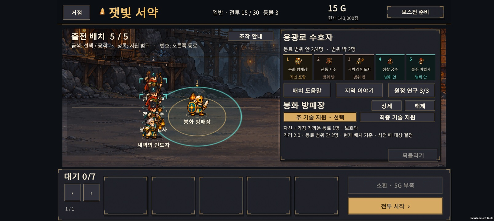
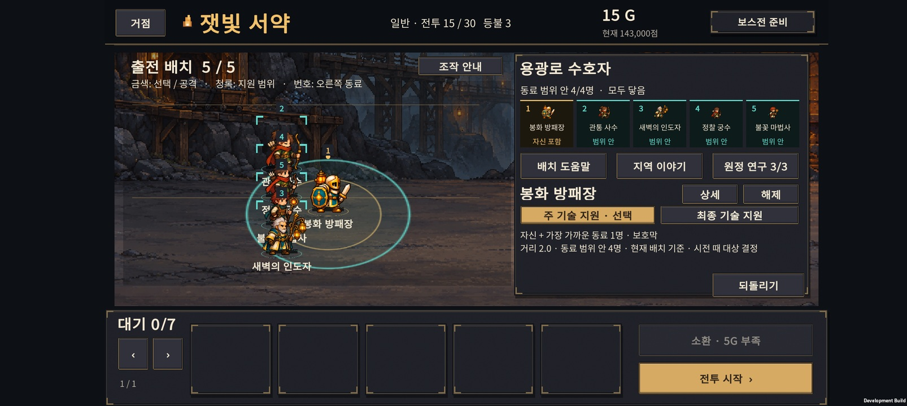
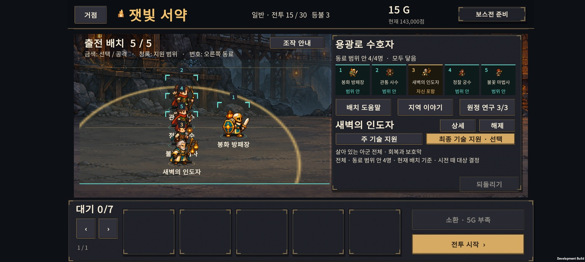

# v0.52 · 지원 배치 확인과 수호룡 일반 공격 조정

2026-10-28 · IGNIS: ASHEN OATH

준비 화면에서 **지원 기술의 범위 안·밖에 있는 동료를 각각 표시**하고, 최종 수호룡은 **일반 불덩이의 공격 계수만 1.0→0.9**로 조정했다. 사거리 3.2, 기본 공격 간격 설정 1.8초, 브레스·비행·착지 패턴은 유지한다.

## 준비 화면

- 지원 동료를 누르면 오른쪽 위에 출전 동료 최대 5명의 그림·이름·범위 상태가 나타난다. 전장의 번호와 목록 번호가 대응하므로 같은 직업도 구별할 수 있다.
- 선택한 유닛은 금색, 지원 범위 안은 청록색, 밖은 흐린 갈색과 끊어진 괄호로 구별한다. 목록에는 ‘자신 포함 / 범위 안 / 범위 밖’을 글자로 함께 표시한다.
- 지원 동료를 끌면 후보 수와 목록이 현재 드래그 위치에 맞춰 바뀐다. 드래그를 취소하면 저장된 배치를 다시 표시한다. 확인 자체는 골드·배치·성장·되돌리기 기록을 바꾸지 않는다.
- 최종 진화의 주 기술과 최종 기술은 버튼으로 바꿔 본다. 예를 들어 사제의 단일 회복 범위와 최종 전체 회복은 서로 다른 표시를 사용한다.
- 아래에는 자신 포함 여부, 최대 대상 수, 대상 우선순위와 발동 조건을 유지했다. **범위 안은 지원 후보이며, 모두가 동시에 효과를 받는다는 뜻은 아니다.** 실제 대상은 시전 시점의 위치·체력·보호막 등에 따라 결정된다.
- 공격 기술에 붙은 지원은 적에게 공격할 조건도 필요하다. 선택한 기술의 표시이며 전승 특성까지 합산한 전투 예측은 아니다.
- 지원 확인 중에는 적 구성·전투 조언 자리에 동료 목록을 보여준다. ‘해제’로 원래 안내를 다시 볼 수 있다. 튜토리얼의 버튼 안내가 나오는 동안은 기존 안내 영역을 우선한다.

범위 판정은 기존 전투 기술과 공유하는 반경과 2차원 거리를 사용한다. 지원 기술의 실제 효과나 15전투 적 수치는 바꾸지 않았다. v0.51의 배치별 52%→88% 차이는 지원 범위만의 효과를 분리한 실험이 아니므로, 이번 UI로 그 차이가 해소됐다고 단정하지 않는다.

## 용의 일반 공격 비교

총 **2,016개 정상 진행 원정 시나리오·40,405회 진행 전투·3,588회 별도 비교**를 실행했다. 4개 시작 편성, 7개 성장 목표, 3개 연구 계열, 2개 구매 시점을 조합했다. 패배는 등불을 소모하고 승리를 강제하지 않는다. 30전투에 처음 도달한 편성을 그대로 복제해 6개 후보를 비교했다.

원정 경로는 변경 전 v0.50 규칙으로 고정했다. 후보 결과는 성장·보상·다음 진행에 영향을 주지 않는다. 새로운 규칙이 30전투 기본 공격만 바꾸므로, 후보별 도달 편성은 동일하다.

| 일반 공격 후보 | 선택용 220개 편성 승리 | 별도 검증 378개 편성 승리 |
| --- | ---: | ---: |
| 기존: 계수 1.0 / 간격 1.8 | 112 (50.9%) | 207 (54.8%) |
| **선택: 계수 0.9 / 간격 1.8** | **139 (63.2%)** | **263 (69.6%)** |
| 계수 0.8 / 간격 1.8 | 165 (75.0%) | 297 (78.6%) |
| 계수 1.0 / 간격 2.1 | 189 (85.9%) | 337 (89.2%) |
| 계수 1.0 / 간격 2.4 | 182 (82.7%) | 335 (88.6%) |
| 계수 0.9 / 간격 2.1 | 208 (94.5%) | 355 (93.9%) |

간격을 늦추는 후보는 자동 전략의 성공률을 크게 올렸다. 난도를 유지하면서 원거리화로 늘어난 압박을 일부 줄이기 위해 **위력만 10% 낮추는 후보**를 선택했다. 별도 시드 결과를 보기 전에 후보를 정했고, 검증 후 다른 후보로 갈아타지 않았다.

### 별도 시드의 성장 목표별 결과

| 성장 목표 | 도달 편성 | 기존 승리 → 조정 후 승리 |
| --- | ---: | ---: |
| 일반 최종 진화 | 123 | 67 → 93 |
| H-01 | 55 | 33 → 33 |
| H-02 | 29 | 18 → 20 |
| H-03 | 43 | 26 → 35 |
| H-04 | 62 | 36 → 42 |
| 성가 기수 H-05 | 10 | 7 → 10 |
| 원정 유격대장 H-06 | 56 | 20 → 30 |

이는 목표 직업을 반드시 얻은 편성만의 결과가 아니다. 획득에 실패한 경로도 포함하는 성장 정책의 집계다. 성가 기수 목표는 표본 10개로 적어 강함을 일반화하지 않는다.

검증 표본에서 기존 패배가 승리로 바뀐 편성은 57개, 승리가 패배로 바뀐 편성은 1개다. 이 1개는 기존 74.1초 승리에서 조정 후 75초 제한에 걸렸고 보스 체력이 0.38% 남았다. 자동 전투는 피해·회복·대상 선택의 타이밍이 함께 바뀌므로 위력을 낮춰도 모든 편성의 결과가 단조롭게 좋아지는 것은 아니다. 원인을 한 가지로 분리한 실험은 하지 않았다.

시간 초과는 기존 12→11개다. 전체 보스 체력이나 제한 시간을 이번에 바꾸지는 않았다.

### 해석 범위

선택용 시드는 51101–51104, 별도 검증은 52101–52108이다. **12개의 시드를 여러 정책으로 공유한 결과이며 2,016개의 독립 시드나 사람의 승률이 아니다.** 30전투에 도달한 조건부 표본이고, 성장 순서는 Balanced로 고정했다. 모든 빌드가 최적화됐거나 출시 난도가 확정됐다는 뜻도 아니다.

[선택용 원시 결과](tuning.json) · [선택용 요약](tuning-summary.json) · [별도 시드 원시 결과](holdout.json) · [별도 시드 요약](holdout-summary.json) · [재현 방법](../../tests/DrakePressure/README.md)

## 저장·기록 호환

- 새 원정: 규칙 5, 저장 v13, 밸런스 `normal-052`.
- 진행 중인 이전 원정: 저장된 규칙 유지. v0.50 원정의 불덩이는 기존 계수 1.0 그대로다.
- 지원 배치 UI는 이전 원정에도 적용된다.
- 개인 기록은 밸런스별로 분리한다. 기록 형식 v5에서 이전 v0.50 최고 기록은 이전 버전 기록으로 보존한다.

## 검증

- 실제 회복·보호 기술의 경계 거리, 대상 우선순위, 공격 조건, 전체 지원: 기존 코어 검사 11조건 통과.
- 용 사거리·기본 공격 계수·브레스/폭격/착지 피해 유지·이전 원정·최고 기록 이관: 550조건 및 36개 비교 전투 통과.
- 계정 저장: 150조건·90개 체크포인트·손상 및 미래 버전 복구 검사 통과.
- 원정 초기화·기록: 1,201조건·80개 실제 비교 전투·30전투 저장 흐름 검사 통과.
- Unity: 지원 목록 이름·설명·범례·5개 카드 배치 60조건, 드래그·선택 26조건, 기존 전투 글자 검사 통과.

Android APK 빌드와 Buddy2 설치를 완료했다. 15전투 준비 화면에서 주 기술의 범위 안 2명/밖 2명, 위치 이동 후 범위 안 4명, 되돌리기, 최종 기술·전체 지원 전환을 확인했다. 새 목록과 설명의 글자 잘림은 확인되지 않았다. 전장의 밀집 배치에서는 기존 유닛 이름이 서로 겹치는 문제가 남아 있으며, 오른쪽 목록에서 전체 이름을 읽을 수 있다.

30전투는 새 규칙의 테스트 체크포인트로 진입해 전투 진행과 비행·착지 예고를 확인했다. 확인 구간의 Unity/AndroidRuntime 로그에서 예외·오류는 검출되지 않았다. 짧은 화면·실행 점검이며 사람이 30전투를 완주한 검증은 아니다. 검사 후 휴대폰의 원래 저장 슬롯과 PlayerPrefs를 바이트 단위로 복원·대조했다.

APK: `unity/Builds/Android/expedition-combat-prototype.apk` · [빌드 정보·SHA-256](build-info.json)

## 다음 확인

새 플레이어가 지원 동료 선택 → 범위 밖 동료 확인 → 배치 수정까지 스스로 할 수 있는지 확인한다. Buddy2 장시간 성능·발열 검증은 별도 작업으로 남는다.
