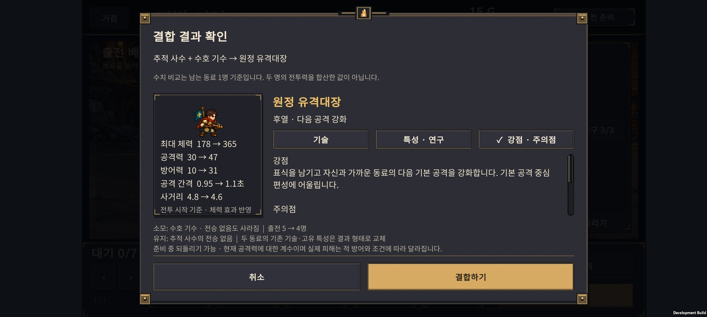
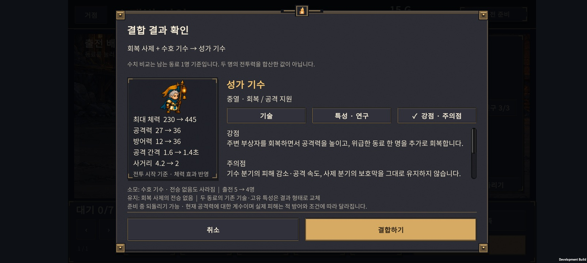

# v0.53 · 직업의 역할과 결합 선택 검증

2026-10-28 · IGNIS: ASHEN OATH

**6개 직업 계열과 6개 결합식을 유지한다.** 모든 계열에 결합 경로가 있는 것 자체보다, 기존 두 명을 남길 이유와 결합으로 얻는 이득이 구별되는지가 중요하다. 이번 비교에서는 편성과 배치에 따라 선택이 달라졌다. 전투 수치는 일괄 상향하거나 하향하지 않았다.

게임 안의 유닛 상세·진화·결합 결과 화면에 **‘강점 · 주의점’ 탭**을 추가했다. 30개 형태에 역할 설명이 있으며, 결합체에는 잃는 기술·특성과 빈 출전 자리를 보충할 수 있다는 점을 함께 표시한다. 기존 기술 계수·스탯·특성 탭도 유지한다. 기본 기사의 첫 피격 방어와 기본 사제의 단일 보호막을 역할 문구에 정확히 반영했다.

## 6개 계열의 기준

| 계열 | 팀에서 맡는 일 | 약점·선택 조건 |
| --- | --- | --- |
| 방패 기사 | 적을 받아내는 전열. 보호막 또는 보호막 파괴 시 반격 | 공격수와 지원이 필요하다. 반격 분기는 보호막 공급원이 있어야 한다. |
| 궁수 | 원거리 기본 공격, 관통 또는 집중 사격 | 몸을 지켜줄 전열 필요. 관통은 적이 일렬로 모였을 때 유리하다. |
| 불꽃술사 | 밀집한 적에 범위 피해와 화상 | 흩어진 적에게 범위 효율이 낮아진다. |
| 사제 | 보호막 또는 회복으로 전열 유지 | 기본 형태는 보호막만 준다. 회복은 치유 분기부터 생긴다. |
| 서리술사 | 이동 둔화로 접근 지연, 조건부 공격 연계 | 둔화는 공격을 멈추지 않는다. 보스에게는 둔화가 절반 적용된다. |
| 기수 | 주변 동료의 공격·생존 지원 | 범위와 대상 수에 제한이 있다. 지원받을 동료의 배치가 중요하다. |

방패 기사를 원정대의 대표 얼굴로 유지한다. 세계관은 같은 중세 원정대이되 직업의 실루엣과 공격 연출로 역할을 구분한다. 추후 아트 검토 기준은 기사=방패·금속 갑옷, 궁수=활·가벼운 장비, 불꽃술사=따뜻한 불꽃색, 사제=빛·성물, 서리술사=차가운 결정색, 기수=군기다. **이번에는 캐릭터 그림과 애니메이션을 변경하지 않았다.** 기수의 체격은 깃발 전체 높이가 아닌 사람 몸통 기준을 유지한다.

## 결합 6종이 얻고 잃는 것

결합은 아무 두 직업이나 가능한 방식이 아니다. 정해진 두 계열의 **분기 진화체끼리** 합친다. 최종 진화체·결합체는 재결합하지 않는다. 두 분기의 기존 기술·고유 특성은 결합체 것으로 바뀌며, 남는 동료의 전승 특성만 유지한다.

| 결합체 | 재료 계열 | 얻는 역할 | 포기·주의할 부분 |
| --- | --- | --- | --- |
| 잿불 검위 H-01 | 기사 + 불꽃 | 전열 화염 참격 + 자기 보호막 | 기사 분기의 동료 보호와 불꽃술사의 원거리 역할을 그대로 유지하지 않는다. |
| 등불 성기사 H-02 | 기사 + 사제 | 근접 공격과 주변 회복 | 적을 공격해야 회복한다. 사제보다 지원 거리가 짧고 보호막 분기는 유지하지 않는다. |
| 빙결 추적자 H-03 | 궁수 + 서리 | 관통 사격 + 이동 둔화 + 조건부 표식 | 집중 사격이나 서리 범위 기술을 둘 다 보존하지 않는다. 이름과 달리 현재 기술은 빙결이 아닌 이동 둔화다. |
| 융해술사 H-04 | 불꽃 + 서리 | 한 기술로 화상·둔화를 걸고 추가 피해 조건 충족 | 두 명의 기본 공격과 서로 다른 시전 주기가 한 명으로 줄어든다. |
| 성가 기수 H-05 | 기수 + 사제 | 주변 회복·긴급 추가 회복·공격력 지원 | 기수의 피해 감소·공격 속도, 사제의 보호막을 모두 유지하는 상위호환은 아니다. |
| 원정 유격대장 H-06 | 궁수 + 기수 | 지휘 사격·표식·동료의 다음 기본 공격 강화 | 기술 피해를 강화하지 않는다. 기존 기수의 지속 지원이 사라지며 동료가 범위 내에서 5초 안에 공격해야 한다. |

‘두 명 → 한 명’은 단순 손해가 아니다. 출전 제한 5명에서 빈자리에 다른 동료를 투입할 수 있다. 반대로 보충할 동료가 없거나 기존 보호막·방어 지원이 핵심이면 결합을 미루는 편이 낫다. 따라서 결합 결과의 한 명 스탯만으로 두 명의 합산 전투력과 비교하지 않는다.

## 같은 투자량 비교

**10,752개 조건 × 3가지 편성 = 32,256회 비교 전투**. 결정성 확인용 반복 52회는 별도다. 현재 규칙 5 / `normal-052`를 사용했고 영구 연구는 넣지 않았다.

각 조건은 같은 재료·연구·대기 동료를 보유한다.

1. 공통 동료 3명 + 결합 재료 2명, 대기 동료는 벤치.
2. 재료를 결합해 총 4명 출전, 대기 동료는 벤치.
3. 같은 결합 편성에 **이미 보유한** 기본 궁수 또는 사제를 투입해 총 5명 출전.

분기 재료 하나는 기본 동료 3명분, 두 재료는 총 6명분을 사용한다. 결합 자체로 추가 골드를 주거나 대기 동료를 공짜로 지급하지 않았다. 연구는 해당 원정에서 지역을 돌파한 뒤 열리는 노드만 적용한다. 같은 행 안에서는 연구 비용도 동일하다.

### 주 비교: 각 결합체 1,408조건

일반전 6개·보스전 5개, 공통 편성 4종, 분기 조합 4종, 밀집·분산 배치, 연구 4정책을 조합했다. 아래는 **승리 횟수**이며 실제 플레이어의 승률이 아니다.

| 결합체 | 두 명 유지 | 결합만: 4명 | 결합 + 기존 대기 동료: 5명 | 유지 시 패배 → 보충 후 승리 | 유지 시 승리 → 보충 후 패배 |
| --- | ---: | ---: | ---: | ---: | ---: |
| 잿불 검위 | 331 | 400 | 648 | 349 | 32 |
| 등불 성기사 | 304 | 328 | 520 | 239 | 23 |
| 빙결 추적자 | 234 | 140 | 372 | 167 | 29 |
| 융해술사 | 236 | 168 | 364 | 180 | 52 |
| 성가 기수 | 360 | 248 | 556 | 261 | 65 |
| 원정 유격대장 | 283 | 160 | 348 | 151 | 86 |

빈자리를 비워두면 후열·지원 결합 4종의 승리 수가 줄었다. 보충 후에는 6종 모두 총 승리 수가 늘었지만, 결합 때문에 이기던 조건이 지는 경우도 남았다. 이 결과만으로 결합을 필수 과정으로 만들거나 모든 결합체를 강화하지 않는다.

### 다른 편성으로 확인: 각 결합체 384조건

다른 공통 편성 3종, 전진 배치, 전투 8·12·16·18·22·26·27·30에서 다시 비교했다. 주 비교를 본 뒤 **수치 유지**를 선택하고 이 결과로 확인했다.

| 결합체 | 두 명 유지 | 결합만: 4명 | 결합 + 보충: 5명 | 패배 → 승리 | 승리 → 패배 |
| --- | ---: | ---: | ---: | ---: | ---: |
| 잿불 검위 | 293 | 284 | 288 | 8 | 13 |
| 등불 성기사 | 273 | 272 | 304 | 34 | 3 |
| 빙결 추적자 | 279 | 228 | 288 | 14 | 5 |
| 융해술사 | 275 | 240 | 288 | 13 | 0 |
| 성가 기수 | 255 | 208 | 272 | 33 | 16 |
| 원정 유격대장 | 261 | 256 | 312 | 51 | 0 |

잿불 검위는 이 편성군에서 보충 후에도 기존 두 명보다 5승 적었다. 유격대장은 반대로 이득이 컸다. 결합체 간 첫 표의 승리 수만 보고 직업 순위를 정하면 안 된다. 재료 계열과 지원 동료가 서로 다르기 때문이다.

### 우선 주의할 선택

- **유격대장과 마법 위주 팀:** 주 비교의 공통 편성 `기사+불꽃+서리`에서는 유지 98승 → 보충 64승이었다. 반면 정밀 연구 정책 전체에서는 88→136승이었다. 각 집계는 다른 조건이 함께 들어 있으므로 인과관계를 한 가지로 확정하지 않는다. 기술 피해를 강화하지 않고 기존 기수의 방어 지원을 잃는 실제 규칙을 설명에 드러냈다.
- **성가 기수의 지원 교체:** 주 비교 일반전은 298→368승이지만, 기존 승리가 패배로 바뀐 조건도 57개다. 회복이 강하다는 이유로 피해 감소·공격 속도·보호막을 포기해도 된다고 안내하면 안 된다.
- **등불 성기사의 화력:** 생존만 보고 고르면 제한 시간에 걸릴 수 있다. 주 비교 보스전 시간 초과는 유지 155개 → 보충 172개였다. 공격수를 함께 확보하는 편성 설명이 필요하다.

## 해석 한계

고정 편성을 만들어 비교한 전투이며, 그 웨이브까지 랜덤 소환으로 실제로 획득했다는 뜻은 아니다. 전투 정의를 가져올 때만 승리를 강제로 진행했다. 공통 유닛 성장은 웨이브 구간에 맞춰 정했고, 모든 배치를 직업별 최적으로 맞추지는 않았다. 전승 특성은 이번 행렬에서 제외했다.

분기가 달라도 결합 후 상태가 같은 조건이 반복된다. 따라서 10,752개의 독립 표본이 아니며 통계적 신뢰구간이나 사람의 완주율을 계산하지 않는다. 두 번째 행렬도 새로운 랜덤 시드 검증이 아니라 다른 편성과 전투의 검증이다. 75초 시간 초과는 승리로 세지 않았다.

이 결과로 확정한 것은 **‘결합 6종을 없애거나 모두 상향할 근거가 부족하며, 역할과 포기하는 능력을 보여주자’**까지다. 출시 난도 확정이나 모든 전승·연구 조합의 밸런스 보장은 아니다.

[주 비교 상세 집계](main-summary.json) · [다른 편성 집계](holdout-summary.json) · [주 비교 원시 JSON gzip](main-raw.json.gz) · [다른 편성 원시 JSON gzip](holdout-raw.json.gz) · [실행 방법·측정 정의](../../tests/HybridRoles/README.md)

## 구현과 검증

- 30형태의 강점·주의점, 결합체의 역할 교체 설명을 게임 상세·결과 미리보기에 연결했다.
- 정보 화면을 기술 / 특성·연구 / 강점·주의점의 3개 탭으로 구성했다. 긴 문구는 기존 터치 스크롤 영역에서 읽는다.
- 스탯 미리보기의 전투 생성기에 원정에 저장된 규칙 버전을 명시적으로 전달한다. 이번 변경으로 전투 스탯을 바꾸지는 않았다.
- 코어: 미리보기 1,912조건·311사례, 결합 기술 20조건, 준비 범위 11조건 통과.
- Unity: 30형태의 이름·역할·탭 폭·스크롤 내용·초상화 검사 134조건, 드래그·선택 26조건 통과.
- 비교 행렬: 590,512검사와 결정성 재실행 52회 통과.

밸런스와 저장 버전은 이전 작업의 규칙 5 / 저장 v13 / `normal-052`를 유지한다. 캐릭터 수치·기술·레시피·아트에는 이번 작업의 변경이 없다.

Android APK를 빌드하고 Buddy2에 설치했다. 유격대장·성가 기수 결합 결과에서 탭 전환, 주의점까지 터치 스크롤, 미리보기 취소를 확인했다. 확인한 탭 제목·스탯·하단 버튼의 글자 잘림은 없었다. 긴 설명은 스크롤 영역에서 이어 읽는다. 두 저장 슬롯의 동료·골드·출전·연구·랜덤 상태·되돌리기 기록이 미리보기 전후 동일함도 확인했다. 검사 구간의 Unity/AndroidRuntime 로그에서 예외·오류는 검출되지 않았다.

폰의 원래 저장과 PlayerPrefs는 검사 후 바이트 단위로 복원·대조했다. 이는 화면·조작 점검이며 30전투 실기기 완주나 장시간 성능 검증은 아니다.

APK: `unity/Builds/Android/expedition-combat-prototype.apk` · [빌드 정보·SHA-256](build-info.json)

## 다음 확인

새 플레이어가 결합 전후 인원, 사라지는 지원, 빈자리 보충을 설명 탭을 보고 이해하는지 관찰한다. 이후 실제 소환·골드 지출로 진행하는 원정에서 결합을 선택하거나 미루는 시점을 비교한다. 강한 기본 공격 동료와 연결한 유격대장, 방어 지원을 남기는 선택, 결합 후 벤치 보충 정책을 우선 대상으로 삼는다.
