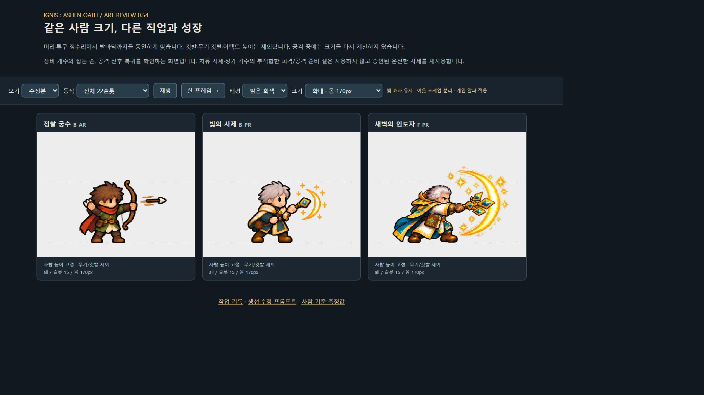

# v0.54 — 원정대 도트 정리와 공격 프레임 보정

방패 기사를 기준으로 기본 직업과 일부 상위 형태의 장비·색감·사람 비율을 정리했다. 공격의 빛과 화살은 유지하면서, 옆 프레임의 효과나 망토 조각이 캐릭터 뒤에 나타나는 문제를 수정했다.

- [움직이는 전후 비교](art-review.html)
- [공격 효과 검수 화면](attack-effects-verified.png)
- [사람 기준 측정값](body-calibration.json)
- [프레임 검사 결과](art-inspection.json)

## 적용 범위

기준인 방패 기사(B-KN)의 원본은 유지했다. 정찰 궁수, 불꽃 마법사, 서리 마법사, 빛의 사제, 서약 기수의 기본 5종과 보호 사제, 회복 사제, 새벽의 인도자, 서약 수호장, 광휘 성기사, 성가 기수의 상위 6종을 교체했다. 총 11종이며 나머지 18종은 기존 그림을 유지한다.

새 그림은 `unity/Assets/Resources/Art/Units/v054/`에 저장했다. 기존 v010 그림을 보존하고 아틀라스의 참조만 변경했다. 머리·투구 정수리부터 발바닥까지의 길이로 크기를 맞추며, 깃털·깃발·지팡이·무기·이펙트는 키에서 제외한다. 공격할 때마다 다시 크기를 계산하지 않는다. 상위 형태는 갑옷·어깨·방패·장식의 차이로 성장감을 표현한다.

## 장비와 공격 효과

서약 수호장의 중복 검, 성기사의 무기/방패 손바뀜, 보호 사제의 중복 책을 수정했다. 신체 일부를 떼어서 움직이는 방식은 사용하지 않았다.

회복 사제(E-PR-H)와 성가 기수(H-05)의 원본 중 장비가 잘못 그려진 피격 슬롯 4와 공격 준비 슬롯 14는 각각 온전한 슬롯 18과 13으로 대체한다. 따라서 22개 재생 슬롯이 모두 서로 다른 새 그림인 것은 아니다.

궁수의 화살과 빛의 사제의 작은 발광이 다음 자세에 잘못 배정되어 뒤쪽에 나타났다. 효과가 진행하는 방향을 기준으로 해당 자세에 다시 연결했다. 대사제·회복 사제·서약 수호장·기수의 일부 프레임은 서로 다른 자세의 직사각형 경계가 겹쳤다. 이 경우 원본 그림을 지우지 않고 **그 자세에 속한 영역만 화면에 표시**한다. 같은 처리 방식을 준비 화면, 전투, 브라우저 검수 페이지에 적용했다.

빛을 제거한 대사제 재생성본은 채택하지 않았다. 금빛 원호·별·광택이 있는 원본을 유지한다. 알파가 매우 낮은 배경 잡음은 기존 게임의 알파 컷오프로 처리한다. 화면 배율에 따라 분할 영역 사이에 가는 선이 생기지 않도록 경계는 화면 픽셀에 맞춘다.



## 등불 설정과 문구

캐릭터의 등불 소품과 등불을 운반하는 이야기 설정을 정리했다. 실패 한도는 기존처럼 3회이며 화면에는 **남은 기회**로 표시한다. 시작·결과·기록 화면의 관련 문구도 정리했다. 상단 전투 정보와 남은 기회는 두 줄로 나누어 잘림을 줄였다.

기존 저장 데이터를 읽기 위한 내부 `Lantern` 필드와 열거형 이름은 유지했다. 전투 능력치, 연구, 소환 비용, 원정 규칙과 저장 버전은 이번 미술 수정에서 변경하지 않았다.

## 검증

- 새 11종의 22슬롯, 총 242슬롯에서 몸·장비·효과의 픽셀 소속과 표시 영역을 검사한다. 소속된 유효 픽셀을 잘라내거나 다른 자세의 유효 픽셀을 포함하면 검사 실패로 처리한다.
- 30형태의 리소스·아틀라스 범위·피벗과 새 분할 영역의 경계·중복을 Unity에서 검사한다. 기준 방패 기사의 원본 유지도 검사한다.
- 몸 크기 검증, 전투 HUD 가독성 검사와 이야기·유닛 정보 회귀 검사를 함께 수행한다.
- 브라우저에서는 궁수와 두 사제의 공격·복귀, 수호장·회복 사제·기수·성기사·마법사의 주요 공격 자세를 확인했다.
- 최종 Unity 검사 1,365개, 사람 크기 검사 460개와 HUD 검사를 통과했다. 이야기 26개, 유닛 정보 1,912개 검사도 통과했다.
- Buddy2에 최종 APK를 설치하고 기본·상위·사제 편성의 짧은 전투 및 1×/2× 전환을 확인했다. 서리 마법사를 포함해 기본 6종과 교체한 상위 6종을 준비 화면에서 확인했다. 기존 세이브와 설정은 별도 보관 후 **바이트 단위 일치까지 확인하여 복원**했다.

[Buddy2 상위 편성](buddy2-advanced-preparation.png) · [기본 편성 전투](buddy2-base-battle.png) · [사제 편성 2× 전투](buddy2-magic-battle-2x.png)

최종 APK와 실기기 확인 결과는 [빌드·검증 기록](build-info.json)에 남긴다. 자동 픽셀 검사는 프레임 혼입 여부를 확인하는 것이며, 모든 동작의 미적 완성도나 장시간 성능을 보증하는 검사는 아니다. 남은 18형태의 미술 통일과 두 캐릭터의 재사용 자세 개선은 후속 범위다.

## 재현과 출처

```powershell
node tools/inspect-unit-refresh.cjs
node tools/publish-unit-refresh.cjs
```

그림 제작·수정에는 내장 ImageGen을 사용했다. [전체 생성·수정 프롬프트](art-prompts.json), [배경 정리·최종 선택 기록](art-selection.json), [최종 이미지 SHA-256](asset-hashes.json)을 보관했다. 프레임 분리 보정은 원본 PNG를 다시 그리지 않고 표시 메타데이터와 렌더링 코드에서 처리했다.

검수 페이지는 프로젝트 루트를 정적 웹 서버로 열면 게임과 같은 알파 처리를 확인할 수 있다. 현재 로컬 미리보기 주소는 `http://127.0.0.1:8540/docs/design-v0.54/art-review.html`이다.
