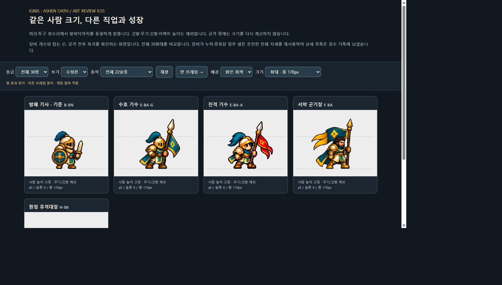
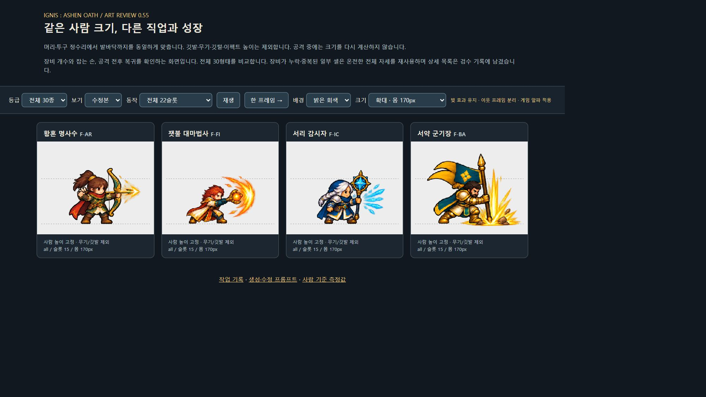

# v0.55 — 남은 18형태 미술 통일과 장비 연속성 검수

남아 있던 분기 진화 10종, 최종 진화 4종, 결합 4종을 새로 제작하고 게임에 연결했다. 기준 방패 기사 1종과 v0.54의 11종을 포함해 전체 30형태를 한 검수 화면에서 비교할 수 있다.

- [전체 30형태 움직이는 비교](art-review.html)
- [최종 진화 공격 비교](art-review.html?unit=F-AR,F-FI,F-IC,F-BA&frame=15)
- [사람 기준 크기 측정](body-calibration.json) · [픽셀 검사](art-inspection.json) · [빌드·실기기 기록](build-info.json)

## 이번에 바꾼 형태

- 분기: 수호 기사, 반격 기사, 관통 사수, 추적 사수, 폭발술사, 잔화술사, 결빙술사, 서리 척후, 수호 기수, 진격 기수.
- 최종: 황혼 명사수, 잿불 대마법사, 서리 감시자, 서약 군기장.
- 결합: 잿불 검위, 빙결 추적자, 융해술사, 원정 유격대장.

새 PNG와 Unity 임포트 설정은 `unity/Assets/Resources/Art/Units/v055/`에 있다. 기존 v010 그림은 보존하고 실제 게임이 읽는 아틀라스 참조를 변경했다. 기준 방패 기사는 원본을 유지했다.

## 미술 기준

금속의 명암·청록과 금빛의 공통 색감은 방패 기사를 기준으로 맞췄다. 상위 형태는 어깨 장갑, 방패 문양, 망토, 무기 형태와 공격 효과로 구별한다. 불·얼음 계열의 색과 궁수·척후의 가벼운 장비는 직업 차이를 유지한다.

크기는 **머리·투구 정수리부터 발바닥까지**로 측정했다. 깃발, 깃털, 지팡이와 공격 효과는 키에서 제외한다. 같은 캐릭터는 공격 중에도 배율이 바뀌지 않는다. 서약 군기장은 바닥 충격의 빛이 발보다 아래로 내려가므로, 공격 슬롯 15의 기준점을 실제 발바닥인 원본 Y=763으로 따로 지정했다.



## 등불과 장비

이번 아군 18형태에는 의미 없는 등불을 넣지 않았다. 잔화술사는 손에 드는 등불 대신 단단한 호박색 결정 지팡이를 사용한다. 광원처럼 보이는 불·얼음 결정과 주문 효과는 해당 직업의 공격 도구다.

검과 방패의 손바뀜·중복, 단검 수 증가, 창대 끊김, 지팡이를 놓친 듯한 자세를 확인하고 수정했다. 활과 석궁은 공격 뒤에도 같은 무기로 돌아온다. 신체 일부를 분리해 붙이는 방식은 쓰지 않았다. 금빛 원호, 불꽃, 얼음 부채꼴, 화살, 지면 충격은 유지한다.



원본 시트의 셀 경계가 겹치는 경우 PNG를 지우는 대신 해당 자세에 속한 영역만 표시한다. 작은 효과는 방향과 소속을 검사해 연결했다. 게임과 비교 페이지 모두 같은 프레임 영역과 알파 기준을 사용한다.

## 재사용한 자세

18종 × 22슬롯, 총 396개 재생 슬롯을 연결했다. 그중 아래 8슬롯은 장비가 온전한 전체 자세로 대체했다. 따라서 396개가 모두 서로 다른 확정 그림은 아니다. 슬롯 번호는 0부터 시작한다.

- 잔화술사: 16→17, 19→20. 지팡이 누락과 세 번째 손처럼 보이는 자세 보정.
- 서리 척후: 12→0. 단검이 세 개처럼 보이는 준비 자세 보정.
- 수호 기수: 20→21. 쓰러질 때 창대 중복 보정.
- 서약 군기장: 14→13, 20→21. 끊긴 창대와 중복 창끝 보정.
- 서리 감시자: 15→16. 손을 펴 지팡이가 떠 보이는 자세를 잡고 시전하는 자세로 교체.
- 수호 기사: 21→20. 마지막 쓰러짐 자세의 검 누락 보정.

v0.54의 재사용 4슬롯도 그대로 유지한다. 향후 동작의 매끄러움을 더 높일 때는 이 자세들을 우선 보완한다. [선택·발 위치 설정](review-config.json)에 재현 가능한 값과 이유를 남겼다.

## 확인한 범위

- 새 18시트에서 온전한 몸 22개씩을 확인하고, 유효한 자기 픽셀 누락·이웃 자세 혼입 검사에서 문제 0건을 확인했다. 자동 검사는 무기의 의미나 미적 품질까지 판정하는 검사는 아니다.
- Unity 리소스·22슬롯·표시 영역·피벗·영역 중복 검사 2,709조건을 통과했다. 사람 크기 460조건과 전투 HUD 가독성 검사도 통과했다.
- 브라우저에서 기사, 기수, 마법, 원거리, 최종 진화 그룹의 주요 공격과 사람 크기를 비교했다.
- Buddy2에서는 새 18종이 모두 포함되는 6개 시험 편성으로 준비·짧은 전투·좌측 초상화·공격 효과를 확인했다. 수집한 1~5번 전투 로그에서 예외·치명적 종료 흔적은 발견되지 않았다. 최종 발 기준점 보정 뒤에는 기수 편성을 다시 확인했다.
- 시험에 사용한 기존 저장 데이터와 PlayerPrefs는 별도로 보관하고 바이트 단위 일치를 확인해 복원했다.

이번 작업은 미술 교체다. 전투 능력치, 소환·연구 비용, 결합 규칙과 저장 버전은 변경하지 않았다. 짧은 실기기 확인을 30전투 완주나 장시간 성능 검증으로 간주하지 않는다.

[Buddy2 마법 편성](screenshots/buddy2-magic.png) · [결합 편성](screenshots/buddy2-hybrid.png) · [최종 기수 확인](screenshots/buddy2-banner-final.png)

APK: `unity/Builds/Android/expedition-combat-prototype.apk`. 정확한 해시와 빌드 결과는 [build-info.json](build-info.json)에 기록한다.

## 재현과 제작 기록

```powershell
node tools/inspect-unit-refresh.cjs v055
node tools/publish-unit-refresh.cjs v055
```

Unity 실행 메서드: `Expedition.EditorTools.UnitArtRefreshValidation.ValidateAndBuild`.

그림 제작·수정은 내장 ImageGen으로 수행했다. PNG 자체를 코드로 다시 그리지 않았다. 코드에서는 픽셀을 읽어 표시 영역·발 위치를 계산하고 메타데이터만 작성한다.

- [첫 6종 생성 프롬프트](production.json)
- [후속 12종 계열별 프롬프트](family-prompts.json)
- [수정 프롬프트](repair-prompts.json)
- [원본 후보·최종 선택·추가 수정 기록](provenance.json)
- [최종 18 PNG 해시](asset-hashes.json)

전체 비교 페이지는 프로젝트 루트에서 정적 서버를 실행해 열면 된다. 현재 주소는 `http://127.0.0.1:8540/docs/design-v0.55/art-review.html`이다.
