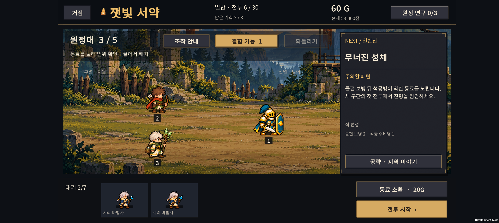
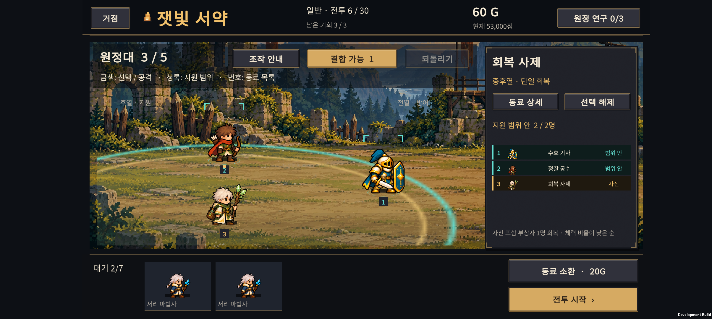
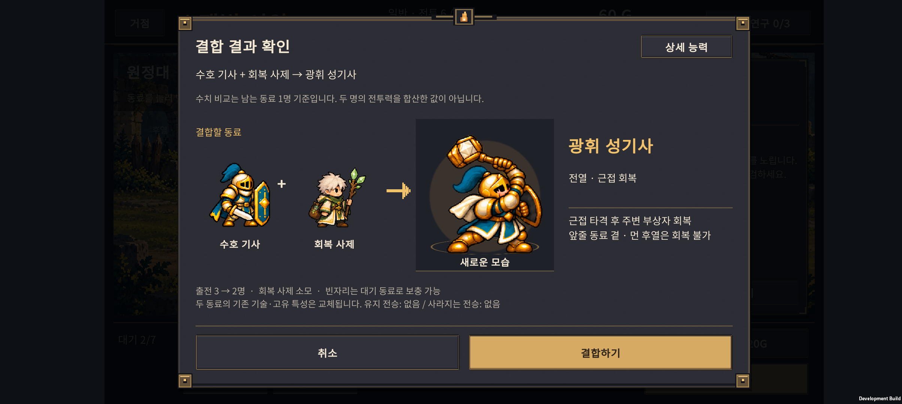
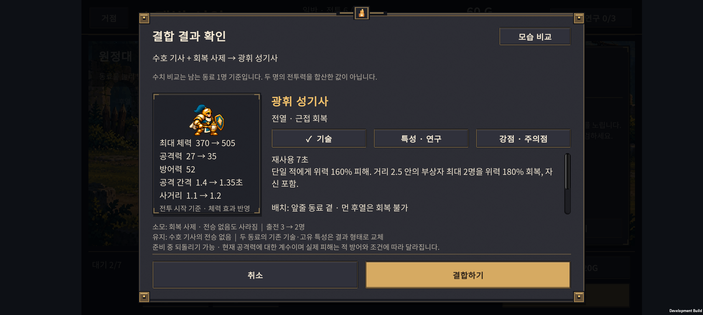
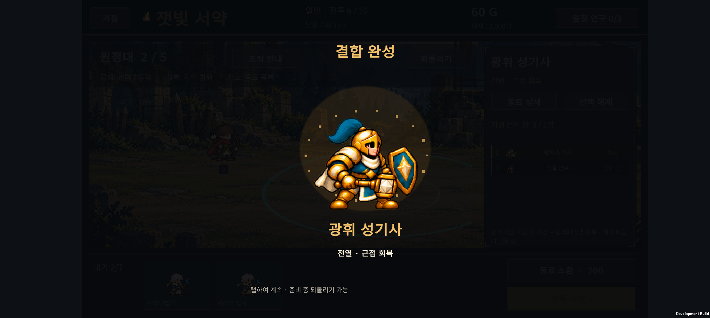
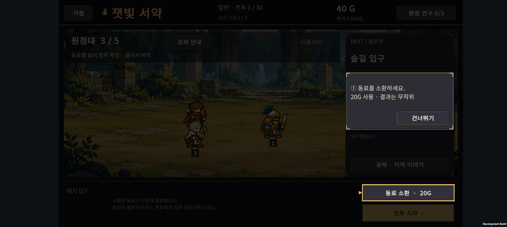
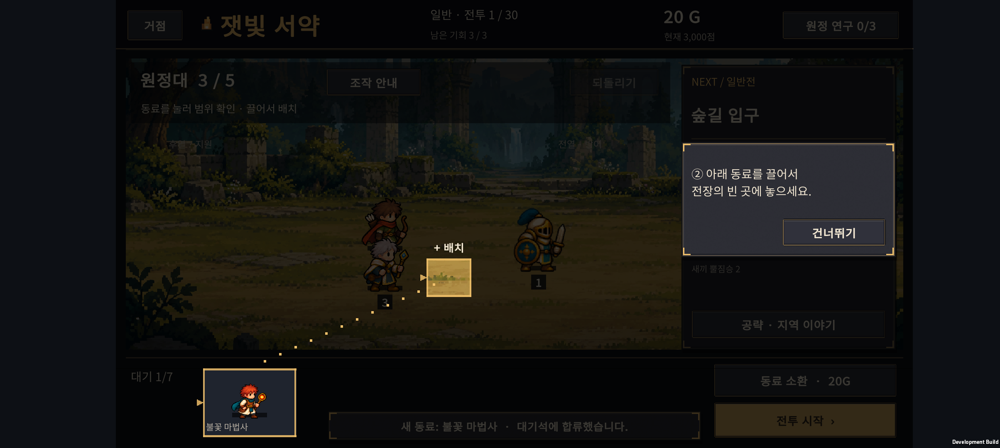
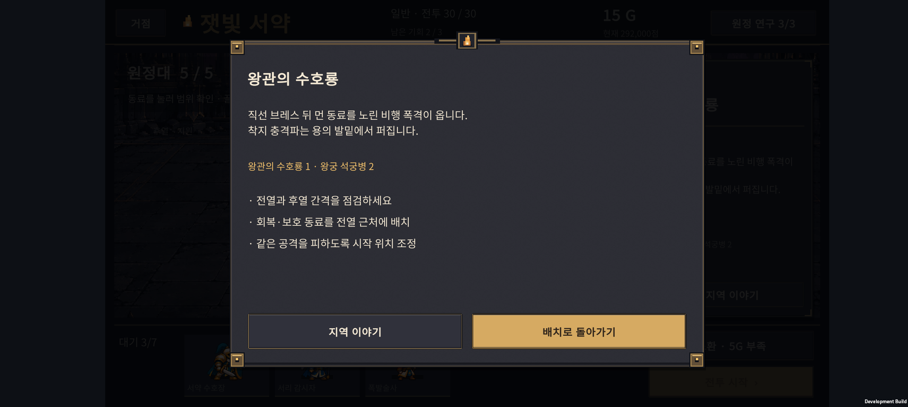
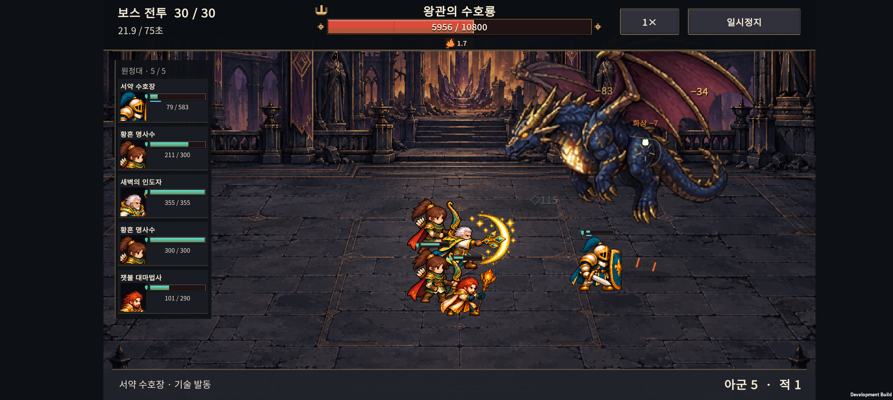

# v0.56 · 전장이 먼저 보이는 준비 화면과 성장 연출

준비 화면에서 전장과 캐릭터가 차지하는 면적을 늘리고, 진화·결합은 재료와 큰 결과 캐릭터를 먼저 비교하도록 바꿨다. 캐릭터 원화·장비·신체 비율 데이터는 v0.55를 그대로 사용한다.

## 준비 화면

- 전장 영역을 넓히고 캐릭터 표시 크기를 키웠다. 화면에 항상 나오던 긴 설명은 오른쪽의 다음 적 요약과 별도 공략 창으로 옮겼다.
- 동료를 누르면 같은 오른쪽 영역에 역할, 상세 보기, 지원 범위 안/밖의 동료 목록을 표시한다. 동료 이름을 전장 전체에 반복해서 띄우는 대신 번호를 사용한다.
- 소환·전투 시작은 오른쪽 아래에, 원정 연구는 상단에 배치했다. 대기석에는 실제 보유한 동료만 표시한다.
- 표시·드래그·지원 범위·튜토리얼이 같은 좌표 변환을 사용한다. 논리상의 배치 위치와 전투 시작 위치는 바꾸지 않았다.
- 겹친 동료는 터치한 몸체 중심과 가까운 동료를 선택한다. 표시 크기가 커져 앞쪽 동료만 선택되던 문제를 수정했다.

## 진화·결합

- 기본 보기는 **재료 → 큰 결과 캐릭터 → 역할과 배치 요점**이다. 진화 분기를 누르면 모습이 즉시 바뀐다.
- **상세 능력**에서 기존의 스탯 전후 비교, 기술, 특성·연구, 강점·주의점 탭을 그대로 볼 수 있다.
- 결합에서 두 명이 한 명으로 줄어드는 점, 소모되는 동료와 사라지는 전승은 확인 버튼 위에 유지한다.
- 확정 뒤 약 1.45초 동안 재료가 모이고 결과 동료가 나타나는 연출을 보여준다. 탭으로 넘길 수 있다.
- 확정·저장을 먼저 처리하고 연출은 결과만 보여준다. 연출 중 중복 실행과 뒤쪽 버튼 입력을 막았다. 되돌리기는 계속 가능하다.
- 모션 감소 시 이동·모으기 동작을 생략하고, 섬광 감소 시 장식 광채와 입자를 생략한다.
- 준비 완료 횟수가 `14 / 13`으로 나오던 기존 시작 화면 표시도 실제 단계 수에 맞췄다.

[Buddy2 결합 연출 영상](growth.mp4)

## 조작·실기기 확인

Unity 검사에서 화면 배치·문구 562조건, 드래그/성장/되돌리기/중복 확인 28조건, 기본 안내 55조건, 성장·연구 안내 20조건을 통과했다. 기존 전투 HUD·피해 표시 검사도 통과했다. 글자 검사는 Windows 폰트를 사용하므로 Android 실기기 캡처로 별도 확인했다.

Buddy2에서 다음을 확인했다.

- 결합 미리보기 → 상세 능력 → 확정 → 준비 화면 → 되돌리기. 소모된 회복 사제와 출전 인원이 복원되는 것을 저장 데이터로 확인했다.
- 기사 진화 두 분기 전환과 취소. 취소 후 원본 동료와 저장 세대가 유지됐다.
- 첫 안내의 소환 → 대기 동료 드래그 → 전투 시작, 2전투의 범위 안내 → 전투 시작.
- 15·30 보스전에서 1배속·2배속 전환과 전투 결과 진입. 별도 시험 편성을 사용했으므로 난이도·승률의 근거로 쓰지 않는다.
- 시험 로그에서 해당 앱 프로세스의 예외·치명적 종료 문자열 0건. 이것이 모든 오류 부재를 보증하지는 않는다.

## 성능 표본

Development APK, Galaxy Buddy2에서 Unity 프레임 간격을 기록했다. 화면 전환 후 첫 3초는 제외했고, 15초 구간 및 마지막 3초 이상 구간을 모았다. 아래 fps는 구간별 평균의 범위이며, 긴 원정 전체 평균이 아니다. 캡처에 따른 지연이 포함될 수 있다. 전투 수치는 영상 녹화 전 실행에서 수집했다.

| 구간 | 기록 시간 | 구간 평균 fps | 구간 p95의 최댓값 |
| --- | ---: | ---: | ---: |
| 준비 화면 | 65.2초 | 58.9–60.0 | 16.8ms |
| 비교·상세 창 | 52.3초 | 58.3–59.8 | 16.8ms |
| 15전투 1배속 | 20.7초 | 59.3 | 16.8ms |
| 15전투 2배속 | 10.2초 | 59.7 | 16.8ms |
| 30전투 1배속 | 21.1초 | 59.4 | 16.8ms |
| 30전투 2배속 | 10.9초 | 59.4 | 16.8ms |

개발용 로그만 추가했으며 외부 전송은 없다. 초기 측정에서 결과 화면이 준비 화면으로 분류되던 구간은 집계에서 제외했고, 최종 코드에서는 분류도 수정했다. 원자료와 조건은 [performance.json](performance.json)에 남겼다. 장시간 발열·배터리·모든 기종 및 30전투 연속 완주 성능 검증은 아직 별도 과제다.

## 전투 확인에서 남은 점

공격 발동 이벤트가 공격 모션의 발동 프레임부터 재생되도록 연결된 것을 코드로 확인했다. 15·30전투의 캡처와 실행에서 상위 동료의 공격 효과, 용의 비행과 원거리 공격도 확인했다. 모든 30형태의 타격 시점을 프레임 단위로 검증한 것은 아니다.

밀집 배치에서는 근접 동료끼리 몸체가 크게 겹치는 장면이 여전히 있다. 지원 범위와 실제 좌표를 바꾸지 않는 선택·표시 개선부터 검토해야 한다. 다음 작업은 새로운 콘텐츠 추가보다 **밀집 전투 가독성과 공격 모션·이펙트·피해 숫자의 타이밍 비교**를 우선한다.

[30전투 2배속 관찰용 녹화](battle30.mp4)

## 재현

Unity 실행 메서드: `Expedition.EditorTools.PreparationPresentationValidation.ValidateAndBuild`.

추적되는 `fixtures/wave-15.json`, `fixtures/wave-30.json`은 이전 자동 시험의 편성이다. 검증기는 이를 검사하고, 진화·결합·튜토리얼용 저장도 `unity/Logs/v056-fixtures`에 생성한다. 실제 사용자 원정에 시험 편성을 덮어쓰지 말고 별도 백업·복원 절차를 사용한다.

APK 경로는 `unity/Builds/Android/expedition-combat-prototype.apk`다. 최종 파일 정보와 저장 복원 결과는 [build-info.json](build-info.json)에 기록한다. 전투 수치·골드 비용·소환·연구·결합 규칙과 저장 버전은 이번 작업에서 바꾸지 않았다.
