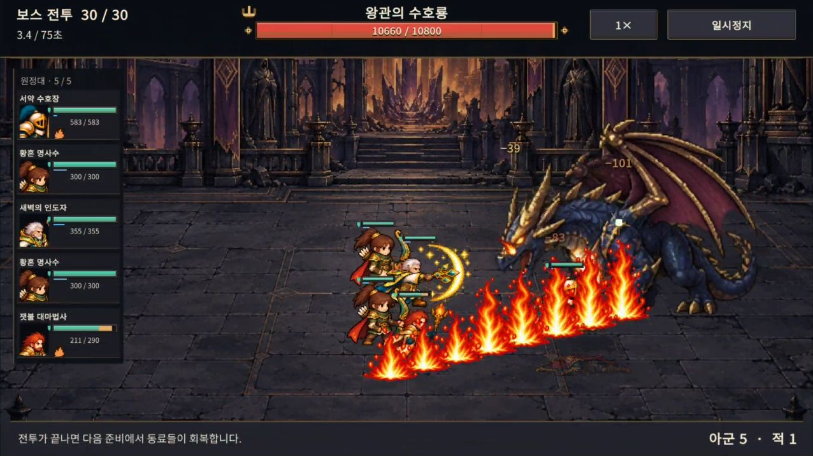
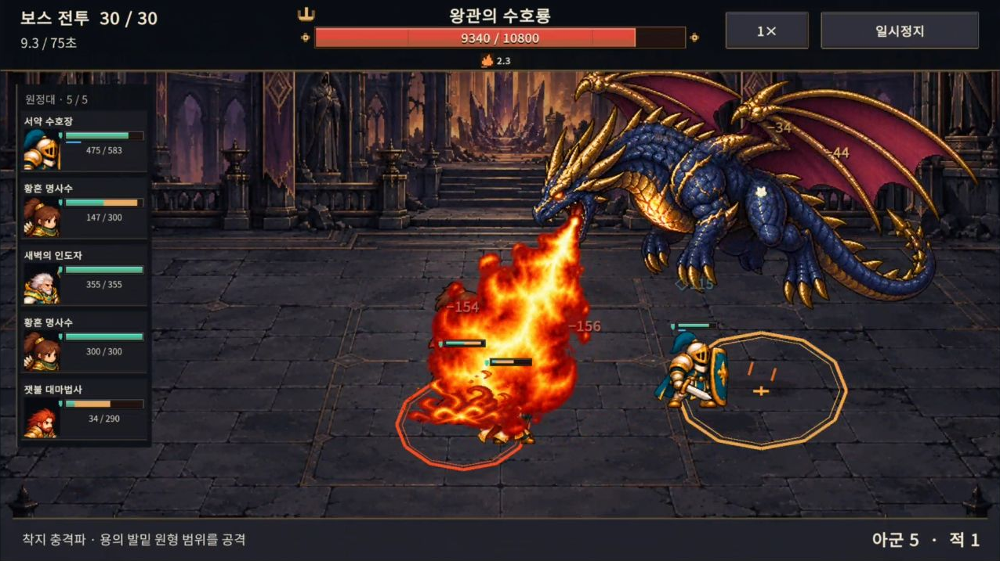

# v0.57 · 용의 화염 균열과 공중 브레스

긴 바닥 예고와 입에서 나오는 불의 경로가 달라 보이던 문제를 정리했다. **긴 영역은 불기둥, 원형 영역은 공중 브레스**로 읽히게 바꿨다.

## 공격 구분

| 공격 | 예고와 연출 | 피해 판정 |
| --- | --- | --- |
| 화염 균열 | 기존의 긴 바닥 예고 위로 8개 도트 불기둥이 연달아 솟는다 | 기존 길이 5.5, 반폭 0.65의 캡슐 영역. 한 번의 피해와 화상 |
| 공중 브레스 | 날개를 편 용의 입에서 예고한 원의 중심으로 불을 뿜는다 | 기존 반지름 1.2의 원 안에 한 번의 피해. 공중의 불줄기 경로는 별도 피해 영역이 아니다 |
| 착지 충격파 | 용의 발밑에 금색 원을 예고하고 착지한다 | 기존 반지름 1.55 유지 |
| 일반 공격 | 불꽃이 그려지지 않은 입 벌림 자세에서 작은 불덩이를 발사한다 | 기존 단일 대상 일반 공격 유지 |

브레스 목표점은 예고 시점의 바닥 좌표에 고정한다. 유닛이 움직여도 끝점을 쫓아 바꾸지 않는다. 브레스 발사 중에는 착탄 원을 붉게 유지하고, 다음 착지 예고는 금색으로 구분한다.

불기둥은 피해 이벤트가 발생할 때 모든 바닥 불씨가 함께 점화된다. 위로 솟는 부분의 높이만 용 쪽에서 끝쪽으로 차례로 커진다. 여러 번의 추가 피해나 지속 지형 피해를 새로 넣은 것은 아니다.

## 아트와 움직임

새 불기둥 8프레임과 공중 입 벌림 2자세를 내장 `image_gen` 도구로 제작했다. 기존 용의 남색 비늘·금색 뿔·자주색 날개를 참조했다. 공중 자세는 날개 끝까지의 전체 높이가 아닌 몸체 기준으로 크기를 잡는다.

공중 브레스를 뿜는 0.44초 동안 비행 높이를 유지하고, 이후 기존 착지 타격 시점까지 내려온다. 일반 공격에는 입가 불꽃이 붙어 있는 기존 14~16번 자세 대신 13번 자세를 사용한다. 착지 순간에도 불꽃 자세를 재사용하지 않는다. 기본 불덩이와 공중 브레스의 출발점 모두 실제 입 위치에 맞춘다.

원화와 생성 지시는 [art-provenance.json](art-provenance.json)에 기록했다.

## 확인

- 전투 규칙 회귀 검사: **2,052개 통과**.
- Unity: 기존 왕궁 아트·브레스 부착·전투 HUD 검사와 새 패턴 표현 **105개 조건 통과**.
- 검사 항목: 지상/공중 효과 분리, 예고 원의 좌표 보존, 입 위치, 비행 중 몸체 배율, 브레스 중 고도 유지, 불기둥 바닥 간격, 일반 공격의 불꽃 없는 자세.
- Galaxy Buddy2: 실제 30전투 녹화에서 두 패턴과 착지를 확인했다. 영상은 시각 검증용 편성이며 난이도·승률 근거가 아니다.

전투 Core, 피해량, 공격 간격, 예고 시간, 보스 능력치와 저장/점수 버전은 변경하지 않았다. 기존 전투 이벤트 ID `DRACONIC_BREATH`는 지상 불기둥, `DRACONIC_BOMB`는 공중 브레스를 표시하도록 연결했다. 과거 테스트와 기록의 ID를 유지하기 위한 매핑이다.

## 실기기 영상

[Buddy2 30전투 · 최종 연출](dragon-patterns.mp4)

APK: `unity/Builds/Android/expedition-combat-prototype.apk`. 최종 빌드와 실기기 확인 정보는 [build-info.json](build-info.json)에 기록한다.
