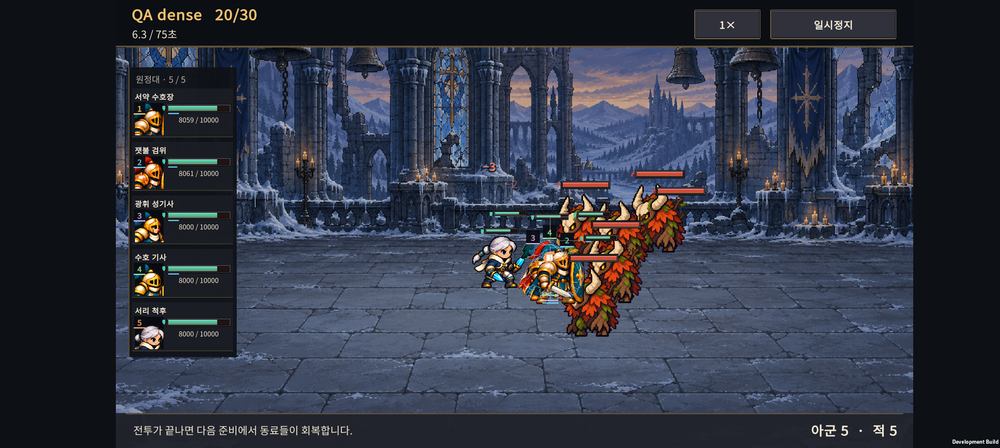
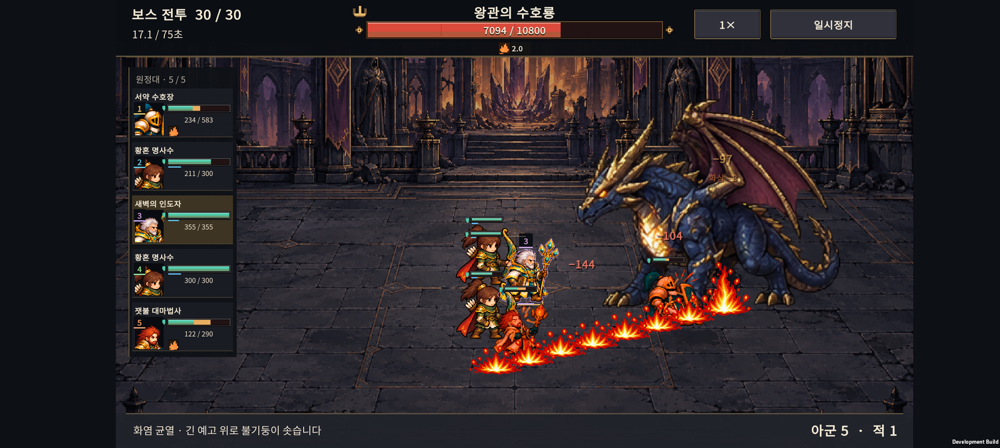
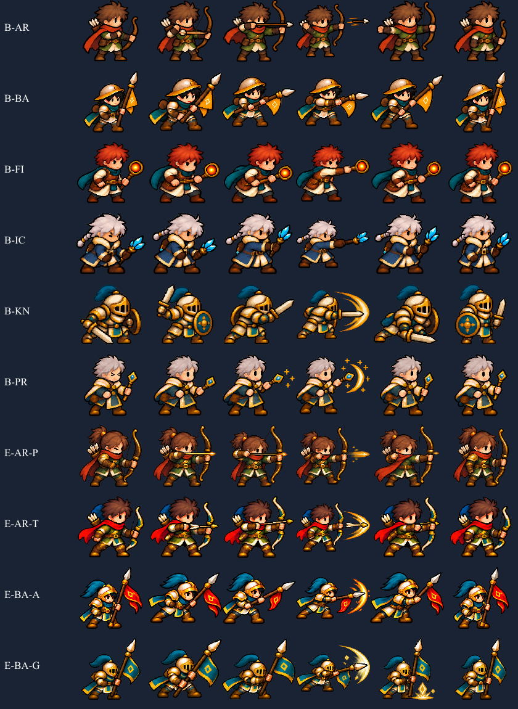
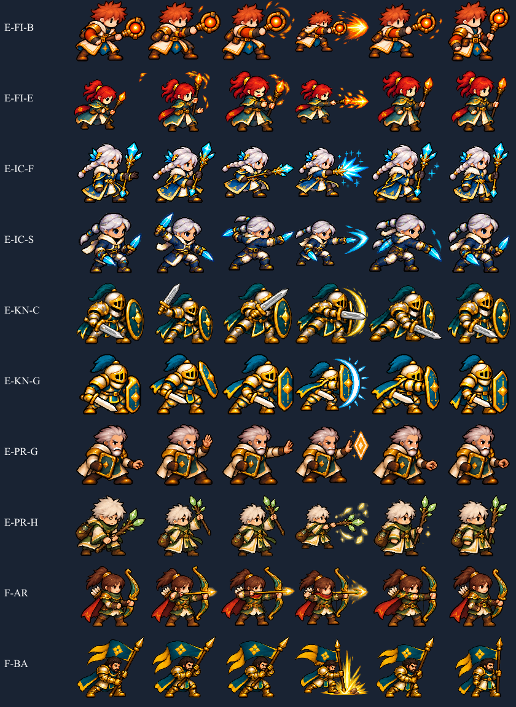
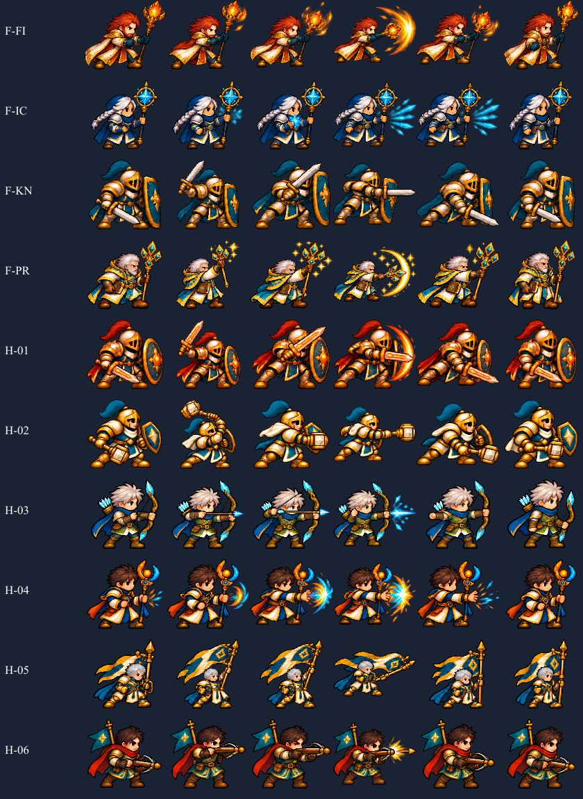
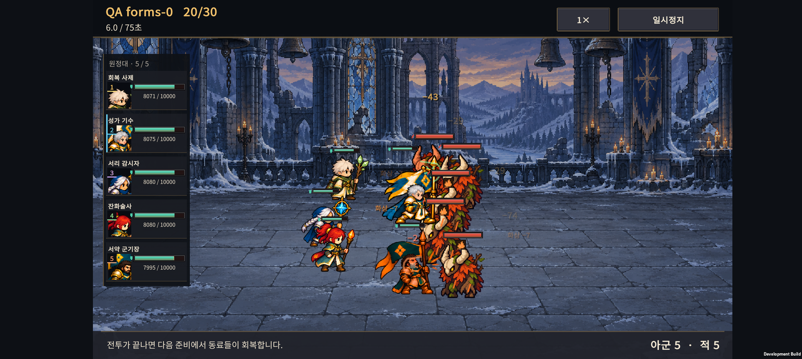
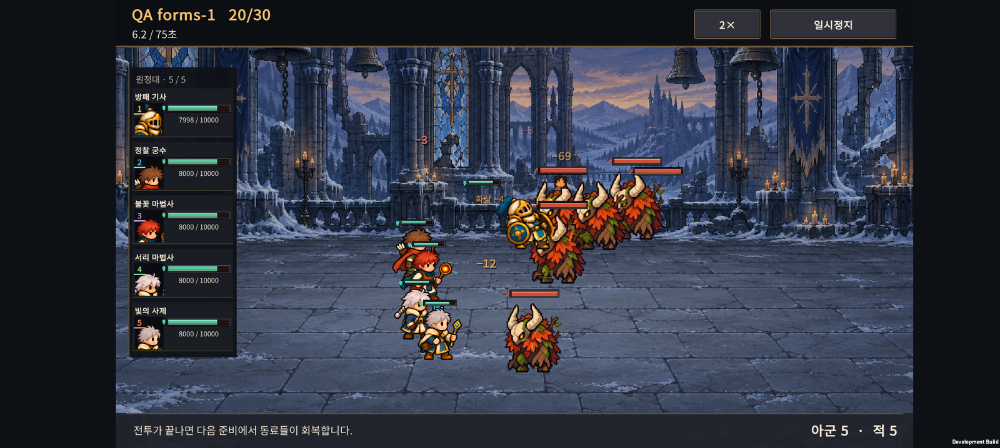
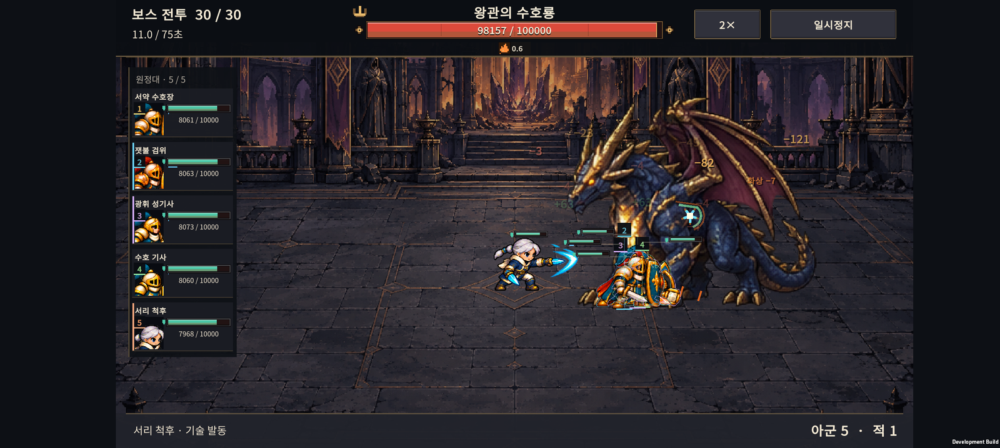

# v0.58 · 밀집 전투에서 동료 식별과 공격 타이밍

동료가 심하게 겹칠 때만 윤곽과 번호를 보충하고, 발사·타격·피해 표시의 순서를 맞췄다. 전투 좌표, 지원 범위, 공격 속도, 피해량, 연구와 저장 규칙은 유지한다.

## 가려진 동료를 찾는 방법

- 왼쪽 초상화에 출전 순서 1–5와 구분 색을 붙였다. 색만으로 구분하지 않아도 되도록 번호를 함께 쓴다.
- 다른 아군의 몸에 머리·몸통 영역의 약 60% 이상이 가려지면 얇은 윤곽, 번호, 발밑 표시가 나타난다. 잠깐 겹쳤다 떨어질 때 표시가 깜빡이지 않도록 0.2초 유지한다.
- 가림 계산은 사람의 키를 기준으로 한다. 깃발·지팡이·공격의 빛은 큰 몸체로 취급하지 않는다. 두 동료가 같은 부분을 가리는 경우도 중복 계산하지 않는다.
- 초상화를 누르면 해당 동료의 윤곽과 위치를 약 2.2초 강조한다. 공격·시전 순간에는 같은 초상화 왼쪽에 짧은 색 표시를 준다.
- 아군·적의 기존 깊이 순서와 자연스러운 부분 겹침을 유지한다. 윤곽은 그림 내부 가장자리만 사용해 옆 프레임의 무기나 빛을 끌어오지 않는다.

## 공격 타이밍 수정

| 확인한 문제 | 바뀐 동작 |
| --- | --- |
| 원거리 공격의 투사체가 준비 자세에서 먼저 날아가고, 적에게 닿을 때 발사 자세로 전환됨 | 마지막 0.18초의 투사체 비행 시작과 발사 자세를 연결. 도착 순간에는 회복 자세를 유지해 두 번 쏘는 느낌을 줄임 |
| 공격 중 피격 자세가 우선되어 자신의 공격 모션이 사라짐 | 진행 중인 공격 자세를 유지. 피격 색·효과·피해 숫자는 계속 표시하고, 사망·빙결은 공격보다 우선 |
| 추적 사수의 연사 후속타에 별도 공격 모션이 없음 | 두 번째·세 번째 타격 이벤트에도 공격 자세 연결. 지속 화상·중독에는 연결하지 않음 |
| 가까운 적을 바라보지만 실제 공격은 다른 적에게 발사됨 | 준비 중인 표적과 직전 발동 표적을 우선해 방향 결정. 왼쪽으로 쏘는 투사체의 출발 위치도 맞춤 |

근접 무기의 발동 자세, 피격 효과와 피해 숫자는 같은 전투 이벤트에 반응한다. 원거리 **일반 공격**은 도착 이벤트에 피해를 표시한다. 기존 기술 중 즉시 적용·지원·연사·지속 피해는 각자의 실제 효과 이벤트를 따른다. 전부 같은 투사체로 바꾸지는 않았다.

## 30형태 점검 범위

전체 30형태의 공격 슬롯 12–17, 총 180칸을 그림으로 비교했다. 회복 사제·성가 기수·서리 감시자·잔화술사·서약 군기장의 재사용 슬롯부터 검토했다. 이번에는 그림을 다시 생성하거나 장비 오류가 있던 원본 슬롯을 복구하지 않았다. 장비가 온전한 전체 자세와 기존 빛 효과를 사용한다.

각 줄의 왼쪽부터 공격 슬롯 12, 13, 14, 15, 16, 17이다. 비교 그림은 자세를 보기 위한 크기이며 실제 게임의 사람 기준 크기 보정과는 다르다.

자동 검사는 **30형태 × 1×·2× × 30·60fps = 120조건**에서 실제 Core 전투 이벤트와 화면에서 사용하는 모션 선택 함수를 연결했다. 일반 공격 발생, 투사체 비행 중 발사 자세, 첫 타격 프레임, 피해 숫자 생성, 가림 중복 계산과 우선순위 등 **2,902조건**을 통과했다. 기존 몸 크기 460조건, 적 깊이 순서 18조건, 전투 HUD 검사를 함께 통과했고, Core 원정 회귀 검사 2,052조건도 통과했다.

[120조건 원자료](timing-validation.json)

## Buddy2 확인

6개 편성으로 30형태 전부를 1×·2×로 실행하고, 근접 5인 밀집 편성과 마지막 용 보스도 각각 두 속도로 실행했다. 동일한 실제 전투 렌더러를 사용하는 개발용 일회성 QA이며, 전투가 너무 빨리 끝나지 않도록 시험 체력을 사용했다. 화면의 10,000 체력과 `QA` 표시는 이 시험에서만 나온다. 정상 원정 난이도나 승률의 근거로 쓰지 않는다.

별도로 기존 30전투 시험 저장을 일반 전투 화면에서 열어 초상화 선택과 위치 강조를 확인했다. 모든 확인 뒤에는 작업 전의 원정 저장·설정을 바이트 단위로 복원·대조했다. 최종 앱 프로세스의 검사 로그에서 예외·치명적 종료 문자열은 0건이다. 녹화·캡처가 포함된 짧은 성능 표본은 평균 약 57.7–59.7fps였으며, 장시간 발열 검사를 뜻하지 않는다.

[30형태·밀집·용 보스 실기기 녹화](combat-audit.mp4)

자동 검사는 픽셀의 의미나 모든 전투 상황의 미적 완성도를 판정하지 못한다. 실제 장비 그림은 180칸 비교로 검토했고, 녹화에서는 각 편성과 속도의 동작 연결을 확인했다. 극단적으로 여러 동료가 같은 위치에 모이면 윤곽과 번호도 늘어날 수 있으므로 후속 실제 플레이에서 표시 밀도를 계속 관찰할 필요가 있다.

## 재현·파일

- Unity 검증·빌드: `Expedition.EditorTools.AllyCombatPresentationValidation.ValidateAndBuild`.
- 개발용 일회성 기기 점검: 앱의 `persistentDataPath`에 `combat-art-audit.flag`가 있을 때만 시작한다. 시작 즉시 플래그를 지우고 별도 전투를 생성하며 원정 저장을 쓰지 않는다. Release 빌드에는 이 진입 코드가 포함되지 않는다.
- 시험별 이벤트 수·완료 여부: [device-audit.json](device-audit.json).
- APK 정보·로그 요약·저장 복원 결과: [build-info.json](build-info.json).
- APK: `unity/Builds/Android/expedition-combat-prototype.apk`.
