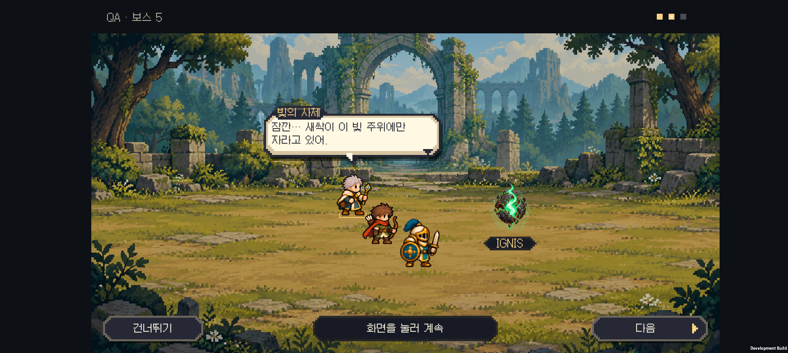
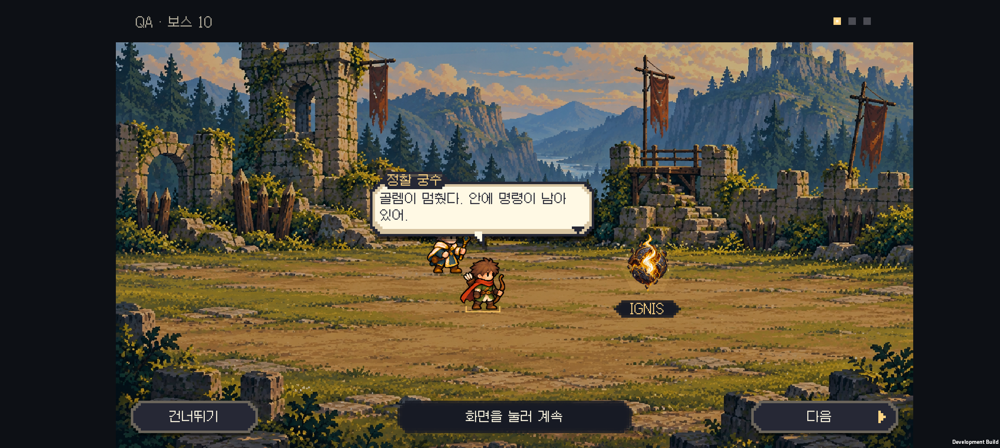
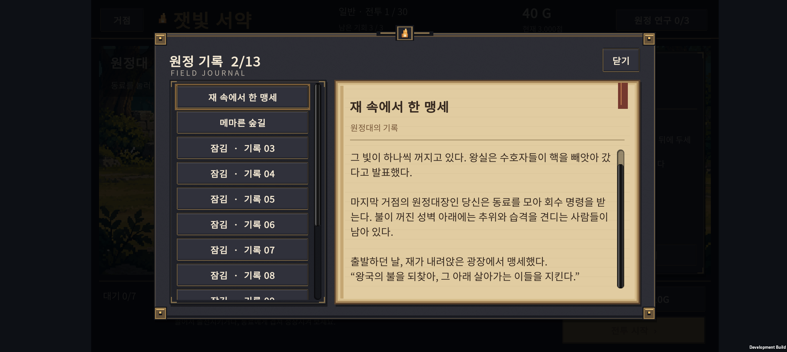

# v0.59 전장의 말풍선과 원정대의 서약

이그니스의 의미, 지역마다 발견하는 단서와 마지막 결말을 기존 30전투에 연결했다. 전투 능력치·연구·소환·점수 규칙은 유지한다.

## 플레이어에게 보이는 흐름

- 홈에서는 이그니스가 왕국을 움직이는 마법의 핵임을 설명하고, 왕실의 회수 명령을 전달한다. 초반 설명에서 반전은 공개하지 않는다.
- 처음 새 원정을 시작하면 출발의 서약을 기록 창으로 한 번 보여 준다. 닫으면 기존 첫 조작 안내가 이어진다. 이미 원정을 시작한 기록이 있는 플레이어는 홈의 이야기에서 도입을 다시 읽을 수 있다.
- 보스 6종을 이기면 실제 전장에 남아 있는 동료들이 말풍선으로 대화한다. 보스마다 3줄, 마지막 용은 4줄이다. 일반전과 패배에는 대화를 끼워 넣지 않는다.
- 실제 출전한 생존자를 화자로 고른다. 기사가 쓰러졌거나 편성에 없으면 다른 동료가 대신하고, 생존자가 한 명이면 혼잣말로 이어진다. 전투 위치와 도트 대기 모션을 유지한다.
- 글자는 짧게 나타난다. 화면을 한 번 누르면 남은 글자가 표시되고, 다시 누르면 다음 대사로 넘어간다. **대화 건너뛰기**로 바로 결과 화면에 갈 수 있다. 대화 속도는 전투의 1×·2×와 무관하다.
- 5·10·15·20·25 보스전 결과에는 두 줄짜리 단서도 남는다. **발견한 단서 읽기**로 자세한 기록을 읽거나 다음 전투를 준비할 수 있다.
- 30전투 결과의 **서약의 결말 읽기**에서 마지막 기록을 연다. 30전투를 완주한 뒤에는 홈 문구가 원정 기록을 다시 펼치는 안내로 바뀐다.
- 잠긴 기록은 제목과 본문을 모두 숨긴다. 해금 조건만 보여 주고, 긴 본문은 세로로 스크롤한다.

전장 대화에는 별도로 그린 인물을 띄우지 않는다. 전투에 사용한 실제 유닛과 배경 위에 말풍선을 그린다. 새로운 몸짓·표정·배경 애니메이션을 제작한 컷신은 후속 범위다.

### 도트 말풍선 수정

처음의 평평한 설명 상자를 교체했다. 4px 계단형 모서리, 짙은 외곽선, 밝은 안쪽 면과 아래쪽 음영, 몸체에 연결되는 굵은 픽셀 꼬리를 사용한다. 작은 이름표를 위에 붙이고 대사가 끝나면 픽셀 화살표가 깜빡인다. 모션 줄이기 설정에서는 화살표가 고정된다.

대사·이름표·대화 버튼에는 한글 도트 폰트 Galmuri11을 번들로 포함했다. 크기 피드백을 반영해 최종 말풍선 폭은 360, 글자는 20, 본문 여백은 16으로 조정했다. 처음 도트 시안의 폭 448·글자 24에서 줄인 값이다. 마지막 조정에서는 글자 크기를 유지하고 폭 384→360, 여백 20→16, 이름표 높이 32→28만 더 줄였다. 버튼의 터치 영역은 유지한다. 글꼴에는 Point 필터를 적용한다. 단어 경계에서 우선 줄을 바꾸고, 한 글자씩 나타나는 동안에도 전체 문장의 줄바꿈 위치를 유지한다. 아래 안내는 짧게 줄이고 어두운 바탕을 넣어 배경과 구분했다. 버튼도 같은 도트 모양으로 맞췄다.

폰트 출처는 [quiple/galmuri](https://github.com/quiple/galmuri), 고정 버전은 `71e1cacf1437a11220307120e63e30bc275312d4`이다. 수정하지 않은 폰트와 SIL OFL 1.1 원문·저작자 고지를 `unity/Assets/Resources/Fonts`에 함께 포함했다.

### 이그니스 등장

보스 승리 직후, 수호자가 쓰러진 자리 옆에서 빛 조각 8개가 모이며 이그니스가 떠오른다. 0.9초 연출 후 동료의 첫 대사가 시작된다. `IGNIS` 이름표가 붙고 대화 동안 전장에 남는다.

단순한 마름모 보석을 전용 도트 원화로 교체했다. 갈라진 검은 외피와 금속 이음새 안쪽으로 불꽃이 드러나고, 떨어져 나온 파편이 핵 주변에 떠 있다. 게임에서 짧은 부유와 작은 불티 움직임을 더했다. 불꽃과 주변 빛은 숲 녹색·성문 호박색·용광로 주황/붉은색·서리 청색·정원 보라색·왕궁 백금빛으로 달라지며, 어두운 외피와 원본 투명도는 유지한다.

원화는 내장 `image_gen`으로 새로 제작했다. [최종 생성 프롬프트와 원본 경로](ignis-art-prompt.txt)를 보관했으며, 실제 사용 파일은 [ignis-living-core.png](../../unity/Assets/Resources/Art/Ignis/ignis-living-core.png)이다. PNG 원본은 수정하지 않았다. Unity에서 최대 256px로 가져오고, 전투 후 한 번만 지역 팔레트를 적용한다. 생성된 런타임 텍스처는 대화 종료 때 해제한다.

탭으로 등장 연출을 넘길 수 있고 대화 건너뛰기는 즉시 결과로 이동한다. 모션 줄이기 설정에서는 결정이 바로 나타나며 떠오르기·부유·입자 움직임을 생략한다. 섬광 줄이기에서는 광량을 낮춘다. 인벤토리나 보상 규칙에 새 자원은 추가하지 않았으며, 원정대로 날아가 흡수되는 연출도 사용하지 않는다. 특히 후반부에 핵을 그 지역에 남기는 이야기와 일치하도록 전장에 둔다.

## 이야기와 저장

도입 1개, 지역 진입 6개, 보스 돌파 6개의 **13개 기록 ID와 해금 조건을 유지**했다. 이전에 열린 기록은 새 문구로 읽으며, 연구·골드·동료 성장은 기존처럼 새 원정에서 초기화된다.

승리와 골드는 **전장 대화가 시작되기 전에 저장**한다. 대화 중 앱을 종료해도 이어하기는 지급이 끝난 결과를 복구한다. 대사 넘기기와 건너뛰기는 보상을 다시 지급하지 않는다. 중단된 대화의 진행 위치는 따로 저장하지 않으며, 이야기 내용은 기록에서 확인한다.

전체 설정과 스포일러는 [세계관 문서](../story-direction.md)에 정리했다. 영문은 동일한 13개 ID의 [번역 초안](story-en.json)을 준비했으며, 게임 내 언어 선택은 아직 없다.

## 검증

- 이야기 Core 62개, 원정 진행 2,052개, 계정 저장 150개, 기존 조작 안내 5,744개 검사를 통과했다.
- Unity에서 대화·전투 정산 **445개 검사 / 28개 승리·패배·건너뛰기 시나리오**를 통과했다. 대화 전 보상 저장, 대화 중 저장본 복구, 결과 콜백 한 번 호출, 대화 중 전투 정지, 말풍선 경계, 도트 폰트의 전체 대사 글리프와 이그니스 원화 가져오기 설정을 확인했다.
- 별도로 글자 높이 47개와 7종 계정 fixture를 검사했다. 기록 13개의 기존 ID와 Unity 저장 직렬화를 유지했다.
- Galaxy Buddy2에서 보스 6종의 **19개 대사 화면**을 캡처했다. 기사 사망, 한 명 생존, 기사 없는 상위 편성, 1×·2×에서의 화자 선택을 확인했다. 실제 터치로 다음 대사·결과 이동과 건너뛰기도 확인했다.
- 첫 원정의 도입 기록, 본문·기록 목록 터치 스크롤, 잠긴 결말 숨김, 기록을 닫은 뒤 기존 튜토리얼 복귀를 폰에서 확인했다.
- 최신 개발 APK를 폰에 설치했고, 검증 후 원래 저장 파일과 PlayerPrefs를 바이트 단위로 비교해 복원했다.

아래 영상과 전장 이미지는 생존 편성과 대화 흐름을 빠르게 재현하기 위한 **격리된 개발용 전투**다. 적 체력을 낮춰 테스트했으며 정상 난이도의 30전투 완주 결과가 아니다. 자동 화면 캡처는 전체 문장을 펼친 상태로 검사하고, 영상에서는 실제 글자 표시와 터치를 사용한다. 전용 대화 확인 코드는 개발 빌드에만 포함되며 명시적인 일회성 플래그가 있어야 실행된다.

[Buddy2 전장 대화 영상](battlefield-dialogue.mp4) · [19개 대사 화면 모음](screenshots/dialogue-contact.png) · [빌드·검증 정보](build-info.json)

## 다음 연출

기존 전투의 속도를 유지하면서 도입과 엔딩에 짧은 도트 장면을 넣는 것이 다음 후보이다. 지역별 핵의 문양과 회복의 흔적도 실제 배경에 반영할 수 있다. 현재는 문구로 전달하는 내용이다.
