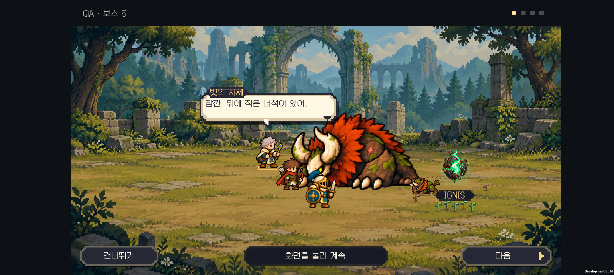

# v0.60 시즌1 설계와 첫 숲 장면

2026-10-31 · IGNIS: ASHEN OATH

시즌1의 보스전 뒤 여섯 장면과 엔딩을 설계하고, **5전투 뒤 잿갈기 장면을 먼저 구현**했다. 10~30전투의 기존 대화는 유지하며, 새 대본과 전용 연출은 후속 제작한다.

[시즌1 대본·연출표](season-one-story.md) · [읽기용 HTML](season-one-story.html) · [영문 첫 장면 초안](forest-scene-en.json)

## 첫 숲 장면

잿갈기는 전투 불능이 된 뒤 몸을 낮춘 자세로 남는다. 작은 숲 생물이 뒤쪽에서 다가와 곁에 웅크리고, 이그니스가 떠오른 아래에는 작은 새싹이 자란다. 가까운 아군은 조금 물러선다. 그 뒤 실제 생존 동료가 네 줄의 짧은 대화를 나눈다.

1. “잠깐. 뒤에 작은 녀석이 있어.”
2. “…무기 내려. 더 다가가지 마.”
3. “새싹도 이 빛 주위에만 자라고 있어.”
4. “이곳을 지키던 건가… 기록해 둬.”

왕국의 약탈과 핵의 원래 주인을 여기서 밝히지는 않는다. 원정대는 추가 공격을 멈추지만 아직 회수 명령을 버리지 못한다. 결과 기록에는 핵을 챙긴 뒤 숲에서 본 광경을 기록하고 다음 지역으로 간다는 행동이 남는다.

[Buddy2 첫 숲 장면 영상](forest-story.mp4)

## 연출과 조작

- 자동 연출은 3.2초이며 전투 속도에 영향을 받지 않는다. 이후 대사는 사용자가 넘긴다.
- **연출 넘기기:** 작은 생물과 새싹이 자리 잡은 상태로 이동한다. 첫 대사는 건너뛰지 않는다.
- **건너뛰기:** 연출과 대사를 닫고 이미 저장된 승리 결과로 이동한다.
- 기사가 쓰러졌거나 편성에 없으면 실제 생존자가 말한다. 한 명만 남아도 혼잣말로 이어진다.
- **모션 줄이기:** 작은 생물과 새싹을 정지된 완성 상태로 바로 보여준다. **섬광 줄이기:** 기존 이그니스의 낮은 광량 설정을 유지한다.

말풍선 폭 360, 글자 크기 20과 기존 버튼 터치 영역을 유지했다. 새싹은 이그니스 이름표 아래의 앞쪽 땅에 두어 가리지 않게 했다.

## 전투와 저장에 미치는 영향

작은 생물은 전장 연출용 그림이다. 적 수, 공격 대상, 체력, 보상에 포함되지 않는다. 잿갈기의 체력은 0인 채로 유지하며 전투에 다시 참여하지 않는다. 아군의 작은 뒷걸음도 화면상의 위치만 조정한다.

승리와 골드는 대화 전에 정산·저장한다. 건너뛰기나 대사 종료는 보상을 다시 지급하지 않는다. 중간에 앱을 종료하면 기존처럼 이미 정산된 결과에서 이어지며, 장면 내용은 이야기 기록에서 다시 읽는다. 원정 난이도·연구·소환·결합·점수는 바꾸지 않았다.

## 제작한 것과 다음 범위

기존 잿갈기와 숲 생물의 완전한 스프라이트를 재사용했다. 잿갈기는 몸을 낮춘 기존 자세, 작은 생물은 걷기와 웅크리기를 사용한다. 팔을 분리하거나 새로운 보호 동작을 생성하지 않았다. 새싹은 코드로 그린 작은 픽셀 배경 요소다.

**전용 감싸기 동작, 황폐화가 더 잘 보이는 숲 배경, 10~30전투의 새 연출과 세 장면 엔딩은 후속 범위다.** 이번에는 첫 장면으로 대사와 실제 전장 관찰을 연결하는 흐름을 확인한다.

시즌2에는 시즌1에서 회복된 숲과 공동체가 남는다는 연결점만 둔다. 시즌3의 기원과 소멸 설정은 확정하지 않았다.

## 검증

- Core 이야기 62개 검사 통과. 기존 이야기 ID와 해금·저장 규칙을 유지했다.
- Unity 대화 484개 검사, 승리·패배·건너뛰기 28개 시나리오, 기존 전투 정산 검사를 통과했다.
- 기사·궁수·결합 성기사 한 명만 생존한 경우에 모션 줄이기 켜기/끄기 조합을 검사했다. 연출 뒤에도 체력·전투 좌표·유닛 수가 달라지지 않는지 확인했다.
- 글자 높이 47개 측정과 7개 저장 fixture 검사를 통과했다.
- Buddy2에서 여섯 보스의 대화 20개 화면과 숲 연출 중간 화면을 확인했다. 별도 실제 터치로 다음 대사·결과 이동과 등장 중 건너뛰기를 확인했다.
- 최종 APK를 Buddy2에 설치했다. 확인을 마친 뒤 원래 저장 파일과 PlayerPrefs를 바이트 단위로 비교해 복원했다.

이미지와 영상은 연출 재현을 위해 적 체력을 낮춘 격리된 QA 전투다. 정상 난이도의 완주 영상이 아니다. 기기 검사 코드는 개발 빌드에서 명시적인 일회성 플래그가 있을 때만 실행된다.

[20개 대화 화면 모음](screenshots/dialogue-contact.png) · [빌드 정보](build-info.json)
