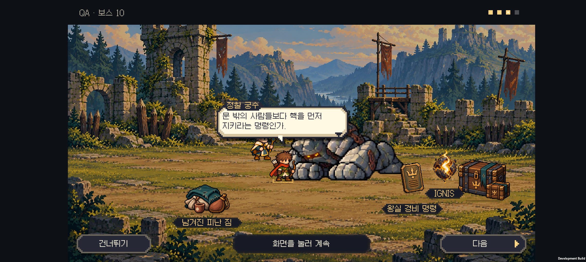

# v0.61 성채의 명령과 도트 소품

2026-10-31 · IGNIS: ASHEN OATH

**10전투 성채 승리 뒤 장면을 구현했다.** 피난 짐과 왕실 보관함을 먼저 보여 주고, 멈춘 골렘 곁의 명령판에서 ‘외부 생물의 동력원 접근 금지’라는 명령을 발견한다. 원정대는 사람보다 핵을 먼저 지킨 명령에 의문을 품는다.

[시즌1 대본·연출표](../design-v0.60/season-one-story.md) · [영문 성채 장면 초안](castle-scene-en.json)

## 실제 전장 장면

[Buddy2 성채 장면 영상](castle-story.mp4)

피난 짐과 봉인된 보관함은 10전투 시작부터 배경에 있다. 승리 뒤 보상처럼 갑자기 떨어지는 물건으로 표현하지 않는다. 전투 불능이 된 골렘은 낮은 자세로 남고 명령판이 드러난 뒤 호박색 이그니스가 떠오른다. 2.8초의 관찰 장면이 끝나면 생존 동료들이 말한다.

1. “왕국의 문장이다. 그런데 우리에게도 문을 닫았군.”
2. “‘외부 생물의 동력원 접근 금지.’ 사람도 예외가 아니었어.”
3. “문 밖의 사람들보다 핵을 먼저 지키라는 명령인가.”
4. “누가 내린 명령인지, 반입 장부를 찾아보자.”

아직 왕국이 각 지역의 핵을 약탈했다는 결론을 내리지 않는다. 두 번째 핵과 명령 기록을 확보한 뒤 폐광의 반입 장부로 이어진다. 기사 계열과 사제 계열이 선두·관찰 역할을 우선 맡지만, 없거나 쓰러졌으면 실제 살아 있는 다른 동료가 말한다. 한 명만 남으면 혼잣말로 이어진다.

## 도트 소품 수정

첫 원화의 천 조직, 목재 결, 금속 흠집이 너무 실사처럼 보여 사용자 피드백에 따라 다시 그렸다. 담요·물통·컵, 명령판, 보관함의 형태는 유지하고 굵은 픽셀, 뚜렷한 윤곽, 단순한 명암으로 맞췄다. 등불 장식은 없다.

- [게임에 적용한 투명 PNG](../../unity/Assets/Resources/Art/Story/v061/castle-story-props.png)
- [최종 이미지 생성 프롬프트와 출처](art-prompt.txt): 내장 `image_gen` 편집 도구를 사용했다. 생성된 PNG와 알파를 그대로 복사하고, 게임에서 UV 영역으로 각 소품을 선택한다.
- 모바일 텍스처 최대 크기 1024, Point 필터. 10전투에서만 로드하고 전투 화면을 닫을 때 해제한다.
- 명령판 설명은 이그니스 이름표와 겹치면 아래로 옮긴다. 하단 진행 버튼과의 여백을 유지한다.

## 조작과 저장

- 연출 시간은 1×·2× 전투 속도와 무관하다. 대사는 사용자가 넘긴다.
- **연출 넘기기:** 소품과 이그니스가 나타난 완성 상태로 이동하고 첫 대사를 유지한다.
- **건너뛰기:** 장면 전체를 닫고 이미 저장된 승리 결과로 이동한다.
- **모션 줄이기:** 완성된 정지 장면을 바로 보여 준다. **섬광 줄이기:** 명령판 강조와 이그니스 광량을 낮춘다.
- 승리·골드는 대화 전에 정산한다. 골렘의 체력은 0이며 다시 공격하거나 공격 대상으로 돌아오지 않는다. 소품은 유닛 수·능력치·보상에 포함되지 않는다.
- 중간에 앱을 종료하면 이미 정산된 결과에서 이어진다. 이야기 ID는 유지하고, 발견한 기록에서 내용을 다시 읽을 수 있다.

## 검증

- Core 이야기 검사 62개, Unity 대화 검사 566개, 승리·패배·건너뛰기 28개 시나리오를 통과했다.
- 명령판 설명 위치 24개 조합에서 이그니스 이름표·하단 버튼과 겹치지 않는지 확인했다. 기존 말풍선 경계 검사와 글자 높이 47개 측정, 저장 fixture 7개 검사도 통과했다.
- 기사·궁수·결합 성기사 한 명만 생존한 경우에 모션 줄이기·섬광 줄이기 조합을 검사했다. 체력, 좌표, 전투 시간과 유닛 수는 장면 전후 동일하다.
- Buddy2에서 여섯 보스의 대화 21개 화면을 캡처해 배치를 검토했다. 성채 장면은 별도 실제 터치로 네 줄 대화·결과 이동, 등장 중 전체 건너뛰기, 연출만 넘긴 뒤 첫 대사 유지까지 확인했다.
- 최종 APK를 Buddy2에 설치했다. 테스트 종료 뒤 원래 저장 파일과 PlayerPrefs를 바이트 단위로 비교해 복원했다.

이미지와 영상은 빠른 재현을 위해 적 체력을 낮춘 격리된 QA 전투다. 정상 난이도의 완주·밸런스 검증은 이번 범위가 아니다. 읽기용 HTML은 소스와 연결 경로만 확인했으며 브라우저 렌더 검증은 하지 않았다.

[21개 대화 화면 모음](screenshots/dialogue-contact.png) · [최종 APK와 검증 정보](build-info.json)

## 다음 범위

5전투 숲과 10전투 성채의 새 장면까지 구현했다. 다음은 **15전투 폐광의 동력관·반출 장부와 네 줄 대화**다. 15~30전투의 기존 대화는 동작하지만 시즌1 설계의 새 전용 연출과 엔딩 세 장면은 아직 제작 전이다. 이번 작업에서 전투 난이도·연구·소환·결합·점수는 변경하지 않았다.
