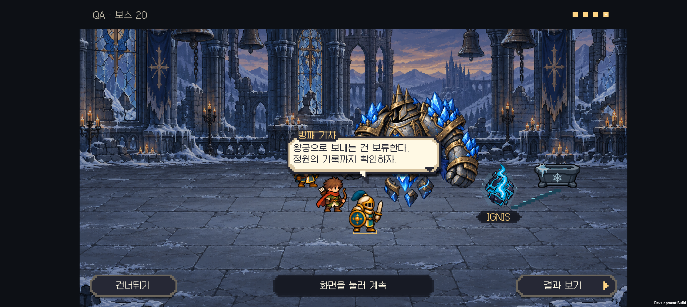
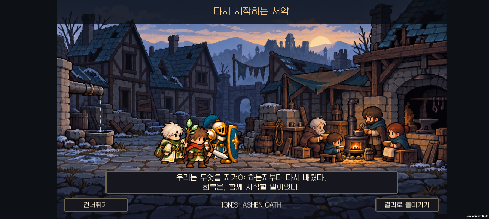

# v0.62 시즌1 후반 장면·엔딩과 아트 통일

2026-10-31 · IGNIS: ASHEN OATH

**15·20·25·30전투의 네 줄 대화와 전장 변화를 연결하고, 핵 반환부터 왕국의 복구 시작까지 세 장면 엔딩을 추가했다.** 성채부터 소품을 전면에 진열하던 배치를 줄이고, 보스와 환경의 반응을 중심으로 다시 정리했다. 이그니스도 굵은 픽셀로 교체했다.

[아트 일관성 기준](../art-direction.md) · [전체 시즌1 설계](../design-v0.60/season-one-story.md) · [아트 파일·프롬프트](art-prompts.txt)

## 장면별 변화

| 전투 | 화면의 사건 | 동료의 발견 |
| --- | --- | --- |
| 5 숲 | 기존 작은 생물·새싹 연출을 유지하고 새 도트 이그니스를 적용 | 적이 지키던 생명에 대한 첫 의문 |
| 10 성채 | 골렘과 경비 회로의 빛이 가라앉는다. 피난 짐·상자는 먼 지면에 작게, 명령판은 골렘 곁에 둔다. 큰 물건 이름표는 제거 | 사람보다 동력원을 먼저 지킨 명령 |
| 15 폐광 | 용광로 수호자가 멈춘 뒤 관의 열기가 사그라지고 작은 장부가 보인다 | 왕국의 겨울을 지탱한 힘과 다른 지역의 피해 |
| 20 서리 성당 | 파수꾼이 공격을 멈추고 제단 아래 좁은 물길만 흐른다. 눈꽃 문양이 핵과 이어진다 | 핵의 소유권에 대한 왕실 설명의 모순 |
| 25 황혼 정원 | 오래된 추출 흔적 곁으로 빛이 돌아와 작은 새싹이 돋는다. 핵은 현지에 남는다 | 약탈의 인과 확인, 회수 중단 결정 |
| 30 왕궁 | 용의 구속 빛이 끊어지고 고리가 떨어진다. 용은 몸을 낮춘 채 핵 곁에 남는다 | 강제 추출을 멈추고 왕국 밖의 생명까지 책임지는 선택 |

단서 소품은 30~108 논리 픽셀의 작은 배경 요소로 사용한다. 실제 휴대폰 전체 화면에서 역할을 읽을 수 있도록 배치하며 전리품처럼 날아오거나 큰 이름표로 강조하지 않는다. 보스의 몸을 분리하지 않고 기존 완전한 자세를 사용한다.

## 세 장면 엔딩

1. **돌아온 빛:** 숲의 작은 생물 옆에 녹색 핵이 돌아와 있고 새싹이 늘어난다.
2. **남겨진 왕국:** 대부분의 창과 시설은 꺼져 있다. 시민들이 작은 난로 곁에서 온기와 식량을 나눈다.
3. **다시 시작하는 서약:** 최종 전투의 생존 동료가 왕국으로 돌아온다. 함께 회복을 시작한다는 문구 뒤 결과로 돌아간다.

첫 30전투 승리 뒤 전장 대화를 마치면 자동으로 이어진다. 이후에는 원정 결과의 **엔딩 다시 보기**, 이야기 기록의 **서약이 지키는 것 → 엔딩 다시 보기**에서 열 수 있다. 장면은 사용자가 넘기며 어느 장면에서든 건너뛸 수 있다.

시민은 새 도트 배경에 포함되어 있고, 복구 작업 전체의 전용 캐릭터 애니메이션을 제작한 것은 아니다. 실제 동료는 기존 걷기·대기 자세로 합류한다. 왕국이 즉시 풍요로워지는 결말이나 시즌3 예고는 넣지 않았다.

## 아트 수정과 고정 기준

사용자는 유닛·적·소품·이그니스가 한 게임처럼 보이는 일관성을 필수 기준으로 지정했다. [제작 기준](../art-direction.md)에 도트 밀도, 몸 기준 크기, 명암, 접지, 장비 연속성과 실기기 비교 절차를 남겼다.

- 이그니스의 큰 돌 조각과 내부 불빛은 유지하고, 실사 표면과 가느다란 불꽃을 큰 픽셀 덩어리로 바꿨다. 지역별 녹색·호박색·주홍색·청색·보라색·백금색 구분은 유지한다.
- 소품의 천 조직·흠집·목재 결을 단순화했다. 전장 안에서 작게 보이고 배경과 함께 읽히도록 대비와 위치를 조정했다.
- 엔딩 주민도 아군처럼 큰 머리와 짧은 몸 비율로 수정했다. 이그니스의 어두운 불꽃 경계까지 지역색으로 바꾸며 전장과 엔딩은 같은 색 변환을 사용한다.
- 원화는 내장 `image_gen`으로 제작했다. 게임에는 생성된 PNG를 복사하고 Point 필터와 UV 크롭으로 표시한다.
- 이 작업에서 30형태 전체나 모든 적의 그림을 다시 만들지는 않았다. 새 장면·소품·핵을 기존 유닛과 같은 화면에서 검수하는 범위다.

## 저장과 전투 규칙

승리·골드·이야기 해금은 연출 전에 정산한다. 대사나 엔딩의 완료·건너뛰기가 보상을 추가 지급하지 않는다. 연출은 전투 시간·체력·공격 대상·배치를 바꾸지 않는다. 쓰러진 보스의 화면상 자세만 유지한다.

엔딩에 등장한 생존 편성의 형태 ID를 이야기 저장의 선택 필드 `EndingParty`에 보관한다. 새 원정에서도 다시 보기 시 활용하며 능력치나 연구 효과를 저장하지 않는다. 이전 저장 파일은 필드가 없어도 읽을 수 있다. 과거 완주 기록에 편성 정보가 없으면 현재 남아 있는 완료 원정의 편성을 사용한다.

앱을 중간에 종료하면 이미 정산된 결과로 돌아온다. 엔딩을 다시 볼 수 있으며, 시청 위치를 프레임 단위로 저장하지는 않는다. 모션 줄이기는 환경 변화와 이동을 완성된 정지 상태로 보여 준다.

## 실기기 화면과 영상

[수호룡의 구속 해제](palace-release.mp4) · [세 장면 엔딩](ending.mp4) · [24개 대사 화면](screenshots/dialogue-contact.png)

위 화면과 영상은 Galaxy Buddy2의 격리된 QA 장면이다. 장면 점검을 위해 적 체력을 줄인 전투이며 실제 원정의 난이도나 완주율을 나타내지 않는다.

## 적용 아트와 제작 기록

내장 `image_gen`으로 제작한 PNG 원본을 사용했다. 지역색 변경과 UV 크롭은 게임의 표시 코드에서 처리한다.

- [이그니스](../../unity/Assets/Resources/Art/Ignis/ignis-living-core.png)
- [소품 8종 시트](../../unity/Assets/Resources/Art/Story/v062/story-props.png)
- [왕국 귀환 배경](../../unity/Assets/Resources/Art/Story/v062/kingdom-return.png)
- [제작 프롬프트·원본 기록](art-prompts.txt) · [주민 비율 수정 프롬프트](town-revision-prompt.txt)

## 검증

- Unity 6000.3.24f1 Android 빌드 성공. [APK 해시·검증 정보](build-info.json).
- 이야기 Core 62개, 전장 대화 609개 검사와 승리·패배·건너뛰기 28개 시나리오 통과.
- 후반 연출·엔딩 214개 검사 통과. 48개 지역·생존자·접근성 설정 조합에서 전투 상태 불변과 결과 복귀 1회를 확인했다.
- 모바일 텍스트 47개 치수 검사와 저장 데이터 7종 검증 통과.
- Buddy2에서 여섯 보스의 대사 24화면, 엔딩 3화면을 캡처해 비교했다. 수호룡 대사 및 엔딩의 실제 터치 영상을 남겼다.
- 실제 결과 화면과 이야기 기록 양쪽의 **엔딩 다시 보기** 진입, 최종 장면의 현재 편성 표시, 결과 복귀와 건너뛰기를 확인했다. 확인 전후 1,155 G·333,000점·기록 1개와 저장 세대 1,000이 유지되었다. 이 수치는 격리 QA 저장의 값이다.
- 테스트 전 저장 파일과 PlayerPrefs를 원래 바이트 그대로 복원하고 일치 여부를 확인했다.

전투 밸런스 수치는 변경하지 않았다. 1~30전투 자연 진행의 완주율 재측정은 이번 검증에 포함되지 않는다. HTML은 소스와 로컬 링크를 검사했으며 브라우저 렌더링을 확인한 것으로 기록하지 않는다. 현재 게임 문구는 한국어다.
