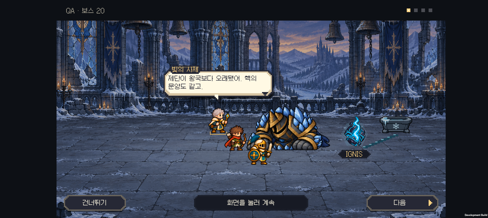
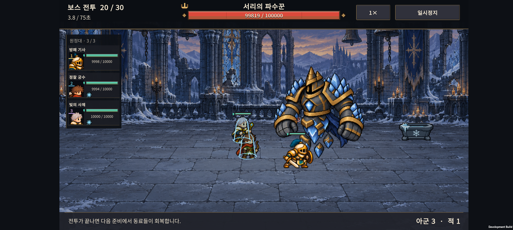

# v0.63 서리 파수꾼 · 도트 표현과 패배 모션

2026-10-31 · IGNIS: ASHEN OATH

**서리 파수꾼을 기존 아군·잿갈기와 함께 놓았을 때 어울리도록 단순화하고, 부유를 멈추며 내려앉는 전용 패배 자세를 추가했다.** 전투 후 대화가 시작되면 다시 대기 자세로 돌아가던 처리도 수정했다.

## 아트와 색

- 넓은 갑주, 큰 주먹, 청색 결정, 남색 천과 하체의 부유 핵을 유지했다.
- 세밀한 흠집·얼음 결·금속 반사를 줄이고 넓은 명암 면과 굵은 픽셀 윤곽으로 바꿨다.
- 첫 시안의 청색과 금색이 다른 보스보다 튄다는 피드백을 반영했다. 결정은 차분한 청색, 장식은 황동색으로 낮추고 가슴 핵에 밝은 포인트를 집중했다.
- 모든 자세는 팔·주먹이 몸통에 붙어 있는 전신 그림이다. 새 다리나 무기를 추가하지 않는다.

## 패배 처리

공격용 4자세에 패배용 4자세를 더했다. **힘이 빠짐 → 내려감 → 지면을 짚음 → 고개를 숙인 채 정지**로 연결하며, 최종 자세에서는 핵의 빛이 약하다. 약 0.72초 뒤 마지막 자세에 도달하고 대화 내내 유지한다.

서리 보스의 체력이 0이 되면 일반 수호자 대기 자세 고정보다 패배 자세 선택이 우선한다. 패배 상태에서는 부유 흔들림이 없다. 모션 줄이기를 켜면 바로 마지막 자세를 보여 준다. 전투 중 쓰러졌을 때의 일반적인 사라짐은 상위 전투 화면이 처리하고, 이야기 장면에서는 몸체를 사라지게 하지 않는다.

살아 있는 기본 높이 290과 자세 전체에 같은 확대 비율을 유지한다. 주저앉은 자세는 몸을 축소한 것이 아니라 낮아진 전신 그림이다. 전투 체력·피해·사거리·공격 간격·보상은 변경하지 않는다.

## 적용 파일

- [새 8자세 시트](../../unity/Assets/Resources/Art/Enemies/v063/frost-warden.png)
- [제작·정리·색 보정 프롬프트](art-prompts.txt)
- [공통 아트 일관성 기준](../art-direction.md)

내장 `image_gen`으로 제작한 PNG와 알파를 그대로 저장했다. 기존 런타임의 투명 경계 처리와 자세별 UV 범위를 사용한다.

## 검증

- Unity 6000.3.24f1 Android 빌드 성공. [빌드 정보](build-info.json).
- 24개 전투 프레임의 범위, 8개 전신 자세 연결, 기본 높이 290, 공격 시 부유 기준점, 패배 후 접지와 부유 정지를 검사했다. 모션 줄이기는 마지막 패배 자세로 즉시 전환한다.
- 기존 전장 대화 609개 검사와 28개 승리·패배·건너뛰기 시나리오, 후반 연출·엔딩 214개 검사를 통과했다.
- Galaxy Buddy2에서 **1×·2× × 모션 줄이기 켬·끔 = 4조건**을 재생했다. 각 조건에서 보스 일반 공격 4회·서리 고유 공격 1회가 발생했고, 결과 콜백과 대화 종료가 각각 한 번 호출됐다. 최종 표시 프레임은 모두 21(새 시트의 마지막 패배 자세)이었다.
- 24개 화면과 48초 영상을 남겨 공격, 내려앉기, 최종 자세를 비교했다. 별도 실제 터치로 다음 대사와 건너뛰기도 확인했다.
- 테스트 전 저장 파일과 PlayerPrefs를 바이트 단위로 복원하고 일치 여부를 확인했다.

이 테스트는 아군·보스의 체력을 늘리고 정해진 시점에 보스를 전투 불능으로 만드는 격리 QA다. 일반 원정의 밸런스·완주율을 평가한 결과는 아니다. HTML은 소스와 연결 파일을 확인했으며 브라우저 렌더링 검증은 포함하지 않는다.

[Buddy2 공격·패배 영상](frost-review.mp4) · [모션 단계 모음](screenshots/motion-contact.png)

## 다음 작업의 우선순위

1. **나머지 보스 5종의 전투 종료 자세와 그림체를 비교한다.** 특히 25전투 정원 보스는 현재 대화에서 대기 자세를 유지한다. 전투가 끝났다는 변화가 필요한지 먼저 보고, 튀는 재질·과한 채도·자세만 선별해 수정한다.
2. **첫 원정부터 30전투 엔딩까지 처음 하는 사람의 플레이를 확인한다.** 튜토리얼, 소환·연구·결합 선택, 패배 이유 이해, 대사 길이와 다시 하기 의향을 기록한다. 연출용 QA의 승리를 실제 게임 난도 평가로 사용하지 않는다.
3. **출시 점검으로 이어간다.** Buddy2 장시간 발열·프레임·저장 복구, 실제 사운드 청취를 확인하고, 영문 UI와 광고판·광고 없는 유료판의 출시 작업을 정리한다.

이번 작업은 1번의 서리 보스 수정까지다. 다른 보스의 아트를 일괄 교체하거나 새로운 게임 콘텐츠를 추가한 것은 아니다.
