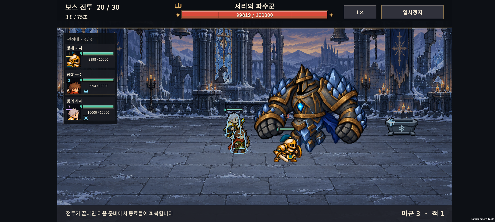
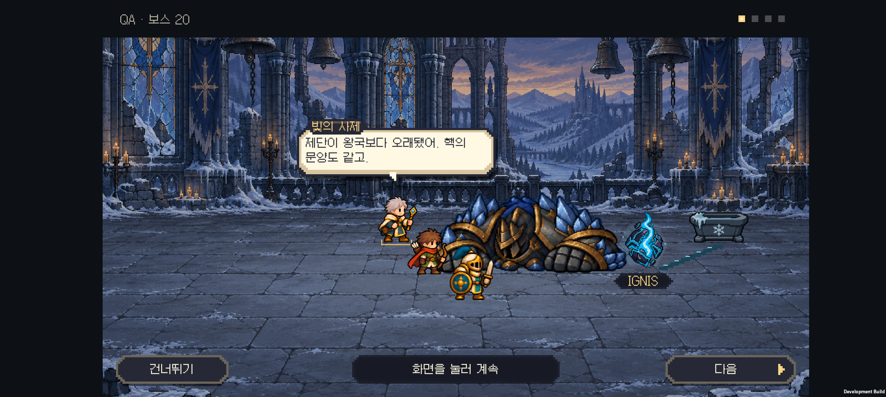

# v0.64 서리 파수꾼 · 체격과 얼음 색감

2026-11-01 · IGNIS: ASHEN OATH

**서리 파수꾼의 넓은 어깨와 큰 주먹을 되살리고, 얼음만 차분한 회청색으로 조정했다.** SPUM은 비교 후 사용자가 도입하지 않기로 결정했다.

## 변경 내용

- v0.63은 높이가 같아도 대기 자세의 폭이 약 287이어서 기존 보스보다 좁고 약해 보였다. v0.64는 넓은 갑주·주먹을 가진 새 전신 그림으로 바꾸었다. 기본 높이 290은 유지하고, 대기 자세 표시 폭은 약 371이다. 가로로 늘린 변형이 아니라 새 그림의 비율이다.
- 사용자가 선택한 새 체형을 기준으로 얼음의 강한 청색 채도를 낮췄다. 어두운 철갑·황동 테두리·남색 천과 가슴 핵의 대비는 유지하는 방향이다.
- 대기·공격 4자세와 패배 4자세를 각각 통째로 그린 8자세 시트다. 팔을 분리해서 움직이지 않는다.
- 이전의 패배 처리도 유지한다. 힘이 빠지고 내려앉아 두 주먹으로 지면을 짚으며, 마지막 자세는 전투 후 대화에서도 유지한다. 모션 줄이기에서는 즉시 마지막 자세를 표시한다.
- 전투 체력·피해·사거리·간격·연구·보상 수치는 변경하지 않았다.

## 아트와 제작 방식

[새 서리 보스 시트](../../unity/Assets/Resources/Art/Enemies/v064/frost-warden.png) · [내장 image_gen 프롬프트 기록](art-prompts.txt) · [공통 아트 기준](../art-direction.md)

내장 `image_gen`으로 생성·편집했다. 최종 PNG와 알파는 도구 출력 그대로 저장했으며, 런타임은 자세별 영역과 기존 투명 경계 처리를 사용한다. 1087×1447 원본을 Point 필터와 최대 1024 설정으로 임포트한다.

## SPUM 검토 결과

공식 상품 설명·위키·갤러리를 비교했다. 파츠 재사용과 공통 동작은 반복적인 아군 제작에 유리하지만, 현재 그림체·특수 보스·기존 프레임 규약을 그대로 대체하는 도구는 아니다. **사용자가 도입하지 않기로 결정했으므로 구매·설치·3종 실험은 진행하지 않았다.** 현재 화풍을 유지하면서 장비 수·손 위치·체격·도트 표현의 일관성을 계속 검수한다.

[기능·라이선스·프로젝트 적용 비교 기록](art-pipeline-comparison.md)

## 검증

- Unity 6000.3.24f1 Android 빌드 성공. 24개 전투 프레임의 표시 범위·기본 높이·패배 시 접지·모션 줄이기 검사를 통과했다.
- 기존 전장 대화 609개 검사/28개 시나리오와 지역 연출·엔딩 214개 검사를 통과했다.
- Galaxy Buddy2에서 1×·2×, 모션 줄이기 켬·끔의 4조건을 확인했다. 각 조건에서 일반 공격 4회, 서리 고유 공격 1회가 발생했고 최종 패배 프레임은 21이었다.
- 24개 화면과 48초 영상을 저장하고 전장 위 얼음 색감·몸체 크기·내려앉는 자세를 확인했다.
- 대화 화면에서 실제 다음·건너뛰기 터치를 확인했다. 테스트 전 저장 파일과 PlayerPrefs를 바이트 단위로 복원하고 일치를 검증했다.

[빌드 정보](build-info.json) · [Buddy2 공격·패배 영상](frost-review.mp4) · [모션 단계 모음](screenshots/motion-contact.png)

체력을 높이고 정해진 시점에 보스를 쓰러뜨린 격리 시각 QA이며, 일반 원정의 승률·난이도 측정은 아니다. HTML은 소스와 연결 파일을 점검했으며 브라우저 렌더링 검증은 포함하지 않는다.

## 다음 작업

나머지 보스의 색감과 전투 종료 자세를 실제 전장에서 비교한다. 특히 정원 보스의 대화 중 자세를 먼저 검토한다. 이후 처음 하는 사람의 원정 플레이와 출시 전 성능·저장·사운드 검증으로 이어간다.
